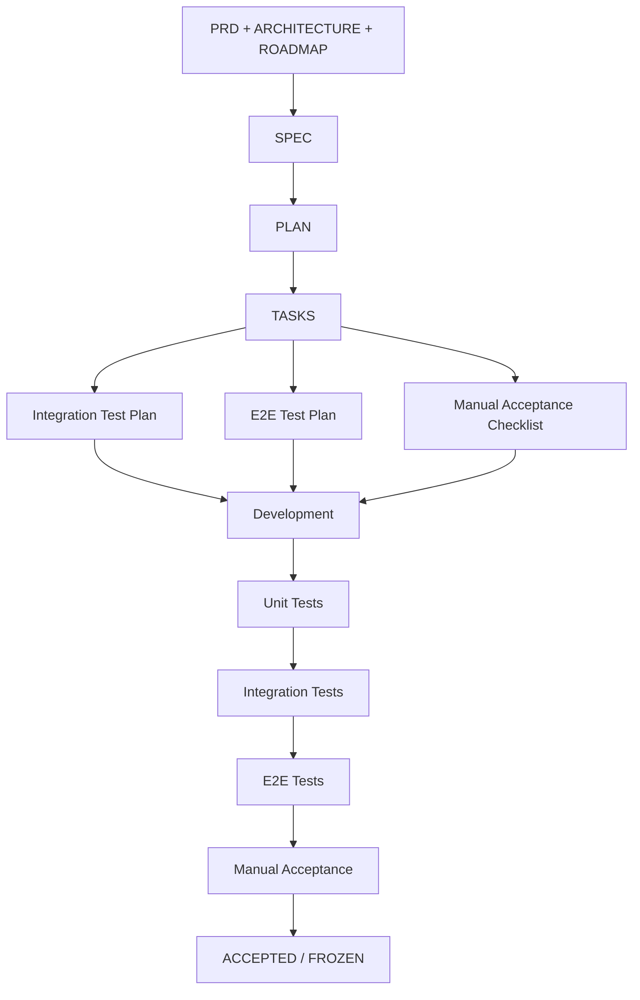

## 智能助手 V1

- 用户工作台：`/assistant`
- 管理控制台：`/assistant/admin`
- 管理员登录：`/assistant/admin/login`

架构、数据模型、API 与安全边界见
[`docs-archive/assistant-capability-console-v1/SPEC.md`](docs-archive/assistant-capability-console-v1/SPEC.md)。
管理员初始化、生产环境变量与迁移步骤见
[`docs-archive/assistant-capability-console-v1/DEPLOYMENT.md`](docs-archive/assistant-capability-console-v1/DEPLOYMENT.md)。
