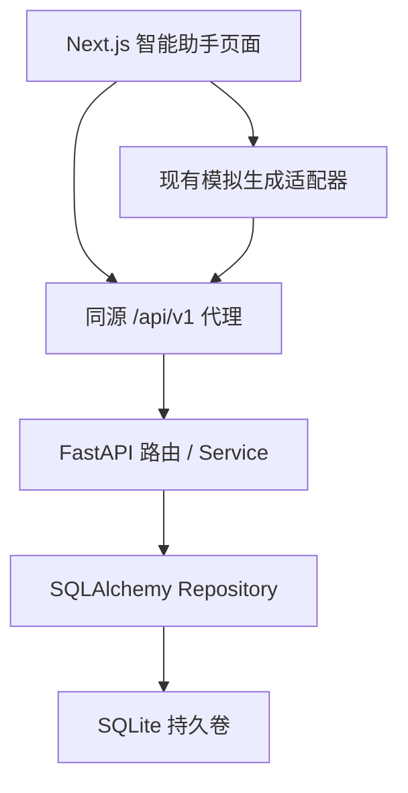

# 智能助手会话持久化 V1：Codex 连续执行任务书

目标仓库：`https://github.com/TotoroKingdom/paiguangguang-ai`  
目标基线：`origin/main`（生产部署分支；**不是**默认分支 `dev`）  
目标范围：`/assistant`、`/assistant/chat/[id]` 的真实会话/消息持久化；复用现有 UI、状态组件与 FastAPI；SQLite 作为服务端唯一会话数据源。  
交付方式：独立 feature 分支 + worktree，验证通过后合并回 `main`，清理仅属于本任务的临时 worktree。

## 一、已核对的仓库现状

1. `frontend/` 是 Next.js 14 App Router。`frontend/src/features/assistant/` 已有 `provider.tsx`、`store.ts`、`types.ts`、`assistant-chat.tsx`、`assistant-composer.tsx`、`assistant-workspace.tsx`，支持新建入口、会话列表、搜索、重命名、删除、消息模拟生成/停止/重试；现有 `localStorage` 键为 `paiguangguang.assistant.v1`。
2. `frontend/src/features/assistant/mock-service.ts` 只生成模拟回答，当前不是实际 LLM 调用。
3. `backend/app/main.py` 为 FastAPI，目前只有 `/api/v1/health`；`backend/requirements.txt` 尚无 ORM、迁移、SQLite 数据层。
4. 当前 `docker-compose.yml` 只运行前端容器；`.github/workflows/deploy.yml` 只构建前端 GHCR 镜像，`main` push 会自动触发生产部署。
5. 仓库默认分支是 `dev`，而 `main` 是实际上线分支，两者已分叉。严禁把 `dev` 当作基线或在本任务中顺手合并它。

## 二、V1 功能边界与产品行为

### 必须完成

- 「新建聊天」显式创建空会话、返回真实 UUID、跳转 `/assistant/chat/{id}`；会话发送第一条消息后默认生成可读标题，支持重命名。
- 会话列表按 `updated_at DESC, id DESC` 排列；支持分页读取、切换、刷新与 URL 直达、按标题搜索、删除确认。空会话也能恢复。
- 用户消息、助手消息、状态（complete/generating/stopped/error）、能力快照、附件名称快照、执行步骤及重试所需 request 元数据持久化到 SQLite。刷新后已中断的 generating 可恢复为 stopped 并重试。
- 消息创建成功、最终生成完成、用户停止或失败时有确定的服务端保存行为；每个模拟输出字符片段**无需**写数据库，避免高频写入。
- 网络断开、后端不可用、保存失败时显示可理解的失败反馈与重试入口；不得误报保存成功或静默丢数据。
- 保留现有输入框、能力选择、模拟回复、草稿、导航、文件库、技能和 MCP 的既有行为，不重做 UI，不顺带接 LLM。
- 将“会话保存在本浏览器”文案改成真实服务端存储描述；“模型回复仍为模拟”必须继续如实展示。

### 暂不包含

- 不接真实大模型、Agent Runtime、MCP 执行、RAG、文件正文存储、多人账号体系、跨设备登录同步。
- 不迁移其他功能的数据表；收藏、个人技能、连接器配置、文件元信息和本地草稿可暂留 `localStorage`。**会话和消息不能同时由 localStorage 与 SQLite 两套状态主导。**
- 旧浏览器数据不得直接清除。明确一次性迁移/导入策略：至少保留旧键与用户自建会话的可恢复路径；六条固定种子演示会话不能被不加区分地写入生产数据。迁移操作必须幂等，防止刷新重复导入。

## 三、目标架构

- 复用 FastAPI，扩展为 `routers / schemas / services / repositories / db` 的精简分层；请求与响应使用 Pydantic，SQLAlchemy 2 + Alembic 管理 SQLite schema，不引入独立重型架构。
- 由前端同源调用 `/api/v1/...`，Next 服务端转发至 Docker 内网 FastAPI；后端不直接开放公网端口。开发环境有明确代理地址；不得在客户端硬编码宿主 IP 或注入数据库路径。
- SQLite 文件位于 `/data/assistant.db`，用 Docker named volume 持久化，`journal_mode=WAL`、`busy_timeout`、外键约束；一次只部署一份后端实例，事务尽量短。
- 匿名访问的公网作品站至少按**浏览器隔离**：由服务端签名的 HttpOnly SameSite cookie 标识匿名 owner，每个 CRUD 查询强制过滤 owner_id；校验 Origin / JSON 请求，限制请求大小。匿名隔离不是正式登录认证，不声称支持敏感数据或跨设备同步；HTTPS 上线后启用 Secure cookie。
- Secret 从环境变量加载，不能硬编码；部署时持久保留，密钥缺失时生产环境 fail-fast，不得自动生成导致重启后用户身份变化。

### 建议最小数据模型

| 表 | 必要字段及规则 |
| --- | --- |
| `conversations` | `id(UUID PK)`, `owner_id`, `title`, `created_at`, `updated_at`, `version`；索引 `(owner_id, updated_at DESC, id DESC)` |
| `messages` | `id(UUID PK)`, `conversation_id(FK ON DELETE CASCADE)`, `seq`, `client_turn_id`（用户消息用于幂等）, `role`, `content`, `status`, `steps_json`, `capability_json`, `attachments_json`, `request_json`, `created_at`, `updated_at`；唯一 `(conversation_id, seq)`，及用户消息 `(conversation_id, client_turn_id)` |

SQLite 的 JSON 字段暂存现有快照结构；只允许受 Pydantic 校验的数据入库。所有时间统一 UTC ISO 8601。真实会话列表分页，不一次加载所有消息。

### 建议 API 契约

| 方法/路径 | 语义 |
| --- | --- |
| `POST /api/v1/conversations` | 创建空会话；201；返回 id、标题、时间、version |
| `GET /api/v1/conversations?limit=20&cursor=...&q=...` | owner 范围内搜索、稳定排序和游标分页；只返回元数据 |
| `GET /api/v1/conversations/{id}` | 单会话详情及消息；非 owner 和不存在均为 404 |
| `PATCH /api/v1/conversations/{id}` | 重命名；验证长度；乐观版本冲突 409 |
| `DELETE /api/v1/conversations/{id}` | 删除该 owner 的会话及消息；204；不能误删他人数据 |
| `POST /api/v1/conversations/{id}/turns` | 通过 `client_turn_id` 幂等创建 user + assistant 生成占位消息，单事务提交；返回消息 ID |
| `PATCH /api/v1/conversations/{id}/messages/{message_id}` | 更新该 assistant 消息的最终文本/状态/步骤，支持停止/失败/完成；验证状态变迁与 owner |

可以在实现时优化 REST 细节，但必须记录契约、保持一次发送不会因网络重试写出重复消息。服务端应在详情读取或恢复流程中，将失去执行者的 `generating` 消息转为 `stopped`，允许明确重试；不要留下永久“生成中”。

## 四、分阶段执行（不要在阶段之间等人工确认）

### T0：基线与隔离（P0）

1. `git fetch origin`，检查 `main`/`dev`、`git status`、现有 worktrees 和 `AGENTS.md`；记录本任务起点 SHA。
2. 为本任务创建**独立** `feat/assistant-session-sqlite` 分支和独立 worktree（例如仓库相邻目录），以最新 `origin/main` 为基线；不得复用、切换、覆盖其他 Codex 会话正在操作的 worktree。
3. 先在任务 worktree 内创建 `docs-codex/assistant-session-v1/SPEC.md`、`PLAN.md`、`TASKS.md`，逐项记录本任务的验收与勾选情况。此后直接实施。

### T1：FastAPI + SQLite（P0）

1. 追加后端数据库配置、依赖、连接/Session 生命周期、Alembic 首次迁移、两张数据表与索引。
2. 实现匿名 owner cookie、业务层、Repository、路由与分页/参数校验/404/409/幂等发送。
3. pytest 聚焦 CRUD、排序/分页、owner 隔离、非法输入、并发版本冲突、幂等、重启后持久化、异常状态恢复、事务与 FK 删除；使用隔离临时数据库，绝不触碰生产数据。

### T2：前端服务化（P0）

1. 在 `frontend/src/features/assistant/` 新增类型化 API client 和会话数据访问层；复用现有 UI/Provider，不在多个组件内散落 fetch。
2. 将 `state.conversations` 的真实读写改成服务端数据流；Provider 负责加载、缓存、请求态与错误态。保留本地草稿与暂不改造的能力状态。
3. 新建、列表、切换、重命名、删除、发消息、停止、失败重试均经 API 持久化；为异步网络请求提供加载/禁用重复提交/冲突刷新行为。避免首次 hydration 时空数据覆盖远端。
4. 旧浏览器会话可选择一次性安全导入；仅成功后标记迁移完成，不删除原始键；旧固定种子仍作为展示样例，不能混作新真实会话。
5. 更新“本地演示/浏览器存储”类错误文案，但保留模拟回复标识，避免声称 LLM 已接入。

### T3：部署闭环（P0）

1. 补后端生产 Dockerfile，扩展 Compose 为现有前端 + 内网 FastAPI + SQLite named volume；保留现有外部前端入口（`127.0.0.1:3000`），不得额外公开 DB/API 端口。
2. 修改 GitHub Actions 同时构建/push 两个镜像并更新 Compose；加入后端健康检查、迁移执行与启动顺序。保证 `docker compose up -d`、容器重建、镜像升级不会删除 SQLite volume。
3. 用环境变量提供稳定的签名密钥与数据库 URL，更新 `.env.example`（不含真实值）。在实际部署前验证密钥配置、卷挂载及可回滚；禁止 `down -v` 或无目标卷清理。
4. 说明备份与恢复：生产已有数据库时用 SQLite 一致性备份（SQLite backup API 或等效）后再做结构迁移；验证重建容器数据不丢。

### T4：针对性验收与回归（P0）

- 后端 pytest：仅本模块及健康检查；前端 Vitest：本次受影响的组件/Provider/Store；`npm run lint`、`npm run build`；新增必要的 API/前端联动测试。
- 针对本功能的 Playwright 场景：新建空会话、发送/自动保存、刷新及 URL 直达、切换/搜索/改名/删除、失败/停止/重试、两个独立浏览器上下文数据隔离、后端重启或容器重建后 SQLite 数据保留。若运行 E2E 需另行授权，则先提交相关测试并将未执行项如实列出，绝不虚报通过。
- 确认首页和其他 assistant 子页面未被破坏；不得将模拟工具/LLM 文案改成“真实执行”。
- 任务进度、测试实际命令/结果、截图或失败证据、遗留风险写入 `docs-codex/assistant-session-v1/ACCEPTANCE.md`。

### T5：合并与善后（P0）

1. 自检 `git diff`，剔除临时库文件、凭证、缓存和无关变更；按逻辑提交 feature 分支，推送并创建 PR 到 `main`，注明部署会自动发生。
2. 确认相关测试和 PR 检查通过，生产部署所需签名密钥/持久卷/回滚方案均已具备，目标分支没有新的未处理冲突后，**自动合并到 `main`**。若无法自动合并，则报告阻塞，不强推、不跳过分支保护、不覆盖他人代码。
3. 合并后确认 `origin/main` 包含提交，检查部署工作流结果；只清理本任务创建且干净的 worktree、已合并的本地临时分支，必要时删除本任务远端 feature 分支。**绝不删除其他 worktree、未提交的用户修改、SQLite 持久卷及备份**。
4. 最终汇报：PR、merge SHA、实际部署状态、验证清单、未解决事项、worktree 清理结果。

## 五、Codex 自主执行指令（可整段粘贴）

> 你是本仓库的主执行工程师。请完整阅读本任务书、仓库 `AGENTS.md` 和相关源码。按 T0→T5 连续执行，不要在每个阶段等我回复，也不要在未完成时仅输出计划。以 `origin/main` 为唯一代码基线，开始就创建本任务独立 worktree，持续更新 SPEC/PLAN/TASKS/ACCEPTANCE。优先实现 FastAPI + SQLite 会话 CRUD/消息持久化，再接入现有 Next.js 智能助手 Provider，最后完善 Docker Compose/CI/CD，并运行范围内测试。修复自己引入的错误后继续；遇到普通 git 冲突主动查看差异并谨慎解决，再重新验证。完成后创建 PR，满足验收和部署安全条件则自动合并到 main，确认合并并清理本任务的临时 worktree 与分支。无须每阶段询问我。对于权限不足、缺失生产密钥、分支保护阻断、无法安全解决的语义冲突、可能造成用户数据丢失的风险，停止相关高风险动作，保留现场并明确说明；不得为了“连续”而强推、绕过审批、删除他人数据或伪造测试结果。最终用中文交付 PR/merge SHA、测试结果、部署状态、清理结果。

## 六、验收门槛

- **功能**：新建空会话与发消息都真实写 SQLite；刷新、URL 直达和服务重启可恢复；改名/删除/搜索/重试无丢失或重复。
- **隔离**：不同浏览器 cookie 的会话不可互相读取/修改；无未授权的跨 owner 访问；敏感配置不进 Git。
- **部署**：前后端同源可访问；FastAPI 只在内部网络；重新部署不会清除数据库；配置不全不自动假成功。
- **兼容**：主页、3D 实验室、RAG、助手其他功能保持正常；本阶段只保证会话系统真实可用，LLM 回复仍标注模拟。
- **Git**：PR 合并到 main；不误合并 dev；任务 worktree 清理完毕且保留数据库及相关备份。
