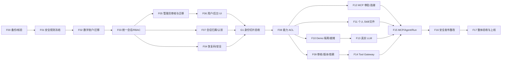

# 智能助手平台 V1｜06 实施 TASKS（feat02）

> 文档版本：v0.1 · 2026-11-08  
> 文档性质：**可执行任务分解 / 开发与验收契约**；不是已经执行的代码修改或测试报告。  
> 目标路径：`docs-work/feat02-后台管理/06-实施TASKS.md`  
> 目标仓库：`TotoroKingdom/paiguangguang-ai`  
> 需求依据：`产品逻辑与页面交互设计总结.md` v0.3、`01-用户与角色权限-PRD.md` v0.2、`02-四类能力业务闭环-PRD.md` v0.2、`03-页面交互与状态-SPEC.md` v0.1、`04-端到端业务验收.md` v0.1、`05-现有代码差距与实施路线图.md` v0.1。  
> 源码静态审查基线：`dev` HEAD `fd7f40bfe787d872f44da51a3003e1a45cf78216`、`main` HEAD `a301e5503e44b65560fdacd6ea734407dd87b7a1`（2026-11-08 审查快照）；**开工前必须重查 HEAD 和工作区，禁止默认源码未变化**。  
> 当前状态：所有任务 `NOT_STARTED`；所有新增验收 `NOT_RUN`；没有执行 GitHub 提交/测试/部署。

---

## 0. 目标与执行边界

本轮从产品规格进入工程交付，不再按“有几个页面/接口”判定完成，而是按**真实用户旅程、服务端授权和可恢复数据**判定完成。

完整 V1 的两个闭环：

1. **身份与使用闭环**：游客进入 → 注册获得从 100 开始递增的数字账号 → 显示并安全保存恢复码 → Pending → Admin 激活 → 统一账号登录 → 聊天/个人资源 → 跨设备恢复 → 停用与权限控制。
2. **能力与执行闭环**：Creator 创建/调试 → Admin 审核发布 → 用户按 ACL 发现 → 需要时授权已批准 MCP → 真实 LLM/Tool/MCP/Agent 执行 → Run/历史/审计 → 版本更新、停用或回滚。

**已冻结产品要求，不得擅改**：

- 数字账号首号 **100**，按成功注册顺序 +1；`999→1000→…`，**不设置三位数或人数上限**；账号不可复用，内部分离 UUID `user_id`。
- **无邮箱、短信、第三方身份注册**；密码最低长度 **6**。弱密码识别、失败限流可增加，但不能擅自改成最少 8/12 位。旧管理员初始化可以独立保持更严的安全策略。
- 初始 `User/PENDING`，管理员激活后方可正式使用；User/Creator/Admin 共用统一身份服务。
- 找回使用**高熵、一次性恢复码 + 受控管理员辅助**；不存在“凭账号直接重置”的后门。
- User **只能连接平台已批准的 MCP Server**；不得让普通用户提交自定义 Server URL，更不得让服务端不受控访问该地址。
- 前台 Demo、浏览器本地模拟 MCP 和 `createMockReply` 不可作为生产可执行功能。
- Admin 的治理权限不包含默认读取私人聊天正文、文件正文、第三方凭据明文。
- 仓库保持 `dev` 开发、`main` 生产发布。**禁止绕过安全门禁把未完成 feat02 合入 `main`**。

### 0.1 现有工程复用基线

| 现有资产 | 复用方式 | 不允许发生的事 |
|---|---|---|
| FastAPI、SQLAlchemy、Alembic、SQLite | 延续现有技术栈，新增增量迁移 | 直接删除旧表/清空匿名聊天库 |
| `conversations/messages`、版本冲突、幂等发送 | 保留 CRUD 与消息协议，改造查询归属和认证 | `owner_id` 直接改名 `user_id`，造成历史丢失或串户 |
| 管理登录的 PBKDF2、Cookie、CSRF/Origin | 复用安全组件与设计，抽离密码策略 | 在生产长期维持两套身份权威源 |
| 四类 Capability Definition / Version / Run | 增量扩展 ACL、审核、依赖和真实运行 | 将 `accepted` 或 `simulated` 写成执行成功 |
| Next.js 用户端 / 管理端 Route Groups | 保留页面结构与视觉组件，替换会话和资源数据源 | 大范围重建首页、RAG、3D 实验室 |
| 现有双镜像部署与 CI | 保留，增加发布检查和数据恢复验证 | 未补 TLS/密钥/漏洞审计就上线真实账号系统 |

### 0.2 任务状态与优先级

- `NOT_STARTED`、`IN_PROGRESS`、`BLOCKED`、`READY_FOR_REVIEW`、`PASSED`、`FAILED`。
- P0：产品数据、安全或完整链路的必要工作；P1：本 V1 的后续阶段能力。P1 不等于可以永远忽略；只是不能抢在身份/权限基础前上线。
- **阶段通过不等于 V1 整体通过**：G1 只代表身份闭环；只有 G0～G4 全部完成且真实联调通过，才声明产品 V1 完整闭环。
- 任务必须留 Git Commit/PR、受影响接口/数据库说明、对应验收证据、失败路径和回滚记录。

---

## 1. 阶段顺序与任务依赖

| Gate | 核心交付 | 对应任务 | 达成标准 |
|---|---|---|---|
| **G0 安全与迁移准备** | 可信初始化、数据备份、危险操作规则和上线风险记录 | F00、F01 | 有确定可恢复方案；禁止的业务路径明确受控 |
| **G1-A 统一身份** | 账号注册、统一会话、密码/恢复、Admin 审核角色 | F02、F03、F04、F05 | 账号唯一，激活生效，服务端越权拒绝 |
| **G1-B 前台与历史归属** | 注册/登录/待审核/个人入口，匿名认领、跨设备会话 | F06、F07 | 用户完整路径跨浏览器可用且不串户 |
| **G2 平台能力与个人资源** | 资源 ACL、Creator 审核、Demo 隔离、Skill/文件、MCP 连接 | F08～F12 | 后台发布与用户授权一致、可执行状态真实 |
| **G3 AI Runtime** | 模型流式、真实 Tool、MCP/Agent 和 Run | F13～F15 | 真模型 + 真工具 + 真 MCP 有复查证据 |
| **G4 生产和回归** | HTTPS、秘密、依赖、迁移/回滚与全链路 E2E | F16、F17 | 所有 P0 安全阻断解除，G0～G4 全通过 |



> 图中 F16 依赖 F15 表示**生产发布放行**顺序，不禁止 F16 的 TLS/依赖漏洞只读排查在 G0 并行开展。G1 最终验收需 F00～F07 均达标；真实 Runtime 尚未完成时禁止将模拟结果视为真实闭环。

### 1.1 三个最小垂直切片

- **S1 / 身份垂直切片（首先实施）**：一个新注册账号在 Pending 状态不能调用聊天 API → Admin 从可见后台入口激活 → 数字账号登录 → 创建真实服务端会话 → 另一个浏览器登录仍能读到该会话 → 另一个用户永远不可访问。验收对应 U-01～U-17 中适用的 P0 项。
- **S2 / 能力治理切片**：Creator 创建只读 Tool → 测试通过 → Admin 审核发布 → 仅授权用户可发现和调用 → 停用后拒绝新调用。不能用 Demo/Mock 假装已执行。
- **S3 / Runtime 切片**：用户使用研究 Agent，真实模型调用至少一个已批准 Tool；如 Agent 声明 MCP 必需，则完成真实已批准 MCP Server 的用户授权和工具调用；结果保存为真实 Run，管理端可脱敏追踪。

---

## 2. G0：上线安全与数据迁移前置（F00～F01）

### F00 · 固定代码基线、存量盘点与备份/恢复演练

- **优先级**：P0；**依赖**：无；**执行方式**：第一步仅只读，获准后在隔离环境演练。
- **目标行为**：明确 `dev/main`、数据库 revision、管理员/匿名会话数量、部署状态；能在安全测试环境从备份恢复旧数据，证明新的迁移不会损坏现有网站和历史。
- **涉及范围**：`backend/alembic/versions/`、`backend/app/db.py`、`backend/app/models.py`、`backend/app/modules/identity/models.py`、`docker-compose.yml`、`.github/workflows/{assistant-session-ci,deploy}.yml`；新增测试脚本/记录，不默认改业务代码。
- **实施动作**：锁定审查 SHA 和现有未提交改动；统计表/索引/SQLite 版本；确认 `admin_users/admin_sessions` 和匿名 `owner_id` 数据量；检查生产安全阻断及历史 PR #11 状态；对独立副本演练备份、恢复、向前迁移、回退应用版本。
- **验收**：O-05 的恢复路径有证据；原会话消息数/归属指纹可核对，旧 Admin 能按原方式登录；未触达生产敏感明文数据。
- **失败与回滚**：盘点不完整或无可用备份即 `BLOCKED`；不允许直接执行 destructive SQL、删除卷或清理旧 Cookie。
- **产物**：`baseline-and-migration-preflight.md`（Commit、数据库版本、脱敏统计、备份恢复证据、阻断清单）。

### F01 · 冻结危险操作、安全规则与 API 契约

- **优先级**：P0；**依赖**：F00；**执行方式**：SPEC/安全设计，不通过凭空编码绕过未决事项。
- **目标行为**：将尚待确定的 Q-01～Q-08 变成实现可核验的规则，优先处理 Q-02 管理员辅助重置身份核验和 Q-03 旧管理员迁移。
- **已确认不可更改**：至少 6 位密码、无邮箱/短信、一次性高熵恢复码、Admin 激活、User 仅连接批准 MCP、数字账号持续递增。
- **建议默认值（需产品确认而非假定已冻结）**：首次注册展示**一枚**高熵恢复码；恢复成功轮换旧码；注册/登录/恢复限流使用后端共享存储或等效多实例安全方案；首个管理员经受信任 CLI 一次性初始化，避免重启改密。
- **必须明确**：人工重置由谁审批、凭什么可信证据验证本人、如何交付临时凭据、如何拒绝仅凭账号请求、审计字段及权限；最少保留哪些账户历史；单用户模型调用预算、最大并发/耗时。
- **接口草案**：`/api/v1/auth/*`、`/api/v1/admin/users/*`、`/api/v1/admin/roles/*`；错误码、CSRF 和权限判定先定稿；所有 `returnTo` 仅限站内批准路径。
- **验收**：U-11、U-16、O-01/O-03 的设计级测试可写出确定断言；没有“后台只输入账号即可重置”的路径。
- **失败与回滚**：可信核验 SOP 未确认时，**管理员辅助重置 API/UI 维持关闭并标为 BLOCKED**；不得伪造“已完成”。
- **产物**：`security-decisions-and-api-contract.md`，附开放问题责任人和风险批准记录。

---

## 3. G1：统一身份与用户业务闭环（F02～F07）

### F02 · 数字账号、用户实体与并发注册事务

- **优先级**：P0；**依赖**：F00、F01 中账号/密码/注册事务规则（不因人工恢复 SOP 尚未定稿而阻塞内部数据模型）；**主要受影响文件**：新增 `backend/app/modules/identity/` 下用户注册服务/Schema/模型，新增**独立 Alembic revision**；保留旧 `admin_users` 和匿名会话。
- **目标行为**：首次成功注册分配 `100`；每次成功注册 +1；`999→1000`，`9999→10000`；创建 `User/PENDING`，不能由请求指定角色或登录号。
- **数据要求**：`users(id UUID, account_number TEXT UNIQUE, password_hash, nickname, status, created_at,...)`，数据库原子计数器/序列（兼容 SQLite）和注册幂等表/约束；账号字符串无前导零，**禁止 `MAX(account_number)+1` 的字符串排序错误**；高并发用事务/锁或等效机制序列化。
- **接口**：`POST /api/v1/auth/register`；客户端不发送 account_number。创建成功返回账号和一次性恢复材料的安全展示契约；恢复码发放契约由 F04 实装并验证；**F04 完成前不得将 F02 的注册 API 开放为生产注册入口**，也不能临时返回弱随机码。
- **验证**：U-02/U-03/U-04；空库首号、跨位数边界、同幂等键重试、同时注册/断连重试、数据库唯一性、弱密码及注册刷号拦截。
- **失败与回滚**：迁移采取 Expand，不改坏旧表；事务失败不可造成同一账号分配两人，客户端不得展示猜测账号。
- **完成证据**：定向 API/数据库/并发测试，最新 migration revision 和失败回滚记录。

### F03 · 统一会话、账户状态与 RBAC 服务端守卫

- **优先级**：P0；**依赖**：F02；**主要受影响文件**：`identity/{models,service,router,dependencies}.py`、`config.py`、后端路由认证依赖；**不立即删除现有管理会话**。
- **目标行为**：账号+密码登录；`PENDING/REJECTED/DISABLED` 不能使用正式业务 API；`ACTIVE` 根据 User/Creator/Admin 和资源归属获得权限；退出/停用后旧会话失效。
- **实现要点**：统一 `user_sessions`（HttpOnly/Secure/CSRF/Origin/失效管理）、`get_current_user` / `require_active_user` / `require_permission`；权限点明确，不只在 React 组件里隐藏按钮；密码摘要复用 PBKDF2 的理念，但把“普通用户最低 6 位”与旧 Admin CLI 12 位初始化校验分离。
- **兼容**：旧 `/api/v1/admin/auth/*` 在迁移窗口受控兼容或桥接；关闭双权威源前检查全部调用方（包括管理 Provider）；不能让已撤权管理员继续持旧 Cookie 写操作。
- **验证**：U-06、U-08、U-09、U-15、U-16；CSRF、会话伪造/过期、角色变更、最后有效 Admin、防开放重定向、IDOR/越权。
- **回滚**：通过 feature gate 保持旧系统只在隔离/迁移用途可用；异常时回退新入口而非清理身份数据；记录每条旧入口的退役条件。

### F04 · 一次性恢复码、密码修改与受控管理员辅助重置

- **优先级**：P0；**依赖**：F01 的 Q-02 核验 SOP、F02、F03；**主要受影响文件**：新增 `user_recovery_codes`、恢复/改密 API、登录限流与安全审计逻辑。
- **目标行为**：注册成功展示**真实且不可再次查询的恢复码**；用户凭账号+有效恢复码完成一次找回；恢复码消费后立即失效并安全轮换；管理员辅助恢复只能基于可信人工核验。
- **实现要点**：独立高熵随机码、只存摘要、限时/限速/防重放；改密和恢复成功撤销旧会话；不得记录明文到日志、URL、浏览器持久存储、遥测；失败错误不泄露账号存在性。恢复码是否仅 1 枚、如何轮换由 F01 定稿。
- **验证**：U-05、U-10、U-11、U-16、O-03；错误码、旧码重放、管理员跨用户修改、登录旧密码及旧会话失效。
- **安全阻断**：**未冻结可信人工核验时不得上线“管理员一键重置”**；可以先完成用户自助恢复，但阶段 G1 的“管理员辅助恢复”保持 BLOCKED，不能标记全通过。
- **回滚**：向后兼容安全字段；回滚不能把已消费恢复码重新变成有效。

### F05 · Admin 迁移、用户审核与角色/停用 API

- **优先级**：P0；**依赖**：F03、F01 的 Q-03；**主要受影响文件**：`backend/app/admin_cli.py`、`identity/service.py`、`capabilities/router.py` 中管理身份依赖；新增管理用户审核/角色路由。
- **目标行为**：原 Admin 能以**统一账号**进入；Admin 查看 Pending、激活、拒绝、停用/恢复、分配 Creator/Admin，操作有审计；Creator 不能激活人或给自己提权。
- **实现要点**：受信任一次性映射旧管理员 `admin_users` → `users`，避免把旧 Admin 密码明文导出；决定保留原 `admin` 登录名还是新专用数字号（F01）；仅一次初始化，启动不能持续覆盖管理员改过的密码；保留故障恢复通道但防双登录权威。
- **接口**：`GET /api/v1/admin/users`、`GET /api/v1/admin/users/{id}`、`POST /api/v1/admin/users/{id}/activate|reject|disable|restore`、`PATCH /api/v1/admin/users/{id}/roles`；具体方法/状态码按 F01 冻结。所有写操作校验 CSRF、状态转移、审计同事务。
- **验证**：U-07、U-08、U-09、U-11（仅 SOP 已冻结）、U-16、O-02/O-05；防最后管理员自锁、重复审批、并发状态冲突、管理权限绕过。
- **回滚**：旧 Admin 表保持迁移审计和备份；新登录失败时受控恢复，但不能让已经停用的人利用旧会话重新获取管理权。

### F06 · 用户注册登录、待审核、个人入口和后台 UI

- **优先级**：P0；**依赖**：F03、F05；恢复码 UI 依赖 F04 的返回契约。
- **主要受影响文件**：`frontend/src/app/assistant/` 路由、`frontend/src/features/assistant/assistant-workspace.tsx`、`provider.tsx`、`api.ts`、`frontend/src/features/admin/{admin-shell,admin-provider,admin-login}.tsx`、现有样式/测试。禁止同一阶段多个执行者同时改 `assistant-workspace.tsx`。
- **最小页面**：`/assistant` 入口判态；`/assistant/register`、`/assistant/register/success`、`/assistant/login`、`/assistant/pending`、`/assistant/me`；管理 `/assistant/admin/users` 与 `/assistant/admin/roles`；旧 `/assistant/admin/login` 安全重定向或受控兼容。
- **目标行为**：游客找得到登录/注册；注册成功显示**后端真实账号和恢复码**而非固定 100；Pending 只能看状态和刷新；Admin 头像菜单/个人中心能进入后台；Creator 有有限入口；后台可回用户工作台；手机端可操作。
- **状态覆盖**：Loading/Empty/Success/Error/Disabled；登录失败/待审核/停用/拒绝、账号复制、恢复码单次展示、无权 403、会话过期、离线；阻止未经授权页面内容闪现。
- **验证**：U-01/U-02/U-05～U-09/U-15/U-17、UI-01～UI-11/UI-24；独立浏览器 context 模拟三角色；不得用前端 role 常量替代真实会话。
- **回滚**：旧用户工作台 UI 组件保留，入口功能门禁可以快速切回只读欢迎页，不允许切回匿名正式写入。

### F07 · 会话 `user_id` 归属、旧匿名认领与跨浏览器恢复

- **优先级**：P0；**依赖**：F03、F00；**影响**：`backend/app/models.py`、`backend/app/owner.py`、`backend/app/routers/conversations.py`、`backend/app/{services,repositories}.py`、新 Alembic revision、`frontend/src/features/assistant/api.ts`、`provider.tsx`、`store.ts`。
- **目标行为**：正式聊天/消息按认证 `user_id` 查询与写入；A 在浏览器 1 发消息，浏览器 2 登录恢复；B 不可通过 ID 读取 A 资源；当前旧浏览器可主动选择认领合法的匿名历史。
- **数据库迁移**：Expand 新增可空 `user_id` 和相关索引/约束；旧 `owner_id` 留在受控认领窗口；身份桥接单向迁移，防止同一聊天既被匿名流程写入又被登录账号并发写入。
- **认领链**：`POST /api/v1/me/legacy-conversations/claim`（示例契约）；必须同时证明**新登录用户会话 + 旧签名匿名 Owner Cookie**；原子、幂等、处理冲突；未经确认不导入演示种子；失败不损坏原历史；不允许跨账户再次认领。
- **验证**：U-12/U-13/U-14/U-15、O-05；刷新、退出、重新登录、无 Cookie/伪造 Cookie、并发认领、重复请求、数据库回滚、历史恢复。
- **回滚**：保留旧 owner 数据及备份；拒绝破坏性重写；G1 通过前不能清除兼容字段或清空本地原始迁移状态。

### G1 合并门禁与首个真实产品里程碑

G1 阶段必须在受控测试环境完成：**注册 100/101/跨 999 → Pending 登录受限 → Admin 可见入口激活 → Active 登录 → 创建会话 → 另一个浏览器恢复 → 第二用户不能读取 → 停用吊销会话 → 恢复码安全路径**。管理员旧身份迁移与匿名会话认领必须有演练证据。此阶段可交付“账户/权限闭环”，**不能宣称 AI 已真实执行**。

---

## 4. G2：四类能力的管理与个人资源（F08～F12）

### F08 · 能力资源归属、可见性、授权与服务端执行准入

- **优先级**：P0；**依赖**：G1 身份和 `user_id`；**影响**：`backend/app/modules/capabilities/{models,schemas,service,router}.py`、新 ACL/授权迁移、前端能力 API。
- **目标行为**：平台能力只有满足 Active、资源可见、执行授权、配额和就绪等条件的用户可使用；Creator 只能维护自己草稿；User 不可访问 Creator/Admin 接口。
- **实现要点**：资源 owner/管理者、`visibility`、`entitlement`、用户启用偏好、RBAC；**目录返回的只是安全元数据**，不能混入凭据/Prompt 秘密；每一次执行在服务端重复鉴权；归属与角色变动应实时生效。
- **验证**：C-03、C-10、U-09、U-13；前端隐藏和直接 API 访问分别测；未授权用 403/404 对应业务语义，不泄露私有资源存在性。
- **回滚**：对未知历史资源默认 Fail Closed，不能以“无 ACL 就全员可用”迁移；管理员可在受控后台修复权限。

### F09 · Creator 提审、Admin 审核、版本锁定与安全发布

- **优先级**：P0；**依赖**：F08；**复用**：`CapabilityDefinition`、`CapabilityVersion`、`CapabilityDependency`、现有原子发布+审计。
- **目标行为**：Creator 创建/测试草稿 → 提交版本快照审核 → Admin 批准/驳回 → 发布不可变版本；新 Run 使用当前发布版本，旧 Run 记录旧版本；停用后新调用立刻拒绝。
- **实现要点**：Review 记录、提交者与审批者、驳回原因、版本并发控制；Tool/Skill/MCP Tool/Agent 依赖绑定**明确版本 ID**而不只是名称；发布前检查依赖、风险、授权和真实就绪测试证据；回滚保留审计。
- **验证**：C-01/C-02/C-07/C-08、O-02；发布与审计同一事务；审批人无权时服务端拒绝；依赖停用后不得仍可执行。
- **回滚**：保留已发布快照；失败发布不修改当前稳定版本；避免破坏已存历史 Run 的版本引用。

### F10 · 演示数据隔离、正式目录与就绪状态

- **优先级**：P0；**依赖**：F08；**影响**：`backend/app/main.py`、`modules/capabilities/{seed,service,schemas,router}.py`、`frontend/src/features/assistant/provider.tsx`、`data.ts`、`mock-service.ts`、`catalog-page.tsx`。
- **目标行为**：生产不再自动发布 24 个 Demo；正式目录仅返回真实或明确未就绪的授权资源；接口失败显式报错，不回退内置 Demo；未就绪不可提交真实执行。
- **实现要点**：Demo 种子只在隔离开发/演示环境显式开启；现有历史 Demo 不直接强删，先归档/禁用并保留引用；`Published`、`Authorized`、`Ready` 与 `Run Completed` 显示/判断分离。
- **验证**：C-09/C-10、U-01、R-01 的“无 Mock 伪成功”断言；正式环境 API 不可用时保持错误/空状态，不出现演示连接成功或模拟回答。
- **回滚**：保留 Demo 迁移前快照；可恢复开发演示能力，但生产永不自动回退模拟执行。

### F11 · 个人 Skill 和个人文件归属

- **优先级**：P0/P1（Skill 接入闭环 P0，文件正文持久化按 V1 功能边界 P1）；**依赖**：F07、F08。
- **子任务 F11-A**：个人 Skill CRUD、Markdown 导入、所有者隔离、服务端持久化和真正的 Runtime 加载；消除 `catalog-page.tsx` 个人 Skill 可选而后端 `resolve_published` 拒绝的潜在 422。测试 C-04、U-13。
- **子任务 F11-B**：用户文件元数据、上传/下载/删除、实际内容存储、ACL、容量与格式校验；保留现有文件库 UI，不再将仅有浏览器 `DemoFile` 的卡片宣称为真实文件。测试 U-12、U-13、O-03。
- **影响**：`frontend/src/features/assistant/catalog-page.tsx`、`files-page.tsx`、`provider.tsx`、`store.ts`、后端个人资源新模块/迁移、文件存储适配器；切勿将用户上传内容作为公开能力配置。
- **验证**：两账户独立浏览器、文件或 Skill 跨设备恢复、伪造 ID 读取、超限和危险文件名、上传失败重试、隐私泄露。
- **回滚**：保留本地旧 Skill/文件清单并提供**经用户确认**的幂等认领；不自动将本地虚拟文件当作已上传的真实正文。

### F12 · 已批准 MCP Server 与个人连接授权

- **优先级**：P0；**依赖**：F08、F03；**影响**：MCP Server/Connection 新实体、管理审核 API、用户连接 API、`frontend/src/features/assistant/catalog-page.tsx`、管理 MCP 页面。
- **目标行为**：Admin/Creator 提交/审核 Server（审批权 Admin）；User 只看已批准 Server，在本人账户中完成连接或授权；B 不能使用 A 的连接或 Token。
- **实现要点**：Server 级批准、工具发现/Schema、地址校验及 SSRF 防护（禁止内网/元数据端点、限制重定向、DNS/IP 复检）、凭据仅加密存储或安全引用、授权到期/撤销；**移除用户任意 Server URL 输入和模拟连接成功逻辑**。
- **验证**：C-05/C-06、U-13；User 请求伪造 URL/API 被拒绝；未批准、过期或吊销后立即禁止新调用；日志不出现 Token。
- **回滚**：一键停止 MCP 工具执行/暂停服务；个人授权记录安全保留，不允许失败时退回共享管理员 Token。

### G2 合并门禁

只有在 Creator/Admin 权限隔离、平台能力审核/发布一致、用户目录 ACL、个人 Skill 后端真实可用、MCP 仅批准服务且个人授权隔离、Demo 不进入正式目录均有证据时，G2 才可通过。**单纯 CRUD 成功、点击“模拟连接成功”、Run=accepted 都不是 G2/G3 通过证据**。

---

## 5. G3：真实模型、工具、MCP 与 Agent Runtime（F13～F15）

### F13 · 真实 LLM 服务端流式与会话状态

- **优先级**：P1（V1 完整闭环必要）；**依赖**：G1、F10；**影响**：新增 `backend/app/modules/runtime/`、模型适配/Provider、前端聊天 SSE/事件消费、会话服务与消息状态。
- **目标行为**：Active 用户发送消息后由后端调用配置好的真实 OpenAI-compatible LLM，流式返回事件，正常结束后保存真实助手消息；刷新、断网、取消、超时状态与持久化一致。
- **实现要点**：Provider 可配置、密钥仅服务端、连接/总体超时、请求幂等、明确 `queued/running/completed/failed/cancelled/timed_out`、服务端终态写入；前端停止使用 `createMockReply` 正式路径；Fake Provider 仅自动化测试。
- **验证**：R-01/R-03/R-06；定向 Fake CI + Staging 真实模型一轮，记录脱敏供应商调用证据；“已接受请求”不能等价“完成模型执行”。
- **回滚**：可停止新模型请求并展示“服务不可用”，不能默默回退浏览器模拟回复；不丢历史用户输入。

### F14 · 受控 Tool Gateway、参数验证与真实只读 Tool

- **优先级**：P1（V1 必要）；**依赖**：F08/F09、F13 的 Run/消息契约。
- **目标行为**：至少一个后台定义、测试和发布的真实只读 Tool，被授权用户调用成功；入参符合 Schema，Tool 执行结果和耗时有可追溯记录。
- **实现要点**：执行器 registry、JSON Schema 验证、参数/结果大小限制、单次超时、并发/预算、策略检查；高风险写操作暂不开放或需显式人工确认；外部 HTTP Tool 需有 SSRF/域名/IP 策略，不能让管理员输入 URL 即获得无限网络访问。
- **验证**：C-01/C-03、R-02/R-05/R-06；无权限/非法参数/撤权/超时/重复请求，不能重复执行有副作用操作。
- **回滚**：执行器级紧急停用，已完成历史可查；新调用失败关闭，不回退无权限 Demo。

### F15 · MCP Client、最小 Agent Loop 和真实 Run/Trace

- **优先级**：P1（V1 必要）；**依赖**：F09、F11-A、F12、F13、F14。
- **子任务 F15-A**：MCP Client 对已批准 Server 完成连接、工具发现和执行，按当前登录用户的个人 Connection 选凭据，每步重新鉴权；不得绕过 F12 的白名单/凭据隔离。
- **子任务 F15-B**：最小 Agent Loop：加载锁定的 Agent/Skill/Tool/MCP Tool 版本；模型产生行动 → 授权/风险校验 → 执行 → 汇总回复；设置最大步骤数、超时、预算、取消/待授权等护栏。
- **子任务 F15-C**：`Run/RunStep` 持久化与用户历史/管理端观测：关联 user、conversation、message、capability/version、步骤、终态、错误、耗时、可得 token 用量；保留旧 `accepted` 记录作为**历史准入事件**，不能批量改成 completed。
- **验收**：R-02～R-06、C-06/C-07/C-08；真实模型 + 真 Tool +（声明必需时）真 MCP Tool，用户只查本人 Run、管理员仅见脱敏治理数据、Creator 范围受限；断线、撤权、取消和版本停用行为正确。
- **回滚**：停止新 Agent Run，不丢已有 Run 与消息；敏感操作前再查用户和依赖权限；不可把失败/取消中的 Run 改写为成功。

### G3 合并门禁

自动化 Fake LLM/Tool/MCP 通过属于集成基础，不等于真实服务验收。需要在受控 Staging **实际调用模型、真实只读 Tool、真实已批准 MCP（若验收 Agent 声明此依赖）**，形成可复查 Run 和脱敏证据后才能宣布 G3 `PASSED`。

---

## 6. G4：生产安全发布与产品总验收（F16～F17）

### F16 · HTTPS、机密配置、依赖风险和迁移发布门禁

- **优先级**：发布 P0；**依赖**：F00 可先并行只读排查；真正发布需 G1～G3 完成。
- **目标行为**：在可访问的实际部署环境中验证 HTTPS/443、反代转发、Secure Cookie、CSRF/Origin、密钥配置、权限、备份恢复和依赖安全；逐项解除或明确阻断生产 PR #11 描述的问题。
- **范围**：`docker-compose.yml`、`backend/app/config.py`、部署镜像、反向代理/TLS、`.github/workflows/deploy.yml`、前端依赖审计；修复前必须核验最新状态，不能拿 PR 历史当作已整改证明。
- **安全规则**：恢复码与用户密码只存摘要；外部 MCP Token 不进日志；应用与数据库备份隔离访问；部署账户最小权限；真实模型预算限制；`main` 的发布使用有明确回滚与数据恢复步骤的批准流程。
- **验收**：O-01/O-02/O-03/O-05；生产预检无未解的高危阻断项，依赖风险有修复/批准决策，迁移演练、备份恢复成功。
- **失败与回滚**：TLS、可信密钥、依赖高危或迁移恢复不可控时 `BLOCKED`，**禁止合并触发生产部署**。

### F17 · 全量回归、按 Gate 收证据、发布与清理

- **优先级**：发布 P0；**依赖**：F00～F16（门禁均通过）。
- **目标行为**：按 `04-端到端业务验收.md` 的 U-01～U-17、C-01～C-10、R-01～R-06、O-01～O-05 共 **38 个**场景产生可检查的结果和证据；执行首页、RAG、3D 实验室及移动端回归。
- **动作**：冻结 commit 和镜像版本；分层跑 API/定向单测、浏览器 E2E、Fake 集成、真实模型/MCP Staging 联调、迁移与回滚演练；记录 PASS/FAIL/BLOCKED/NOT_RUN，不得把 Mock 测试覆盖成真实联调。
- **验收**：38 场景完成符合门禁；无 P0 安全问题；PR #11 当前状态重新评估；仅在完整发布门禁满足时推送/合并 `main`；生产部署后最小烟测并确认回滚可用。
- **回滚**：先停止新执行/新写入，恢复上一稳定镜像与兼容数据库版本；**不能通过逆向删除数据库字段“回滚”已写入的新用户数据**。临时 feature 分支/worktree 仅在确认合并和归档后清理。
- **产物**：`G0-G4-ACCEPTANCE-REPORT.md`（全量用例数、证据、部署版本、风险、回滚演练和发布结论）。

---

## 7. 最小任务交付与切分方式

每个实现任务建议拆成**范围明确且能独立评审的短 PR**；按不同文件所有权并行，不能把前后端/迁移同时变更的大工作合并成“整个 feat02 一次做完”。

| 建议 PR 批次 | 任务 | 允许的阶段性结果 | 明确不要顺手做 |
|---|---|---|---|
| P00 | F00～F01 | 方案和可恢复证据；不改变线上行为 | 生产写入、危险兼容清理 |
| P01 | F02 | 新 Users/序列/注册 API 与并发测试 | 偷改原 Admin 表和现有 Cookie |
| P02 | F03 | 统一会话/RBAC 及过渡守卫 | 让角色只在前端判断 |
| P03 | F05 | 旧 Admin 受控桥接、审核/角色 API | 未经备份删除旧管理员凭据 |
| P04 | F04 | 一次性恢复码/受控重置（需核验 SOP） | 无身份核验的管理员一键重置 |
| P05 | F06 | 登录注册/待审核/管理入口及审核 UI | 重做 RAG/主页/3D 外观 |
| P06 | F07 | 会话归属与可控匿名认领 | 自动把所有匿名历史归给当前用户 |
| P07 | F08～F09 | 能力 ACL + 审核发布/依赖版本 | 没有真实证据就将资源标记 Ready |
| P08 | F10 | Demo 与正式目录隔离 | 直接删除历史 Demo 引用导致旧会话损坏 |
| P09 | F11-A / F11-B | 私人 Skill、文件持久化与隔离 | 把浏览器虚拟文件当作真实上传 |
| P10 | F12 | 已批准 MCP + 用户连接 | 开放任意用户 URL、共享平台凭据 |
| P11 | F13 | 真实 LLM 流式/会话恢复 | 将 Fake 运行当真实联调 |
| P12 | F14 | 真只读 Tool Gateway | 默认开放危险写入/外发工具 |
| P13 | F15-A/B/C | 真 MCP、Agent、Run/Trace | 省略用户/能力每步鉴权 |
| P14 | F16～F17 | 生产安全/完整验收 | 因 CI 绿灯就自动发布 `main` |

### 7.1 允许的并行边界

- **G0/F16 安全预检**可以在 G1 实现前并行展开，但真实部署需等待 G4。
- **F06-A 登录/注册/待审核 UI**可在 F03 API 契约冻结后与 F05 管理 API 并行；前端以 Mock API fixture 做组件测试，不得将 Mock 测试当后端联调。
- **F06-B 管理用户列表/审核 UI**依赖 F05 的响应结构，但可并行独立写组件，不和 F06-A 同时改 `assistant-workspace.tsx`。
- **F11-A Skill** 与 **F11-B 文件** 可以并行：分别新增后端独立服务与前端不同页面；共享 `provider.tsx`/全局类型必须指定单个整合负责人。
- **F13 Provider 适配器**和 **F14 Tool Gateway 原型**可在权限与 Run 合约冻结后分开开发、分别受控集成；不能让单独的执行器绕过授权直接暴露生产 API。
- **F15 MCP/Agent**需等待 F09/F11-A/F12/F13/F14 接口稳定，先用接口契约联测，再整合。

### 7.2 独占共享文件与迁移规则

| 共享边界 | 文件或领域 | 约束 |
|---|---|---|
| 统一后端路由 | `backend/app/main.py` | F02/F03/F05/F10/F13 的路由装配统一由整合负责人操作 |
| 身份 | `identity/{models,router,service,dependencies}.py`、`config.py` | G1 一名主责任人；安全 Reviewer 只读审查 |
| 会话 | `owner.py`、`routers/conversations.py`、`services.py` | F07 独占，F13 集成前先冻结消息/事件契约 |
| 前端共享状态 | `assistant/{provider,store,types}.ts*`、`assistant-workspace.tsx` | 单写入者；其他子任务只提交差异说明/独立组件 |
| 能力版本/授权 | `capabilities/{models,service,router}.py` | F08/F09/F10 串行合入或单人整合，避免覆盖发布原子性 |
| 数据库迁移 | `backend/alembic/versions/` | **一批次一个新增 revision**，基于当时最新 revision，不在并行分支重用 revision ID |
| 生产流水线 | `.github/workflows/deploy.yml`、`docker-compose.yml` | F16/G4 独占；生产环境修改需审批/回滚 |

---

## 8. 任务卡交付协议（供 Codex 执行时复制）

每项任务启动时，应当严格限定**本次仅完成一张任务卡及其直接依赖**。任务结束报告统一记录以下内容：

```markdown
# feat02 / TASK-<F编号> 执行报告

- 任务：
- 当前开发分支 / 起始 SHA / 完成 SHA：
- 影响文件及 API/Schema：
- 本次新增行为：
- 保留的兼容行为：
- 单元与 API 测试：<命令、结果>
- 浏览器 E2E：<场景 ID、结果、证据>
- 外部联调：Fake / Real / NOT_RUN（明确区分）
- 安全校验：越权 / 并发 / 回滚 / 密钥泄漏：
- 发现缺陷与阻断：
- 回滚路径：
- PR/Commit 链接：
- 验收结论：PASSED / FAILED / BLOCKED / NOT_RUN
```

**执行原则**：

1. 实施前读取本任务相关的 PRD、SPEC、U/C/R/O 验收编号和当前源码；若源码与 v0.1 差距分析不一致，以实际新 HEAD 为准更新差异，不照搬旧行号。
2. 新建短期功能分支从当时 `dev` 建立；提交前只跑与改动相关的单元/API/UI 测试，跨模块里程碑再跑全量 CI 和对应 E2E。**不默认触发真实收费模型/外部写入**。
3. 不改用户未授权的生产环境，不执行不可逆数据库清理，不强推 `main`，不覆盖已有未提交修改。
4. 用服务端返回作为真实状态权威：客户端不能自己“判定账户已激活”“标记 Tool 可执行”“把 Run=accepted 当完成”。
5. 对迁移、高风险操作、凭据、外部连接均保留可验证失败路径；没有可信证据就明确 BLOCKED。
6. 合并回 `dev` 后，受影响模块的验收项恢复 `NOT_RUN` 直至新 Commit 验证；完成 G0～G4 前 `main` 保持生产发布门禁。

---

## 9. 阶段验收矩阵（承接 04 的 38 个场景）

| 验收集合 | 对应任务 | 必需结果 |
|---|---|---|
| U-01～U-05 | F02、F04、F06 | 入口、6 位密码规则、账号自动增长、并发、单次恢复码 |
| U-06～U-11 | F03、F04、F05、F06 | Pending/Active/Disabled/Rejected、Admin 审核、RBAC、找回和受控重置 |
| U-12～U-17 | F03、F06、F07、F11、F12 | 跨浏览器、个人数据隔离、认领、安全跳转/限流、移动端 |
| C-01～C-03 | F08、F09、F14 | 真 Tool 测试/发布、授权、不可越权执行 |
| C-04～C-06 | F11、F12、F15 | 私人 Skill 与已批准 MCP 的真实使用和隔离 |
| C-07～C-10 | F08～F10、F15 | Agent 锁定版本、停用/回滚、目录真实就绪 |
| R-01～R-06 | F13～F15 | 真 LLM/Tool/MCP、Run 状态/错误/撤权/取消 |
| O-01～O-05 | F00、F01、F05、F07、F16、F17 | TLS/秘密/审计/数据迁移、全站回归和回滚 |

### 9.1 典型失败用例（不可因 Happy Path 通过而省略）

- 只知数字账号尝试找回/管理员代重置：不能直接接管。
- Pending 或 Disabled 持有效 Cookie 直接调 `/api/v1/conversations` 或已发布能力：服务端拒绝。
- B 直接猜到 A 的 `conversation_id`、`skill_id`、`file_id`、`connection_id`：不得读取、执行或推断私人正文。
- User 在浏览器开发工具中绕过 UI 手工 POST MCP Server URL：服务端拒绝。
- Admin 发布与审计写入分别成功/失败：不得出现“发布成功但无审计”。
- 正式目录 API 出错或真实模型超时：不得回退 Demo 或模拟回复；保留可解释错误。
- 同一 Run 发起两次、断线重试、撤权/停用发生在执行中：不得重复高风险调用或错误标记完成。
- SQLite migration 中断与应用版本回滚：旧会话和旧管理员仍有安全可恢复路径。

---

## 10. 当前就可以启动的第一个工作包

**建议先实施 `F00 → F01 → F02`，形成可评审的独立成果，不一次提交完整 G1**：

1. **F00**：确认当前 `dev`、旧 Admin 和匿名历史、部署/备份安全基线。无真实备份恢复证据不写迁移。
2. **F01**：冻结恢复码数量/轮换、管理员辅助恢复人工核验 SOP、旧 Admin 初始化映射和限流策略。恢复过程不得默认通过。
3. **F02**：完成 `users` + 数字账号原子分配、Pending 注册与并发/跨位数测试，保证不影响现有 Admin 和匿名聊天。

第一批交付时应能回答：**“数据库从空库开始是否真的分配 100、101、…、999、1000？多线程/多请求会不会重复？旧系统数据是否仍然完整？”**

随后再推进 F03～F07 的身份闭环切片，而不是在首个 PR 就改写整个用户端、管理员后台、能力目录和 AI Runtime。

---

## 11. 最终状态与发布判定

- 本文任务状态：**未执行**；验收：**NOT_RUN**；GitHub 仓库：**未变更**。
- `dev` 可以作为阶段性集成分支；`main` 是实际生产发布分支，不因开发合并成功自动认定可上线。
- G1 可以独立宣布“账户与权限闭环达标”，但页面仍显示“真实 AI 执行未开放/暂不可用”，不得宣称 V1 全功能。
- 只有 `04-端到端业务验收.md` 38 场景具备有效证据、G0～G4 全部符合放行条件并完成真实模型/工具/MCP 联调时，才能宣布**产品 V1 完整闭环**。

**下一动作：先启动 F00 的只读基线盘点及安全决策清单，再进入 F02 的数据库与注册 API 开发。**
