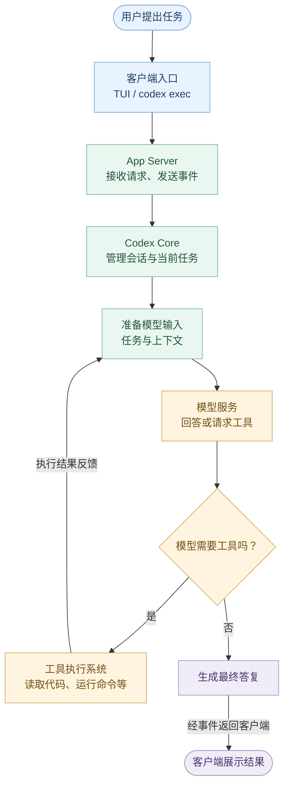
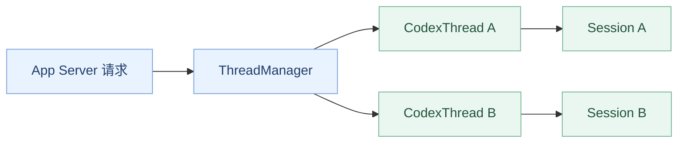
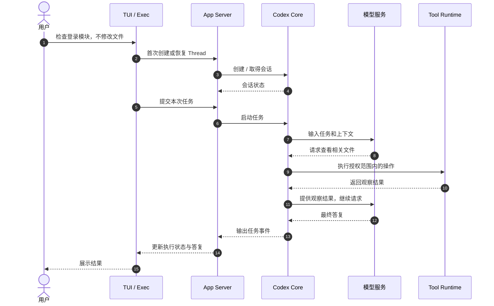

# 第 01 章：Codex 的整体架构——一次任务究竟经过哪些系统？

> **本章只解决一个问题：** 用户对 Codex 说“帮我检查项目”，这句话是怎样从界面进入 Agent Runtime，再经过模型与工具，最终变成答复的？
>
> [返回教程首页](../README.zh.md) · [课程大纲](../codex00.md) · [本章最小演示代码](./demo.py)

## 学习目标

读完本章，你应当能够：

1. 区分 **客户端入口、App Server、Codex Core、模型服务、工具执行环境** 五类职责。
2. 讲清 `codex` 与 `codex exec` 为什么是两种入口，而不意味着两套 Agent 核心。
3. 顺着真实源码定位一条任务的关键节点，而不是一开始就陷入成千上万行 Rust。
4. 运行一个无需 API Key 的最小示例，亲眼看到“提交请求 → 执行 → 返回事件”的过程。

**本章边界：** 不展开 Thread 的完整生命周期、Prompt 拼装、工具注册细节与 Sandbox 实现。这些各有独立章节。

**源码依据：** [openai/codex 固定版本 `014489466a17`](https://github.com/openai/codex/tree/014489466a1739c2c563cdfe57880c2c7c8680e3)。以下文件链接都固定在这一版本，保证读者看到的代码与文章尽可能一致。

---

## 1. 先提出一个工程问题

假设你正在维护一个登录系统，向 Codex 输入：

> 帮我看看这个项目的登录模块可能有哪些问题。先只分析，不要修改文件。

如果我们直接调用大模型 API，把这句话当作 Prompt 发过去，会遇到一个显而易见的问题：

**模型并不知道本地仓库长什么样。**

要认真回答这个问题，系统至少需要完成下列事情：

1. 接收用户指令，知道工作目录在哪。
2. 建立或恢复一段对话，保留本轮执行所需要的信息。
3. 向模型描述当前任务、可用能力和必要上下文。
4. 当模型要求“查看目录”或“读取文件”时，由程序实际执行。
5. 将执行结果返回模型，直到它能够给出有依据的回答。
6. 把执行进度、工具结果和最终答复反馈给用户。

这六件事的责任并不相同。

- **模型**擅长理解、推理、生成文本及提出工具请求。
- **Codex**负责组织任务、选择并调度能力、执行约束检查、记录状态和传递结果。
- **操作系统或执行服务**实际访问文件、运行程序，并实施相应隔离。

因此，Codex 不是“在聊天框里接一个模型”那么简单。它是一套围绕模型建立起来的 **Agent Runtime**。

## 2. 第一张图：一条任务如何流过 Codex？

只沿着从上到下的主线读图；中间的循环表示 Codex 可能反复向模型请求下一步。



这里有两个需要立即建立的认识。

**第一：Codex Core 是控制过程的中心，但不是大模型本身。** `ModelClient` 负责与模型服务交互，工具系统负责操作环境；核心 Runtime 将二者连接起来。

**第二：图上画出的模块是逻辑职责，不是一组固定的操作系统进程。** 例如，当前 Codex 的 TUI 和 `codex exec` 支持进程内 App Server；连接本地守护进程或远端服务时，部署方式又不同。不要把“App Server”简单理解为“必须独立启动的服务”。

## 3. 第一层：入口负责交互，不负责实现 Agent

一个新手最先接触的是：

```bash
codex
```

或者：

```bash
codex exec "解释这个项目的目录结构"
```

前者通常进入交互式终端界面；后者使用非交互方式运行任务。它们在产品交互上不同，却不应该各自实现一份模型循环和工具系统。

这就是为什么源码里要区分：

| 源码模块 | 主要职责 | 你现在可以怎样理解 |
| --- | --- | --- |
| `cli/` | 解析命令与选择运行入口 | “这次该打开哪种工作方式？” |
| `tui/` | 终端交互与结果展示 | “怎样和用户持续对话？” |
| `exec/` | 非交互任务入口 | “怎样从命令或脚本发起任务？” |
| `app-server-client/` | 连接 App Server，转交请求和接收事件 | “客户端怎样与 Runtime 通信？” |

在 [`cli/src/main.rs`](https://github.com/openai/codex/blob/014489466a1739c2c563cdfe57880c2c7c8680e3/codex-rs/cli/src/main.rs#L125-L162) 中，你可以看到 `MultitoolCli` 与 `Exec(ExecCli)` 的声明；继续到 [启动 TUI 的调用位置](https://github.com/openai/codex/blob/014489466a1739c2c563cdfe57880c2c7c8680e3/codex-rs/cli/src/main.rs#L2528-L2539)，能看到 `codex_tui::run_main`。

本章无需读懂这些 Rust 实现。只需确认：**命令入口负责分发使用方式，而不是承载 Agent 的全部核心逻辑。**

## 4. 第二层：App Server 为什么存在？

想象你正在与 Codex 对话：

- 用户提交了一个新任务。
- 界面需要显示“开始执行”。
- Codex 读取了文件，界面需要显示进展。
- Codex 请求审批，界面需要把选择发回去。
- 最终答复产生，界面需要展示内容。

这不是一个简单的“发 HTTP 请求，等一个字符串”的场景，而是**请求和事件持续往返**。

App Server 所在的边界就是为客户端提供统一的交互能力。它连接用户界面与 Core，让不同入口不必各自实现会话启动、事件处理等流程。

对初学者，先认识两类消息：

| 方向 | 举例 | 含义 |
| --- | --- | --- |
| 客户端 → Runtime | 开始会话、开始任务、取消任务 | “我希望 Codex 做什么？” |
| Runtime → 客户端 | 状态变化、工具执行信息、最终答复 | “Codex 当前发生了什么？” |

### 一个容易踩坑的细节：App Server 不一定是独立进程

当前源码的 [`app-server-client/README.md`](https://github.com/openai/codex/blob/014489466a1739c2c563cdfe57880c2c7c8680e3/codex-rs/app-server-client/README.md#L1-L55) 明确写出：

- `codex-tui` 和 `codex-exec` 都能使用共享的**进程内** App Server 客户端。
- 进程内通信使用类型化通道，而不是每次都通过外部网络发送 JSON。
- 即便在进程内，客户端依然遵循 App Server 的会话协议，例如 `thread/start` 和 `thread/resume`。
- 对外部 stdio / WebSocket 等通信边界，则有相应的协议传输。

这说明两件事情：**服务边界不等于进程边界；复用统一的交互语义，也不意味着每次必须走网络。**

## 5. 第三层：Codex Core 才是运行时的中心

现在进入真正关键的部分。

如果用户开了多个 Codex 会话，谁负责维护它们？如果一个会话中有任务正在执行，谁保存它的配置和当前状态？

Codex Core 需要有组织运行的对象，而不能只维护一个全局 `messages` 数组。

先认识三个名字：

```text
ThreadManager
    └── CodexThread
            └── Session
```

- **`ThreadManager`**：管理 Thread 的创建与内存中的引用。
- **`CodexThread`**：一个 Thread 对外的交互对象，关联内部 Session 与消息通道。
- **`Session`**：支撑当前会话执行的运行时状态和服务。

这些解释只用于建立第一印象；第 02、03 章会分别讨论对象关系与生命周期。

有三处源码能证明这不是我们凭空编造的分层：

1. [`thread_manager.rs`](https://github.com/openai/codex/blob/014489466a1739c2c563cdfe57880c2c7c8680e3/codex-rs/core/src/thread_manager.rs#L251-L258) 对 `ThreadManager` 的说明是创建并在内存中维护 Threads。
2. [`codex_thread.rs`](https://github.com/openai/codex/blob/014489466a1739c2c563cdfe57880c2c7c8680e3/codex-rs/core/src/codex_thread.rs#L208-L220) 中的 `CodexThread` 持有 `Arc<Session>` 与 `SessionIo`。
3. [`session/session.rs`](https://github.com/openai/codex/blob/014489466a1739c2c563cdfe57880c2c7c8680e3/codex-rs/core/src/session/session.rs#L58-L75) 说明一个 Session 同时至多有一个正在运行的 task，并能被用户输入打断。

于是，第一次能画出一个更接近源码的骨架：



这幅图是**关系示意**：表示管理、引用与关联，而不是宣称每个 Thread 一定对应独立进程。

## 6. 第四层：Runtime 怎么连接模型和工具？

前面解决了“任务如何来到 Core”，现在只差两个问题：

**模型给出下一步建议以后，谁来执行？执行结果又送给谁？**

在 Codex Core 的重要执行路径中，有一个函数：

[`core/src/session/turn.rs → run_turn()`](https://github.com/openai/codex/blob/014489466a1739c2c563cdfe57880c2c7c8680e3/codex-rs/core/src/session/turn.rs#L161-L181)

它附近的源码注释已经解释了这个循环：

- 如果模型返回工具调用，Codex 执行工具，将结果作为下一次模型请求的输入。
- 如果模型只返回最终答复，就记录回答并结束当前执行。

这里只需要理解**控制关系**：

```text
Agent Runtime
    ├── Model Client：让模型决定下一步
    └── Tool Runtime：执行模型请求的操作
              ↓
      将观察结果送回 Runtime
```

模型可能请求“执行测试”，但它**并不直接拥有操作系统权限**。Codex 的工具与执行基础设施才负责具体操作，并在相应的权限、审批和隔离边界下运行。

你还可以在 [`core/src/tools/router.rs`](https://github.com/openai/codex/blob/014489466a1739c2c563cdfe57880c2c7c8680e3/codex-rs/core/src/tools/router.rs#L85-L95) 中找到 `ToolRouter`。现在只需记住：**工具路由把模型所能请求的工具与相应的执行逻辑连接起来**。第 07、08 章会专门解释。

## 7. 一条任务的完整时间线

把上面所有内容接起来，我们得到一个简化的典型场景：



**注意：** 这是教学用的典型成功路径，刻意省略了流式事件的逐条传输、部分并发行为、审批中断、错误恢复，以及状态写入的精确时序。某些操作在真实系统中可能使用不同的内部消息路径。它不是可用于调试的逐函数调用栈。

## 8. 动手：运行一个只有四层的“迷你 Codex”

理解架构最有效的方式，是先看一个刻意缩小后的可运行程序。

本章提供：[`demo.py`](./demo.py)。

它包含四个教学角色：

| 教学类 | 对应的概念 |
| --- | --- |
| `AppServer` | 接收请求，将任务转交给核心，并返回事件 |
| `AgentRuntime` | 管理当前模拟会话，循环组织模型和工具 |
| `FakeModel` | 用确定性规则模拟模型“先调工具，后回答” |
| `SafeTools` | 返回预置的工具结果，不实际操作文件 |

在已经安装 Python 3.10+ 的环境中，进入本章目录，执行：

```bash
python demo.py
```

Windows 也可以使用 `py demo.py`（取决于本机安装方式）。

预期输出：

```text
Client > 请分析项目的登录问题，先不要修改文件
thread/started > demo-1
tool/call > read_project_info
tool/result > 【模拟资料】项目包含登录模块；异常处理逻辑需要进一步检查。
turn/completed > 已收到模拟项目资料。下一步应检查登录异常处理逻辑。
```

这几行日志分别对应了三个值得观察的事实：

1. **客户端输入没有直接触发模型 API**，而是交给模拟的服务接口。
2. **工具执行和模型决策是两个不同的职责**，Runtime 负责把它们连接起来。
3. **执行过程可以形成多个事件**，最后才出现 `turn/completed`。

### 这个 Demo 故意没有实现什么？

它没有真实模型调用、没有读取本地项目、没有写文件、没有 Sandbox、没有异步事件传输，也没有 Codex 的真实 Thread 存储结构。

其中的 `thread/started`、`tool/call`、`tool/result`、`turn/completed` 都只是**教学演示输出标签**，不是对 Codex App Server 协议字段的一比一还原。

**不要用这个 Demo 推断真实 Codex 的安全性、调用栈或协议契约。** 它仅用于验证核心分层思路。真正的 Agent Loop 将从第 04 章开始展开。

## 9. 第一次打开真实源码，应该看哪里？

此时再进入源码，就不会不知道在找什么了。本章建议只阅读这些入口：

| 顺序 | 文件 | 只看什么 |
| --- | --- | --- |
| 1 | [`cli/src/main.rs`](https://github.com/openai/codex/blob/014489466a1739c2c563cdfe57880c2c7c8680e3/codex-rs/cli/src/main.rs#L125-L162) | 找到用户入口如何区分交互和非交互命令 |
| 2 | [`app-server-client/README.md`](https://github.com/openai/codex/blob/014489466a1739c2c563cdfe57880c2c7c8680e3/codex-rs/app-server-client/README.md) | 理解客户端与 App Server 的通信边界 |
| 3 | [`app-server/src/message_processor.rs`](https://github.com/openai/codex/blob/014489466a1739c2c563cdfe57880c2c7c8680e3/codex-rs/app-server/src/message_processor.rs#L1295-L1312) | 找到 `ThreadStart` 请求的分发位置 |
| 4 | [`core/src/thread_manager.rs`](https://github.com/openai/codex/blob/014489466a1739c2c563cdfe57880c2c7c8680e3/codex-rs/core/src/thread_manager.rs#L251-L258) | 找到 Thread 的管理对象 |
| 5 | [`core/src/codex_thread.rs`](https://github.com/openai/codex/blob/014489466a1739c2c563cdfe57880c2c7c8680e3/codex-rs/core/src/codex_thread.rs#L208-L220) | 观察 Thread 与 Session 的关系 |
| 6 | [`core/src/session/turn.rs`](https://github.com/openai/codex/blob/014489466a1739c2c563cdfe57880c2c7c8680e3/codex-rs/core/src/session/turn.rs#L161-L181) | 确认模型与工具如何构成循环 |

**今天无需把任意一个文件读完。** 如果能指出“入口在这里、会话在这里、执行循环在这里”，就已经达到第一章的阅读目标。

## 10. 检查自己是不是真的学会了

尝试不看答案，回答：

1. 两个人分别通过 TUI 和 `codex exec` 提交任务，是否意味着 Codex 有两套互不相关的 Agent Core？为什么？
2. “App Server”一定代表一台服务器或一个独立的进程吗？
3. 模型输出“请读取文件 A”时，谁负责真正读取？为什么需要分离？
4. 如果有多个会话同时存在，应当去哪个核心对象附近寻找管理逻辑？
5. 本章 Demo 的哪一部分最明显地**不能**视为真实 Codex 源码实现？

<details>
<summary>展开参考答案</summary>

1. 不意味着两套 Core。两种入口可以复用共同的 App Server 接口和核心 Runtime。
2. 不一定。它先是职责与协议边界，当前实现也支持进程内路径。
3. Codex 的工具及执行系统负责动作；模型提出请求，Runtime 进行调度与约束处理。
4. `ThreadManager`，再沿 `CodexThread` 找到具体会话。
5. `FakeModel`、`SafeTools`、简化事件标签、同步循环及缺失的安全/持久化机制，都属于教学模拟。

</details>

## 本章小结

**一句话记住 Codex：** 它通过统一的交互与会话管理，将模型推理、工具执行和状态维护组织成可持续的 Agent 工作过程。

你已经掌握了它的骨架：

```text
客户端入口
    ↓
App Server
    ↓
Codex Core（Thread / Session）
    ↓
模型请求 ⇄ 工具执行
    ↓
事件与最终答复返回客户端
```

下一章我们不再泛泛地介绍整个系统，而是只追一个问题：

> **如果用户同时打开多个 Codex 会话，ThreadManager 如何创建、找到、持有和结束它们？**

这将带我们正式进入 `ThreadManager` 与 `CodexThread` 的真实设计。

