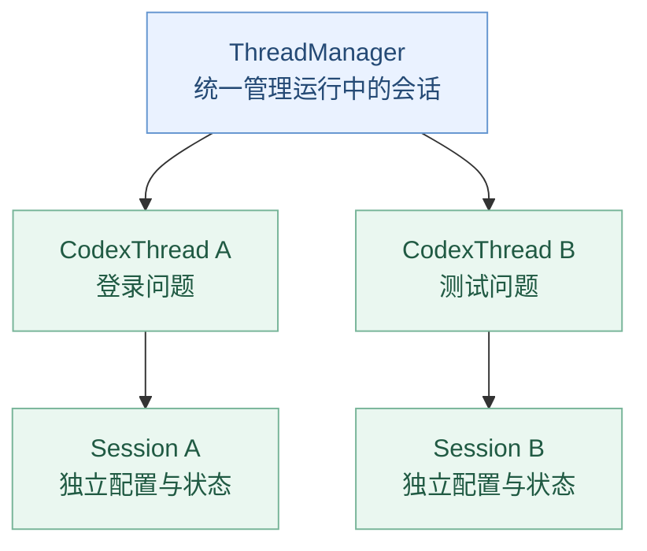
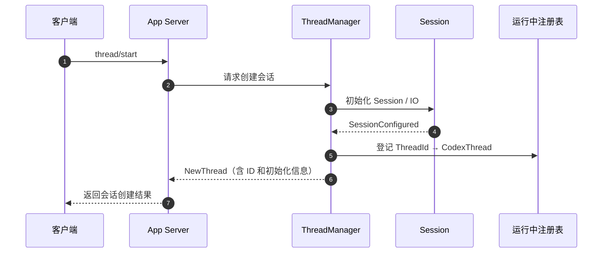

# 第 02 章：ThreadManager 与 CodexThread——Codex 如何管理多个会话？

> **本章的问题：** 如果我们同时打开两个 Codex 会话，一个分析登录 Bug，另一个检查测试失败，Codex 如何确保它们各自拥有自己的状态、接收各自的任务，并把结果送回正确的会话？
>
> [上一章：整体架构](../01-codex-architecture/README.zh.md) · [返回目录](../README.zh.md) · [本章示例代码](./demo.py)

第一章我们认识了入口、App Server、Codex Core、模型与工具。这一章只放大中间的一部分：**Codex Core 如何组织会话**。

本章结束时，你应该能说清楚：

1. 为什么不能只用一个全局 `messages` 列表管理所有任务？
2. `ThreadManager`、`CodexThread`、`Session` 分别承担什么职责？
3. 一个新会话怎样创建、登记、被找到，再通过消息通道交互？
4. 为什么**从运行中注册表移除会话**，不等于**关闭它**，更不等于**删除聊天历史**？

**源码基线：** [openai/codex @ `014489466a17`](https://github.com/openai/codex/tree/014489466a1739c2c563cdfe57880c2c7c8680e3)。下文所有源码链接都固定在此版本。

---

## 1. 为什么需要一个 ThreadManager？

想象用户同时打开两个终端：

| 会话 A | 会话 B |
| --- | --- |
| “帮我定位登录接口的异常。” | “帮我检查单元测试失败原因。” |
| 读取登录模块 | 读取测试模块 |
| 讨论登录 Bug | 讨论测试数据 |
| 保留 A 的上下文 | 保留 B 的上下文 |

如果我们只写一个全局变量：

```python
messages = []
```

两个会话的信息可能混在一起，甚至无法判断一条工具结果应该交给谁。

我们真正需要的是：



核心不是“一个线程执行所有工作”，而是**每个会话有自己的身份和运行对象，管理器负责找到它们**。

> **注意术语：** Codex 的 `Thread` 指 Agent 的会话线程，**不等同于操作系统中的 OS Thread 或 Python `threading.Thread`**。这是一个领域概念，不要因为名字相同而混淆。

## 2. 先看真实源码中的三个对象

让我们从少量真实代码开始，暂时不展开它们依赖的其他模块。

### 2.1 ThreadManager：运行中会话的管理者

打开 [`core/src/thread_manager.rs`](https://github.com/openai/codex/blob/014489466a1739c2c563cdfe57880c2c7c8680e3/codex-rs/core/src/thread_manager.rs#L251-L258)，你会找到：

```rust
/// [`ThreadManager`] is responsible for creating threads and maintaining
/// them in memory.
pub struct ThreadManager {
    state: Arc<ThreadManagerState>,
    // ...
}
```

源码中最能解释它职责的，是内部保存的这一类结构：

```rust
threads: Arc<RwLock<HashMap<ThreadId, Arc<CodexThread>>>>
```

对应 [`ThreadManagerState`](https://github.com/openai/codex/blob/014489466a1739c2c563cdfe57880c2c7c8680e3/codex-rs/core/src/thread_manager.rs#L422-L445)。

先把 Rust 的语法翻译成大家熟悉的概念：

| 代码 | 读法 |
| --- | --- |
| `ThreadId` | 每个会话的唯一标识 |
| `HashMap<ThreadId, …>` | 通过 ID 快速查找会话 |
| `Arc<CodexThread>` | 共享同一个会话对象的引用，而非简单复制会话 |
| `RwLock` | 让多个异步执行路径能够协调访问这一注册表 |

所以我们可以先把管理器想成：

```python
threads = {
    "thread-A": codex_thread_a,
    "thread-B": codex_thread_b,
}
```

这是**为了理解结构**写的 Python 对照，不是 Codex 的实际实现。

**关键结论：ThreadManager 关心“有哪些运行中的会话，以及怎样找到它们”，而不是亲自完成每一次模型推理。**

### 2.2 CodexThread：一个会话的交互入口

打开 [`core/src/codex_thread.rs`](https://github.com/openai/codex/blob/014489466a1739c2c563cdfe57880c2c7c8680e3/codex-rs/core/src/codex_thread.rs#L208-L220)：

```rust
pub struct CodexThread {
    pub(crate) session: Arc<Session>,
    pub(crate) io: SessionIo,
    // ...
}
```

只看前两个字段：

- `session`：内部运行时状态与服务所在的对象。
- `io`：与内部 Session 之间交互的消息通道抽象。

它还公开了两个非常直观的方法：

```rust
pub async fn submit(&self, op: Op) -> CodexResult<String> {
    self.io.submit(op).await
}

pub async fn next_event(&self) -> CodexResult<Event> {
    self.io.next_event().await
}
```

可分别在 [`submit()`](https://github.com/openai/codex/blob/014489466a1739c2c563cdfe57880c2c7c8680e3/codex-rs/core/src/codex_thread.rs#L253-L261) 和 [`next_event()`](https://github.com/openai/codex/blob/014489466a1739c2c563cdfe57880c2c7c8680e3/codex-rs/core/src/codex_thread.rs#L772-L783) 找到。

初学者可以记成：

```text
向 CodexThread 提交操作
            ↓
      内部 Session 处理
            ↓
从 CodexThread 获取执行事件
```

`Op` 与 `Event` 的精确类型、以及 App Server 如何把它们转换为客户端可见通知，会在第 10 章展开。**现在只理解双向交互这个职责。**

### 2.3 Session：真正持有运行时状态

进入 [`core/src/session/session.rs`](https://github.com/openai/codex/blob/014489466a1739c2c563cdfe57880c2c7c8680e3/codex-rs/core/src/session/session.rs#L58-L82)。

`Session` 包含 `thread_id`、状态、正在运行的任务、事件发送通道和各类运行时服务等内容。

源码中的一句注释非常关键：

> A session has at most 1 running task at a time, and can be interrupted by user input.

即：**一个 Session 同时最多运行一个任务，并且可被用户输入打断**。

这不等于整个 Codex 只能处理一个任务。不同 Thread 可以各自拥有自己的 Session；具体的调度、并发与中断机制，后面再学。

现在我们可以建立一个准确的职责边界：

| 对象 | 核心问题 |
| --- | --- |
| **ThreadManager** | 去哪里找到或创建会话？ |
| **CodexThread** | 怎样向这个会话提交操作、取得事件？ |
| **Session** | 这个会话当前怎样运行、保存哪些运行时状态？ |

---

## 3. 沿源码追踪：一个新 Thread 怎样出现？

假设客户端第一次打开 Codex 会话。

真实系统要完成的事情不只是 `new CodexThread()`。它还必须准备配置、服务、运行时通道，以及必要的初始化事件。

### 3.1 从 App Server 收到创建请求

客户端可以发送 `thread/start`。在 [`app-server/src/message_processor.rs`](https://github.com/openai/codex/blob/014489466a1739c2c563cdfe57880c2c7c8680e3/codex-rs/app-server/src/message_processor.rs#L1298-L1311) 中，`ClientRequest::ThreadStart` 被交给 `thread_processor.thread_start(...)` 处理。

这一步体现的是**分层**：请求由 App Server 接收和校验，再进入 Core 的会话管理路径，而不是由终端界面直接建立所有底层状态。

### 3.2 ThreadManager 启动创建流程

打开 [`core/src/thread_manager.rs` 的 `start_thread()`](https://github.com/openai/codex/blob/014489466a1739c2c563cdfe57880c2c7c8680e3/codex-rs/core/src/thread_manager.rs#L1097-L1104)：

```rust
pub async fn start_thread(
    &self,
    options: StartThreadOptions,
) -> CodexResult<NewThread> {
    Box::pin(self.start_thread_inner(
        options, /*forked_from_thread_id*/ None, /*startup*/ None,
    ))
    .await
}
```

`StartThreadOptions` 用于携带创建会话需要的配置和初始化选项。

**为什么不直接造一个对象？** 因为真实的会话需要准备身份、配置、模型服务、环境、历史与运行任务所依赖的组件；创建本身就是一个需要管理的过程。

### 3.3 初始化完成后，登记到运行中注册表

在 [`finalize_thread_spawn()`](https://github.com/openai/codex/blob/014489466a1739c2c563cdfe57880c2c7c8680e3/codex-rs/core/src/thread_manager.rs#L2464-L2511) 中，源码先读取并核对初始化事件 `SessionConfigured`，随后在注册表中插入：

```rust
let thread = Arc::new(CodexThread::new(
    session,
    io,
    // 初始化元数据等
));
e.insert(thread.clone());
```

最后返回的 `NewThread` 含有三个值得注意的字段：

```rust
pub struct NewThread {
    pub thread_id: ThreadId,
    pub thread: Arc<CodexThread>,
    pub session_configured: SessionConfiguredEvent,
}
```

见 [`NewThread`](https://github.com/openai/codex/blob/014489466a1739c2c563cdfe57880c2c7c8680e3/codex-rs/core/src/thread_manager.rs#L185-L194)。

也就是说，调用方不只得到了一个 ID，还得到了**可操作的 Thread 引用**和**已完成初始化的会话信息**。

### 创建过程总览



这是**教学压缩流程**，不是对所有异步消息和内部调用的逐行还原。

## 4. 创建之后：怎样定位并与它交互？

会话已经创建，管理器里也有记录。下一次针对同一个会话的操作，就需要能按 ID 找到它。

在 [`core/src/thread_manager.rs`](https://github.com/openai/codex/blob/014489466a1739c2c563cdfe57880c2c7c8680e3/codex-rs/core/src/thread_manager.rs#L944-L955) 里可以看到：

```rust
pub async fn list_thread_ids(&self) -> Vec<ThreadId> {
    self.state.list_thread_ids().await
}

pub async fn get_thread(
    &self, thread_id: ThreadId
) -> CodexResult<Arc<CodexThread>> {
    self.state.get_thread(thread_id).await
}
```

因此，核心步骤是：

```text
收到会话 ID
     ↓
ThreadManager 查找运行中 Thread
     ↓
得到 CodexThread 引用
     ↓
通过受控入口提交操作、订阅或读取事件
     ↓
对应 Session 推进任务
```

为了准确，这里还要强调：**真实 Codex 并不是让任意客户端对所有 Thread 都拥有同等访问权**。例如，内部创建的 Agent Worker 可能具有特殊的生命周期与访问约束。

因此，`get_thread()` 是理解 Core 注册表的入口，不代表 App Server 会无条件把所有内部 Thread 暴露给客户端。

## 5. 一个容易被忽略的问题：移除不等于关闭

假设用户关闭某个会话界面，我们要从管理器中清理对应运行对象。

是不是只需要：

```python
del threads[thread_id]
```

就完成一切？

**不是。**

真实源码在 [`remove_thread()`](https://github.com/openai/codex/blob/014489466a1739c2c563cdfe57880c2c7c8680e3/codex-rs/core/src/thread_manager.rs#L1390-L1396) 的注释里明确写道：它只是从管理器内部 Map 中移除对象，**其他位置仍可能持有这个 `Arc<CodexThread>` 引用**。

所以至少要区分三件事：

| 操作 | 它意味着什么 | 不意味着什么 |
| --- | --- | --- |
| **从注册表移除** | Manager 不再通过这条注册记录找到运行对象 | 对象已经销毁、任务已经停止 |
| **关闭运行时** | 请求 Session 终止运行、释放相关资源 | 历史记录一定已删除 |
| **删除持久化历史** | 按存储系统约定删除保存的数据 | 与内存中的运行对象完全相同 |

Codex 还提供了 [`shutdown_all_threads_bounded()`](https://github.com/openai/codex/blob/014489466a1739c2c563cdfe57880c2c7c8680e3/codex-rs/core/src/thread_manager.rs#L1439-L1483)，它会尝试终止跟踪的线程，并区分已完成、提交失败和超时的结果；未成功关闭的运行对象不会简单当作“已经结束”。

而 [`remove_thread_for_client()`](https://github.com/openai/codex/blob/014489466a1739c2c563cdfe57880c2c7c8680e3/codex-rs/core/src/thread_manager.rs#L1399-L1417) 还会阻止普通客户端直接移除活跃的内部 Worker。

这些都说明：**一个生产级 Agent 的生命周期管理，远不止在 Map 中 `pop` 一下。**

### 额外观察：旧清理任务不能误删新对象

另一个值得留意的接口是 [`remove_thread_if_matches()`](https://github.com/openai/codex/blob/014489466a1739c2c563cdfe57880c2c7c8680e3/codex-rs/core/src/thread_manager.rs#L1420-L1437)。

它不仅核对 `thread_id`，还会通过 `Arc::ptr_eq` 确认注册表里仍是预期的那个对象，再决定移除。

为什么？假设一个延迟的清理任务终于开始执行，但同一个 ID 对应的运行对象已被替换。只按 ID 清理，就有可能误删刚刚登记的新对象。

这也是工程化会话管理里非常典型的**对象身份与并发清理问题**。第一次阅读只需理解风险，不必掌握 Rust 的锁与引用计数细节。

## 6. Resume 和 Fork：为什么不能混为一谈？

到这里还剩两个常见操作：

- **Resume**：继续已有会话。
- **Fork**：从已有会话历史的某个状态创建新的分支会话。

在当前源码中，恢复不一定都从磁盘重新启动。若目标 Thread 已在内存中运行，某些恢复路径会检查已有运行对象，并可能复用它；否则才需要结合持久化历史初始化运行时。这可以在 [`thread_manager.rs` 的恢复路径](https://github.com/openai/codex/blob/014489466a1739c2c563cdfe57880c2c7c8680e3/codex-rs/core/src/thread_manager.rs#L2170-L2213) 中找到。

Fork 则需要处理历史快照与新会话的关系。它不等于让两个会话继续共享同一个可变的 Session。

```text
原始会话 A
   │
   ├── Resume A：继续原有会话身份
   │
   └── Fork → 新会话 B
                  │
                  └── 在选定历史基础上独立推进
```

本章先建立区别。历史从哪里读、如何持久化、怎样形成快照，放在第 11 章完整分析。

---

## 7. 动手：实现一个最小 ThreadManager

本章的 [`demo.py`](./demo.py) 不调用模型，而是专门模拟这章关注的“会话管理”能力。

**运行环境：** Python 3.10+，仅依赖标准库。

```bash
python demo.py
```

预期输出：

```text
created: ['demo-1', 'demo-2']
[demo-1] task/accepted: 检查登录模块
[demo-1] turn/completed: processed 1 message(s)
[demo-1] task/accepted: 继续定位异常处理
[demo-1] turn/completed: processed 2 message(s)
[demo-2] task/accepted: 分析测试失败
[demo-2] turn/completed: processed 1 message(s)
after remove: ['demo-2']
lookup removed thread: not found
detached thread closed: True
other thread remains: demo-2
```

观察三件事情。

### 实验一：多个会话为什么不会串？

`MiniThreadManager` 中的字典按 ID 管理独立的 `MiniThread`，而每个 `MiniThread` 又持有自己的 `Session.messages`。

演示代码通过断言检查：

- A 收到了两条任务。
- B 只收到了自己的那一条。
- A 的历史没有进入 B。

### 实验二：同一个会话如何继续工作？

我们调用两次 `login.submit(...)`。因为都操作同一个 `MiniThread`，它们会进入同一个 `Session.messages`。

这里没有真的进行多轮模型调用，只是在证明：**会话对象能保留自己的状态，直到被显式清理。**

### 实验三：从注册表移除会发生什么？

`remove_thread()` 把 A 从注册表中移除，但返回的 `detached` 仍然指向那个对象。

因此：

- 再通过 Manager 查询 A 会报未找到。
- 旧引用仍然存在。
- `detached.closed` 仍为 `False`。
- 直到显式调用 `detached.shutdown()` 才转为 `True`。
- B 不受影响。

这是本章最重要的一次观察：**注册表成员资格、对象引用与运行生命周期，是三个不同概念。**

> 演示中的 `MiniThread`、`task/accepted`、`turn/completed` 都是教学自定义类型或输出标签，**不是 Codex 官方 API 契约**。它没有实现异步队列、权限鉴别、真正的多任务并发、持久化、冷热恢复或真实 Session 关闭逻辑。演示只对应我们讲解的最小结构。

## 8. 对照真实源码，给自己的理解做一次验证

这一次不要求把 `thread_manager.rs` 全部读完，只沿着几个可定位的入口学习：

| 阅读顺序 | 找到的位置 | 要验证的事实 |
| --- | --- | --- |
| 1 | [`ThreadManagerState.threads`](https://github.com/openai/codex/blob/014489466a1739c2c563cdfe57880c2c7c8680e3/codex-rs/core/src/thread_manager.rs#L422-L429) | 运行中会话确实按 ID 注册 |
| 2 | [`ThreadManager::start_thread`](https://github.com/openai/codex/blob/014489466a1739c2c563cdfe57880c2c7c8680e3/codex-rs/core/src/thread_manager.rs#L1097-L1104) | 管理器确实提供创建入口 |
| 3 | [`finalize_thread_spawn`](https://github.com/openai/codex/blob/014489466a1739c2c563cdfe57880c2c7c8680e3/codex-rs/core/src/thread_manager.rs#L2464-L2511) | 创建完成后生成 `CodexThread` 并登记 |
| 4 | [`ThreadManager::get_thread`](https://github.com/openai/codex/blob/014489466a1739c2c563cdfe57880c2c7c8680e3/codex-rs/core/src/thread_manager.rs#L944-L955) | 后续可以通过 ThreadId 定位运行对象 |
| 5 | [`CodexThread::submit`](https://github.com/openai/codex/blob/014489466a1739c2c563cdfe57880c2c7c8680e3/codex-rs/core/src/codex_thread.rs#L253-L261) | 操作通过会话通道提交 |
| 6 | [`CodexThread::next_event`](https://github.com/openai/codex/blob/014489466a1739c2c563cdfe57880c2c7c8680e3/codex-rs/core/src/codex_thread.rs#L772-L783) | 事件通过会话通道获得 |
| 7 | [`remove_thread`](https://github.com/openai/codex/blob/014489466a1739c2c563cdfe57880c2c7c8680e3/codex-rs/core/src/thread_manager.rs#L1390-L1396) | 从注册表移除不等于立即销毁对象 |

到这里，你已经能理解 ThreadManager 与 CodexThread 的责任划分，而无需先读懂复杂的构造依赖。

## 9. 思考题：能否做出正确的架构判断？

试着回答：

1. 如果把所有会话的消息都放在一个全局列表里，最直接的风险是什么？
2. `ThreadManager` 的 `HashMap` 存放的是全部持久化对话历史吗？
3. 为什么 `CodexThread` 同时要关联 `Session` 和 `SessionIo`？
4. 当 `remove_thread()` 返回成功后，能否直接宣称“Agent 已经停止，磁盘记录也已删除”？
5. 为什么延迟清理时，只比较 ThreadId 有可能不够？

**参考答案：**

1. 不同会话之间的输入、结果和状态容易混淆。
2. 不是。它是活跃运行对象的注册表；持久化由其他组件负责。
3. `Session` 代表内部运行状态，`SessionIo` 提供交互通道；二者职责不同。
4. 不能。移除注册表、结束运行和删除历史是不同操作。
5. 同一 ID 对应的运行对象可能已经变化；必须避免旧清理任务移除新对象。

## 10. 本章小结与下一章

从这章开始，你应该能够分清：

```text
ThreadManager  —— 管理“有哪些运行中的会话”
      │
      └── CodexThread —— 对某个会话进行交互
                  │
                  ├── Session —— 保存内部运行时状态
                  └── SessionIo —— 传入操作、读出事件
```

**本章的核心收获不是记住几个 Rust 类型，而是理解三种边界：会话身份、运行时对象、消息通道。**

下一章：[第 03 章 · Session / Turn / Step（待编写）](../codex00.md)。

我们会进入 `Session` 内部，回答一个更深入的问题：

> **为什么同一个会话里，可以发生多个用户任务，而一个任务中又可能存在多次模型采样？它们之间的状态和生命周期应该如何划分？**
