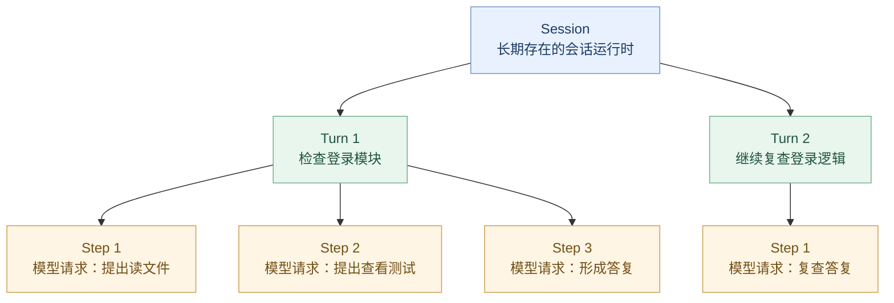
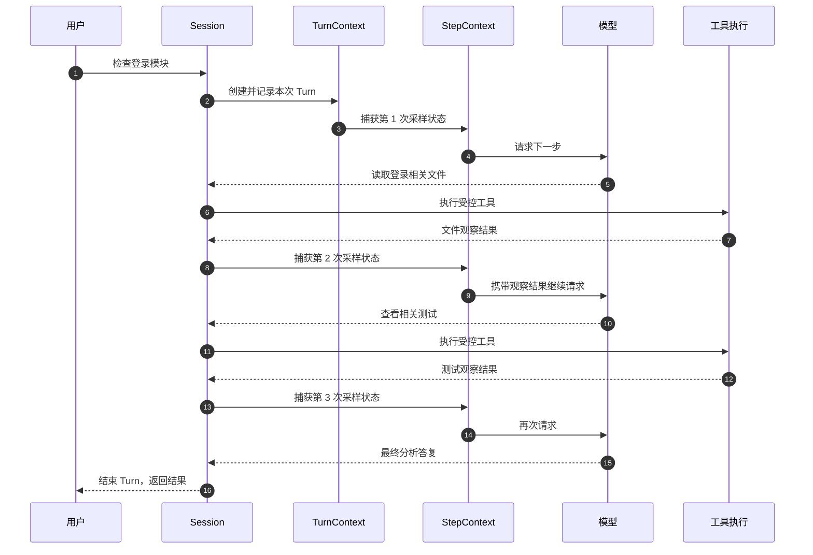

# 第 03 章：Session / Turn / Step——一次任务为什么需要三层运行状态？

> **本章的问题：** 你只说了一句“检查登录模块”，Codex 却可能先读取文件，再运行测试，最后回答你。为什么这算一个任务，却经历了多次模型请求？这几层状态分别应该由谁维护？
>
> [上一章：ThreadManager 与 CodexThread](../02-thread-management/README.zh.md) · [教程首页](../README.zh.md) · [本章演示代码](./demo.py)

前两章，我们已经知道客户端如何把请求交给 Codex Core，以及 `ThreadManager` 如何管理多个 `CodexThread`。本章继续向里走，研究 **单个会话内部的运行模型**。

完成本章，你应该能：

1. 区分 `Session`、`TurnContext`、`StepContext` 的作用与生命周期。
2. 解释为什么**一次 Turn 可能需要多次模型采样**，不能把工具调用当作新的用户任务。
3. 理解“每次采样使用自己的快照”解决了什么工程问题。
4. 找到真实 Codex 中的活跃任务状态、启动或追加输入的接口，以及 `run_turn` 与 Step 的关系。

本章不是 Agent Loop 的完整实现课。模型流式协议、工具路由、Prompt 构建将在第 04–08 章展开。

**源码基线：** [openai/codex @ `014489466a17`](https://github.com/openai/codex/tree/014489466a1739c2c563cdfe57880c2c7c8680e3)。所有源码链接固定到这一提交，以避免上游更新影响阅读。

---

## 1. 从一个“看似只有一句话”的任务开始

假设你在已经创建的 Codex 会话中输入：

> 检查登录模块，分析可能的问题。先不要修改文件。

合理的执行轨迹可能是：

```text
用户提出任务
    │
    ├─ 第 1 次请求模型：下一步要做什么？
    │       └─ 模型提出：读取登录模块文件
    │
    ├─ 工具执行：返回相关代码
    │
    ├─ 第 2 次请求模型：看到了什么，还缺什么？
    │       └─ 模型提出：查看相关测试
    │
    ├─ 工具执行：返回测试结果
    │
    └─ 第 3 次请求模型：是否已经足够回答？
            └─ 模型给出分析结果
```

**一个用户任务，三个模型请求，中间夹着两个工具结果。**

如果代码里只有一个 `messages` 列表，我们很难清楚表达：

- “这个会话还在不在？”
- “当前执行的是哪个用户任务？”
- “这一次模型请求使用什么设置？”
- “用户中途改变要求，会影响当前请求，还是下一次请求？”

这就需要三层不同作用域的状态。

## 2. 一张图认识 Session、Turn 和 Step



请按下表记住它们的边界：

| 层次 | 作用范围 | 管理什么 | 何时变化 |
| --- | --- | --- | --- |
| **Session** | 一段运行中的会话 | 会话状态、当前任务、输入与事件、运行时服务 | 跨多个 Turn 持续存在 |
| **TurnContext** | 一次被接纳的任务执行 | 本轮任务的标识、配置、环境与相关上下文 | 创建 Turn 时建立；执行期间可承载后续更新 |
| **StepContext** | 一次模型采样请求 | 此次请求使用的设置、工具集合、环境等快照 | 每次需要新的采样上下文时捕获 |

这里的 `Step` 是我们对**模型采样请求边界**的教学简称。真实源码有 `StepContext` 类型，但不能简单理解为“每调用一次工具就创建一个 Step”。工具执行是采样请求产生调用后的执行阶段；只有需要再次向模型采样时，才会形成新的采样上下文。

**最重要的关系：同一个 Session 可以经历多个 Turn，而一个 Turn 中可以经历多个 Step。**

---

## 3. 第一层：Session 负责什么？

先看真实源码：[`core/src/session/session.rs`](https://github.com/openai/codex/blob/014489466a1739c2c563cdfe57880c2c7c8680e3/codex-rs/core/src/session/session.rs#L58-L101)。

精简后的结构是：

```rust
pub(crate) struct Session {
    pub(crate) thread_id: ThreadId,
    pub(super) state: Mutex<SessionState>,
    pub(crate) active_turn: Mutex<Option<ActiveTurn>>,
    pub(crate) input_queue: InputQueue,
    pub(crate) services: SessionServices,
    // 还有事件、运行设置、扩展能力等字段
}
```

请不要被 `Mutex`、`Arc` 等 Rust 细节挡住。现在只看名字：

- `thread_id`：Session 所属的会话身份。
- `state`：会话范围内的状态。
- `active_turn`：当前有没有活跃 Turn。
- `input_queue`：输入进入运行时的路径之一。
- `services`：这个会话可以使用的运行时服务。

源码注释还指出：[**一个 Session 同时至多运行一个 task，并且可以被用户输入打断**](https://github.com/openai/codex/blob/014489466a1739c2c563cdfe57880c2c7c8680e3/codex-rs/core/src/session/session.rs#L58-L63)。

这句话容易被误读，值得分开理解：

- **并不是整个 Codex 同时只能执行一个任务。** 不同 Session 可以各自运行。
- **也不是同一个 Session 永远只能有一个 Turn。** 一个 Turn 完成后，后续输入可以开始新的 Turn。
- **也不等于任何新输入都会立即创建新 Turn。** 活跃任务还涉及追加输入、拒绝请求或中断等语义。

`Session` 所以存在，是为了让会话级资源与单次任务分离。

### 活跃任务放在哪里？

真实源码还有一个 [`ActiveTurn`](https://github.com/openai/codex/blob/014489466a1739c2c563cdfe57880c2c7c8680e3/codex-rs/core/src/state/turn.rs#L29-L43) 类型，其中包含当前任务相关的 `RunningTask` 与完成阶段状态。

我们现在只需要理解：

```text
Session
  ├── 可跨任务使用的状态和服务
  └── active_turn
          ├── Some(...) → 正在处理任务
          └── None      → 当前没有活跃任务
```

这是状态关系示意，不代表 Codex 的所有中间状态都能被两个值完整表达。

## 4. 第二层：TurnContext 负责什么？

打开 [`core/src/session/turn_context.rs`](https://github.com/openai/codex/blob/014489466a1739c2c563cdfe57880c2c7c8680e3/codex-rs/core/src/session/turn_context.rs#L322-L365)。

文件中的注释明确写着：

> The context needed for a single turn of the thread.

即：**单个 Thread Turn 所需的上下文**。

在 `TurnContext` 中，我们能找到这些具有代表性的字段：

```rust
pub struct TurnContext {
    pub(crate) sub_id: String,
    pub config: Arc<Config>,
    pub(crate) initial_settings: Arc<ResolvedStepSettings>,
    pub(super) next_step_settings: ArcSwap<ResolvedStepSettings>,
    // 还有会话来源、环境、追踪信息、扩展数据等
}
```

你可以暂时这样理解：

- `sub_id` 关联当前 Turn 的身份与消息。
- `config` 提供这一 Turn 的相关配置。
- `initial_settings` 保留 Turn 建立时解析的设置视图。
- `next_step_settings` 保存后续采样可使用的设置版本。

为什么不把这些信息全部放在 `Session` 中？

因为 **会话生命周期长于任务生命周期**。当前正在执行的任务需要知道自己基于什么上下文开始，也不能在任意时刻无条件地把后续变更理解成“之前已经执行的请求也发生了变化”。

因此，`Session` 与 `TurnContext` 分工：前者负责持续运行的会话，后者负责当前任务的上下文边界。

## 5. 第三层：StepContext 为什么是一次“快照”？

这是本章最关键的设计。

在 [`core/src/session/step_context.rs`](https://github.com/openai/codex/blob/014489466a1739c2c563cdfe57880c2c7c8680e3/codex-rs/core/src/session/step_context.rs#L23-L49) 中，`StepContext` 的注释非常直白：

> Request-scoped state that may change between model sampling requests.

即：**一次请求使用的状态；不同模型采样请求之间可以发生变化。**

源码中的部分字段：

```rust
pub(crate) struct StepContext {
    pub(crate) turn: Arc<TurnContext>,
    pub(crate) settings: Arc<ResolvedStepSettings>,
    pub(crate) environments: TurnEnvironmentSnapshot,
    pub(crate) mcp: Arc<McpBinding>,
    pub(crate) tool_router: Arc<ToolRouter>,
    // 还有预算、权限关联信息与扩展快照等
}
```

这些字段组合在一起并不是偶然的。

想象模型在一次采样请求里看到了工具 `read_file`，并决定调用它。这次调用应该按照**与这次采样相对应的工具计划和执行上下文**解释。

如果模型请求发出后，Runtime 无条件使用一份随时变化的全局工具表，就可能发生：

```text
Step 1 请求模型时：
    模型看到的工具 = [read_file, search]

但工具真正执行时：
    全局工具表已经变成 [search, new_tool]

问题：
    模型发出的 read_file 应交给谁执行？
```

`StepContext` 保持这一采样请求所用的模型设置、工具计划、环境和其他必要状态之间的一致性。

**结论：Turn 表达“我们还在处理哪项任务”，Step 表达“这次模型请求实际依据什么状态运行”。**

注意两点：

1. “快照”不意味着所有关联资源都被深拷贝，也不意味着所有权限都是永久冻结的。真实执行仍然需要遵守有效的授权与安全约束。
2. 这里描述的是采样状态的一致性设计，不代表 Codex 无条件允许在任何时刻修改模型、权限或工具；实际更新会受到具体实现的约束。

---

## 6. Turn 中的多个 Step 怎样形成循环？

现在才去看 [`core/src/session/turn.rs → run_turn()`](https://github.com/openai/codex/blob/014489466a1739c2c563cdfe57880c2c7c8680e3/codex-rs/core/src/session/turn.rs#L160-L183)。

它的函数参数包含：

```rust
pub(crate) async fn run_turn(
    sess: Arc<Session>,
    turn_context: Arc<TurnContext>,
    mut input: Vec<TurnInput>,
    // ...
) -> CodexResult<Option<String>>
```

从参数就能看出来，`run_turn` 不只有一句 Prompt；它同时接收**会话对象**和**当前 Turn 的上下文**。

而源码注释对循环的描述是：

- 模型采样返回工具请求时，执行工具。
- 将工具结果提供给下一次模型采样。
- 如果模型只给出最终答复，就记录它并结束本轮 Turn。

另外，[`run_turn` 的初始 Step 构建位置](https://github.com/openai/codex/blob/014489466a1739c2c563cdfe57880c2c7c8680e3/codex-rs/core/src/session/turn.rs#L274-L289) 可以看到：

```rust
let first_step_context = sess
    .capture_step_context_with_required_mcp_servers(
        Arc::clone(&turn_context),
        // ...
    )
    .await;
```

这里的源码是**删去错误处理等分支的教学摘录**，不是可以直接替换原实现的完整代码。

一次典型任务可以画成：



这张图中的 `P` 代表**先后捕获的不同 StepContext 实例**，不是一个对象被反复覆盖。图示省略真实流式事件、重试、审批及异常路径。

所以，**工具调用不会天然开启新 Turn**：它通常仍然属于当前 Turn 的工作过程。

## 7. 一个容易搞错的边界：用户发新消息，一定开启新 Turn 吗？

**不一定。**

查看 [`CodexThread::start_or_steer_turn()`](https://github.com/openai/codex/blob/014489466a1739c2c563cdfe57880c2c7c8680e3/codex-rs/core/src/codex_thread.rs#L411-L425)，其接口注释明确说明，它会根据当前状态：

- 启动新的 Turn；
- 对正在执行的 Turn 追加（steer）输入；
- 或者拒绝本次提交。

还有 [`start_turn_if_idle()`](https://github.com/openai/codex/blob/014489466a1739c2c563cdfe57880c2c7c8680e3/codex-rs/core/src/codex_thread.rs#L426-L442)：它要求当前处于可开始任务的空闲状态，否则不直接开始。

这说明一件事：

**“用户提交了输入”与“系统创建了一个新 Turn”不是同一件事。**

例如用户在 Codex 正分析文件时补充：

> 顺便检查一下空指针异常。

系统可能将输入纳入当前执行，也可能走其他处理路径，取决于具体调用模式、状态及约束。不能在教程中把每条用户消息都画成新的 Turn。

关于打断、steering、输入接纳和任务完成的状态机，会在后面的 Runtime 与事件章节继续分析。

### 一个版本阅读提醒

仓库内还有较早的 [`docs/protocol_v1.md`](https://github.com/openai/codex/blob/014489466a1739c2c563cdfe57880c2c7c8680e3/codex-rs/docs/protocol_v1.md)，它使用 `Task` / `Turn` 等较早的术语组合，其中的 “Turn” 更接近一次模型请求周期，而且文档自己注明可能与实现不完全一致。

**本教程以本章核对过的当前固定源码中的 `Session` / `TurnContext` / `StepContext` 为准。** 不要直接用旧协议文档的术语去替代当前类型。

---

## 8. 动手实验：1 个 Session，2 个 Turn，4 个 Step

本章提供了 [`demo.py`](./demo.py)，使用 Python 3.10+ 标准库即可运行：

```bash
python demo.py
```

它没有真正的大模型，只包含：

- 一个模拟 `Session`，负责保存跨 Turn 的历史和当前活跃任务；
- 每次调用 `run_turn()`，创建一个新的 `TurnContext`；
- 每次模型采样时，创建一个独立 `StepContext`；
- `FakeModel` 用固定剧本产生工具请求与最终答复；
- 工具结果是预置字符串，不触碰真实项目文件。

完整的教学执行轨迹如下：

```text
Session opened: demo-thread-1
Turn 1 started: 检查登录模块
  Step 1 [mock-v1] -> tool: inspect_login
    observation: 发现登录模块存在异常处理代码（预置数据）
    future sampling settings changed to mock-v2
  Step 2 [mock-v2] -> tool: inspect_tests
    observation: 发现登录测试存在失败断言（预置数据）
  Step 3 [mock-v2] -> final: 登录模块检查完成（模拟）
Turn 1 completed
Turn 2 started: 继续复查
  Step 1 [mock-v2] -> final: 已结合此前记录给出复查意见（模拟）
Turn 2 completed
Summary: 1 session, 2 turns, 4 model sampling steps
All teaching assertions passed
```

### 实验 A：一次 Turn 为什么包含三个 Step？

第一个 Turn 的三个采样请求分别得到：

1. 读取登录模块的工具请求。
2. 查看测试的工具请求。
3. 最终答复。

中间虽然执行了两个工具，**但没有创建三个 Turn**。这三个采样仍然属于同一任务。

### 实验 B：第二次用户任务为什么没有创建新 Session？

`run_turn("继续复查")` 仍然在同一个 `Session` 对象上调用，所以会话身份没有改变；但是它有新的 `TurnContext`，本章示例将其记为 Turn 2。

### 实验 C：一次请求的快照会不会被后续修改追溯改变？

示例在 Step 1 之后，将**未来采样要使用的教学模型名**从 `mock-v1` 修改为 `mock-v2`。

因此：

- Step 1 仍然记录 `mock-v1`。
- Step 2、Step 3 记录 `mock-v2`。
- 第二个 Turn 的采样使用 `mock-v2`。

程序会用断言验证这些条件。这不是 Codex 真实模型切换策略的还原，而是在说明：**已经捕获的请求状态与未来可变的会话设置应当区分**。

> 演示代码不支持真实并发、Steer、模型网络请求、权限审批、数据持久化或 Context 压缩。`TurnContext`、`StepContext` 的 Python 字段仅是教学子集；输出事件也不是官方 Codex 协议。

## 9. 本章真实源码导览

先读**声明和注释**，不要上来就试图读完整个运行循环。

| 阅读顺序 | 源码入口 | 这一步确认什么 |
| --- | --- | --- |
| 1 | [`Session`](https://github.com/openai/codex/blob/014489466a1739c2c563cdfe57880c2c7c8680e3/codex-rs/core/src/session/session.rs#L58-L101) | 会话级状态和 `active_turn` 在哪里 |
| 2 | [`ActiveTurn`](https://github.com/openai/codex/blob/014489466a1739c2c563cdfe57880c2c7c8680e3/codex-rs/core/src/state/turn.rs#L29-L43) | 正在执行的 Turn 如何被表示 |
| 3 | [`TurnContext`](https://github.com/openai/codex/blob/014489466a1739c2c563cdfe57880c2c7c8680e3/codex-rs/core/src/session/turn_context.rs#L322-L365) | Turn 的身份与上下文有哪些 |
| 4 | [`StepContext`](https://github.com/openai/codex/blob/014489466a1739c2c563cdfe57880c2c7c8680e3/codex-rs/core/src/session/step_context.rs#L23-L49) | 一次采样需要捕获哪些设置 |
| 5 | [`run_turn()`](https://github.com/openai/codex/blob/014489466a1739c2c563cdfe57880c2c7c8680e3/codex-rs/core/src/session/turn.rs#L160-L183) | 工具结果怎样进入下一次采样 |
| 6 | [`第一份 Step 快照`](https://github.com/openai/codex/blob/014489466a1739c2c563cdfe57880c2c7c8680e3/codex-rs/core/src/session/turn.rs#L274-L289) | Runtime 在哪里构造初始请求上下文 |
| 7 | [`start_or_steer_turn()`](https://github.com/openai/codex/blob/014489466a1739c2c563cdfe57880c2c7c8680e3/codex-rs/core/src/codex_thread.rs#L411-L425) | 为什么新输入不一定代表新 Turn |

## 10. 自测：这些情况分别属于哪一层？

1. 一段会话执行完任务后，用户再次追问。什么对象可以继续存在？
2. 模型在同一个任务里要求执行两次工具。每次工具调用都新建 Turn 吗？
3. 某次请求使用的工具集合和环境信息，主要应该在哪一层建立对应快照？
4. 用户正在执行中的 Turn 追加一个要求，是否一定要先终止旧 Turn？
5. 如果查阅旧 `protocol_v1.md` 时发现 `Turn` 的含义和本文不同，应该优先相信什么？

**参考答案：**

1. 原 Session 可以继续存在，新的任务有新的 Turn。
2. 不需要。工具调用可能由一个 Turn 内的不同模型采样产生。
3. `StepContext`；它记录与当前采样相对应的设置和工具计划。
4. 不一定。要看活跃状态与 `start_or_steer_turn` 等调用语义。
5. 优先核对固定版本的真实实现与类型注释，不机械套用旧文档词汇。

## 本章小结

```text
CodexThread
    └── Session         会话级状态、服务与当前执行情况
           │
           ├── Turn 1   一次被接纳的任务
           │      ├── Step 1   一次模型采样
           │      ├── Step 2   下一次模型采样
           │      └── Step 3   最终模型采样
           │
           └── Turn 2   另一项任务
                  └── Step 1
```

**真正需要记住的不是三个对象名称，而是三个不同的生命周期：会话长于任务，任务可能跨越多次模型请求，每次模型请求需要一致的采样上下文。**

接下来进入 [第 04 章：`run_turn`——真正的 Agent Loop（课程大纲）](../codex00.md)。

下一章我们会把本章暂时当作黑箱的“模型请求 + 工具反馈”拆开，回答：

> **Codex 如何判断下一步应该继续调用模型、执行工具，还是结束本轮任务？**

