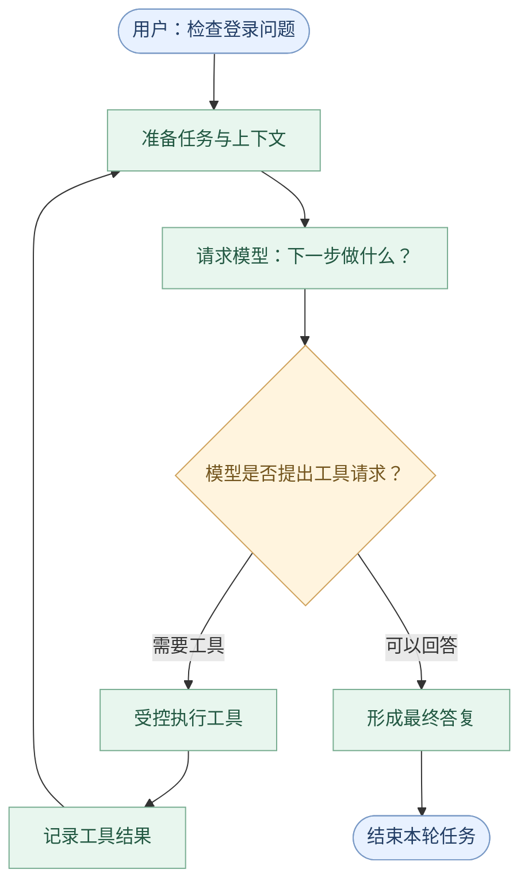
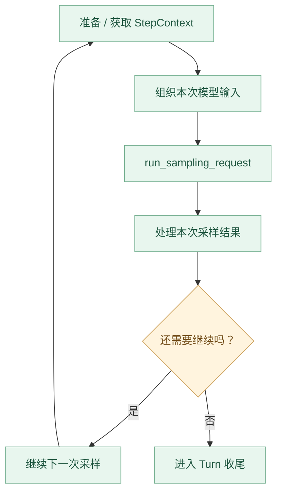

# 第 04 章：`run_turn`——Codex 真正的 Agent Loop

> **核心问题：** 用户只说了一句“帮我检查登录问题”，Codex 为什么能连续读取代码、分析测试，再根据结果继续行动？是谁决定“再请求模型一次”，又是谁决定“这个任务到此结束”？
>
> [上一章：Session / Turn / Step](../03-session-turn-step/README.zh.md) · [返回教程首页](../README.zh.md) · [本章 Demo](./demo.py)

在前三章中，我们建立了 Codex 的整体架构，也知道一个 `Session` 可以包含多个 `Turn`，一个 Turn 又可能包含多个模型采样 `Step`。

这一章终于进入 Codex 最核心的执行逻辑：**`run_turn` 是如何驱动一轮任务不断前进的？**

学完本章，你将能够：

1. 解释 **Agent Loop = 模型决策 + 工具执行 + 观察反馈 + 继续判断**。
2. 说出真实 `run_turn` 与模型流式请求处理之间的职责边界。
3. 理解工具输出如何进入下一次采样，以及 `needs_follow_up` 决定的是什么。
4. 区分 **模型响应完成**、**Turn 正常完成**、**中断 / 异常退出**。
5. 运行一个无 API Key 的最小 Agent Loop，观察三种结束路径。

**源码版本：** [openai/codex @ `014489466a17`](https://github.com/openai/codex/tree/014489466a1739c2c563cdfe57880c2c7c8680e3)。后文所有源码入口均固定至这个提交。

---

## 1. 如果只调用一次模型，会遇到什么问题？

假设你先写一个最简单的 AI 助手：

```python
reply = model.generate("检查项目里的登录 Bug")
print(reply)
```

模型可能回答：

> 我需要先查看登录模块的代码。

但程序在 `print(reply)` 之后就结束了。模型**提出了下一步行动，却没有机制推动行动发生**。

我们需要一个控制过程：



**关键不是有一个 `while True`，而是循环里每一步有明确的输入、输出和结束条件。**

举个正常执行的例子：

| 模型采样 | 模型输出 | Codex 做什么 | 之后 |
| --- | --- | --- | --- |
| 第 1 次 | 请求读取登录文件 | 校验并执行工具，得到代码 | 继续采样 |
| 第 2 次 | 请求查看测试结果 | 执行对应工具，得到观察结果 | 继续采样 |
| 第 3 次 | 给出分析结论 | 记录回答，进入结束阶段 | 不再自动采样 |

注意：**一次模型采样可能返回多个输出项，甚至多个工具调用**。表格只描述最易理解的一条典型路径，并不限制真实 Codex 每次只能产生一个工具调用。

## 2. 真正的入口在哪里？

打开源码：[`codex-rs/core/src/session/turn.rs`](https://github.com/openai/codex/blob/014489466a1739c2c563cdfe57880c2c7c8680e3/codex-rs/core/src/session/turn.rs#L160-L185)。

你会找到：

```rust
pub(crate) async fn run_turn(
    sess: Arc<Session>,
    turn_context: Arc<TurnContext>,
    mut input: Vec<TurnInput>,
    mcp_startup_requirements: &mut McpStartupRequirements,
    prewarmed_client_session: Option<ModelClientSession>,
    cancellation_token: CancellationToken,
) -> CodexResult<Option<String>>
```

首先不要急着研究函数内部的几千行代码。先读懂这几个输入：

| 参数 | 本章需要理解的含义 |
| --- | --- |
| `sess` | 当前会话的运行状态与服务 |
| `turn_context` | 这一轮任务的上下文、设置与标识 |
| `input` | 进入本轮的输入 |
| `mcp_startup_requirements` | 与本轮相关的 MCP 启动需求 |
| `prewarmed_client_session` | 可复用的模型客户端会话 |
| `cancellation_token` | 中断 / 取消传播能力 |

仅从签名就能得出一个结论：

**`run_turn` 不是一个纯粹的“Prompt → 文本”函数，它位于会话、模型请求、工具和任务控制之间。**

源码在函数前的注释也描述了核心流程：模型返回工具调用，则执行并把结果放入后续请求；如果模型给出结束答复，则完成本轮。

但还需要注意：注释概括的是基础流程。真实实现还会考虑用户新增输入、Hooks、上下文压缩、重试和错误处理，不能把注释当作完整状态机。

## 3. 先抓住最重要的外层循环

`run_turn` 内部会准备初始上下文，再进入一个持续推进的循环。

在 [`turn.rs#L451–L463`](https://github.com/openai/codex/blob/014489466a1739c2c563cdfe57880c2c7c8680e3/codex-rs/core/src/session/turn.rs#L451-L463) 中，可以看到：

```rust
let mut next_step_context = Some(first_step_context);
let mut guardian_budget_compacted = false;
loop {
    // ...
}
```

这里的 `loop` 是本章要研究的**外层 Agent Loop**。

它不是每循环一次就创建一个新 Turn，而是**在当前 Turn 中，根据需要执行下一次模型采样**。

其主要职责可以概括为：



为什么要让外层控制下一次采样，而不是模型返回结果后立刻结束？

因为一次模型请求可能只完成了任务的一小部分；它的工具结果需要被组织成下一次模型请求的输入。

还有一个细节来自第 03 章：每次采样都需要与当前请求一致的 `StepContext`，不能把正在变化的设置简单当作一份永久不变的全局对象。

## 4. 真正向模型发请求的，不是外层 `loop` 本身

沿着 [`turn.rs#L533–L580`](https://github.com/openai/codex/blob/014489466a1739c2c563cdfe57880c2c7c8680e3/codex-rs/core/src/session/turn.rs#L533-L580) 往下看，会看到模型输入准备及调用：

```rust
run_sampling_request(
    Arc::clone(&sess),
    Arc::clone(&step_context),
    // 省略其他参数
)
.await
```

**这是教学摘录**，真实调用还包括 Turn 扩展数据、差异跟踪器、`ModelClientSession`、输入和取消令牌等参数。

进一步进入 [`run_sampling_request()`](https://github.com/openai/codex/blob/014489466a1739c2c563cdfe57880c2c7c8680e3/codex-rs/core/src/session/turn.rs#L1714-L1772)，可以看到它做的事情包括：

- 获取或准备本次模型输入；
- 建立与本次 `StepContext` 关联的工具运行时；
- 构造 `Prompt`；
- 准备模型请求元数据；
- 调用更底层的采样请求逻辑，并处理适用的重试策略。

再沿着 [`try_run_sampling_request()`](https://github.com/openai/codex/blob/014489466a1739c2c563cdfe57880c2c7c8680e3/codex-rs/core/src/session/turn.rs#L2628-L2740)，可以找到 `client_session.stream(...)`。

所以我们先把分工记成：

| 层次 | 负责的主要问题 |
| --- | --- |
| **`run_turn`** | 这个 Turn 要不要进入下一次模型采样？ |
| **`run_sampling_request`** | 怎样准备并完成这次模型采样，包括适用的重试？ |
| **`try_run_sampling_request`** | 怎样接收模型流式事件、处理输出项和工具执行？ |

这三层不是同义词。**外层 Turn Loop、单次采样的重试循环、采样内部的流式事件循环，也不是同一个循环。**

### 为什么流式响应很重要？

模型不是只能在完成全部输出后返回一整段文本。一次流式响应可能陆续产生：

```text
响应开始
    ↓
输出项出现 / 更新
    ↓
工具调用或助手内容完成
    ↓
响应完成
```

Codex 必须在流式过程中识别不同类型的输出项，更新状态，向客户端发送必要事件，并准备工具执行。

这也是为什么真实源码远比教学用的几行 `model.generate()` 复杂。

## 5. 从模型输出到工具执行，中间发生了什么？

这是你理解 Agent Loop 最关键的一步。

在 [`stream_events_utils.rs → handle_output_item_done()`](https://github.com/openai/codex/blob/014489466a1739c2c563cdfe57880c2c7c8680e3/codex-rs/core/src/stream_events_utils.rs#L316-L371)，可以看到 Codex 处理一个已完成的模型输出项。

其中一个重要分支是：

```rust
match ToolRouter::build_tool_call(item.clone()) {
    Ok(Some(call)) => {
        // 记录工具调用，准备执行
        // ...
        output.needs_follow_up = true;
        output.tool_future = Some(tool_future);
    }
    Ok(None) => {
        // 处理非工具类输出
        // ...
    }
    // ...
}
```

这是**省略了大量代码的逻辑摘录**，不是原文件的连续完整片段。

它揭示了三个步骤：

1. **识别**：把模型输出项解析为可处理的工具调用。
2. **执行**：由工具运行时接收并调度，而不是模型自己操作操作系统。
3. **反馈**：将执行结果记录，供后续模型采样继续使用。

真实实现还会处理不支持的调用、模型可见工具与可执行工具的匹配、取消、并发以及工具级错误等情况。第 07、08 章会拆解这里的细节。

### 工具执行完成之前，能否直接进入下一次采样？

不能简单地认为“模型产生工具调用，就立即进行下一次模型请求”。

在本版本的 [`try_run_sampling_request` 收尾处](https://github.com/openai/codex/blob/014489466a1739c2c563cdfe57880c2c7c8680e3/codex-rs/core/src/session/turn.rs#L3348-L3365)，代码会等待尚未处理完的 `in_flight` 工具调用，并把相关结果纳入运行过程。

这也是为什么**一次采样可能产生多个工具调用**：内部需要管理它们的执行和完成，而不是假设永远只有一个工具。

## 6. 决定“是否继续”，不只是看有没有工具

初学者经常把结束条件写成：

```python
if no_tool_call:
    break
```

这是很好的最小入门模型，但**并不足以概括真实 Codex**。

回到 [`run_turn` 的采样结果处理](https://github.com/openai/codex/blob/014489466a1739c2c563cdfe57880c2c7c8680e3/codex-rs/core/src/session/turn.rs#L580-L611)，源码包含：

```rust
let SamplingRequestResult {
    needs_follow_up: model_needs_follow_up,
    last_agent_message: sampling_request_last_agent_message,
} = sampling_request_output;

// ...
let needs_follow_up = model_needs_follow_up || has_pending_input;
```

这里特别值得注意的是 `has_pending_input`。

想象 Codex 在读取登录模块时，用户补充：

> 顺便检查是否有空指针异常。

即使模型刚产生一条看似完成的答复，如果当前 Turn 仍有待处理的有效输入，运行时仍可能需要继续推进。

**因此，“模型不请求工具”并不是唯一的继续或停止条件。**

此外，在 [`ResponseEvent::Completed` 分支](https://github.com/openai/codex/blob/014489466a1739c2c563cdfe57880c2c7c8680e3/codex-rs/core/src/session/turn.rs#L3137-L3182)，`end_turn` 为明确的 `false` 时，也会使 `needs_follow_up` 为真。这同样说明：

**模型的一次 Response 完成，并不自动等于整个 Turn 完成。**

在没有进一步工作时，外层会进入收尾逻辑，见 [`run_turn` 的 `!needs_follow_up` 分支](https://github.com/openai/codex/blob/014489466a1739c2c563cdfe57880c2c7c8680e3/codex-rs/core/src/session/turn.rs#L725-L769)。这里还涉及 Stop Hooks：在特定条件下，Hook 可以请求继续执行，而不是立即退出。

### 三个需要区分的“完成”

| 事件 / 状态 | 到底完成了什么？ |
| --- | --- |
| **`ResponseEvent::Completed`** | 一次模型响应流已经完成 |
| **本轮不再需要 follow-up** | `run_turn` 可以准备结束当前工作，仍可能经过 Hooks 等收尾逻辑 |
| **`EventMsg::TurnComplete`** | 会话的任务生命周期向客户端报告完成；由任务管理相关逻辑产生 |

第三个的源码可以在 [`core/src/tasks/mod.rs`](https://github.com/openai/codex/blob/014489466a1739c2c563cdfe57880c2c7c8680e3/codex-rs/core/src/tasks/mod.rs#L840-L885) 找到。

不能把模型服务的一条 `response.completed` 事件直接等同于客户端看到的 `TurnComplete`。

## 7. 失败、取消与重试是“另外的出口”

一个完整 Agent Loop 不能只考虑成功路径，还需要面对：

| 场景 | 应该怎样理解 |
| --- | --- |
| 模型请求暂时失败 | 在符合策略时重试当前采样请求 |
| 工具执行出错 | 按错误类别记录 / 反馈给模型，或让当前任务失败 |
| 用户请求打断 | 通过取消路径停止当前工作，不能继续无限循环 |
| 上下文超限 | 可能触发压缩或失败处理，而不是无条件重复请求 |
| Hook 要求继续 | 在满足约束时重新进入后续步骤 |

`run_sampling_request` 的 [重试处理](https://github.com/openai/codex/blob/014489466a1739c2c563cdfe57880c2c7c8680e3/codex-rs/core/src/session/turn.rs#L1800-L1830) 和采样中的 [取消处理](https://github.com/openai/codex/blob/014489466a1739c2c563cdfe57880c2c7c8680e3/codex-rs/core/src/session/turn.rs#L2780-L2815) 都是对应证据。

任务终止时，`tasks/mod.rs` 还区分 [`TurnAborted` 与 `TurnComplete`](https://github.com/openai/codex/blob/014489466a1739c2c563cdfe57880c2c7c8680e3/codex-rs/core/src/tasks/mod.rs#L840-L874)。

这里没有必要在第 04 章就重写 Codex 的完整异常状态机。记住一个工程原则即可：

**继续执行必须有明确的原因；失败和取消也必须有明确的退出路径。**

---

## 8. 动手：写一个只有几十行核心逻辑的 Agent Loop

打开本章 [`demo.py`](./demo.py)，运行：

```bash
python demo.py
```

适用 Python 3.10+，无需 API Key，无需编译 Rust，也不需要联网。模型与工具都是**确定性的模拟实现**。

代码中四个关键角色：

| 教学角色 | 对应的概念 |
| --- | --- |
| `MiniAgentRuntime.run_turn` | 控制一次 Turn 中的循环 |
| `FakeModel.sample` | 用规则模拟一次模型采样 |
| `ToolCall / FinalAnswer` | 区分需要执行工具与最终回答 |
| `MockTools.execute` | 通过预先定义的工具名称返回模拟观察 |

请重点阅读 `MiniAgentRuntime.run_turn()`。它的核心逻辑可以缩写为：

```python
for step in range(1, max_samplings + 1):
    response = model.sample(turn)

    if isinstance(response, FinalAnswer):
        return finish_turn(response)

    observation = tools.execute(response)
    history.append(observation)  # 下一次采样可读取
```

这是一段**用于讲解机制的伪代码化摘录**，实际可运行代码请以 [`demo.py`](./demo.py) 为准。

### 实验 A：连续两次工具调用，然后完成

程序先模拟：

- 第 1 次采样：请求 `inspect_login`；
- 第 2 次采样：请求 `inspect_tests`；
- 第 3 次采样：生成最终回答。

运行输出中的关键片段：

```text
Turn started: 分析登录问题
  sampling 1: request model
  tool request: inspect_login [call-1]
  tool observation: 登录代码中有待检查的异常分支（预置观察）
  sampling 2: request model
  tool request: inspect_tests [call-2]
  tool observation: 相关测试存在失败断言（预置观察）
  sampling 3: request model
  final answer: 分析完成：检查了登录代码与相关测试（模拟结果）。
Turn completed
```

这里**没有创建三个 Turn**。三个采样都是当前 Turn 内部的执行步骤。

### 实验 B：不需要工具时，直接完成

第二次调用模拟“你好”，在第一次采样就返回最终消息。

```text
Turn started: 你好
  sampling 1: request model
  final answer: 你好！无需工具。
Turn completed
```

这说明 **Agent Loop 不意味着每次都必须调用工具**。模型如果已经能够回答，就不需要额外执行动作。

### 实验 C：如果模型总是要求调用工具怎么办？

第三次调用把教学采样上限设为 1。由于第 1 次采样只会请求工具，程序在达到上限时抛出一个受控异常：

```text
Guard triggered: Teaching guard: maximum model samplings reached
All teaching assertions passed
```

这个上限是**教学代码自行设计的安全防护**，并非声称真实 Codex 使用相同的默认次数限制。

实际系统还需要成本预算、取消、授权、异常、上下文管理等机制，它们不能被一个固定的计数器取代。

### 特别说明：这个 Demo 没有模拟什么？

它不接入真实模型、不调用 shell、不读取真实代码；也没有实现流式事件、多工具并行、Hooks、steering、模型请求重试、压缩、完整工具审批或 Codex 的真实协议。

教学中的 `ToolCall`、`FinalAnswer` 都是自行定义的简化类型，不是开源 Codex 原样暴露的 API。

**用 Demo 理解“循环为什么成立”，再用 Rust 源码理解“Codex 怎样工程化实现它”。**

## 9. 从真实源码验证：只读七个关键入口

不要试图一次读完三千多行的 `turn.rs`。按下面的路线阅读，就能证明本章的每一步：

| 顺序 | 源码 | 只关注什么 |
| --- | --- | --- |
| 1 | [`run_turn` 入口](https://github.com/openai/codex/blob/014489466a1739c2c563cdfe57880c2c7c8680e3/codex-rs/core/src/session/turn.rs#L160-L183) | 会话、TurnContext 与取消令牌 |
| 2 | [外层 `loop`](https://github.com/openai/codex/blob/014489466a1739c2c563cdfe57880c2c7c8680e3/codex-rs/core/src/session/turn.rs#L451-L463) | 为什么一次 Turn 可以有多个模型采样 |
| 3 | [`run_sampling_request`](https://github.com/openai/codex/blob/014489466a1739c2c563cdfe57880c2c7c8680e3/codex-rs/core/src/session/turn.rs#L1714-L1772) | 模型输入如何准备 |
| 4 | [`try_run_sampling_request`](https://github.com/openai/codex/blob/014489466a1739c2c563cdfe57880c2c7c8680e3/codex-rs/core/src/session/turn.rs#L2628-L2740) | 模型流式请求如何开始 |
| 5 | [`handle_output_item_done`](https://github.com/openai/codex/blob/014489466a1739c2c563cdfe57880c2c7c8680e3/codex-rs/core/src/stream_events_utils.rs#L316-L371) | 模型的工具请求怎样进入执行系统 |
| 6 | [`needs_follow_up`](https://github.com/openai/codex/blob/014489466a1739c2c563cdfe57880c2c7c8680e3/codex-rs/core/src/session/turn.rs#L580-L611) | 什么条件可能让当前 Turn 继续 |
| 7 | [`TurnComplete / TurnAborted`](https://github.com/openai/codex/blob/014489466a1739c2c563cdfe57880c2c7c8680e3/codex-rs/core/src/tasks/mod.rs#L840-L874) | 完成与中断的客户端生命周期事件 |

读完后再回头看第一节的流程图，应该能把每一个重要方框对应到真实代码位置。

## 10. 本章自测

**问题 1**：模型发出读取文件请求，为什么不能立刻宣布 Turn 完成？

因为工具调用需要先由执行系统处理，结果需要纳入上下文，模型可能还要基于观察结果继续推理。

**问题 2**：`ResponseEvent::Completed` 是否等于 `TurnComplete`？

不是。前者是一次模型响应流完成；后者是任务生命周期的完成通知，两者处于不同层次。

**问题 3**：`needs_follow_up` 是否只代表“模型请求了工具”？

不是。除了模型产生的继续需求，待处理输入、响应终止信息以及一些其他运行时机制也会影响是否继续。

**问题 4**：为什么教学 Demo 要有退出上限？

因为不受控制的循环可能永远不产生最终答复。实际工程还需要多种可靠性与安全保障。

**问题 5**：第 03 章的 StepContext 与本章的模型采样有何关系？

每次采样应使用与本次请求相对应的配置、工具和环境快照，从而保持模型所见与执行所依据的信息之间的合理一致性。

## 本章小结

```text
Session / TurnContext
        │
        ▼
    run_turn
        │
        ├── 捕获 StepContext
        ├── 准备模型输入
        ├── run_sampling_request
        │      ├── 接收流式模型输出
        │      ├── 识别并调度工具
        │      └── 等待 / 记录工具观察
        │
        ├── 需要继续？── 是 ──┐
        │                    │
        │                    └── 回到下一次采样
        │
        └── 否：收尾，交由任务管理逻辑完成生命周期
```

**这章最重要的一句话：Codex 的 Agent Loop 不是“模型不断调用模型”，而是 Runtime 根据模型输出、工具观察和当前运行状态，决定何时继续、何时结束。**

**下一章：[第 05 章：ModelClient——模型请求与流式响应（课程大纲）](../codex00.md)**。

下一步，我们会深入本章暂时作为黑箱的 `ModelClientSession` 和模型流式响应，回答“Codex 究竟怎样把一次模型请求发送出去，并实时处理返回的不同事件”。

