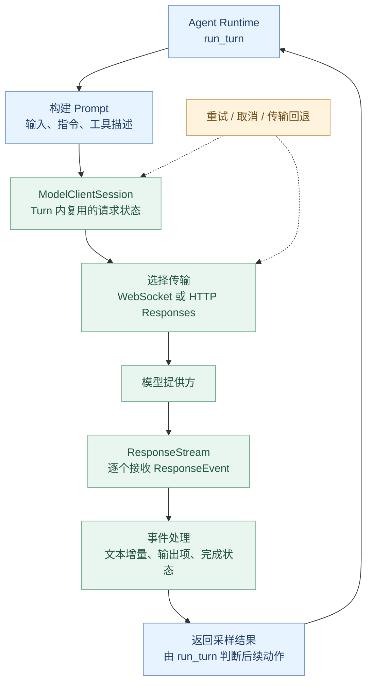
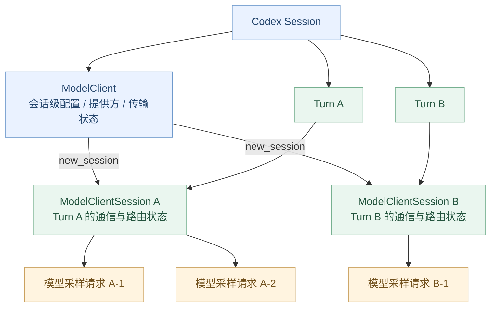

# 第 05 章：ModelClient——模型请求与流式响应

> **本章只解决一个问题：** Codex 已经决定向模型请求下一步，那么它怎样组织请求、选择传输方式、持续接收响应，并在连接异常时恢复？
>
> [上一章：Agent Loop](../04-agent-loop/README.zh.md) · [教程首页](../README.zh.md) · [本章可运行示例](./demo.py)

前四章，我们从用户入口走到了 `run_turn`：它会准备模型输入，发起采样请求，再根据模型输出决定是否执行工具或结束任务。

但`“请求模型”`至今还是一个黑箱。第 05 章把这个黑箱拆开，看看 Codex 如何把一项 Agent 任务转换成真正的模型通信。

**学完本章，你应该能：**

1. 区分 `ModelClient` 和 `ModelClientSession`，理解为什么一个是**会话级**、另一个是**Turn 级**。
2. 认识一次模型请求需要的 `Prompt`、模型设置和流式事件。
3. 理解 `Created`、`OutputTextDelta`、`OutputItemDone`、`Completed` 之间的区别。
4. 解释 WebSocket / HTTP 传输回退、重试和取消为什么属于模型通信层的重要能力。
5. 使用无需 API Key 的模拟模型流，验证同一 Turn 连续请求、事件收集和跨 Turn 状态隔离。

**阅读基线：** [openai/codex @ `014489466a17`](https://github.com/openai/codex/tree/014489466a1739c2c563cdfe57880c2c7c8680e3)。本章讲的是这一固定源码版本，并不推断所有运行配置都使用相同的传输路径。

---

## 1. 从一个真实问题进入模型通信层

继续沿用前面的任务：

> 检查登录模块，先不要修改代码。

假设 Codex 已经整理好了上下文，准备向模型询问下一步。这并不是把一句话直接发给模型那么简单。

一次请求还可能需要携带：

- 对话与工具观察形成的输入项；
- 系统级与开发级指令；
- 这次模型能看见哪些工具，以及是否允许并行工具调用；
- 选择的模型、推理设置和输出格式；
- 与此次请求对应的追踪、路由和身份信息。

收到模型响应后，Codex 还必须处理**逐步到达的事件**：有的表示文本正在生成，有的表示工具请求已经完整，有的表示整个模型响应流结束。

这就是为什么需要一个独立的 **Model Client**：让 Agent Runtime 关注“下一步做什么”，而让模型通信层关注“怎样可靠地完成这次模型请求”。

## 2. 先看全貌：一次采样请求如何流动



**这张图展示的是职责和数据流，而不是每个方框对应一个进程。**

把它和第 04 章连接起来：

- `run_turn`：决定当前 Turn 是否需要新的模型采样；
- `run_sampling_request`：准备这一次采样并管理适用的重试；
- `ModelClientSession::stream`：走适用的模型传输路径，返回事件流；
- `try_run_sampling_request`：消费事件流、处理输出项和工具调用，再将采样结果交还上层。

参考：[`run_sampling_request`](https://github.com/openai/codex/blob/014489466a1739c2c563cdfe57880c2c7c8680e3/codex-rs/core/src/session/turn.rs#L1714-L1772)、[`try_run_sampling_request`](https://github.com/openai/codex/blob/014489466a1739c2c563cdfe57880c2c7c8680e3/codex-rs/core/src/session/turn.rs#L2628-L2740)。

## 3. 核心设计：ModelClient 为什么还要创建 ModelClientSession？

这是本章最值得理解的架构设计。

在 [`core/src/client.rs`](https://github.com/openai/codex/blob/014489466a1739c2c563cdfe57880c2c7c8680e3/codex-rs/core/src/client.rs#L255-L310) 中，真实源码定义了两个不同生命周期的对象。

### 3.1 ModelClient：会话级的通信基础设施

源码给 `ModelClient` 的注释是：

> A session-scoped client for model-provider API calls.

也就是说，**`ModelClient` 面向 Codex Session 生命周期**，持有在多个 Turn 之间可能需要共享的模型提供方、身份认证、Thread 身份和传输回退状态。

这不代表所有 Turn 都使用同一份可变请求参数。模型选择、推理设置等 Turn 特定信息会在请求时显式传入。

### 3.2 ModelClientSession：一次 Turn 自己的流式通信会话

源码紧接着定义 `ModelClientSession`，并明确说明它是**Turn-scoped streaming session**，即一轮 Turn 对应的流式会话。

`ModelClient::new_session()` 创建它，见 [`client.rs`](https://github.com/openai/codex/blob/014489466a1739c2c563cdfe57880c2c7c8680e3/codex-rs/core/src/client.rs#L671-L689)。

`ModelClientSession` 能在**同一个 Turn 的多次模型请求之间**复用适用的 WebSocket 状态，以及上一请求的增量传输信息与路由状态。

那么为什么不直接跨 Turn 复用它？

因为源码明确提到 `x-codex-turn-state` 路由令牌：它用于**同一 Turn 内后续请求**的路由连续性。把上一 Turn 的令牌错误带入新 Turn，会违反客户端与服务端的契约，导致路由问题。

因此：



这张图表现的是**对象生命周期与使用关系**，不是精确指针所有权图。

**一个常见误区：** `ModelClientSession` 虽然名字里包含 Session，但它**不是第 03 章的 `core::Session`**。前者是模型通信层的 Turn 级对象；后者是 Agent 的会话运行时。

## 4. 模型到底收到了什么？

阅读 [`core/src/client_common.rs` 中的 `Prompt`](https://github.com/openai/codex/blob/014489466a1739c2c563cdfe57880c2c7c8680e3/codex-rs/core/src/client_common.rs#L22-L42)，可以看到：

```rust
pub struct Prompt {
    pub input: Vec<ResponseItem>,
    pub(crate) tools: Arc<[ToolSpec]>,
    pub(crate) parallel_tool_calls: bool,
    pub base_instructions: BaseInstructions,
    pub output_schema: Option<Value>,
    // ...
}
```

这段是从源码中保留关键字段的**节选**。

注意：`Prompt` 不只是一个字符串，而是**本次模型请求所需的结构化输入**。

| 字段 | 它在解决什么问题？ |
| --- | --- |
| `input` | 对话、工具结果等模型输入项是什么？ |
| `tools` | 这次可向模型声明哪些工具？ |
| `parallel_tool_calls` | 是否向模型允许并行工具调用？ |
| `base_instructions` | 模型这次应遵循哪些基础指令？ |
| `output_schema` | 是否需要按指定结构生成输出？ |

另外，选用的模型、推理强度、服务层级等并不都塞在 `Prompt` 里。阅读 [`ModelClientSession::stream` 的签名](https://github.com/openai/codex/blob/014489466a1739c2c563cdfe57880c2c7c8680e3/codex-rs/core/src/client.rs#L2359-L2381)，可以看到其中还显式传入 `model_info`、`effort`、`summary` 等参数。

这也解释了 **Prompt / Context 与 ModelClient 的分工**：

- `Context` 负责“组织什么信息给模型”；
- `ModelClient` 负责“按什么通信契约把这些信息送过去并接收响应”。

**Prompt 的具体构建规则**留到第 06 章；本章只研究它怎样成为一个模型请求。

## 5. 为什么模型响应要用 Stream，而不是等整个字符串？

因为模型可能还在生成内容，客户端却已经需要展示进度；同时模型输出可能包含**不同类型的内容项**，而不只是普通文字。

当前 `codex-api` 中定义了 [`ResponseEvent`](https://github.com/openai/codex/blob/014489466a1739c2c563cdfe57880c2c7c8680e3/codex-rs/codex-api/src/common.rs#L74-L126)，其中一些重要类型如下：

| 事件 | 初学者可以怎样理解？ |
| --- | --- |
| `Created` | 模型响应已建立，可能提供响应 ID |
| `OutputTextDelta` | 文字正在增量生成 |
| `OutputItemAdded` | 一个新的输出项出现 |
| `OutputItemDone` | 某个输出项完整了，可能是消息，也可能是工具调用 |
| `ToolCallInputDelta` | 工具调用的输入参数正在增量到达 |
| `Completed` | **这一次模型响应流**结束，并携带适用的用量与结束信息 |

还有推理摘要、速率限制等其他事件。**这不是完整事件枚举。**

我们可以用一个简化的流式时间线理解：

```text
ResponseEvent::Created
    ↓
ResponseEvent::OutputItemAdded
    ↓
ResponseEvent::OutputTextDelta("分析")
    ↓
ResponseEvent::OutputTextDelta("完成")
    ↓
ResponseEvent::OutputItemDone(assistant message)
    ↓
ResponseEvent::Completed
```

注意这几个区别：

- **Delta** 是增量，不代表完整消息；界面可能逐步呈现它。
- **OutputItemDone** 是一个输出项结束，不代表整次模型响应结束；还可能有其他输出项。
- **Completed** 是**一次模型响应完成**，不是整个 Agent Turn 一定完成。

如果模型输出的是工具调用，`OutputItemDone` 可以成为工具路由的输入，工具结果之后可能驱动下一次采样。第 04 章已经验证了这一点。

### 真实源码如何处理事件？

在 [`try_run_sampling_request` 中的 `stream.next()`](https://github.com/openai/codex/blob/014489466a1739c2c563cdfe57880c2c7c8680e3/codex-rs/core/src/session/turn.rs#L2774-L2796)，Codex 从流中逐个取得事件并进入 `match event`。

你还可以在 [`Created / OutputItemDone` 分支](https://github.com/openai/codex/blob/014489466a1739c2c563cdfe57880c2c7c8680e3/codex-rs/core/src/session/turn.rs#L2854-L2875) 和 [`Completed` 分支](https://github.com/openai/codex/blob/014489466a1739c2c563cdfe57880c2c7c8680e3/codex-rs/core/src/session/turn.rs#L3132-L3182) 找到不同的处理行为。

其中 `Completed` 会记录响应相关信息和 token 用量；如果服务端明确返回 `end_turn: Some(false)`，还可能要求后续采样。

**这再次证明：模型响应生命周期与 Agent Turn 生命周期是不同概念。**

## 6. 一次请求会走 WebSocket，还是 HTTP？

阅读 [`ModelClientSession::stream()`](https://github.com/openai/codex/blob/014489466a1739c2c563cdfe57880c2c7c8680e3/codex-rs/core/src/client.rs#L2359-L2430) 会发现：

- 当提供方与当前配置支持并允许时，可以尝试 **Responses WebSocket**；
- WebSocket 路径不适合继续使用或需要回退时，会使用 **HTTP Responses API**；
- 并非每个提供方都默认启用 WebSocket；
- 具体网络路径取决于提供方能力、连接健康状态和会话设置。

因此，本章不应该画成“所有 Codex 请求一律经由 WebSocket”。

### 为什么要优先复用连接与 Turn 状态？

在同一 Turn 中，模型可能被请求多次：

```text
第一次：读取文件前要怎样行动？
第二次：工具返回后下一步是什么？
第三次：是否可以结束？
```

持续建立连接、维护与这轮 Turn 对应的路由状态，能避免把每次采样当成完全独立且无法复用的信息交换。

但**复用范围必须清晰**：Turn 级状态不能无条件泄漏到后续 Turn；认证身份或其他关键条件变化时，旧的相关连接状态也需要重新处理。

这也是把 `ModelClient` 和 `ModelClientSession` 分开设计的工程价值。

## 7. 网络失败：重试、回退和取消的边界

模型服务和网络都可能失败。一个可靠的 Agent 需要回答：

> 这次模型请求失败后，是应该重试、换传输路径，还是把失败返回给 Runtime？

在 [`core/src/responses_retry.rs`](https://github.com/openai/codex/blob/014489466a1739c2c563cdfe57880c2c7c8680e3/codex-rs/core/src/responses_retry.rs#L55-L180) 中，`handle_response_stream_error` 负责部分重试和传输回退决策，包括：

- 识别适合重试的错误，不是所有异常都直接重试；
- 根据配置的次数限制与服务端的 `Retry-After` 建议选择重试时间；
- 在符合条件时从 WebSocket 回退到 HTTP；
- 对部分连接失败提供特殊的重试策略；
- 重试耗尽或遇到终止性错误时，将错误交给上层。

在 [`run_sampling_request`](https://github.com/openai/codex/blob/014489466a1739c2c563cdfe57880c2c7c8680e3/codex-rs/core/src/session/turn.rs#L1740-L1839) 中，可以看到调用这一重试决策的路径。

### 这里有两种不同的“继续”

| 情况 | 下一步是什么？ |
| --- | --- |
| **同一次采样发生可恢复的通信失败** | 在重试策略允许时重做模型请求 |
| **模型响应成功，但请求了工具** | 工具执行后，由 Agent Loop 决定开始下一次采样 |

**网络重试 ≠ Agent Loop 的下一步决策。**

同样也不能无条件重放一个已经产生用户可见输出的流。如何恢复要依据具体协议、已记录状态和重试策略，不能仅凭一条 `except` 就把输出再打印一遍。

### 为什么需要取消机制？

[`ResponseStream`](https://github.com/openai/codex/blob/014489466a1739c2c563cdfe57880c2c7c8680e3/codex-rs/core/src/client_common.rs#L111-L137) 包含事件接收端、可选中断通道和消费者停止读取时的取消标识。

在采样循环的 [`stream.next()`](https://github.com/openai/codex/blob/014489466a1739c2c563cdfe57880c2c7c8680e3/codex-rs/core/src/session/turn.rs#L2790-L2805) 附近，还可以看到用户输入抢占与任务取消对事件接收的影响。

这说明 Codex 不只是“连上模型然后一直等”。当用户中断任务或传输失去意义时，模型通信也需要响应生命周期变化。

---

## 8. 动手实验：模拟一次真正的流式请求

代码见：[`demo.py`](./demo.py)。

**环境**：Python 3.10+，仅标准库；无 API Key、不联网、不读写项目文件。

这次不需要重新实现 Agent Loop，而是**专注模型通信这一层**。示例有四个类：

| 类 | 模拟职责 |
| --- | --- |
| `ModelClient` | 保存提供方信息，创建 Turn 级会话 |
| `ModelClientSession` | 同一 Turn 中多次发起请求，维护模拟路由令牌 |
| `FakeProvider` | 按预置顺序产出模型事件，或模拟通信失败 |
| `Event` | 用教学事件模拟响应创建、文本增量、输出项结束与响应完成 |

运行：

```bash
python demo.py
```

预期关键输出：

```text
request=inspect attempt=1 route=-
  retryable before output: connection closed before first event
request=inspect attempt=2 route=-
  created: resp-1
  output_item_done: tool:inspect_login
  completed: end_turn=false
request=answer attempt=1 route=route:turn-1
  created: resp-2
  output_text_delta: 模拟分析
  output_text_delta: 已完成
  output_item_done: assistant_message
  completed: end_turn=true
next turn has fresh routing state
All teaching assertions passed
```

### 实验 A：流式事件如何组成一次响应？

第一次请求的完整输出项是**工具调用**。程序只把它交给上层，没有真正执行工具。

我们在 Demo 中用预置字符串模拟“上层 Runtime 执行了工具”，再把这段观察信息放到第二次请求的 `Prompt` 中。

第二次请求发出两条 `output_text_delta`，将它们拼起来得到：

```text
模拟分析已完成
```

你应当能够区分：**增量文本、完整输出项与响应完成事件**。

### 实验 B：为何一个 Turn 中可以共享通信状态？

第一次成功请求从模拟服务端事件中收到 `route:turn-1`。第二次请求在**同一 ModelClientSession** 内复用了这份模拟状态。

当调用 `client.new_session("turn-2")` 创建新 Turn 的客户端会话时，路由状态重新从空开始。

这个实验帮助理解 **Turn 级状态隔离**，不是在实现 `x-codex-turn-state` 的真实 HTTP Header 处理过程。

### 实验 C：为什么重试时要谨慎？

模拟服务端在第一次请求、**尚未发出任何事件之前**发生了一次暂时性连接失败。演示客户端随后重试成功。

这里的演示策略刻意非常保守：仅在没有任何事件交付时重试，且最多一次。**这是教学决策，不等同于 Codex 的实际重试上限与恢复机制。**

实际 Codex 还需要处理服务端重试建议、WebSocket 健康状况、身份变更、流式取消、历史一致性等复杂问题。

## 9. 读源码：本章只要验证这些地方

| 顺序 | 源码入口 | 验证的结论 |
| --- | --- | --- |
| 1 | [`ModelClient / ModelClientSession`](https://github.com/openai/codex/blob/014489466a1739c2c563cdfe57880c2c7c8680e3/codex-rs/core/src/client.rs#L255-L311) | 会话级与 Turn 级模型客户端分开 |
| 2 | [`ModelClient::new_session`](https://github.com/openai/codex/blob/014489466a1739c2c563cdfe57880c2c7c8680e3/codex-rs/core/src/client.rs#L671-L689) | Turn 级会话怎样创建 |
| 3 | [`Prompt`](https://github.com/openai/codex/blob/014489466a1739c2c563cdfe57880c2c7c8680e3/codex-rs/core/src/client_common.rs#L22-L42) | 模型输入不只是字符串 |
| 4 | [`ModelClientSession::stream`](https://github.com/openai/codex/blob/014489466a1739c2c563cdfe57880c2c7c8680e3/codex-rs/core/src/client.rs#L2359-L2430) | 传输分支与请求参数在哪里 |
| 5 | [`ResponseEvent`](https://github.com/openai/codex/blob/014489466a1739c2c563cdfe57880c2c7c8680e3/codex-rs/codex-api/src/common.rs#L74-L126) | 流事件种类在哪里定义 |
| 6 | [`stream.next()`](https://github.com/openai/codex/blob/014489466a1739c2c563cdfe57880c2c7c8680e3/codex-rs/core/src/session/turn.rs#L2774-L2796) | Runtime 如何持续读取事件 |
| 7 | [`Responses 重试决策`](https://github.com/openai/codex/blob/014489466a1739c2c563cdfe57880c2c7c8680e3/codex-rs/core/src/responses_retry.rs#L55-L180) | 重试 / 回退在什么边界发生 |

**不要求本章看懂所有网络代码。** 只要能顺着这条路径说出“谁准备请求、谁执行传输、谁读取事件、谁决定后续行动”，就达到了阅读目标。

## 10. 五个自测问题

1. 为什么 `ModelClient` 与 `ModelClientSession` 不能简单合并成一个长期复用的对象？
2. `ResponseEvent::OutputTextDelta` 和 `ResponseEvent::OutputItemDone` 有什么区别？
3. 模型的 `ResponseEvent::Completed` 是否一定代表整个 Turn 结束？
4. 一次网络请求失败后的重试，与模型要求执行工具后的下一次采样，有什么不同？
5. `ModelClientSession` 是否亲自执行 `read_file` 一类工具？

**参考答案：**

1. 它们的状态生命周期不同；尤其是 Turn 级路由与连接上下文不能被任意跨 Turn 复用。
2. 前者是部分文本增量，后者是某个完整输出项。
3. 不一定。它只说明本次响应完成，Turn 是否继续由上层 Runtime 结合其他状态决定。
4. 前者是传输 / 请求恢复，后者是 Agent 根据已完成采样和工具观察推进任务。
5. 不负责。它负责模型请求和响应；工具执行由 Agent Runtime 关联的工具系统负责。

## 本章小结

```text
Session
  └─ ModelClient                      会话级通信配置与提供方状态
       └─ ModelClientSession           一次 Turn 的请求会话
            ├─ Prompt                  结构化输入与工具说明
            ├─ stream()                选用合适的传输方式
            └─ ResponseStream          持续返回 ResponseEvent
                  │
                  └─ run_turn / 工具系统消费事件并继续任务
```

本章最重要的结论是：

**ModelClient 不负责决定 Agent 要做什么，而负责让“与模型的一次或多次通信”在正确的生命周期、传输和事件语义下可靠进行。**

下一章：[第 06 章《Context：Prompt 到底怎样构建？》](../06-context-prompt/README.zh.md)。

下一步，我们将回到本章的 `Prompt`，进一步追问：**系统指令、项目文件、历史记录和工具结果是怎样被组织成模型真正看见的上下文？**

