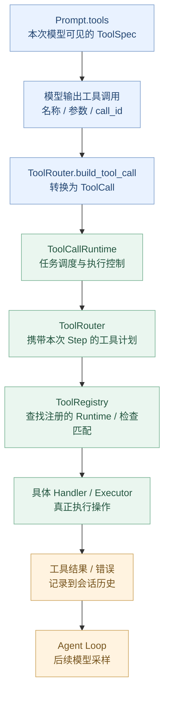
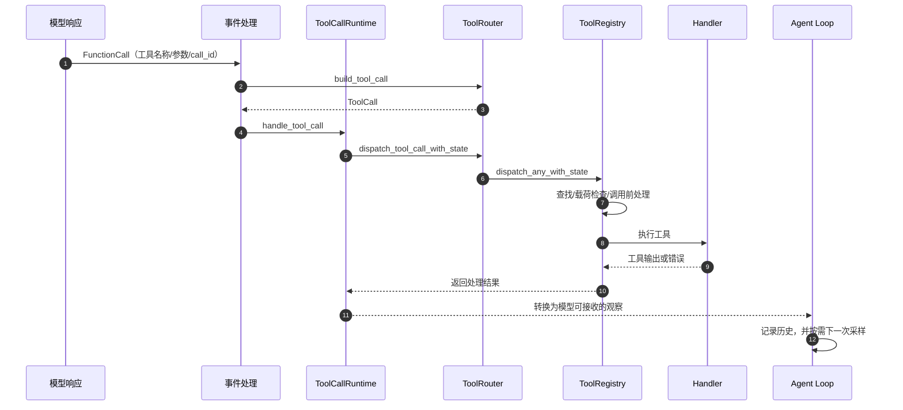

# 第 07 章：Tool System——从工具声明到真实执行

> **核心问题：** 模型返回 `read_file({"path":"src/login.py"})`，Codex 如何知道这个工具是否存在、是否向模型开放、由谁执行，并把结果送回模型？
>
> [上一章：Context 与 Prompt](../06-context-prompt/README.zh.md) · [教程首页](../README.zh.md) · [本章 Demo](./demo.py)

第 06 章解释了 `Prompt.tools`：模型能看到一批工具规格。**但“告诉模型工具存在”与“真正执行工具”是两回事。**

本章沿着 Codex 固定版本的真实源码，拆开四个职责：**Spec、Registry、Router、Handler**。最后用一个完全不访问磁盘的 Python 示例串起来。

读完以后，你应该能解释：

1. 为什么工具不仅需要一个 Python/Rust 函数，还需要**模型可见的声明**。
2. `ToolRegistry` 注册的工具为什么不一定全部对模型可见。
3. 如何从 `ResponseItem::FunctionCall` 走到实际执行的工具 Runtime。
4. 未知工具、错误参数和执行失败，为什么应该有不同的处理边界。
5. 为什么工具执行必须使用**与发起请求时相对应的 StepContext**。

**固定源码：** [openai/codex @ `014489466a17`](https://github.com/openai/codex/tree/014489466a1739c2c563cdfe57880c2c7c8680e3)。本文使用的 `read_file` 是教学工具名；不能据此推断 Codex 的真实本地文件工具就叫这个名字。

---

## 1. 模型提出工具请求，为什么不等于已经执行？

假设模型返回：

```json
{
  "name": "read_file",
  "arguments": {"path": "src/login.py"}
}
```

模型只是生成了**请求执行某项操作的结构化内容**，它没有在用户计算机上直接执行代码。

要从这段内容变为真实操作，Runtime 至少需要回答：

- **工具认识吗？** 名称能否与某个已注册工具匹配？
- **参数有效吗？** 需要的字段是否存在，类型是否正确？
- **这次能用吗？** 当前模式、权限和策略是否允许？
- **谁执行？** 应交给本地工具、MCP、动态工具，还是其他执行方？
- **结果怎么办？** 如何记录输出，让下一轮模型采样看到？

这就是工具系统存在的理由：**把模型的意图转换为受控的程序执行**。

## 2. 四层架构：Spec / Registry / Router / Handler



先用最短的一句话区分四者：

| 概念 | 回答的问题 | 源码中如何对应 |
| --- | --- | --- |
| **Spec** | 模型能看到什么接口？ | `codex_tools::ToolSpec` |
| **Registry** | 这个工具对应哪个运行对象？ | `ToolRegistry`、`RegisteredTool` |
| **Router** | 本次采样的工具调用该如何分发？ | `ToolRouter` |
| **Handler / Executor** | 如何完成实际操作？ | `CoreToolRuntime` / `ToolExecutor<ToolInvocation>` 和具体实现 |

注意：**“Handler”是我们用于教学的职责名称，而不是说当前 Codex 恰好存在一个统一叫 `ToolHandler` 的 Rust Trait。** 真实通用执行接口是 `ToolExecutor`，Codex Core 则在此基础上定义了 `CoreToolRuntime`。

## 3. ToolSpec：模型看到的不是 Rust 函数

在第 06 章的 [`build_prompt()`](https://github.com/openai/codex/blob/014489466a1739c2c563cdfe57880c2c7c8680e3/codex-rs/core/src/session/turn.rs#L1673-L1703) 中，常见路径会从 `step_context.tool_router.model_visible_specs()` 取得工具声明，放进 `Prompt.tools`。

对于初学者，ToolSpec 的作用可以理解为：

```text
工具名称：read_file
用途描述：读取示例文件
参数定义：需要 path，类型为字符串
```

**这是说明书，不是执行器。** 它让模型知道如何构造一个请求，而不是让模型直接持有文件系统权限。

真实 `ToolSpec` 定义来自 `codex_tools` 依赖；当前 [`ToolRegistry`](https://github.com/openai/codex/blob/014489466a1739c2c563cdfe57880c2c7c8680e3/codex-rs/core/src/tools/registry.rs#L305-L322) 可以从运行时对象或当前采样的覆盖规格获取模型可见声明。

这样拆分是为了允许不同的表示与执行实现：

- 同一个实际执行器可以提供相应的结构化工具描述。
- 工具说明可根据当前 Step 的模式进行调整。
- 模型不必理解执行器使用了什么语言、运行在哪个进程。

## 4. Registry：为什么不能只维护 `dict[name] = function`？

在 [`tools/registry.rs`](https://github.com/openai/codex/blob/014489466a1739c2c563cdfe57880c2c7c8680e3/codex-rs/core/src/tools/registry.rs#L305-L335) 可以看到：

```rust
pub(crate) struct RegisteredTool {
    pub(crate) runtime: Arc<dyn CoreToolRuntime>,
    pub(crate) exposure: ToolExposure,
    pub(crate) model_spec: Option<Arc<ToolSpec>>,
}

pub struct ToolRegistry {
    tools: IndexMap<ToolName, RegisteredTool>,
    // ...
}
```

这说明注册表至少管理三个维度：

**执行实现**（`runtime`）、**暴露策略**（`exposure`），以及可能覆盖的**工具描述**（`model_spec`）。

为什么要有 `exposure`？因为实际工具体系可能包含：

- 直接呈现给模型的工具；
- 暂时不直接展示、通过搜索发现的工具；
- Code Mode 内可用的工具；
- 隐藏的内部工具。

所以**注册了，不意味着这个 ToolSpec 每次都出现在模型请求中**。

在 [`spec_plan.rs 的 `build_model_visible_specs()`](https://github.com/openai/codex/blob/014489466a1739c2c563cdfe57880c2c7c8680e3/codex-rs/core/src/tools/spec_plan.rs#L625-L654)，构建对模型可见的工具声明时，会结合工具的暴露信息以及当前模式进行筛选。

还有另一个重要事实：**工具能被模型看到，不代表任意参数都能执行成功**。实际执行仍需通过工具策略、执行路径和安全机制。第 09 章会专门讲审批与 Sandbox。

### 注册表还要防止什么？

从 [`register_trusted_with_exposure()`](https://github.com/openai/codex/blob/014489466a1739c2c563cdfe57880c2c7c8680e3/codex-rs/core/src/tools/registry.rs#L422-L442) 可以看到：

- 注册前会检查当前的工具策略；
- 同名工具冲突会被识别，而不是悄悄覆盖；
- 注册时同时保留执行器和暴露属性。

在生产级 Agent 中，**工具冲突和可用范围是架构问题，不只是 `if name in tools` 的字符串判断**。

## 5. ToolRouter：谁负责把模型输出变成可调用对象？

先去 [`tools/router.rs`](https://github.com/openai/codex/blob/014489466a1739c2c563cdfe57880c2c7c8680e3/codex-rs/core/src/tools/router.rs#L85-L93) 看 `ToolRouter`：

```rust
pub struct ToolRouter {
    registry: ToolRegistry,
    model_visible_specs: Arc<[ToolSpec]>,
    tool_mode: ToolMode,
    // ...
}
```

这体现的是：**一次已确定的工具计划同时包含模型可见声明与匹配的本地执行能力**。

再看 [`build_tool_call()`](https://github.com/openai/codex/blob/014489466a1739c2c563cdfe57880c2c7c8680e3/codex-rs/core/src/tools/router.rs#L257-L307)。它会把某些模型响应项转换为 `ToolCall`，例如：

- `ResponseItem::FunctionCall`；
- `ResponseItem::CustomToolCall`；
- 适用条件下的客户端 `ToolSearchCall`。

`ToolCall` 中重要的内容包括：

```rust
pub struct ToolCall {
    pub tool_name: ToolName,
    pub call_id: String,
    pub payload: ToolPayload,
    // ...
}
```

见 [`router.rs`](https://github.com/openai/codex/blob/014489466a1739c2c563cdfe57880c2c7c8680e3/codex-rs/core/src/tools/router.rs#L48-L55)。

这里 `call_id` 很重要：**结果必须能够对应回原来的请求**。它不是用来决定权限的，也不意味着模型能通过自行指定 ID 获得执行权。

而且并非任何 `ResponseItem` 都是本地工具请求。普通文本、推理项或服务端托管工具等，可能走不同分支。

## 6. ToolCallRuntime：为何不让 Router 直接同步执行？

在 [`tools/parallel.rs`](https://github.com/openai/codex/blob/014489466a1739c2c563cdfe57880c2c7c8680e3/codex-rs/core/src/tools/parallel.rs#L46-L84) 中，可以看到 `ToolCallRuntime` 持有：

```rust
session: Arc<Session>,
step_context: Arc<StepContext>,
tracker: SharedTurnDiffTracker,
parallel_execution: Arc<RwLock<()>>,
```

最值得关注的是 `step_context`：

> Tool calls may run later, so retain the step whose tool list advertised them.

即：**工具可能稍后才执行，必须保留当时向模型声明这批工具的 StepContext。**

第 03 章已经解释过 Step 快照：它防止模型在请求 A 看到的工具计划，被随后的请求 B 的变化悄悄替换。

`ToolCallRuntime::handle_tool_call()` 会将调用交由 Router 分发，并处理适用的跟踪、取消、结果包装与错误路径。

### 并行究竟如何控制？

真实源码并不是“模型一下子请求多个工具，就不分条件全部并行执行”。

在 [`parallel.rs 的执行门禁](https://github.com/openai/codex/blob/014489466a1739c2c563cdfe57880c2c7c8680e3/codex-rs/core/src/tools/parallel.rs#L190-L234)，可看到部分工具使用共享的读锁并发，其他工具使用独占写锁，从而协调执行顺序。

这也是为什么系统需要执行调度层：**模型输出多个操作不等于这些操作可以安全地同时进行。**

## 7. Registry 怎样真正找到 Handler？

到目前为止，模型请求已经变成了 `ToolCall`。真正执行发生在 Router 将 `ToolInvocation` 交给 Registry 后。

你可以在 [`router.rs` 的分发路径](https://github.com/openai/codex/blob/014489466a1739c2c563cdfe57880c2c7c8680e3/codex-rs/core/src/tools/router.rs#L359-L394) 找到：

```rust
self.registry
    .dispatch_any_with_state(invocation, call_state)
    .await
```

进入 [`registry.rs → dispatch_any_with_state()`](https://github.com/openai/codex/blob/014489466a1739c2c563cdfe57880c2c7c8680e3/codex-rs/core/src/tools/registry.rs#L615-L702)，会看到它处理：

- 在注册表里查找工具；
- 找不到时构造适当的失败反馈；
- 检查模型给出的载荷种类是否匹配；
- 执行适用的工具调用 Hooks 与生命周期处理；
- 再调用真正的执行器。

最后的执行路径可以在 [`registry.rs`](https://github.com/openai/codex/blob/014489466a1739c2c563cdfe57880c2c7c8680e3/codex-rs/core/src/tools/registry.rs#L770-L795) 找到 `handle_any_tool(...)`。

而一个具体 Handler 的例子是 [`ApplyPatchHandler`](https://github.com/openai/codex/blob/014489466a1739c2c563cdfe57880c2c7c8680e3/codex-rs/core/src/tools/handlers/apply_patch.rs#L284-L332)：

```rust
impl ToolExecutor<ToolInvocation> for ApplyPatchHandler {
    fn tool_name(&self) -> ToolName { /* ... */ }
    fn spec(&self) -> ToolSpec { /* ... */ }
    fn handle<'a>(&'a self, invocation: ToolInvocation)
        -> codex_tools::ToolExecutorFuture<'a> { /* ... */ }
}
```

这段是**按真实方法签名缩写的教学摘录**，不是完整源文件。

`ApplyPatchHandler` 会先解析补丁载荷，之后才进入更具体的执行逻辑。其名称、参数格式和执行语义与本章的假工具 `read_file` 不同。

**所以真实执行链是：模型的 ToolCall → 带上下文的 Invocation → 注册表匹配 → Handler 处理 → 工具结果。**

---

## 8. 把一次工具调用追踪到底



在 [`stream_events_utils.rs → handle_output_item_done()`](https://github.com/openai/codex/blob/014489466a1739c2c563cdfe57880c2c7c8680e3/codex-rs/core/src/stream_events_utils.rs#L316-L375)，可以找到模型工具请求进入调度的起点。该函数在识别工具调用后，会安排执行并标记需要后续模型采样。

这张图省略了并行、流式执行、Hooks、取消、工具搜索、Server-hosted Tool 与具体环境调度。**它是典型本地工具调用的简化路径，不是所有工具类别都完全相同。**

## 9. 工具失败：都应该中断整个 Agent 吗？

假设模型请求了一个不存在的工具，或者输入参数不兼容。Runtime 需要区分：

| 情况 | 可能的处理 | 意义 |
| --- | --- | --- |
| 工具不存在 | 将“不支持此工具”作为可反馈错误 | 模型可能修正调用 |
| 参数解析失败 | 返回参数格式错误或拒绝 | 不应带着无效参数继续执行 |
| 工具本身执行失败 | 生成可用的失败观察，或触发特定错误 | 不等于模型采样失败 |
| 致命的 Runtime 错误 | 向上传播并结束相关执行 | 不应无限重试 |

在 [`registry.rs` 的未知工具处理](https://github.com/openai/codex/blob/014489466a1739c2c563cdfe57880c2c7c8680e3/codex-rs/core/src/tools/registry.rs#L648-L681)，可以看到 `FunctionCallError::RespondToModel`。而载荷类型不匹配等情况，也可能触发 `Fatal`。

在 [`parallel.rs`](https://github.com/openai/codex/blob/014489466a1739c2c563cdfe57880c2c7c8680e3/codex-rs/core/src/tools/parallel.rs#L89-L119)，常规工具错误和致命错误会走不同的结果处理路径。

**重点：模型“成功输出了工具调用”不等于工具执行成功。** Agent Loop 必须能接受工具反馈，并决定下一步。

还有一层安全界限不能省略：**ToolSpec 是能力描述，不是权限凭证**。工具声明、注册、曝光与审批 / Sandbox 是不同机制；即使工具被正确识别，也仍需要遵守执行约束。

## 10. 动手：写一个最小 Tool System

本章提供可运行的 [`demo.py`](./demo.py)。

```bash
python demo.py
```

适用 Python 3.10+，无需外部库。示例中的文件与测试结果都是**内存中预置的字符串**，不会读取真实仓库、执行 Shell 或修改磁盘。

四层对应关系：

| 教学实现 | 负责的内容 |
| --- | --- |
| `ToolSpec` | 名称、用途描述和必填参数名 |
| `ToolRegistry` | 注册工具，决定本次演示的模型可见集合 |
| `ToolRouter` | 按名称匹配、解析 JSON 参数并调用 Handler |
| `ReadFileHandler / RunTestsHandler` | 返回预置的模拟观察结果 |

### 实验 A：注册的工具并不一定全部向模型开放

程序注册三个工具，其中 `internal_note` 只用于模拟内部工具，但只向模型声明：

```text
advertised: ['read_file', 'run_tests']
```

**为了便于观察，Demo 特意禁止模型直接调用未曝光的工具。** 这是一条教学简化规则，不能理解成 Codex 所有隐藏工具、Code Mode 工具、延迟发现工具都遵循相同的分发条件。

### 实验 B：正确请求如何返回结果？

模拟工具调用：

```json
{"call_id": "c1", "name": "read_file", "arguments": {"path":"src/login.py"}}
```

经 Registry 查找和 Router 参数检查后，由 Handler 从内存字典返回一个模拟文件内容。

另一条 `run_tests` 调用返回预置的测试失败信息。

### 实验 C：错误要能够定位到原始调用

然后尝试：

- `internal_note`：注册了，但这次未对模型开放；
- `missing_tool`：不存在的工具；
- `read_file` 参数 `path` 为数字：参数类型错误。

程序输出应当类似：

```text
advertised: ['read_file', 'run_tests']
c1: ok=True; def login(): return check_password()
c2: ok=True; login tests: 1 failure (simulated)
c3: ok=False; tool error: tool not available to this model request
c4: ok=False; tool error: tool not available to this model request
c5: ok=False; tool error: expected string argument: path
next model request can use the two successful tool observations
All teaching assertions passed
```

所有返回值保留 `call_id`，让下一层能够区分哪次调用成功、哪次失败。

**本 Demo 没有实现真实 Codex 的 JSON Schema 校验、MCP、Hooks、并发锁、权限审批、Sandbox、工具搜索或持久化。** 它只用于验证本章的基本分层。

## 11. 源码阅读路线

| 顺序 | 路径 | 应该验证的问题 |
| --- | --- | --- |
| 1 | [`spec_plan.rs → build_tool_router`](https://github.com/openai/codex/blob/014489466a1739c2c563cdfe57880c2c7c8680e3/codex-rs/core/src/tools/spec_plan.rs#L121-L185) | 工具来源如何汇入一次 Step 的计划 |
| 2 | [`spec_plan.rs → build_model_visible_specs`](https://github.com/openai/codex/blob/014489466a1739c2c563cdfe57880c2c7c8680e3/codex-rs/core/src/tools/spec_plan.rs#L625-L654) | 为什么可见工具只是注册工具的一部分 |
| 3 | [`registry.rs → RegisteredTool / ToolRegistry`](https://github.com/openai/codex/blob/014489466a1739c2c563cdfe57880c2c7c8680e3/codex-rs/core/src/tools/registry.rs#L305-L335) | 执行实现、曝光策略与声明怎样分开 |
| 4 | [`router.rs → ToolRouter`](https://github.com/openai/codex/blob/014489466a1739c2c563cdfe57880c2c7c8680e3/codex-rs/core/src/tools/router.rs#L85-L93) | Router 为什么持有本次工具计划 |
| 5 | [`router.rs → build_tool_call`](https://github.com/openai/codex/blob/014489466a1739c2c563cdfe57880c2c7c8680e3/codex-rs/core/src/tools/router.rs#L257-L307) | 模型输出怎样变成内部工具调用 |
| 6 | [`parallel.rs → handle_tool_call`](https://github.com/openai/codex/blob/014489466a1739c2c563cdfe57880c2c7c8680e3/codex-rs/core/src/tools/parallel.rs#L78-L115) | 执行控制与结果包装在哪里 |
| 7 | [`registry.rs → dispatch_any_with_state`](https://github.com/openai/codex/blob/014489466a1739c2c563cdfe57880c2c7c8680e3/codex-rs/core/src/tools/registry.rs#L615-L702) | 怎样查找 Runtime 和处理无效调用 |
| 8 | [`apply_patch.rs → ToolExecutor`](https://github.com/openai/codex/blob/014489466a1739c2c563cdfe57880c2c7c8680e3/codex-rs/core/src/tools/handlers/apply_patch.rs#L284-L332) | 真实 Handler 怎样实现接口 |

今天不用研究一个 Shell 进程怎样启动。那是第 08 章的任务。

## 12. 思考题

1. **为什么模型的 ToolSpec 和真正的执行器不能视为同一个对象？**  
   因为它们分别承担接口声明和执行，模型只需要调用契约，Runtime 还必须保留校验、执行及安全边界。

2. **Registry 中有 `internal_note`，为什么模型不一定看到它？**  
   模型可见工具要按暴露策略和当前工具模式筛选，注册本身不等于公开。

3. **模型传来 `call_id`，是否意味着这个调用已经获准执行？**  
   不是。它主要用于关联调用和结果，不代替注册、策略、校验和授权。

4. **为什么 ToolCallRuntime 要保留触发它的 StepContext？**  
   因为工具可能延迟执行，必须使用与模型当时看到的工具计划相对应的执行上下文。

5. **模型给出合法 JSON，工具就一定成功吗？**  
   不一定。参数语义、策略、运行环境以及工具自身错误仍可能导致失败。

---

## 本章小结

```text
构建 ToolSpec
    ↓
ToolRegistry（注册 Runtime 和暴露策略）
    ↓
ToolRouter（确定本次 Step 可用工具计划）
    ↓
模型返回 FunctionCall
    ↓
build_tool_call（转成内部 ToolCall）
    ↓
ToolCallRuntime（调度）
    ↓
Registry（查找 / 检查）
    ↓
Handler / Executor（实际操作）
    ↓
工具观察 → Agent Loop 下一次采样
```

**真正需要记住的一句话：工具系统把“模型声明要做什么”与“程序实际可以做什么”分开，并用统一的注册、路由、执行和反馈机制把两者连接起来。**

下一章：[第 08 章《一次 Shell Tool 的完整执行链》（课程大纲）](../codex00.md)。

我们将继续跟踪一个真实的命令执行请求：**从模型提出 Shell 操作，到审批、执行环境、进程输出和结果反馈，完整链路究竟怎样运行？**

