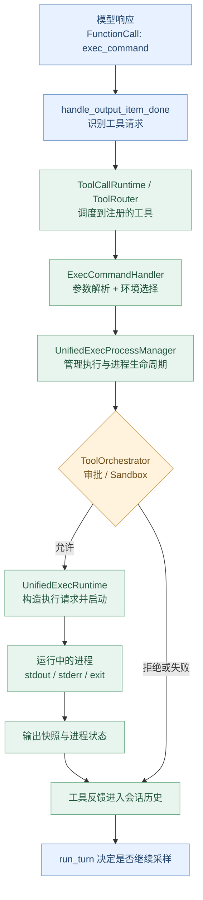
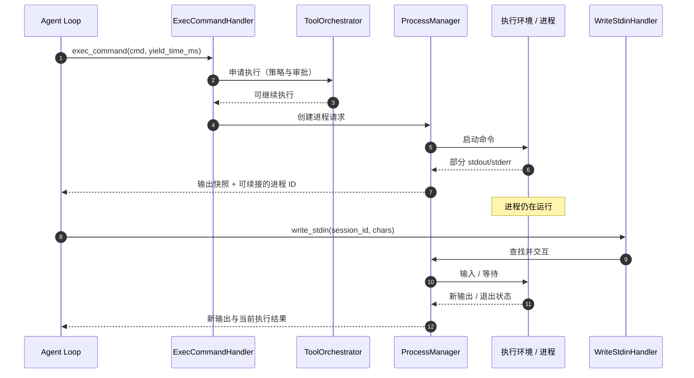

# 第 08 章：Shell Tool——一条命令从模型输出到进程结束的完整执行链

> **这一章回答：** 模型输出 `exec_command({"cmd":"pytest -q"})` 后，Codex 怎样决定能不能执行、在哪里执行、什么时候返回，以及怎样把执行结果交回模型？
>
> [上一章：Tool System](../07-tool-system/README.zh.md) · [教程首页](../README.zh.md) · [本章可运行 Demo](./demo.py)

第 07 章认识了 `ToolSpec → ToolRegistry → ToolRouter → Handler`。但真正处理 Shell 命令时，Handler 并不是简单调用一个 `subprocess.run()`：Codex 还要确认执行环境、权限、Sandbox、进程是否继续运行，以及输出如何收集。

这一章把执行过程拆成可以在源码里逐步验证的八个阶段。

学完后，你应该能够：

1. 从模型的 `FunctionCall` 追踪到 `ExecCommandHandler`；
2. 分清 `yield_time_ms`、`timeout_ms` 与进程 `session_id`；
3. 解释 **审批（Approval）与 Sandbox 是不同的安全机制**；
4. 理解 `exec_command` 为什么可能返回“进程仍在运行”，以及 `write_stdin` 在做什么；
5. 区分**工具调用已得到响应、进程已退出、命令成功、整个 Turn 完成**这四种状态；
6. 实际运行一个只允许固定安全程序的 Python 子进程 Demo，验证正常退出、非零退出、拒绝和超时路径。

**固定源码：** [openai/codex @ `014489466a17`](https://github.com/openai/codex/tree/014489466a1739c2c563cdfe57880c2c7c8680e3)。这是一份基于特定提交的源码导读；不同系统、配置、远程执行器及工具模式不一定走完全相同的执行分支。

---

## 1. 用户只提出任务，模型为什么需要 Shell？

继续使用之前的任务：

> 检查登录模块为什么测试失败。先分析，不修改代码。

模型可能需要了解项目结构、读取文件、运行一组测试。假设它决定执行：

```json
{
  "name": "exec_command",
  "arguments": {
    "cmd": "pytest -q",
    "yield_time_ms": 1000
  }
}
```

这段 JSON 只是**教学上接近 FunctionCall 的形状**，不是完整的 Responses 流式事件协议。

模型没有直接操作操作系统的能力。它提出工具请求后，Codex Runtime 需要执行一段与模型推理不同的、具有真实副作用风险的程序逻辑。

### 为什么不能直接运行任意模型输出？

因为 `cmd` 最终可能访问文件、启动网络连接、修改源码或调用外部程序。如果只要模型生成命令，程序就无条件执行，相当于绕过了用户授权和运行环境的边界。

这就是第 08 章的核心主题：

**模型负责提出行动；工具执行链负责判断、执行、观测和反馈。**

## 2. 一张总图：真实执行链有哪些层次？



这里**逻辑组件不等于独立的操作系统进程**。真实执行还可能通过远程 Executor 或 Exec Server；图里把几种实现路径压缩到了职责边界，不表示每个运行环境都直接在 Codex Core 进程里启动命令。

## 3. 第一步：Shell 工具首先是一份 ToolSpec

在当前源码 [`tools/handlers/shell_spec.rs`](https://github.com/openai/codex/blob/014489466a1739c2c563cdfe57880c2c7c8680e3/codex-rs/core/src/tools/handlers/shell_spec.rs#L22-L91)，`create_exec_command_tool_with_environment_id()` 构建给模型看的 `exec_command` 工具声明。

你会看到一些重要参数：

| 参数 | 它表达什么？ |
| --- | --- |
| `cmd` | 要在所选 Shell 中执行的命令文本 |
| `workdir` | 执行命令的工作目录 |
| `shell` / `login` | Shell 选择和启动形式 |
| `tty` | 是否使用交互式终端 / PTY |
| `yield_time_ms` | 首次工具调用等待多久再返回当前输出快照 |
| `timeout_ms` | 在支持的一次性执行模式下，命令最多等待多久 |
| `max_output_tokens` | 工具输出预算 |
| `environment_id` | 在支持多个执行环境的配置中选择环境 |
| `sandbox_permissions` 等 | 向执行层请求特定权限处理，不是模型自行获得授权 |

其中的工具声明会随配置、模式改变。**不要把所有字段都假定为每一种模式下必然存在、必然生效。**

特别注意：`yield_time_ms` **不是**命令的总执行超时。一个命令可能运行很久，但首次调用先返回一部分输出和可继续交互的进程标识。

## 4. 第二步：模型输出怎样找到真正的 ExecCommandHandler？

第 07 章的链路依然适用：

```text
ResponseItem::FunctionCall
       ↓
ToolRouter::build_tool_call
       ↓
ToolCallRuntime::handle_tool_call
       ↓
ToolRouter::dispatch_tool_call_with_state
       ↓
ToolRegistry::dispatch_any_with_state
       ↓
ExecCommandHandler::handle_call
```

重要源码入口：

- [`stream_events_utils.rs → handle_output_item_done()`](https://github.com/openai/codex/blob/014489466a1739c2c563cdfe57880c2c7c8680e3/codex-rs/core/src/stream_events_utils.rs#L316-L372)：识别模型完成的工具输出项；
- [`tools/router.rs → build_tool_call()`](https://github.com/openai/codex/blob/014489466a1739c2c563cdfe57880c2c7c8680e3/codex-rs/core/src/tools/router.rs#L257-L308)：转换为带 `call_id` 的内部调用；
- [`tools/parallel.rs → ToolCallRuntime`](https://github.com/openai/codex/blob/014489466a1739c2c563cdfe57880c2c7c8680e3/codex-rs/core/src/tools/parallel.rs#L46-L115)：关联本次 `StepContext`，安排调用；
- [`tools/handlers/unified_exec/exec_command.rs`](https://github.com/openai/codex/blob/014489466a1739c2c563cdfe57880c2c7c8680e3/codex-rs/core/src/tools/handlers/unified_exec/exec_command.rs#L107-L178)：真正的 Handler。

当前实际工具名是 **`exec_command`**，并且还有 **`write_stdin`** 工具。本章不再用前几章的教学工具名 `read_file` 代替它们。

### 为什么必须保留 StepContext？

因为命令可能在模型发出工具请求后才开始执行，而此时其他请求的工具计划、权限视图或执行环境可能变化。

第 07 章已从源码确认：`ToolCallRuntime` 持有触发这次工具调用的 `StepContext`。这能避免无意中拿下一次采样的工具设置解释本次调用。

不过这**不等于**授权永久冻结。执行时仍需经过有效的策略与安全检查。

## 5. 第三步：ExecCommandHandler 负责什么？

读 [`exec_command.rs → handle_call()`](https://github.com/openai/codex/blob/014489466a1739c2c563cdfe57880c2c7c8680e3/codex-rs/core/src/tools/handlers/unified_exec/exec_command.rs#L148-L204)，你会看到它先从 `ToolInvocation` 取出会话、`StepContext`、`cancellation_token`、`call_id` 和 `payload`。

紧接着它会处理：

1. 检查载荷是否是支持的函数调用形状；
2. 解析 JSON 参数；
3. 解析并选择 `environment_id`；
4. 以**选定执行环境**的当前目录为基础，解析 `workdir`；
5. 检查 Shell 与执行环境是否匹配；
6. 转换命令为适当的启动参数；
7. 结合审批和运行策略构造 `ExecCommandRequest`。

例如 [`unified_exec.rs → ExecCommandArgs`](https://github.com/openai/codex/blob/014489466a1739c2c563cdfe57880c2c7c8680e3/codex-rs/core/src/tools/handlers/unified_exec.rs#L26-L52) 包含 `cmd`、`shell`、`tty`、`yield_time_ms` 等字段。

`cmd` 是模型请求的字符串；真正要启动的可执行文件和参数由 Shell 选择和 `get_command()` 等逻辑进一步确定。

### 为什么工作目录属于执行契约？

例如命令：

```bash
pytest -q
```

同一个命令在不同目录执行，可能找不到测试、读取不同配置，甚至影响完全不同的项目。

因此 `cwd/workdir` 不是界面的附属信息，而是命令执行的重要上下文。

需要强调的是：真实源码还支持**执行环境选择**。远程环境可能自行实施与 URI 有关的权限与 Sandbox 策略，不能只按本机文件路径推断实际行为。

## 6. 第四步：审批与 Sandbox 不是一回事

这一章最容易误解的概念是：

> 需要审批，就是命令被 Sandbox 阻止了吗？

**不是。**

**Approval** 决定当前命令在有效策略下是否允许或需要进一步确认；**Sandbox** 限制实际执行过程对文件系统、网络等资源的访问能力。

两者的职责不同，而且需要共同起作用。

在 [`unified_exec/process_manager.rs`](https://github.com/openai/codex/blob/014489466a1739c2c563cdfe57880c2c7c8680e3/codex-rs/core/src/unified_exec/process_manager.rs#L1491-L1567)，可以看到构造 `ExecApprovalRequest`，以及把它交给 `ToolOrchestrator` 的路径。

[`tools/orchestrator.rs → run()`](https://github.com/openai/codex/blob/014489466a1739c2c563cdfe57880c2c7c8680e3/codex-rs/core/src/tools/orchestrator.rs#L125-L215) 明确包含审批决策分支：

| 典型情况 | 理解方式 |
| --- | --- |
| `Skip` | 按当前配置允许跳过额外确认；不意味着跳过所有安全边界 |
| `NeedsApproval` | 需要走相关审批流程 |
| `Forbidden` | 当前策略不允许该操作 |
| 执行时 Sandbox 拒绝 | 操作未获得当前隔离环境下需要的资源访问能力 |

源码的设计还支持在**策略允许**的条件下处理 Sandbox 拒绝后的重试或权限升级，绝不是“Sandbox 失败就自动无条件绕过 Sandbox”。

> 更完整的审批策略、系统差异、文件与网络权限模型将在第 09 章讨论。本章只理解 Shell 命令进入执行之前必须经过哪些门禁。

## 7. 第五步：ToolOrchestrator 和 UnifiedExecRuntime 怎样启动进程？

[`unified_exec/mod.rs` 文件头](https://github.com/openai/codex/blob/014489466a1739c2c563cdfe57880c2c7c8680e3/codex-rs/core/src/unified_exec/mod.rs#L1-L25) 非常适合初学者阅读。源码将 Unified Exec 描述为：

- 统一管理**交互式进程**的创建、复用和输出缓冲；
- 支持一次性等待完成的请求，处理超时和取消；
- 借助 `ToolOrchestrator` 进行审批、Sandbox 选择和符合条件的重试；
- 将命令转成能够被当前执行后端启动的请求。

对应的执行 Runtime 是 [`UnifiedExecRuntime::run()`](https://github.com/openai/codex/blob/014489466a1739c2c563cdfe57880c2c7c8680e3/codex-rs/core/src/tools/runtimes/unified_exec.rs#L260-L297)。

真正的进程运行部分还有：

- [`UnifiedExecProcessManager::exec_command()`](https://github.com/openai/codex/blob/014489466a1739c2c563cdfe57880c2c7c8680e3/codex-rs/core/src/unified_exec/process_manager.rs#L506-L533)；
- [`UnifiedExecProcess`](https://github.com/openai/codex/blob/014489466a1739c2c563cdfe57880c2c7c8680e3/codex-rs/core/src/unified_exec/process.rs#L99-L146)；
- [`core/src/exec.rs`](https://github.com/openai/codex/blob/014489466a1739c2c563cdfe57880c2c7c8680e3/codex-rs/core/src/exec.rs#L97-L112)，提供另一层与执行参数和沙箱执行相关的代码。

**为什么要拆多层？**

因为不同执行环境的实现差异很大：本机进程、远程执行器、不同的 Sandbox 和网络限制，不能都交给某个 Handler 里的 `subprocess.run` 处理。

Runtime 需要分离：**命令是什么、是否批准、如何隔离、在哪里启动、怎样收集进程状态**。

## 8. 第六步：进程还在跑，但 exec_command 已经返回？

**完全可能。**

这是本章最重要的进程生命周期问题。

比如模型调用：

```json
{
  "name": "exec_command",
  "arguments": {
    "cmd": "pytest -q",
    "yield_time_ms": 1000
  }
}
```

如果测试没有在首次等待窗口内结束，在支持交互式进程的执行模式下，Codex 可以先返回一个输出快照和**仍可继续访问的进程标识**。

查看 [`UnifiedExecProcessManager::exec_command`](https://github.com/openai/codex/blob/014489466a1739c2c563cdfe57880c2c7c8680e3/codex-rs/core/src/unified_exec/process_manager.rs#L506-L526)，源码使用以下情况区分结果：

```rust
Ok(output) if output.process_id.is_some() => "yielded",
Ok(_) => "exited",
```

以上是原函数中状态匹配的节选。

- `yielded`：本次工具调用返回了可续接的进程状态，不意味着执行结束；
- `exited`：进程已退出；
- `failed` / `cancelled`：其他失败或取消路径。

而在 [`process_manager.rs`](https://github.com/openai/codex/blob/014489466a1739c2c563cdfe57880c2c7c8680e3/codex-rs/core/src/unified_exec/process_manager.rs#L600-L670)，源码会启动输出流事件发送，并按 `yield_time_ms` 收集首批输出。

### yield_time_ms 和 timeout_ms 的区别

| 参数 | 核心意义 | 常见结果 |
| --- | --- | --- |
| **`yield_time_ms`** | 首次等待多久就返回当前可用输出 | 进程可能继续运行 |
| **`timeout_ms`** | 一次性完成模式的执行期限 | 超时会走终止处理 |
| **`max_output_tokens`** | 限制工具结果内容规模 | 可能被截断或省略 |
| **`session_id`** | 后续交互时指向被管理的进程 | 不是 `ThreadId`，也不是模型 API 的 Response ID |

**`yield` 是等待窗口，不等于进程超时。**

另外，`exec_command` 的具体运行模式可能配置为**交互式**或**一次性完成**。阅读 [`exec_command.rs`](https://github.com/openai/codex/blob/014489466a1739c2c563cdfe57880c2c7c8680e3/codex-rs/core/src/tools/handlers/unified_exec/exec_command.rs#L65-L103) 和 [`处理 completion_timeout 的位置`](https://github.com/openai/codex/blob/014489466a1739c2c563cdfe57880c2c7c8680e3/codex-rs/core/src/tools/handlers/unified_exec/exec_command.rs#L279-L302)，你会看到模式影响最终执行分支。

不要把“每次命令都会返回进程 ID”当成固定规则。

## 9. 第七步：write_stdin 为什么是独立工具？

当一个进程仍然运行，Codex 可能需要：

- 再等一小段时间，收集新增输出；
- 向交互式进程的标准输入发送字符；
- 在支持的路径下发出相应的中断或退出输入。

这不是再运行一次原命令。

在 [`tools/handlers/unified_exec/write_stdin.rs`](https://github.com/openai/codex/blob/014489466a1739c2c563cdfe57880c2c7c8680e3/codex-rs/core/src/tools/handlers/unified_exec/write_stdin.rs#L24-L102)，你会看到 `WriteStdinArgs` 包含：

```rust
session_id: i32,
chars: String,
yield_time_ms: u64,
max_output_tokens: Option<usize>,
```

`WriteStdinHandler` 会调用 `session.services.unified_exec_manager.write_stdin(...)`，并将 `session_id` 作为内部进程标识来定位对应进程。

于是典型的交互式流程是：



这张图展示的是**审批通过、进程尚未退出的典型交互式路径**，不是所有模式的必经过程。

### 三种 ID 不要混淆

- `ThreadId`：Codex Agent 会话身份；
- `call_id`：一次模型工具请求与响应的关联标识；
- `session_id`（`write_stdin` 参数）：统一执行管理器中的进程标识。

它们不是同一种东西，不能互换。

## 10. 第八步：返回结果以后，什么时候算成功？

在真正的进程执行中，需要区分四层“结果”：

| 层次 | 发生了什么 | 不自动意味着 |
| --- | --- | --- |
| 工具调用得到响应 | Handler 向 Agent Runtime 交回一份结果 | 进程已退出 |
| 进程退出 | 操作系统进程结束，获得状态 | 命令成功 |
| 命令退出码为 0 | 对常见 CLI 约定而言表示成功 | 整个用户任务完成 |
| Agent Turn 完成 | Runtime 不再需要后续动作，发出完成生命周期事件 | 所有程序副作用都一定正确 |

典型的 Shell 结果还可能包含：

- 标准输出 `stdout`；
- 标准错误 `stderr`；
- 退出码 `exit_code`；
- 执行时长；
- 被截断的输出；
- 进程仍在运行时的可续接标识。

退出码 `3` 不应被错误地伪装成“工具不存在”；它是**程序已经运行、但命令执行返回非零**的证据。

而正常返回非零退出码，也不必然让 Agent Turn 立即失败：比如测试失败就是需要模型继续分析的重要观察。

只有进入完整错误分类、任务生命周期和安全策略后，才谈得上最终结束或重试。

---

## 11. 动手实验：真正启动一个安全的子进程

本章 Demo：[`demo.py`](./demo.py)。

```bash
python demo.py
```

环境：Python 3.10+，仅标准库。与前几章纯模拟工具不同，这次 Demo 会**确实启动 Python 子进程**；但只执行代码中预先写死的几个无害程序。

它采用：

- `sys.executable -I -c`：明确的 Python 可执行文件和预置脚本；
- `shell=False`：不让任意字符串交给系统 Shell 解析；
- `subprocess.run(..., timeout=...)`：演示完成、超时和退出码；
- `TeachingApprovalGate`：演示在启动进程**之前**做准入判断。

**安全边界特别说明：** Demo 的固定程序表和 `TeachingApprovalGate` 是教学措施，**不是 Codex 的审批系统、Sandbox、OS 安全隔离或命令执行策略**。它不接受任意用户命令，不读写项目文件。

### 实验 A：正常退出

`inspect` 与 `run_tests` 会执行两个预置 Python 子进程，返回状态 `completed` 与退出码 `0`。

```text
[call-1] status=completed; launched=True; exit=0; stdout='login module: inspected (simulated)'; stderr=''
[call-2] status=completed; launched=True; exit=0; stdout='tests: 2 passed (simulated)'; stderr=''
```

这里输出文字是模拟结果，但**进程启动和退出是真实发生的**。

### 实验 B：程序执行了，但以非零码退出

`nonzero` 的进程向标准错误输出 `test failed`，再调用 `sys.exit(3)`。

```text
[call-3] status=exited_nonzero; launched=True; exit=3; stdout=''; stderr='test failed'
```

这是最需要读懂的结果：工具请求已被执行，但命令返回了失败状态。Agent 应把失败观察交给模型，而不是假装没有调用过工具。

### 实验 C：审批拒绝时，不应启动进程

`needs_approval` 在教学准入层被拒绝，程序验证：

```text
[call-4] status=denied; launched=False; exit=None; stdout=''; stderr=''
```

它代表的是**执行前被拒绝**，与“进程启动后返回退出码 3”是不同状态。

### 实验 D：超时后的终止路径

`timeout` 预置程序会休眠，Demo 用较短的 `timeout_ms` 触发超时并由 `subprocess.run` 结束该子进程：

```text
[call-5] status=timed_out; launched=True; exit=None; stdout=''; stderr=''
```

**这个演示是“一次性完成模式下的真实超时”**，不模拟 `yield_time_ms` 返回进程 ID 的交互式模式。它也不覆盖子进程再启动孙进程、PTY、远程执行器等情况。

### 实验 E：任意未列入允许清单的命令

`arbitrary_shell_string` 没有对应的预置程序，所以不启动任何进程：

```text
[call-6] status=unsupported; launched=False; exit=None; stdout=''; stderr=''
All teaching assertions passed
```

这里的允许清单是**Demo 人为定义的保护边界**。不要误解成真实 Codex 只允许这几个命令。

### 练习：辨认返回值

运行完后试着回答：

- `launched=False` 与 `exit_code=3` 有什么不同？
- 为什么 `timed_out` 不应被记为 `completed`？
- 为什么 `call_id` 对错误结果同样重要？
- 如果要支持真正的交互式进程，为什么仅有 `subprocess.run()` 不够？

## 12. 源码阅读路线：只读关键位置

| 顺序 | 文件与入口 | 验证要点 |
| --- | --- | --- |
| 1 | [`shell_spec.rs`](https://github.com/openai/codex/blob/014489466a1739c2c563cdfe57880c2c7c8680e3/codex-rs/core/src/tools/handlers/shell_spec.rs#L22-L91) | `exec_command` 的模型可见参数 |
| 2 | [`unified_exec.rs → ExecCommandArgs`](https://github.com/openai/codex/blob/014489466a1739c2c563cdfe57880c2c7c8680e3/codex-rs/core/src/tools/handlers/unified_exec.rs#L26-L52) | 参数如何被解析到 Rust 结构 |
| 3 | [`ExecCommandHandler::handle_call`](https://github.com/openai/codex/blob/014489466a1739c2c563cdfe57880c2c7c8680e3/codex-rs/core/src/tools/handlers/unified_exec/exec_command.rs#L148-L204) | 选择环境、工作目录和执行上下文 |
| 4 | [`ExecCommandRequest 构建`](https://github.com/openai/codex/blob/014489466a1739c2c563cdfe57880c2c7c8680e3/codex-rs/core/src/tools/handlers/unified_exec/exec_command.rs#L385-L425) | 怎样移交统一执行管理器 |
| 5 | [`ToolOrchestrator::run`](https://github.com/openai/codex/blob/014489466a1739c2c563cdfe57880c2c7c8680e3/codex-rs/core/src/tools/orchestrator.rs#L125-L215) | 审批、安全策略和 Sandbox 决策 |
| 6 | [`UnifiedExecRuntime::run`](https://github.com/openai/codex/blob/014489466a1739c2c563cdfe57880c2c7c8680e3/codex-rs/core/src/tools/runtimes/unified_exec.rs#L260-L297) | 进入真正执行后端 |
| 7 | [`UnifiedExecProcessManager::exec_command`](https://github.com/openai/codex/blob/014489466a1739c2c563cdfe57880c2c7c8680e3/codex-rs/core/src/unified_exec/process_manager.rs#L506-L533) | yielded 和 exited 的分界 |
| 8 | [`首批输出收集`](https://github.com/openai/codex/blob/014489466a1739c2c563cdfe57880c2c7c8680e3/codex-rs/core/src/unified_exec/process_manager.rs#L600-L670) | 输出事件与 yield 等待 |
| 9 | [`WriteStdinHandler`](https://github.com/openai/codex/blob/014489466a1739c2c563cdfe57880c2c7c8680e3/codex-rs/core/src/tools/handlers/unified_exec/write_stdin.rs#L24-L102) | 如何续接已有进程 |
| 10 | [`UnifiedExecProcess`](https://github.com/openai/codex/blob/014489466a1739c2c563cdfe57880c2c7c8680e3/codex-rs/core/src/unified_exec/process.rs#L99-L146) | 进程句柄与生命周期状态 |

第 08 章只需要把调用链串起来。第 09 章会深入分析 Approval 与 Sandbox 的具体策略和安全边界。

## 13. 思考题与答案

**问题 1：** 模型输出一个合法的 `exec_command` JSON，是否代表操作已经得到授权？

不是。合法的参数形状只表示可以进入进一步的执行处理，仍要经过有效的审批、执行环境与安全策略。

**问题 2：** `yield_time_ms=1000` 是否意味着命令运行一秒就会被强制终止？

不意味着。它是交互式模式下首批输出的等待窗口，进程可能继续运行。一次性模式的 `timeout_ms` 才与等待完成的执行期限相关。

**问题 3：** `write_stdin` 会再次执行前一次 `cmd` 吗？

不是。它使用进程标识与统一进程管理器中已有的进程交互。

**问题 4：** 测试进程退出码非零，为什么不应该直接认为 Agent Turn 必须失败？

因为失败的测试输出可能正是完成当前诊断任务需要的证据，Runtime 可以把它反馈给模型继续分析。

**问题 5：** Shell 调用的 `session_id` 和 Codex `ThreadId` 有关系吗？

它们都是身份标识，但标识不同实体。前者用于找到被管理的进程，后者用于找到 Agent 会话，不能混用。

---

## 本章小结

```text
模型提出 exec_command
       ↓
ToolRouter / ToolCallRuntime
       ↓
ExecCommandHandler（参数 + 环境）
       ↓
UnifiedExecProcessManager
       ↓
ToolOrchestrator（审批 + Sandbox）
       ↓
UnifiedExecRuntime / 执行后端
       ↓
进程 stdout / stderr / exit
       │
       ├─ 已退出：返回退出结果
       └─ 仍运行：返回进程 ID 和输出快照
                    ↓
              write_stdin 续接
       ↓
工具观察进入历史 → Agent Loop 继续判断
```

**本章真正要掌握的不是执行一条 Shell 命令，而是理解“模型要求执行”与“操作系统实际执行”之间必须存在的完整、安全且可观测的控制链。**

下一章：[第 09 章《Permission / Approval / Sandbox / Exec》（课程大纲）](../codex00.md)。

届时我们会进一步研究：**相同的命令为什么在某些上下文可以直接执行、某些需要审批、某些必须拒绝？Codex 如何将权限策略落实到不同执行环境？**

