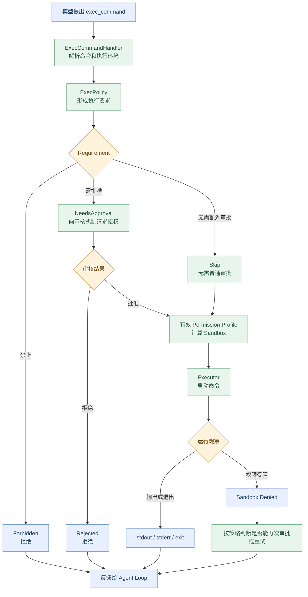
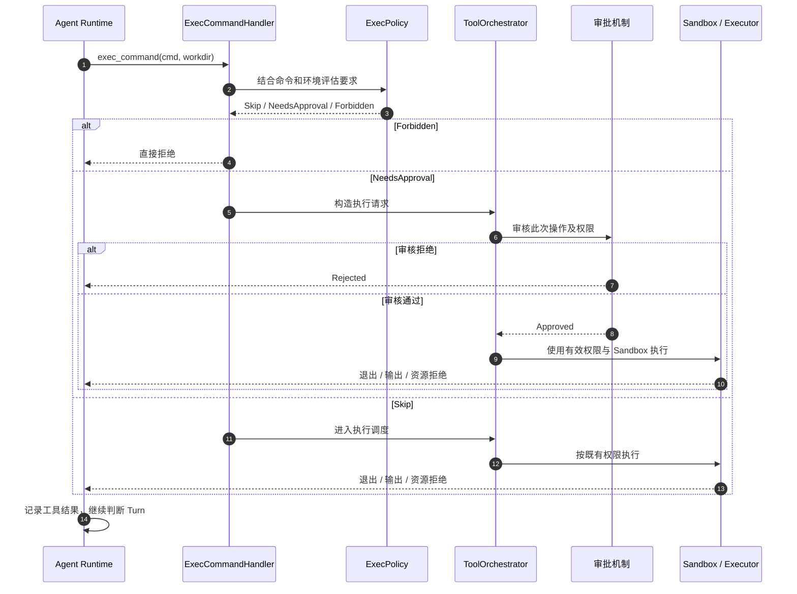

# 第 09 章：Permission / Approval / Sandbox / Exec——Codex 如何安全地执行命令？

> **核心问题：** 为什么同样一条命令，有时 Codex 可以直接运行，有时要审批，有时即使批准了仍然不能访问特定文件？
>
> [上一章：Shell Tool 执行链](../08-shell-execution/README.zh.md) · [教程首页](../README.zh.md) · [本章可运行实验](./demo.py)

第 08 章已经沿源码走通 `exec_command → UnifiedExecProcessManager → ToolOrchestrator → UnifiedExecRuntime`。这一章深入它背后的安全设计：**命令能否执行，是多个独立边界共同决定的。**

学完应能：

1. 区分 `PermissionProfile`、`ExecPolicy`、`Approval`、`Sandbox` 的职责。
2. 解释 `AskForApproval::Never` 为什么不代表无条件放行。
3. 读懂 `Skip / NeedsApproval / Forbidden` 及其与命令策略决策的关系。
4. 说明 Sandbox 拒绝后何时可以重新审批、何时必须保持禁止。
5. 通过八组纯内存实验，验证审批与资源能力约束的差异。

**固定源码基线：** [openai/codex @ `014489466a17`](https://github.com/openai/codex/tree/014489466a1739c2c563cdfe57880c2c7c8680e3)。本文只描述这一提交中的开源逻辑，不代表所有平台及配置使用同一执行路径。

---

## 1. 为什么不能只写一个 allowed？

假设用户要求检查登录测试，模型提出四个动作：

- **A：** 在工作区内运行测试。
- **B：** 读取登录模块源码。
- **C：** 读取当前权限明确禁止访问的凭据。
- **D：** 在工作区之外写入报告。

一个简单的 `if allowed: run()` 不够表达差异。

命令本身可能不危险，却尝试访问受限文件；命令可能有写入需要，但审核者只批准有限的目录权限；命令也可能被策略直接禁止，根本不需要启动进程。

这对应四个不同的问题：

| 层级 | 核心问题 | 典型状态 |
| --- | --- | --- |
| **Permission Profile** | 原本具有什么文件、网络能力？ | 允许 / 受限 |
| **Exec Policy** | 这条命令的策略结论是什么？ | Allow / Prompt / Forbidden |
| **Approval** | 是否需要申请额外权限，审核是否通过？ | Skip / Approved / Rejected |
| **Sandbox / Executor** | 运行时如何落实有效限制？ | 实际运行 / 资源拒绝 |

**行动许可不等于资源访问许可。** 这个区别贯穿整章。

## 2. 一张图看完整决策链



这是**教学用职责图**。真实源码中的审批、策略和 Sandbox 计算存在于 Handler、ProcessManager 与 Orchestrator 之间；还可能有 Hooks、Guardian、审批缓存、网络策略、远程执行器等额外路径。

## 3. Permission Profile：运行时已经拥有的能力

先看 [`ToolOrchestrator::run()`](https://github.com/openai/codex/blob/014489466a1739c2c563cdfe57880c2c7c8680e3/codex-rs/core/src/tools/orchestrator.rs#L125-L162)，它从所选执行环境中取出权限：

```rust
let environment = tool.turn_environment(req);
let permission_profile = environment.permission_profile();
let permissions = if executor_managed_process_sandbox {
    permission_profile.clone()
} else {
    environment.permission_profile_with_workspace_roots()
};
let file_system_sandbox_policy = permissions.file_system_sandbox_policy();
```

这个片段说明：

- **Execution Environment** 决定在哪里执行以及有哪些平台能力。
- **Permission Profile** 是当前权限配置。
- **FileSystemSandboxPolicy** 是与文件访问相关的限制表达。
- 网络还有独立的相关策略，不能从文件权限推断网络一定可用。

想象一个工程环境：允许读取工作区源码，允许在指定目录写入，禁止读取显式排除的凭据路径，并限制外部网络。即使某条命令合法，它的子进程也不应因此获得所有磁盘或网络权限。

**注意本地 / 远程差异：** 有的 Sandbox 由主机侧构造，有的由执行器自己强制执行。源码中的 `executor_managed_process_sandbox` 就用于区分相关路径。不能因为主进程没有本地创建 Sandbox，就推断远程执行没有任何隔离。

## 4. ExecPolicy：真正决定这条命令怎么办

在 [`exec_policy.rs`](https://github.com/openai/codex/blob/014489466a1739c2c563cdfe57880c2c7c8680e3/codex-rs/core/src/exec_policy.rs#L767-L878) 中，可以看到未命中显式执行规则时的决策逻辑，综合：

- `approval_policy`；
- 文件系统 Sandbox 的限制级别；
- 请求是否需要提升权限；
- 危险命令判断；
- 特定平台的隔离后端是否可用。

源码还存在显式的命令规则，所以上述函数只是**一类决策路径**，不能用它代表所有策略求值。

| 策略决策 | 通俗理解 |
| --- | --- |
| `Decision::Allow` | 可以在有效限制下尝试执行 |
| `Decision::Prompt` | 需要进入审核路径 |
| `Decision::Forbidden` | 不得执行这次命令 |

### 误区一：Never = 永远放行？

**不是。** `AskForApproval::Never` 只是代表不向用户询问授权，不是解除限制。

在 [`exec_policy.rs`](https://github.com/openai/codex/blob/014489466a1739c2c563cdfe57880c2c7c8680e3/codex-rs/core/src/exec_policy.rs#L802-L821)，对于被视为危险、或者无法依赖预期隔离保障的部分命令，`Never` 可导致 `Decision::Forbidden`。

对于其他允许执行的普通命令，Sandbox 仍可能拒绝敏感资源访问。

### 误区二：OnRequest = 每条命令都弹窗？

也不是。[`exec_policy.rs`](https://github.com/openai/codex/blob/014489466a1739c2c563cdfe57880c2c7c8680e3/codex-rs/core/src/exec_policy.rs#L831-L853) 区分非危险的普通命令与主动请求升级权限的命令；在适当的受限环境下，普通命令可以不额外询问，而交由 Sandbox 强制限制。

结论：**只有结合具体命令、规则、权限配置和执行环境，才能判断是否需要审批。**

## 5. ExecApprovalRequirement：把命令决策交给 Orchestrator

[`tools/sandboxing.rs`](https://github.com/openai/codex/blob/014489466a1739c2c563cdfe57880c2c7c8680e3/codex-rs/core/src/tools/sandboxing.rs#L152-L176) 定义：

```rust
pub(crate) enum ExecApprovalRequirement {
    Skip { /* ... */ },
    NeedsApproval { /* ... */ },
    Forbidden { reason: String },
}
```

这些是 Orchestrator 面对工具调用时使用的**执行要求**，与上面的 `Decision::Allow / Prompt / Forbidden` 并不是同一个 Rust 枚举类型。

[`default_exec_approval_requirement()`](https://github.com/openai/codex/blob/014489466a1739c2c563cdfe57880c2c7c8680e3/codex-rs/core/src/tools/sandboxing.rs#L196-L226) 提供一个缺省推导，而 Shell 工具还有更具体的命令策略评估。请勿将默认函数理解成完整的实际 Shell 审批算法。

在 [`ToolOrchestrator::run()`](https://github.com/openai/codex/blob/014489466a1739c2c563cdfe57880c2c7c8680e3/codex-rs/core/src/tools/orchestrator.rs#L163-L224) 可以看到：

- `Skip`：通常无需常规用户弹窗，但特定严格自动审核仍可能介入。
- `NeedsApproval`：准备这次操作的授权请求。
- `Forbidden`：返回拒绝，不进入普通执行阶段。

这里的 `Skip` **不是**不使用 Sandbox。

## 6. Approval：谁能做审批，审批可否复用？

在 [`tools/approvals.rs → request_approval()`](https://github.com/openai/codex/blob/014489466a1739c2c563cdfe57880c2c7c8680e3/codex-rs/core/src/tools/approvals.rs#L454-L570) 中，审核并非简单的 `input("approve?")`。

源码的相关优先顺序是：

1. 权限请求 Hooks；
2. 如配置启用 StrictAutoReview 或 Guardian，则由相关自动审核机制处理；
3. 否则使用适用的用户审批路径。

不同调用类型、环境与配置会影响实际分支。不能宣称每次调用都必然经过以上全部三层。

### 一次批准是否代表以后都批准？

不必然。

[`ApprovalStore / with_cached_approval`](https://github.com/openai/codex/blob/014489466a1739c2c563cdfe57880c2c7c8680e3/codex-rs/core/src/tools/sandboxing.rs#L33-L116) 提供针对匹配操作的会话级审批缓存。例如用户选择“本会话内批准”时，后续命中对应 Key 的请求可能不再反复询问。

这并不是“任何命令都获得永久免审”：缓存有适用键和授权范围，权限变化也需要按实际逻辑重新判断。

### 审批通过后还能拒绝执行吗？

可以，而且这是重要的安全属性。审核允许一项行动，并不自然产生所有磁盘或网络的访问能力。

## 7. Sandbox：审批与运行时隔离为什么必须分开？

在 [`tools/orchestrator.rs`](https://github.com/openai/codex/blob/014489466a1739c2c563cdfe57880c2c7c8680e3/codex-rs/core/src/tools/orchestrator.rs#L229-L379) 中，Runtime 计算当前尝试的有效权限、`SandboxOverride` 与实际使用的 `SandboxType`，再构造 `SandboxAttempt`。

看一个例子：

```text
ExecPolicy       Allow
Approval         Skip（无需再次询问）
Sandbox          拒绝读取被禁用的凭据路径
进程观察        Access denied
```

没有矛盾：**命令可以在受限环境启动，但访问受限资源依旧失败。**

### 保护显式禁止读取的路径

本章最重要的源码设计之一在 [`sandbox_override_for_first_attempt()`](https://github.com/openai/codex/blob/014489466a1739c2c563cdfe57880c2c7c8680e3/codex-rs/core/src/tools/sandboxing.rs#L249-L292)。

源码说明，如果权限配置包含 `denied-read` 路径，无条件绕过 Sandbox 会把本来禁止读取的文件暴露出来。某些升级路径必须保留这种约束。

[`ensure_native_sandbox()`](https://github.com/openai/codex/blob/014489466a1739c2c563cdfe57880c2c7c8680e3/codex-rs/core/src/tools/sandboxing.rs#L232-L246) 还会在相关条件下检查所需隔离能否成立。如果不能安全保留必要的限制，执行可能被拒绝。

**通过审批不等于自动撤销全部资源限制。**

## 8. 为什么有时 Sandbox 拒绝后还会再次请求审批？

[`ToolOrchestrator::run()` 的后半段](https://github.com/openai/codex/blob/014489466a1739c2c563cdfe57880c2c7c8680e3/codex-rs/core/src/tools/orchestrator.rs#L390-L573) 包含针对特定 Sandbox 拒绝的处理。

受控重试可能涉及：

- 判断错误是否为可识别的 Sandbox 拒绝；
- 当前工具是否允许因 Sandbox 失败而升级；
- 当前 `AskForApproval` 是否允许相关操作；
- 是否可以不带 Sandbox 执行，或者必须保留显式禁读；
- 网络审批场景是否有更具体的处理路径；
- 是否需要就**实际重试的权限范围**重新审批。

**绝不能将这一过程简化成“Sandbox 失败 → 自动关掉 Sandbox → 再执行一次”。**

另外，程序返回非零退出码并不自动说明 Sandbox 拒绝。比如测试失败返回退出码 1，可能只是业务测试失败；它应作为工具观察进入 Agent Loop，而不是被当作升级权限的理由。

## 9. Shell 执行的安全决策时序



这是一张**职责示意图，不是 Rust 逐行调用顺序**。真实实现可能在 ProcessManager 中求值具体命令策略、经由 Orchestrator 再选 Sandbox，并且支持执行器侧的隔离。

## 10. 动手实验：八种执行安全决策

本章的 [`demo.py`](./demo.py) 是一个**纯内存决策模拟器**，不启动子进程，也不读写文件或访问网络。

运行（Python 3.10+）：

```bash
python demo.py
```

它只定义了三个可观察的逻辑阶段：

```text
decide_requirement() → 模拟命令策略
        ↓
assess()            → 模拟审核结论
        ↓
sandbox_allows()    → 模拟当前资源访问范围
```

主要输入包括 `Request`、`ApprovalMode` 和 `SandboxProfile`。Demo 在代码中预设哪些操作是 `dangerous`，并预设审批结果，不自动解析真实命令。

### 实验 A：普通操作无需弹窗，但仍受限

```text
safe-read   approval=skipped  sandbox=allowed  => simulated-success
safe-write  approval=skipped  sandbox=allowed  => simulated-success
```

只表示：按这份**教学策略**，两项操作无需额外审批，且目标处于虚构的允许范围。

### 实验 B：Never 不等于无限授权

```text
denied-secret    approval=skipped        sandbox=denied  => sandbox-denied
dangerous-never  approval=not-requested  sandbox=not-run => forbidden-by-policy
```

前者是资源访问被拒，后者是命令策略提前禁止：**结果不同，应该由不同层负责解释。**

### 实验 C：批准命令，不等于允许任意文件写入

```text
dangerous-rejected         approval=denied    => rejected-by-reviewer
approved-not-unrestricted  approval=approved  => sandbox-denied
```

第二条尤其重要：一项操作已通过教学审核，但目标位置仍超出有效文件系统权限。

### 实验 D：批准有限扩权，不意味着解除全部限制

```text
scoped-extension  approval=approved  sandbox=allowed => simulated-success
network-off       approval=skipped   sandbox=denied  => sandbox-denied
```

`scoped-extension` 仅在教学规则下增加对 `workspace/exports/` 的写入权限，不会让网络自动可用。程序还断言，即使审核已通过，`workspace/.secrets/` 的显式禁读仍然被拒绝。

**实验结束标志：**

```text
Explicit denied-read remains denied after simulated approval
All teaching assertions passed
```

### 为什么它不是可用的生产安全方案？

`sandbox_allows()` 仅用字符串前缀模拟权限判断。真实文件系统权限涉及路径规范化、符号链接、竞态、进程继承和操作系统实际执行能力。

**只有检查字符串并不能强制限制程序。** 本 Demo 不实现官方 Codex 的 ExecPolicy、ApprovalStore、Guardian、Hook 或 Sandbox，不应被复制为真实业务鉴权代码。

## 11. 诊断实践：不要把所有执行失败都归咎于权限

| 现象 | 优先检查 | 不应该直接得出的结论 |
| --- | --- | --- |
| `Forbidden` | ExecPolicy 与有效的审批策略 | 模型 API 不稳定 |
| 审批被拒 | 审核来源、审批记录和请求范围 | 命令已在 OS 中执行 |
| 文件 / 网络访问被拒 | PermissionProfile、Sandbox 和执行环境 | 一定要立即提权重试 |
| 命令非零退出 | 进程退出码、stdout、stderr | 一定是 Sandbox 拒绝 |
| 命令仍在运行 | `UnifiedExecProcessManager`、进程 ID | 当前 Turn 已完成 |
| 远程执行不支持某种扩权 | 执行器能力与目标平台 | 本机权限配置必然错误 |

排障时建议保留 `call_id`、命令参数、环境标识、策略判定、审批结论、实际 Sandbox、退出码与事件记录，才容易区分上述情况。

## 12. 真实源码阅读路径

按顺序阅读即可，不需要一次读懂所有分支。

| 顺序 | 源码入口 | 核对的问题 |
| --- | --- | --- |
| 1 | [`ExecApprovalRequirement`](https://github.com/openai/codex/blob/014489466a1739c2c563cdfe57880c2c7c8680e3/codex-rs/core/src/tools/sandboxing.rs#L152-L176) | Skip / NeedsApproval / Forbidden |
| 2 | [`default_exec_approval_requirement()`](https://github.com/openai/codex/blob/014489466a1739c2c563cdfe57880c2c7c8680e3/codex-rs/core/src/tools/sandboxing.rs#L196-L226) | 默认执行要求如何推导 |
| 3 | [`exec_policy.rs`](https://github.com/openai/codex/blob/014489466a1739c2c563cdfe57880c2c7c8680e3/codex-rs/core/src/exec_policy.rs#L767-L878) | 危险命令与执行规则 |
| 4 | [`ToolOrchestrator::run()`](https://github.com/openai/codex/blob/014489466a1739c2c563cdfe57880c2c7c8680e3/codex-rs/core/src/tools/orchestrator.rs#L125-L224) | 审批门禁的真实分支 |
| 5 | [`request_approval()`](https://github.com/openai/codex/blob/014489466a1739c2c563cdfe57880c2c7c8680e3/codex-rs/core/src/tools/approvals.rs#L454-L570) | Hooks、自动审核、用户审批 |
| 6 | [`with_cached_approval()`](https://github.com/openai/codex/blob/014489466a1739c2c563cdfe57880c2c7c8680e3/codex-rs/core/src/tools/sandboxing.rs#L33-L116) | 会话内批准怎样复用 |
| 7 | [`sandbox_override_for_first_attempt()`](https://github.com/openai/codex/blob/014489466a1739c2c563cdfe57880c2c7c8680e3/codex-rs/core/src/tools/sandboxing.rs#L249-L292) | 扩权为什么保留显式禁读 |
| 8 | [`SandboxAttempt 构造`](https://github.com/openai/codex/blob/014489466a1739c2c563cdfe57880c2c7c8680e3/codex-rs/core/src/tools/orchestrator.rs#L327-L379) | 实际尝试的隔离参数 |
| 9 | [`Sandbox 拒绝与重试`](https://github.com/openai/codex/blob/014489466a1739c2c563cdfe57880c2c7c8680e3/codex-rs/core/src/tools/orchestrator.rs#L390-L573) | 何时能追加审批或拒绝 |
| 10 | [`UnifiedExecRuntime::run()`](https://github.com/openai/codex/blob/014489466a1739c2c563cdfe57880c2c7c8680e3/codex-rs/core/src/tools/runtimes/unified_exec.rs#L260-L297) | 执行后端处理入口 |

## 13. 五个思考题

**1. AskForApproval::Never 是不是关闭了安全机制？** 不是，它只改变审批交互。危险命令可能被禁止，Sandbox 仍可能限制资源访问。

**2. User Approved 是否代表以 root 或管理员权限运行？** 不代表。审批针对相应操作和权限范围，不等于无条件获得系统管理员能力。

**3. 用户批准过一次，后续任何相似命令都自动免审吗？** 不一定。缓存需匹配实际审批 Key 与范围，不能随意外推。

**4. Sandbox 拒绝是否一定要让模型换个方式绕过？** 不应该。拒绝可能是有效的安全结果；只能在策略明确允许的范围内重新审批、重试。

**5. 为什么 Prompt 的禁止性语句不能替代 OS Sandbox？** Prompt 是模型上下文，不是操作系统强制资源控制。真正隔离需要受信任执行后端落实。

---

## 本章小结

```text
模型：提出命令
       │
       ▼
ExecPolicy：针对命令形成执行要求
       ├─ Forbidden → 拒绝
       ├─ NeedsApproval → 审核
       └─ Skip
                 │
                 ▼
        Permission Profile
                 │
                 ▼
        Sandbox / Executor
                 │
                 ▼
       实际输出 / 退出 / 拒绝
                 │
                 ▼
          Agent Loop 再决策
```

**请记住：执行安全不是一个按钮，而是命令策略、有效权限、审核结果与运行时隔离的交集。**

下一章：[第 10 章《Op / Event：UI 与 Core 的通信模型》](../10-op-event/README.zh.md)。

这一章将把视角从执行环境切回产品运行时：用户提交输入、客户端显示工具进度、审批请求与 Turn 完成，是怎样通过 `Op` 和 `Event` 连起来的？

