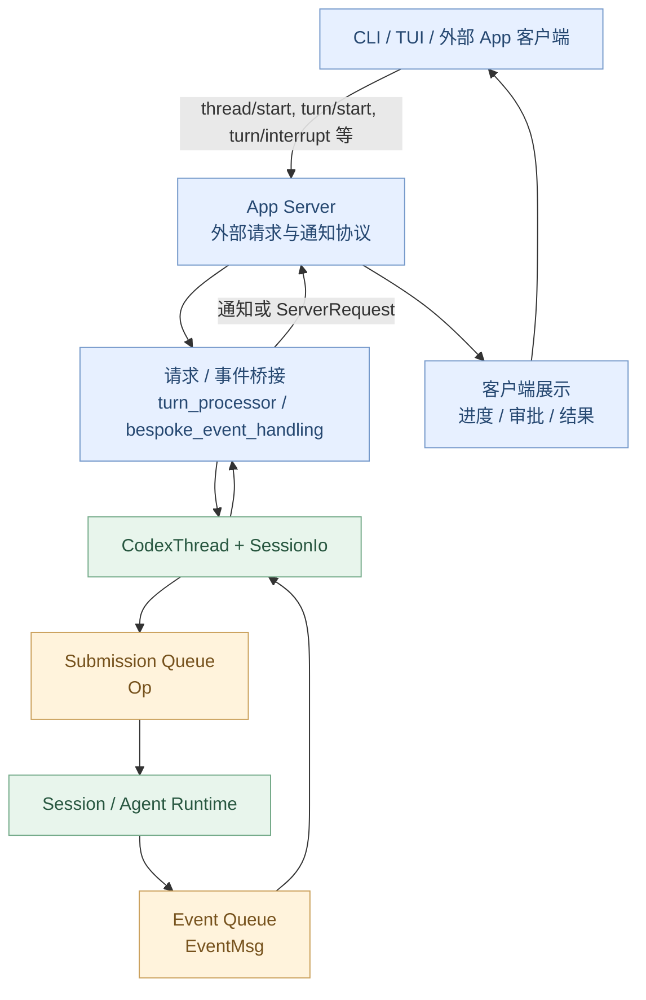
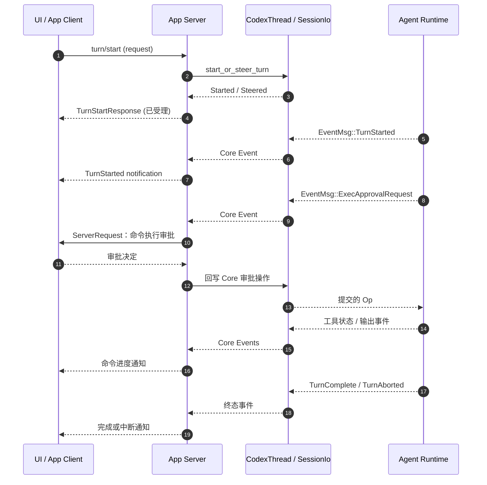

# 第 10 章：Op / Event——UI 与 Core 如何双向通信？

> **本章问题：** 用户点击“发送”，前端为什么可以立刻显示任务已创建，随后又逐步看到模型消息、Shell 输出、审批弹窗和最终完成状态？这些消息是怎样穿过 App Server 到达 Codex Core 的？
>
> [上一章：Permission / Approval / Sandbox / Exec](../09-permission-sandbox/README.zh.md) · [返回教程首页](../README.zh.md) · [本章 Demo](./demo.py)

前九章围绕 Codex 内核展开：从一次 Turn、模型采样、ToolRouter，到真正执行 Shell、审批与 Sandbox。还有一个关键问题：

**内核怎样与前端保持联系？** Core 的执行可能需要数秒或数分钟，但 UI 不应卡在一条同步函数调用中。用户还可能在执行过程中决定中断，或回复审批请求。

第 10 章将说明这套双向通信的模型。

完成本章后，你应该能：

1. 区分 **App Server 外部协议** 与 **Core 内部的 `Op / Event` 协议**；
2. 读懂 `Submission`、`Op`、`Event`、`EventMsg` 与 `SessionIo` 的职责；
3. 跟踪一次 `turn/start` 如何进入 Core 并逐步产生事件；
4. 理解工具进度、审批往返以及 `TurnComplete`、`TurnAborted` 的区别；
5. 运行一个不调用模型的异步事件系统，验证**提交确认并非任务完成**。

**源码基线**：[openai/codex 固定提交 `014489466a17`](https://github.com/openai/codex/tree/014489466a1739c2c563cdfe57880c2c7c8680e3)。源码随时间演进，本章不假定所有历史版本具有相同字段或生命周期语义。

---

## 1. 如果只能同步调用 Core，会有什么问题？

设想最简单的实现：

```python
result = core.run_task("检查登录模块")
show(result)
```

只在函数返回后展示结果，用户就看不到执行中的信息：

- 这次 Turn 是否真正开始？
- 已经调用了哪些工具？
- 命令输出了什么？
- 是否正在等待审批？
- 用户想取消时怎样传达给 Runtime？
- 如果执行失败，何时恢复 UI 可操作状态？

因此生产级 Agent 产品需要两种消息流：

- **输入方向：客户端提交意图**，如开始 Turn、追加输入、中断、回复审批。
- **输出方向：内核报告事实**，如 Turn 开始、工具进度、模型消息、错误、完成或中断。

这种分离还意味着：**一个请求被受理、一次工具执行结束、整个 Turn 完成，不是同一时刻。**

## 2. 整体架构：先分清两层协议



这是一张**逻辑视图**，不是每个方框都代表独立进程。也不是所有客户端都必须通过外部 JSON 传输。

### 外部 App Server 协议

当前版本的 [`app-server-client/README.md`](https://github.com/openai/codex/blob/014489466a1739c2c563cdfe57880c2c7c8680e3/codex-rs/app-server-client/README.md#L1-L45) 明确描述：

- CLI 的 TUI 与 exec 可以使用**进程内 App Server**；
- 进程内通信使用类型化的 `ClientRequest / ClientNotification` 与 `InProcessServerEvent`；
- 外部的 stdio、WebSocket 边界仍使用 JSON 序列化；
- 进程内请求保留 App Server 原有响应语义，并非绕过 App Server 直接调用所有 Core 方法。

因此**App Server 不是永远都要单独起一个服务进程**。

### Core 内部协议

在 Core 层，操作使用 `Op`，事件使用 `EventMsg`。例如：

```text
输入：Op::TurnInput / Op::Interrupt / Op::ExecApproval
输出：EventMsg::TurnStarted / EventMsg::ExecCommandOutputDelta
     EventMsg::ExecApprovalRequest / EventMsg::TurnComplete
```

它们来自 [`codex-rs/protocol/src/protocol.rs`](https://github.com/openai/codex/blob/014489466a1739c2c563cdfe57880c2c7c8680e3/codex-rs/protocol/src/protocol.rs#L650-L755) 与 [`EventMsg`](https://github.com/openai/codex/blob/014489466a1739c2c563cdfe57880c2c7c8680e3/codex-rs/protocol/src/protocol.rs#L1451-L1615)。

**不要把 App Server 的 `ClientRequest::TurnStart` 和 Core 的 `Op` 当成同一个枚举值。** 前者是客户端请求；处理器需要将其转换成 Core 能受理的操作。

## 3. 输入端：Submission 与 Op 分别是什么？

[`protocol.rs`](https://github.com/openai/codex/blob/014489466a1739c2c563cdfe57880c2c7c8680e3/codex-rs/protocol/src/protocol.rs#L650-L720) 中的 `Op` 是一个 enum，包含多种向 Runtime 表达意图的操作：

| 典型 `Op` | 意图 |
| --- | --- |
| `TurnInput` | 提交 Turn 输入并选择路由方式；可能开始新 Turn 或引导当前 Turn |
| `Interrupt` | 请求中断当前任务 |
| `ThreadSettings` | 更新线程级设置 |
| `ExecApproval` | 将某次执行审批决策送回 Core |
| `Shutdown` | 请求关闭当前运行会话 |

它们的细节和是否携带 oneshot 回复通道各不相同，不应全部视作“用户新消息”。

而真正进入内部提交队列的是 [`session/submission.rs`](https://github.com/openai/codex/blob/014489466a1739c2c563cdfe57880c2c7c8680e3/codex-rs/core/src/session/submission.rs#L1-L21) 中的 `Submission`：

```rust
pub(crate) struct Submission {
    pub id: String,
    pub op: Op,
    // 扩展初始化数据、trace、父 / 根 Turn、驻留保护等省略
}
```

**`Op` 是要执行的动作；`Submission` 是把这个动作与提交 ID 等运行元数据包装在一起的队列条目。**

### 为什么需要提交 ID？

因为一个长生命周期的会话里会不断接收动作。Runtime 必须在一定范围内关联“这是哪次提交”，必要时传播追踪与 Turn 关联信息。

不过切勿把所有 ID 都混用：

- App Server **请求 ID**：标识某次客户端请求与响应；
- `Submission.id`：Core 队列中本次提交的 ID；
- `Turn ID`：标识一轮任务；对于启动 Turn 的相关提交，App Server 可能直接暴露该提交 ID 作为 Turn ID；
- `call_id`：标识一次工具调用和其结果。

这些标识存在关联，但**绝不是所有事件都以原始 App Server JSON-RPC 请求 ID 为 `Event.id`**。

## 4. 消息怎么进队列？SessionIo 是什么？

在 [`core/src/session/mod.rs`](https://github.com/openai/codex/blob/014489466a1739c2c563cdfe57880c2c7c8680e3/codex-rs/core/src/session/mod.rs#L420-L438) 中有：

```rust
pub(crate) struct SessionIo {
    pub(crate) tx_sub: Sender<Submission>,
    pub(crate) rx_event: Receiver<Event>,
    // agent_status / termination future 等
}
```

它正好代表 Session 的**两个方向**：

- `tx_sub`：把 `Submission` 交给后台的执行循环。
- `rx_event`：接收该 Session 产生的 `Event`。

[`SessionIo::submit_with_trace()`](https://github.com/openai/codex/blob/014489466a1739c2c563cdfe57880c2c7c8680e3/codex-rs/core/src/session/mod.rs#L1051-L1093) 构造提交并送入 `tx_sub`；[`next_event()`](https://github.com/openai/codex/blob/014489466a1739c2c563cdfe57880c2c7c8680e3/codex-rs/core/src/session/mod.rs#L1172-L1182) 则从事件队列异步接收。

而 [`CodexThread::submit() / next_event()`](https://github.com/openai/codex/blob/014489466a1739c2c563cdfe57880c2c7c8680e3/codex-rs/core/src/codex_thread.rs#L258-L261) 与 [`codex_thread.rs`](https://github.com/openai/codex/blob/014489466a1739c2c563cdfe57880c2c7c8680e3/codex-rs/core/src/codex_thread.rs#L774-L777) 暴露了这些操作的包装接口。

### 一个值得理解的队列设计

在该固定版本的 [`session/mod.rs`](https://github.com/openai/codex/blob/014489466a1739c2c563cdfe57880c2c7c8680e3/codex-rs/core/src/session/mod.rs#L645-L649)，提交与事件队列采用不同配置：

```rust
let (tx_sub, rx_sub) = async_channel::bounded(SUBMISSION_CHANNEL_CAPACITY);
let (tx_event, rx_event) = async_channel::unbounded();
```

这意味着：

- **提交端有容量限制**，当生产速度大于消费速度时需要背压；
- **事件端在这里是无界队列**，让 Core 的生产者不必按同一容量限制等待前端读取。

但无界不等于无限免费：**慢消费者有内存积压风险**，产品层仍需要考虑队列消费、断线、状态重建与资源治理。App Server 的进程内事件桥接也有它自己的队列和生命周期管理；不能把两个队列架构混成一个。

### 谁消费提交？

在 [`session/mod.rs`](https://github.com/openai/codex/blob/014489466a1739c2c563cdfe57880c2c7c8680e3/codex-rs/core/src/session/mod.rs#L1022-L1043)，后台任务执行 `submission_loop(session_for_loop, configured_config, rx_sub)`，继续处理来自 `tx_sub` 的提交。

你可以把它理解为**Session 的控制入口**，而不是模型采样的 `run_turn` 循环本身。第 04 章已经讲过：一次 Turn 内部的 Agent Loop 是另一层生命周期。

## 5. 输出端：Event 和 EventMsg 为什么要分开？

在 [`protocol.rs`](https://github.com/openai/codex/blob/014489466a1739c2c563cdfe57880c2c7c8680e3/codex-rs/protocol/src/protocol.rs#L1450-L1474) 中：

```rust
pub struct Event {
    pub id: String,
    pub msg: EventMsg,
}
```

因此 `Event` 负责承载关联标识与事件载荷，`EventMsg` 则表示**发生了什么**。

典型消息：

| `EventMsg` | UI 可以如何使用 |
| --- | --- |
| `TurnStarted` | 显示执行中 |
| `AgentMessage` | 增量或完整模型消息的相应呈现 |
| `ExecCommandBegin` | 显示工具开始 |
| `ExecCommandOutputDelta` | 持续更新命令输出 |
| `ExecCommandEnd` | 更新该命令的结束状态 |
| `ExecApprovalRequest` | 进入审批交互 |
| `TurnComplete` | 结束当前 Turn 的运行态 |
| `TurnAborted` | 呈现已中断 |
| `Error / Warning` | 展示失败或警告信息 |

注意：**事件名称是 Core 内部事件类型，不必与外部 App Server 的通知方法名逐字一致**。App Server 会根据自己的公开协议和兼容策略进行映射。

### `Event.id` 究竟表示什么？

[`Session::send_event()`](https://github.com/openai/codex/blob/014489466a1739c2c563cdfe57880c2c7c8680e3/codex-rs/core/src/session/mod.rs#L2461-L2494) 创建事件时，会使用：

```rust
let event = Event {
    id: turn_context.sub_id.clone(),
    msg,
};
```

即对于这里发送的 Turn 相关事件，`id` 对应当前 `turn_context.sub_id`。它不是“随便生成的事件流水号”，也**不是外部 App Server 请求 ID**。

因此 UI 在处理事件时，需要保持正确的 Thread、Turn、工具调用关联，不能简单地把所有消息放到“最新一个对话框”里。

## 6. 一次 turn/start 究竟什么时候返回？

这是本章最关键的时序。

在 [`app-server/message_processor.rs`](https://github.com/openai/codex/blob/014489466a1739c2c563cdfe57880c2c7c8680e3/codex-rs/app-server/src/message_processor.rs#L1672-L1705)，`ClientRequest::TurnStart` 被转交给 `turn_processor.turn_start(...)`。

继续打开 [`turn_processor.rs`](https://github.com/openai/codex/blob/014489466a1739c2c563cdfe57880c2c7c8680e3/codex-rs/app-server/src/request_processors/turn_processor.rs#L525-L553) 和 [`turn_processor.rs`](https://github.com/openai/codex/blob/014489466a1739c2c563cdfe57880c2c7c8680e3/codex-rs/app-server/src/request_processors/turn_processor.rs#L660-L738)：

1. App Server 校验输入并找到目标 `CodexThread`；
2. 通过 `start_or_steer_turn()` 提交输入；
3. 结果可能是 **`Started`、`Steered` 或 `NotSubmitted`**；
4. 成功后，App Server 返回带 Turn 信息的响应；
5. Core 的真实执行继续进行，后续通过事件向客户端报告进度。

**所以 `turn/start` 返回成功不表示工具已运行，更不表示整个 Turn 已结束。**

还有一个细节：**提交新输入不一定创建新 Turn**。如果已有 Turn 正在运行，输入可能按请求模式被接纳为 steering。这正是第 03 章 `Session / Turn / Step` 所强调的行为。

## 7. 谁把 Core 事件转换成 UI 能消费的通知？

Core 本身只需要按自己的协议发事件。App Server 负责将这些事件转成客户端协议表达。

在 [`bespoke_event_handling.rs`](https://github.com/openai/codex/blob/014489466a1739c2c563cdfe57880c2c7c8680e3/codex-rs/app-server/src/bespoke_event_handling.rs#L143-L213) 能看到：

- `EventMsg::TurnStarted` 转换成 `ServerNotification::TurnStarted`；
- `EventMsg::TurnComplete` 走独立的 Turn 完成处理；
- `TurnAborted` 有自己的终态处理与待处理请求收口；
- 工具输出增量可能转换为客户端事件或相关 Item 更新。

例如 [`ExecCommandOutputDelta` 处理](https://github.com/openai/codex/blob/014489466a1739c2c563cdfe57880c2c7c8680e3/codex-rs/app-server/src/bespoke_event_handling.rs#L1209-L1218)，会把 Core 的命令输出增量转换成客户端通知。

**重要边界：Core 的 `EventMsg` 不是外部 JSON-RPC Notification 的原样复制。** 部分事件会做协议升级兼容、状态聚合或转换为更高层的 Item 表达。

## 8. Approval 证明通信不是单向“事件推送”

第 09 章已解释审批：执行时可能需要用户授权。在 App Server 层，这通常不只是显示一条状态消息。

真实 [`bespoke_event_handling.rs`](https://github.com/openai/codex/blob/014489466a1739c2c563cdfe57880c2c7c8680e3/codex-rs/app-server/src/bespoke_event_handling.rs#L675-L825) 对 `ExecApprovalRequest` 的处理可以看见：

1. Core 先发出审批请求事件。
2. App Server 准备客户端可理解的命令、目录和权限信息。
3. App Server 通过 **`ServerRequestPayload::CommandExecutionRequestApproval`** 发起需要响应的客户端请求。
4. 客户端返回批准、拒绝或其他受支持的决定。
5. 桥接逻辑再将结果转为 Core 的对应操作 / 审批决策。

所以审批不是一个“收到 Event 就全部结束”的过程。**它是 Core 发起、App Server 转发并等待响应、再回到 Core 的双向交互。**

别把 `ExecApprovalRequest` 的 Core 事件与 `Op::ExecApproval` 的回应视为同一条消息。



这张图描述一个可能触发审批的典型 Turn。不是每个 Turn 都调用 Shell，也不是每次 Shell 都需要审批。

## 9. `TurnComplete` 和 `TurnAborted` 不可以混用

在 [`core/src/tasks/mod.rs`](https://github.com/openai/codex/blob/014489466a1739c2c563cdfe57880c2c7c8680e3/codex-rs/core/src/tasks/mod.rs#L821-L882) 中，任务收尾时会根据中断原因等状态发出：

- `EventMsg::TurnAborted`：中断路径；
- `EventMsg::TurnComplete`：完成路径，**其结构还可能携带终止性错误信息**。

因此不能将 `TurnComplete` 机械理解为“业务任务 100% 成功”。它首先表达**Turn 的生命周期完成**；UI 还需要查看错误和结果元数据。

相应地，第 08 章中 `ExecCommandEnd` 表示一次 Shell 执行观察结束，也不等于 `TurnComplete`。

在 [`bespoke_event_handling.rs`](https://github.com/openai/codex/blob/014489466a1739c2c563cdfe57880c2c7c8680e3/codex-rs/app-server/src/bespoke_event_handling.rs#L1218-L1237) 还可以看到处理中断时，App Server 会清理与当前 Turn 相关的待处理请求并响应待完成的中断调用。

**前端应按生命周期事件更新状态，而不是只根据有没有收到最终一句文本推断任务已结束。**

## 10. 取消命令是怎样回到 Core 的？

在 [`message_processor.rs`](https://github.com/openai/codex/blob/014489466a1739c2c563cdfe57880c2c7c8680e3/codex-rs/app-server/src/message_processor.rs#L1695-L1701)，`TurnInterrupt` 交给 `turn_processor.turn_interrupt(...)`。

[`turn_processor.rs`](https://github.com/openai/codex/blob/014489466a1739c2c563cdfe57880c2c7c8680e3/codex-rs/app-server/src/request_processors/turn_processor.rs#L1622-L1672) 验证目标 Turn 与活跃状态，把普通中断请求与 Turn 关联起来，并提交 `Op::Interrupt`。

但有一个细节：**非启动阶段的中断请求不一定在“提交 Op”时就回复成功**。源码注释说明，正常 Turn 的中断响应可以等到收到 `TurnAborted` 后再回复，启动阶段特殊情况则可能更早确认。

这体现了异步协议中三个常见时间点：

| 时间点 | 代表什么 |
| --- | --- |
| 接收到中断请求 | 客户端提出取消意图 |
| 中断 Op 被受理 | Runtime 开始执行取消控制 |
| `TurnAborted` 到达 | 当前 Turn 的中断生命周期已经被报告 |

对需要准确表示“已取消”的 UI 而言，这些状态不应被合并。

---

## 11. 动手：构建一个最小双向异步 Runtime

本章 [`demo.py`](./demo.py) 采用 **Python 3.10+ 标准库 `asyncio`**。无模型、无网络、无真实 Shell 和人工审批界面。

它模拟：

- `Op`：来自 App Server 的一条操作；
- `Event`：标记某个 Turn 的 Core 事件；
- `FakeCore.ops`：一个有界输入队列；
- `FakeCore.events`：一条独立的事件队列；
- `FakeCore.serve()`：消费操作并分派给正在运行的 Turn；
- `FakeCore._run_turn()`：逐步产生事件并等待审批回复。

运行：

```bash
python demo.py
```

### 实验 A：请求受理 ≠ 执行完成

调用 `submit_turn()` 后，打印：

```text
AppServer turn/start ACK: turn-1; terminal event not received
```

之后才陆续收到：

```text
[turn-1] TurnStarted
[turn-1] ExecCommandBegin
[turn-1] ExecApprovalRequest
[turn-1] ExecCommandOutputDelta
[turn-1] ExecCommandEnd
[turn-1] AgentMessage
[turn-1] TurnComplete
```

这验证“提交应立即返回，而任务结果通过独立事件流交付”的核心交互模型。

### 实验 B：审批拒绝也可以形成正常结束的 Turn

第二个 Turn 在 `ExecApprovalRequest` 后回复拒绝，接着收到：

```text
[turn-2] ExecCommandEnd: not executed: denied
[turn-2] AgentMessage: 审批拒绝，未执行命令
[turn-2] TurnComplete: finished
```

**这是教学脚本的行为设计**，不是说真实 Codex 所有审批拒绝都必定产生这三条事件。重点是：**工具没有运行成功，但 Agent 仍可能向用户解释拒绝结果并正常结束 Turn**。

### 实验 C：中断不等于完成

第三个 Turn 先产生审批请求，再从输入队列收到中断操作，最后输出：

```text
[turn-3] TurnAborted: interrupted
```

示例断言第三个 Turn **没有 `TurnComplete`**。

### 实验 D：事件必须匹配正确的 Turn

每次收到 `Event`，代码都验证：

```python
assert event.turn_id == turn_id, "cross-turn event misrouting"
```

这说明 UI 必须把事件绑定到正确的 Turn，而不是简单放进最近活跃的消息框。

### 本 Demo 不负责什么？

它没有实现 JSON-RPC、真实 Core 协议、App Server 的完整服务器请求管理、多进程桥接、持久化、Token Streaming、取消令牌细节、真实审批或 Tool Runtime。`turn-1`、`call-1` 等都是预置教学标识。

运行成功的最后一行：

```text
All teaching assertions passed
```

## 12. 源码阅读路线

| 顺序 | 源码入口 | 要验证的事实 |
| --- | --- | --- |
| 1 | [`Op`](https://github.com/openai/codex/blob/014489466a1739c2c563cdfe57880c2c7c8680e3/codex-rs/protocol/src/protocol.rs#L650-L755) | Core 可接收的控制操作 |
| 2 | [`Submission`](https://github.com/openai/codex/blob/014489466a1739c2c563cdfe57880c2c7c8680e3/codex-rs/core/src/session/submission.rs#L1-L21) | 操作如何携带提交元数据 |
| 3 | [`SessionIo`](https://github.com/openai/codex/blob/014489466a1739c2c563cdfe57880c2c7c8680e3/codex-rs/core/src/session/mod.rs#L420-L438) | 双向通道的两端 |
| 4 | [`SessionIo::submit`](https://github.com/openai/codex/blob/014489466a1739c2c563cdfe57880c2c7c8680e3/codex-rs/core/src/session/mod.rs#L1051-L1093) | Op 怎样被排队 |
| 5 | [`Event / EventMsg`](https://github.com/openai/codex/blob/014489466a1739c2c563cdfe57880c2c7c8680e3/codex-rs/protocol/src/protocol.rs#L1451-L1535) | Event ID 和载荷如何组织 |
| 6 | [`Session::send_event`](https://github.com/openai/codex/blob/014489466a1739c2c563cdfe57880c2c7c8680e3/codex-rs/core/src/session/mod.rs#L2461-L2494) | Turn 关联与事件发送 |
| 7 | [`turn_start_inner`](https://github.com/openai/codex/blob/014489466a1739c2c563cdfe57880c2c7c8680e3/codex-rs/app-server/src/request_processors/turn_processor.rs#L660-L738) | App Server 请求为什么先于任务完成返回 |
| 8 | [`apply_bespoke_event_handling`](https://github.com/openai/codex/blob/014489466a1739c2c563cdfe57880c2c7c8680e3/codex-rs/app-server/src/bespoke_event_handling.rs#L143-L213) | Core 事件如何映射成客户端通知 |
| 9 | [`ExecApprovalRequest 映射`](https://github.com/openai/codex/blob/014489466a1739c2c563cdfe57880c2c7c8680e3/codex-rs/app-server/src/bespoke_event_handling.rs#L675-L825) | 双向审批请求与回写 |
| 10 | [`turn_interrupt_inner`](https://github.com/openai/codex/blob/014489466a1739c2c563cdfe57880c2c7c8680e3/codex-rs/app-server/src/request_processors/turn_processor.rs#L1622-L1672) | 中断请求为什么有自己的一致性约束 |
| 11 | [`TurnComplete / TurnAborted`](https://github.com/openai/codex/blob/014489466a1739c2c563cdfe57880c2c7c8680e3/codex-rs/core/src/tasks/mod.rs#L821-L882) | 生命周期终态从哪里产生 |

## 13. 五个自测问题

**问题 1：** App Server 的 `turn/start` 返回成功，是否代表整个 Turn 已完成？

不是。它代表输入得到处理 / 受理的相应结果。执行进度及终态随后通过事件报告；输入还可能按模式变成 steering。

**问题 2：** 为什么不能把 `ClientRequest::TurnStart` 直接当作 `Op::TurnInput`？

它们是两层不同的通信契约。App Server 先解析并验证外部协议，再调用 Core 提供的入口提交相应操作。

**问题 3：** `Event.id` 是每条通知自己的唯一流水号吗？

不能这样假定。对于 `Session::send_event`，它使用的是当前 `turn_context.sub_id`；不同事件可以具有同一个相关 Turn ID。

**问题 4：** UI 收到 `ExecCommandEnd`，能不能立即把整个任务标为 Completed？

不能。它只是一个工具执行的阶段性事件，整个 Turn 可能继续向模型请求下一步。

**问题 5：** 为什么审批系统需要双向交互而不只是单向事件流？

因为 Runtime 需要等待审核者的决定，再按这个决定继续或拒绝执行。事件通知和审批回复代表相反的信息方向。

---

## 本章总结

```text
客户端：发送请求
      │
      ▼
App Server：解析 + 桥接
      │
      ▼
CodexThread / SessionIo
      │
      ├── tx_sub → Submission(Op) → Session Runtime
      │
      └── rx_event ← Event(EventMsg) ← Runtime
                                  │
                                  ▼
                      App Server 事件映射
                                  │
                                  ▼
                     客户端通知 / 审批请求
                                  │
                          审批结果再回写 Op
```

**这一章最重要的结论：Codex 的 UI 与 Core 不是一次同步函数调用，而是通过“操作提交 + 异步事件 + 必要时双向请求”协同工作。**

下一章：[第 11 章《History / Rollout / Thread Store》](../11-history-rollout-thread-store/README.zh.md)。

接下来追问：**既然事件会持续产生，Codex 如何保存它们、恢复会话、重建 UI 状态，并保证下一次打开仍然知道之前发生过什么？**

