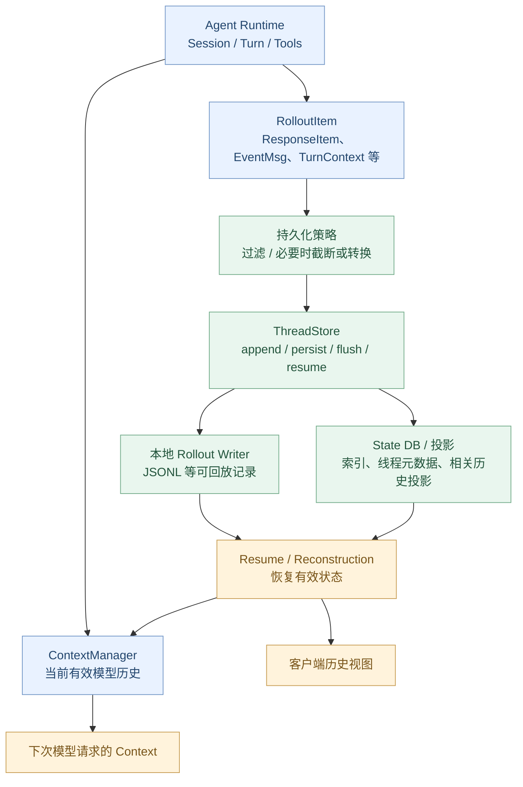
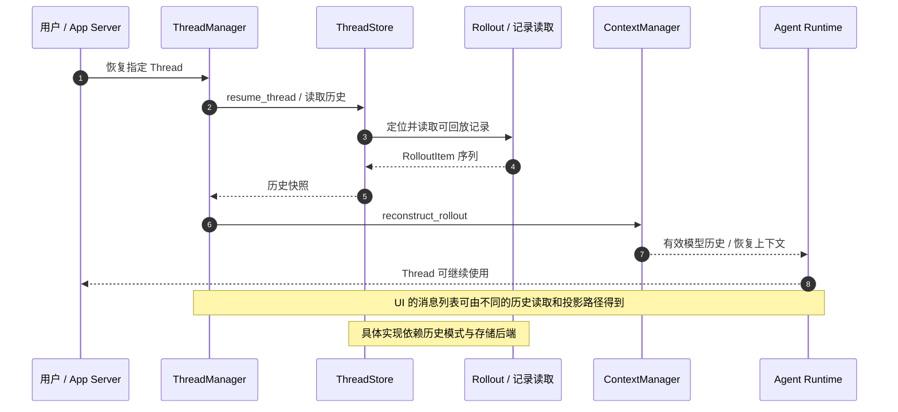

# 第 11 章：History / Rollout / Thread Store——Codex 如何保存与恢复会话？

> **核心问题：** 一轮 Codex 任务包含用户输入、模型输出、工具结果和大量生命周期事件。关闭应用再打开时，Codex 怎样找回它们？为什么“历史记录、Rollout、模型上下文”不能当成同一个东西？
>
> [上一章：Op / Event](../10-op-event/README.zh.md) · [教程首页](../README.zh.md) · [本章 demo.py](./demo.py)

第 10 章解释了 `Op` 如何进入 Core，以及 `EventMsg` 怎样送到 UI。现在需要回答另一个问题：

> **UI 收到的事件不是永久存储。进程结束后，谁负责保存事实？重启后的 Agent 又怎么接着理解以前发生的事情？**

这是一个持久化与恢复问题，也是长运行 Agent 能否可靠工作的基础。

学习目标：

1. 区分 **ContextManager、RolloutItem、ThreadStore、State DB**；
2. 理解 `ResponseItem` 与 `EventMsg` 在持久化历史中的不同用途；
3. 顺着 `append → persist/flush → resume → reconstruct` 找到真实源码；
4. 理解 **提交成功、排队成功、刷盘完成、会话恢复**是不同状态；
5. 通过一个可运行的 JSONL 实验，验证崩溃前未刷新数据、恢复时的历史筛选与 Turn 终态重建。

固定源码版本：[openai/codex @ `014489466a17`](https://github.com/openai/codex/tree/014489466a1739c2c563cdfe57880c2c7c8680e3)。章节只讨论此版本；下述 Python 实验是专门用于理解机制的缩小模型。

---

## 1. 为什么有了 History，还要 Rollout？

设想一条任务：

> 检查登录模块，运行测试，解释失败原因。

实际过程可能是：

```text
TurnStarted
用户输入：检查登录模块
模型发出 exec_command
ExecCommandBegin
进程输出：1 failed
ExecCommandEnd
模型分析：某个断言失败
TurnComplete
```

这些信息其实对应**不同消费者**：

| 消费者 | 真正关心什么？ |
| --- | --- |
| **模型** | 当前问题、之前的模型输出和工具观察，以及相关指令 |
| **UI** | Turn 开始、工具进度、消息、审批、完成等呈现状态 |
| **审计 / 诊断** | 某个调用在哪个 Turn、经过什么步骤、发生了哪些重要事件 |
| **会话恢复** | 现存历史、有效上下文、最后一个 Turn 处于什么状态 |
| **搜索 / 列表页面** | 有哪些 Thread、标题、时间、存储位置和摘要元数据 |

如果只保存“模型看到的聊天记录”，就缺少大量 UI 和运行时信息。如果只保存 UI 事件，又未必足以重建模型需要的精确输入。

Codex 因此采用了比“一个聊天消息数组”更丰富的**可回放记录模型**。

## 2. 四个名词：不要混为一谈

| 结构 | 作用 | 本章主要源码 |
| --- | --- | --- |
| **`ContextManager`** | 管理 Runtime 中的对话历史、上下文快照、模型输入视图 | `core/src/context_manager/history.rs` |
| **`RolloutItem`** | 表示可记录、可回放的不同种类历史事实 | `history/src/lib.rs` |
| **`ThreadStore`** | 抽象线程持久化：创建、追加、持久化、恢复、读取 | `thread-store/src/store.rs` |
| **`State DB`** | 支持线程发现、索引、元数据以及相关投影等用途 | `rollout/src/state_db.rs` |

需要把两个层面分开：

- **语义层面**：什么信息能让模型继续任务？什么信息用于 UI 展示？
- **存储层面**：哪些信息应该长期保存、何时视为可靠保存、如何重新加载？

在第 06 章，[`ContextManager`](https://github.com/openai/codex/blob/014489466a1739c2c563cdfe57880c2c7c8680e3/codex-rs/core/src/context_manager/history.rs#L91-L121) 已经出现。它的历史内容还包括模型之外的 Runtime 关联状态；**它不是存储后端本身**。

## 3. 一张架构图：内存历史怎样进入持久化层？



**这是职责图，不是某个配置下完全固定的数据通路。** 不同历史模式、压缩、投影和 ThreadStore 实现会改变具体读写方式；也不能认定所有 Thread 都恰好有一个可直接读取的未压缩 JSONL 文件。

## 4. `RolloutItem`：真正持久化的内容有哪些？

在 [`history/src/lib.rs`](https://github.com/openai/codex/blob/014489466a1739c2c563cdfe57880c2c7c8680e3/codex-rs/history/src/lib.rs#L215-L231)，真实源码定义了：

```rust
pub enum RolloutItem {
    SessionMeta(SessionMetaLine),
    ResponseItem(ResponseItemEnvelope),
    InterAgentCommunication(InterAgentCommunication),
    InterAgentCommunicationMetadata { trigger_turn: bool },
    Compacted(CompactedItem),
    TurnContext(TurnContextItem),
    TokenUsageRecord(TokenUsageRecord),
    WorldState(WorldStateItem),
    SecurityRiskScore(SecurityRiskScore),
    RetainedContext(RetainedContextEvent),
    EventMsg(EventMsg),
    RealtimeItem(RealtimeItem),
}
```

这一节是**源码原型节选**。不同变体承担不同职责：

| 变体 | 用来记什么？ |
| --- | --- |
| `SessionMeta` | 该 Rollout 归属的 Session / Thread 等元信息 |
| `ResponseItem` | 模型历史里的输入与输出项 |
| `EventMsg` | 重要运行事件：如 Turn 终态 |
| `TurnContext` | 关联当前 Turn 的部分上下文与设置 |
| `Compacted` | 上下文压缩后的标记与相关重建信息 |
| `TokenUsageRecord` | Token 用量相关信息 |
| `WorldState / RetainedContext` | 运行时需要保留的其他上下文事实 |
| `RealtimeItem` | 为实时会话呈现重建提供的稀疏事实 |

这告诉我们：**Rollout 不等于模型聊天记录，也不等于 UI 的事件日志。** 它是更广泛的可回放事实集合。

### `ResponseItemEnvelope` 又是什么？

[`history/src/lib.rs`](https://github.com/openai/codex/blob/014489466a1739c2c563cdfe57880c2c7c8680e3/codex-rs/history/src/lib.rs#L55-L70) 定义：

```rust
pub struct ResponseItemEnvelope {
    pub item: ResponseItem,
    pub metadata: Option<CodexHarnessMetadata>,
}
```

即保存模型历史项的同时，还能携带属于 Codex Harness 的元数据。

这些元数据不代表每次都应发给模型。持久化用于准确记录和恢复；**模型可见历史仍要经过上下文准备与筛选**。

## 5. JSONL 长什么样？一行为什么不只是文本？

在 [`history/src/lib.rs`](https://github.com/openai/codex/blob/014489466a1739c2c563cdfe57880c2c7c8680e3/codex-rs/history/src/lib.rs#L364-L375)：

```rust
pub struct RolloutLine {
    pub timestamp: String,
    pub ordinal: Option<u64>,
    pub item: RolloutItem, // 序列化时扁平化
}
```

当前 `RolloutItem` 通过 [`rollout_payload.rs`](https://github.com/openai/codex/blob/014489466a1739c2c563cdfe57880c2c7c8680e3/codex-rs/history/src/rollout_payload.rs#L29-L72) 的类型化 wire 表示进行序列化。大致可以把一条记录理解为：

```json
{
  "timestamp": "2026-01-01T00:00:00Z",
  "type": "event_msg",
  "payload": {
    "type": "task_complete"
  }
}
```

**上面是用于理解结构的简化示意，省略了真实事件必需字段，不能直接作为可由 Codex 解析的完整记录。** 实际记录还可能有 `ordinal`、更多嵌套字段，且要遵守兼容和解析规则。

### 为什么写成多行事件而不是总是一次保存整个历史数组？

追加式设计能依次记录新发生的事实，不需要每次重写完整历史。它也支持后续回放和诊断。

但“追加成功”并不天然等于“写入已经可靠落盘”，这引出后面的持久化屏障。

## 6. 写入前还有 Persistence Policy

**最值得纠正的误解之一：Core 产生的每一条事件，不一定都会原样落盘。**

[`rollout/src/policy.rs`](https://github.com/openai/codex/blob/014489466a1739c2c563cdfe57880c2c7c8680e3/codex-rs/rollout/src/policy.rs#L18-L70) 有一个关键函数：

```rust
pub fn persisted_rollout_item(
    item: &RolloutItem,
    history_mode: ThreadHistoryMode,
) -> Option<Cow<'_, RolloutItem>>
```

它根据记录种类和当前 `ThreadHistoryMode` 决定：

- 保留记录；
- 不保存某些记录；
- 为持久化转换或截断相应内容。

比如，该源码存在命令输出、MCP 工具结果等**持久化大小限制**，也会根据历史模式处理某些事件和实时信息。

这里请记住三份可能不同的内容：

```text
Runtime 刚发生的事件
        ≠
Rollout 最终的持久化表示
        ≠
下一次模型请求看到的上下文
```

这不是自相矛盾，而是**不同消费者与资源约束**。

**持久化过滤也不能被当成保密机制。** 真正的敏感信息隔离还需要来源、权限与数据处理策略，不能只靠截断长字符串实现。

## 7. `ThreadStore`：把存储实现隔离在抽象后面

在 [`thread-store/src/store.rs`](https://github.com/openai/codex/blob/014489466a1739c2c563cdfe57880c2c7c8680e3/codex-rs/thread-store/src/store.rs#L129-L155) 中，`ThreadStore` 是一个存储中立的 trait。

它包括：

| 方法 | 职责 |
| --- | --- |
| `create_thread` | 为新 Thread 建立存储上下文 |
| `append_items` | 按顺序追加可回放项目 |
| `persist_thread` | 进入明确的持久化检查点 |
| `flush_thread` | 等待已排队的写入变成可读取的持久状态 |
| `resume_thread` | 重新打开 Thread 并取回历史 |
| `load_thread_history` | 为恢复、分叉等场景读取历史 |
| `shutdown_thread` | 刷新并结束 Thread writer 生命周期 |

这些接口见 [`store.rs`](https://github.com/openai/codex/blob/014489466a1739c2c563cdfe57880c2c7c8680e3/codex-rs/thread-store/src/store.rs#L180-L251)。

**为什么不把文件路径写死在 Agent Runtime 里？**

因为存储方式可以变化。当前源码至少有：

- [`LocalThreadStore`](https://github.com/openai/codex/blob/014489466a1739c2c563cdfe57880c2c7c8680e3/codex-rs/thread-store/src/local/mod.rs#L147-L162)；
- [`InMemoryThreadStore`](https://github.com/openai/codex/blob/014489466a1739c2c563cdfe57880c2c7c8680e3/codex-rs/thread-store/src/in_memory.rs#L521-L560)。

[`LocalThreadStore impl ThreadStore`](https://github.com/openai/codex/blob/014489466a1739c2c563cdfe57880c2c7c8680e3/codex-rs/thread-store/src/local/mod.rs#L480-L570) 还体现默认的 Paginated 历史模式及相关 Writer 路径。

所以，**ThreadStore 是功能契约，不等于一个具体 JSONL 文件，也不等于 SQLite 本身。**

### State DB 在哪里？

在 [`rollout/src/state_db.rs`](https://github.com/openai/codex/blob/014489466a1739c2c563cdfe57880c2c7c8680e3/codex-rs/rollout/src/state_db.rs#L29-L70) 中，`StateDbHandle` 表示状态数据库 Runtime 的引用；同一模块还支持线程查询、查找 Rollout 路径、协调元数据与索引等操作。

State DB 与 Rollout 文件有协作关系，但不能简单推断为“所有历史只存 SQLite”或“SQLite 只是一个永远可以无损重建的标题缓存”。不同历史模式可能有更复杂的投影或物化逻辑。

## 8. durability：append、persist、flush 为什么要分开？

考虑下面的时序：

```text
Tool 执行完毕
    ↓
append_items(记录工具结果)
    ↓
进程突然退出
    ↓
新进程尝试 resume
```

**刚调用了追加接口，不代表后续进程一定能找回这条记录。**

在 [`ThreadStore::persist_thread / flush_thread`](https://github.com/openai/codex/blob/014489466a1739c2c563cdfe57880c2c7c8680e3/codex-rs/thread-store/src/store.rs#L226-L249) 的注释中：

- `persist_thread` 可能根据上下文允许后台排队；
- `flush_thread` 则表示等待已排队数据完成可靠持久化，并能够被读取；
- `shutdown_thread` 负责在结束 Writer 时处理待写内容。

[`PersistContext`](https://github.com/openai/codex/blob/014489466a1739c2c563cdfe57880c2c7c8680e3/codex-rs/thread-store/src/store.rs#L101-L126) 进一步区分：

- `ThreadPreparation`；
- `Standard`；
- `SubagentSpawn`；
- `TurnStart`；
- `SteeredUserInput`。

其中某些上下文允许**推迟完成持久化**；`Standard` 等明确要求更强的完成边界。

### 为什么要允许后台写？

为了降低常规交互延迟。每次模型生成一个小事件，都同步阻塞到磁盘完成可能严重拖慢 Agent。

### 为什么还必须有 flush？

因为某些重要时刻需要一个明确的事实：

> **我已经等到此前排队的记录持久化成功。**

例如线程交接、关闭、恢复前的数据一致性边界，就不能只依赖“发送了写入请求”。

这里的持久化保证也不是说任意硬件故障下 100% 永不丢失；实际可靠性还受文件系统、驱动、存储实现等影响。

## 9. `RolloutRecorder` 怎样写入、读取和恢复？

[`rollout/src/recorder.rs`](https://github.com/openai/codex/blob/014489466a1739c2c563cdfe57880c2c7c8680e3/codex-rs/rollout/src/recorder.rs#L85-L154) 定义 `RolloutRecorder`，内部使用 `RolloutCmd` 将追加、持久化、刷新、关闭等指令交给 Writer。

特别有用的源码入口：

| 方法 | 能验证什么？ |
| --- | --- |
| [`record_canonical_items`](https://github.com/openai/codex/blob/014489466a1739c2c563cdfe57880c2c7c8680e3/codex-rs/rollout/src/recorder.rs#L1064-L1080) | 提交项目给 Writer |
| [`persist`](https://github.com/openai/codex/blob/014489466a1739c2c563cdfe57880c2c7c8680e3/codex-rs/rollout/src/recorder.rs#L1082-L1101) | 建立 / 物化持久化边界 |
| [`flush`](https://github.com/openai/codex/blob/014489466a1739c2c563cdfe57880c2c7c8680e3/codex-rs/rollout/src/recorder.rs#L1103-L1118) | 等 Writer 报告刷新完成 |
| [`load_rollout_items`](https://github.com/openai/codex/blob/014489466a1739c2c563cdfe57880c2c7c8680e3/codex-rs/rollout/src/recorder.rs#L1120-L1182) | 逐行解析记录、恢复项目 |

这里不要把 `record_canonical_items` 简化为“直接调用 File.write()”。Writer 通过自己的通道和任务管理顺序、资源与失败反馈。

### JSONL 有坏行会发生什么？

真实 [`load_rollout_items`](https://github.com/openai/codex/blob/014489466a1739c2c563cdfe57880c2c7c8680e3/codex-rs/rollout/src/recorder.rs#L1120-L1182) 遇到部分无法解析的行时，会增加解析错误计数并跳过相关记录；还有一些特殊旧版记录处理。

这说明恢复并不总是“读取全部行一定成功”，也不意味着**静默跳过后历史一定完整**。

本章的 Python Demo 刻意采用更容易理解的规则：**发现坏行就明确报错**。这与真实 Codex 的部分容错解析策略不同，不能混淆。

## 10. 恢复 Thread：重新加载文件 ≠ 恢复当前运行时

当用户关闭应用又回来时，真正的恢复问题包括：

1. 找到正确的 Thread；
2. 找到对应持久化数据；
3. 读入有效的 RolloutItem；
4. 重建模型继续推理所需的上下文；
5. 确定最近 Turn 处于怎样的状态；
6. 将适用数据提供给 App Server / UI。

[`InitialHistory`](https://github.com/openai/codex/blob/014489466a1739c2c563cdfe57880c2c7c8680e3/codex-rs/history/src/lib.rs#L378-L395) 包含：

```rust
pub enum InitialHistory {
    New,
    Cleared,
    Resumed(ResumedHistory),
    Forked(Vec<RolloutItem>),
}
```

这几种来源具有不同语义：

| 形式 | 含义 |
| --- | --- |
| `New` | 全新历史 |
| `Cleared` | 被清除的历史 |
| `Resumed` | 从已有 Thread 的保存记录恢复 |
| `Forked` | 以提供的历史构造新的分叉 |

### 真正的模型历史重建在哪里？

在 [`core/src/session/rollout_reconstruction.rs`](https://github.com/openai/codex/blob/014489466a1739c2c563cdfe57880c2c7c8680e3/codex-rs/core/src/session/rollout_reconstruction.rs#L189-L229) 中，`ContextManager::reconstruct_rollout` 会：

- 检查输入 RolloutItem；
- 选择与当前重建有关的压缩检查点与后缀；
- 处理压缩后的有效窗口信息；
- 根据历史项目重建有效状态。

后续的 [`逆向扫描与 Turn 终态处理`](https://github.com/openai/codex/blob/014489466a1739c2c563cdfe57880c2c7c8680e3/codex-rs/core/src/session/rollout_reconstruction.rs#L235-L359) 还会识别 `TurnStarted / TurnComplete / TurnAborted` 等标记，避免错误地把较旧或延迟到达的状态当成当前最新事实。

一个值得注意的源码注释是：**Stop Hooks 可能在新的 Turn 开始之后才完成**。因此恢复时只用“整个文件最后一个 TurnComplete”推断当前任务状态，可能会得出错误结论。

这就是为什么真实恢复需要**重建算法**，不只是简单的 `items[-1]`。

## 11. 一张图看恢复过程



这也是职责层面的抽象时序，并非保证任意 `ThreadStore` 实现都在 `resume_thread` 内直接调用相同的 `RolloutRecorder::load_rollout_items`。

### “恢复”是不是自动续跑之前的命令？

**不能这么推断。** 恢复对话上下文，不等于自动重复启动之前执行过的 Shell 命令。旧命令可能有副作用；没有明确恢复协议就重放命令，会带来重复执行风险。

不同状态的 Turn 是否可恢复、以什么方式恢复，有额外的生命周期和恢复控制。第 11 章要掌握的是：**回放信息与重做副作用必须分离**。

## 12. 动手实验：一个最小的持久化与恢复系统

本章 Demo：[`demo.py`](./demo.py)。

运行环境：**Python 3.10+**，仅标准库，无 API Key、不连接模型。程序会在系统临时目录内创建一份教学用 JSONL，结束后自动清理；不会改动 GitHub 仓库或现有项目文件。

```bash
python demo.py
```

它定义了：

| 教学类型 | 对应概念 |
| --- | --- |
| `RolloutItem` | 带类型与 Turn ID 的记录 |
| `ToyThreadStore.append` | 把记录先加入等待写入的缓冲区 |
| `ToyThreadStore.flush` | 把缓冲区写入 JSONL，并执行文件刷新 |
| `ToyThreadStore.resume` | 从 JSONL 重新建立记录列表 |
| `project_ui` | 选择 Event 类事实供 UI 展示 |
| `model_input` | 选择 ResponseItem 类事实供教学模型视图 |
| `turn_state` | 通过终态标记判断特定 Turn 状态 |

**注意：** `ToyThreadStore` 的方法命名模仿 ThreadStore 职责，但它不实现 Codex 的真实存储协议、完整策略或异步 Writer。

### 实验 A：先持久化一次完整 Turn

代码追加：

```text
session_meta
turn-1: TurnStarted
turn-1: ResponseItem（用户消息）
turn-1: ResponseItem（模拟工具观察）
turn-1: ExecCommandEnd
turn-1: TurnComplete
```

然后调用 `flush()`，输出：

```text
Persisted first turn (flush complete)
```

### 实验 B：模拟崩溃前尚未刷盘

接着添加 `turn-2` 的两条记录，但**不调用 flush**，直接创建一个新的 `ToyThreadStore` 去加载磁盘内容。

结果：

```text
Recovered after simulated pre-flush crash: turn-1 completed; turn-2 absent
```

这个实验演示的是**程序内待写缓冲区丢失**，不是在模拟完整的断电、文件系统缓存行为或真实 Codex 的 Writer。

### 实验 C：重新保存中断的 Turn

重新写入第二个 Turn：

```text
turn-2: TurnStarted
turn-2: ResponseItem（用户要求取消）
turn-2: TurnAborted
```

`flush()` 后重新打开 Rollout，通过 `turn_state` 判断：

- `turn-1`：`completed`；
- `turn-2`：`aborted`。

**不会把 TurnAborted 当成 TurnComplete。**

### 实验 D：同一份记录的两个视图

Demo 会打印：

```text
UI event projection: ['turn-1: TurnStarted', 'turn-1: ExecCommandEnd', 'turn-1: TurnComplete', 'turn-2: TurnStarted', 'turn-2: TurnAborted']
Model input projection: ['用户：检查登录模块', '工具观察：模拟测试通过', '用户：取消操作']
Turn states: completed aborted
All teaching assertions passed
```

注意：

- UI 的教学投影包含**生命周期事件**；
- 模型的教学投影包含**历史输入项**；
- 两者来自同一份持久化记录，却不是同一条列表。

真实 Codex 的模型上下文构建还涉及指令、工具规格、模态过滤、Compaction 和历史恢复规则，绝不是 Demo 中的两个 `if` 过滤器。

### 实验 E：增加错误记录会怎样？

尝试在临时文件里人为放入无效 JSON 再调用 `resume()`。这个 Toy 实现会明确报错并指出行号。

**这只是一个教学上更容易定位错误的选择。** 真实 `RolloutRecorder::load_rollout_items` 对某些坏行采取跳过并记录解析错误的策略，不能据此推断官方总是 fail-fast。

---

## 13. 再次区分：什么是 History Mode？

固定源码中存在 `ThreadHistoryMode::Legacy` 与 `ThreadHistoryMode::Paginated` 的分支。

在 [`rollout/src/policy.rs`](https://github.com/openai/codex/blob/014489466a1739c2c563cdfe57880c2c7c8680e3/codex-rs/rollout/src/policy.rs#L18-L70) 可看到存储政策按历史模式区分；[`LocalThreadStore`](https://github.com/openai/codex/blob/014489466a1739c2c563cdfe57880c2c7c8680e3/codex-rs/thread-store/src/local/mod.rs#L480-L488) 在当前版本中的默认历史模式是 `Paginated`，但 `ThreadStore` trait 为兼容还声明了不同的默认值。

因此不能用“Codex 一定永远把全部事件放在一个 JSONL 文件”描述所有版本和配置。

概念上可以这样理解：

- **Legacy**：与旧版历史和 Rollout 兼容的模式；
- **Paginated**：支持分页、历史物化及不同投影视图的模式；
- **用户读历史**和**模型恢复上下文**可能采用不同的读取投影。

要查真实的分页读取与存储实现，可继续读 [`thread-store/src/local/thread_history.rs`](https://github.com/openai/codex/blob/014489466a1739c2c563cdfe57880c2c7c8680e3/codex-rs/thread-store/src/local/thread_history.rs) 与 [`thread_history_materialization.rs`](https://github.com/openai/codex/blob/014489466a1739c2c563cdfe57880c2c7c8680e3/codex-rs/thread-store/src/local/thread_history_materialization.rs)。

本章不展开 SQLite Schema 和物化表的逐列定义；这不影响理解存储抽象边界。

## 14. 工程设计：如果你自己做 Agent History，最先防什么？

除了实现 `append`，还需要思考几个真实工程问题。

| 风险 | 为什么严重 | 对应设计 |
| --- | --- | --- |
| **重复执行工具** | Resume 时错误重放具有副作用的命令 | 将历史重建与副作用执行分开 |
| **写入未持久化** | UI 已显示成功但崩溃后记录丢失 | 明确 flush / durability 边界 |
| **事件顺序错乱** | Turn 状态被旧事件覆盖 | 事件关联、顺序与恢复算法 |
| **历史过大** | 模型上下文和存储无限膨胀 | 持久化策略、截断、Compaction |
| **索引与内容不一致** | 列表能找到 Thread 但读历史失败 | 索引修复、容错读取及告警 |
| **私密数据泄露** | 将原始工具输出长期保存 | 权限分离、内容治理和数据保留策略 |

这些风险与第 10 章的事件传输、第 09 章的权限边界相连接。**Agent 的可靠性不仅取决于能否正确调用一次模型，还取决于状态可恢复和执行不可错误重复。**

## 15. 真实源码阅读清单

从抽象到实现，再回到恢复：

| 顺序 | 源码 | 只需验证的事实 |
| --- | --- | --- |
| 1 | [`ContextManager`](https://github.com/openai/codex/blob/014489466a1739c2c563cdfe57880c2c7c8680e3/codex-rs/core/src/context_manager/history.rs#L91-L121) | 内存中的模型历史与快照 |
| 2 | [`RolloutItem`](https://github.com/openai/codex/blob/014489466a1739c2c563cdfe57880c2c7c8680e3/codex-rs/history/src/lib.rs#L215-L231) | Rollout 保存的事实种类 |
| 3 | [`RolloutLine`](https://github.com/openai/codex/blob/014489466a1739c2c563cdfe57880c2c7c8680e3/codex-rs/history/src/lib.rs#L364-L375) | 持久化记录结构 |
| 4 | [`persisted_rollout_item`](https://github.com/openai/codex/blob/014489466a1739c2c563cdfe57880c2c7c8680e3/codex-rs/rollout/src/policy.rs#L18-L70) | 记录如何按模式筛选与转换 |
| 5 | [`ThreadStore`](https://github.com/openai/codex/blob/014489466a1739c2c563cdfe57880c2c7c8680e3/codex-rs/thread-store/src/store.rs#L129-L155) | 存储中立的接口 |
| 6 | [`PersistContext`](https://github.com/openai/codex/blob/014489466a1739c2c563cdfe57880c2c7c8680e3/codex-rs/thread-store/src/store.rs#L101-L126) | 哪些场景允许后台落盘 |
| 7 | [`persist / flush / shutdown`](https://github.com/openai/codex/blob/014489466a1739c2c563cdfe57880c2c7c8680e3/codex-rs/thread-store/src/store.rs#L226-L249) | 持久化完成语义 |
| 8 | [`LocalThreadStore`](https://github.com/openai/codex/blob/014489466a1739c2c563cdfe57880c2c7c8680e3/codex-rs/thread-store/src/local/mod.rs#L480-L570) | 本地存储实现与历史模式 |
| 9 | [`RolloutRecorder`](https://github.com/openai/codex/blob/014489466a1739c2c563cdfe57880c2c7c8680e3/codex-rs/rollout/src/recorder.rs#L85-L154) | Writer 与指令队列 |
| 10 | [`load_rollout_items`](https://github.com/openai/codex/blob/014489466a1739c2c563cdfe57880c2c7c8680e3/codex-rs/rollout/src/recorder.rs#L1120-L1182) | 读取和容错解析 |
| 11 | [`InitialHistory`](https://github.com/openai/codex/blob/014489466a1739c2c563cdfe57880c2c7c8680e3/codex-rs/history/src/lib.rs#L378-L395) | 新建、恢复、分叉的来源区别 |
| 12 | [`reconstruct_rollout`](https://github.com/openai/codex/blob/014489466a1739c2c563cdfe57880c2c7c8680e3/codex-rs/core/src/session/rollout_reconstruction.rs#L208-L279) | 恢复有效上下文的入口 |
| 13 | [`Turn 终态回放`](https://github.com/openai/codex/blob/014489466a1739c2c563cdfe57880c2c7c8680e3/codex-rs/core/src/session/rollout_reconstruction.rs#L317-L359) | 为什么不能只看最后一行 |

## 16. 五道思考题与答案

**Q1：RolloutItem 全部都是发给模型的文本吗？** 不是，它还包括 SessionMeta、EventMsg、TurnContext、压缩标记等不同职责的事实。

**Q2：`append_items` 返回成功，是否说明立即断电后一定不会丢？** 不能直接推断。需看该存储实现的持久化语义及相关 flush 屏障。

**Q3：Resume 时读取 Rollout JSONL 是否就相当于恢复了完整 Agent Runtime？** 不是。还要重建有效历史、Turn 状态、环境等；旧副作用也不能无条件重放。

**Q4：为什么 EventMsg 的持久化内容与 UI 实时收到的内容可能不同？** 存在历史模式、持久化过滤和内容限制，UI 还可能有自己的状态投影与事件映射。

**Q5：如果文件末尾是 TurnComplete，能否直接认为整个 Thread 最新 Turn 成功完成？** 不能。可能存在延迟到达的终态、多个 Turn 及错误信息；真实恢复算法会进行相应的状态关联与重建。

---

## 本章总结

```text
Session / Runtime
       │
       ├── ContextManager（当前有效模型上下文）
       │
       └── RolloutItem（模型项、事件、上下文、标记...）
                    │
                    ▼
              Persistence Policy
                    │
                    ▼
             ThreadStore / Writer
                    │
          ┌─────────┴──────────┐
          ▼                    ▼
     Rollout 记录       State DB / 投影
          └─────────┬──────────┘
                    ▼
            Resume / Reconstruction
                    │
             ┌──────┴───────┐
             ▼              ▼
        模型历史         UI 历史视图
```

**第 11 章最重要的一句话：历史是为推理准备的有效上下文，Rollout 是可回放的运行事实，ThreadStore 则负责这些事实的持久化、读取和恢复边界。**

下一章：[第 12 章《Token Budget / Compaction》](../12-token-budget-compaction/README.zh.md)。

接下来研究：**当历史越来越长、上下文窗口即将耗尽时，Codex 怎样选择保留什么、何时压缩、压缩后如何继续执行？**

