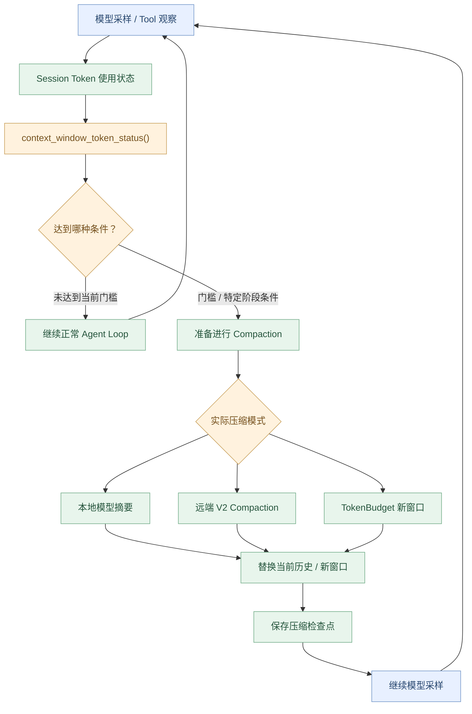
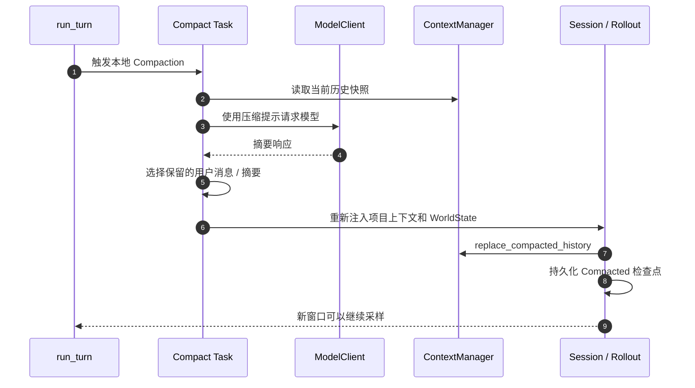

# 第 12 章：Token Budget / Compaction——上下文快满时 Codex 怎样继续运行？

> **本章核心问题：** 一个 Agent 已经读取了大量文件、执行了多次工具、处理了很多轮消息。当模型上下文窗口越来越满，Codex 怎样判断是否需要压缩？压缩后保留什么？历史是否会丢失？
>
> [上一章：History / Rollout / Thread Store](../11-history-rollout-thread-store/README.zh.md) · [教程首页](../README.zh.md) · [本章 Demo](./demo.py)

前 11 章已经从用户输入追踪到模型采样、工具执行、安全审批、事件通信和历史持久化。现在处理一个长运行 Agent 必然面对的问题：**有限的模型上下文窗口**。

本章不只介绍“摘要压缩”，还会区分真实源码中的 **上下文用量计算、自动压缩触发、本地总结、远端 V2 压缩、TokenBudget 新窗口模式和后台异步压缩**。

学完应能：

1. 区分 **模型上下文容量、自动压缩阈值、后备缓冲区、上下文内估算 Token 数量**。
2. 根据 `ContextWindowTokenStatus` 判断何时触发压缩，而不是猜一个固定百分比。
3. 找到 `run_turn` 中压缩发生在 **PreTurn、MidTurn、PostTurn** 的不同位置。
4. 解释本地摘要、远端 V2 和 TokenBudget 模式之间的本质区别。
5. 理解旧历史仍可能存在于 Rollout，而**当前模型看到的历史已经被替换**。
6. 通过可运行的 Demo 验证触发边界、历史版本检查以及新窗口重置。

**源码基线：** [openai/codex @ `014489466a17`](https://github.com/openai/codex/tree/014489466a1739c2c563cdfe57880c2c7c8680e3)，下文均以这一固定提交为准。

---

## 1. 模型为什么会“忘记前文”？

看一个实际的 Agent 任务：

> 检查登录模块所有失败的测试，并给出最小修复建议。

执行步骤不断积累：

```text
用户要求
  ↓
读取项目说明
  ↓
读取登录模块
  ↓
读取测试文件
  ↓
执行 pytest，得到大量日志
  ↓
继续阅读依赖代码
  ↓
再次执行测试
  ↓
分析结果并输出建议
```

每次模型需要继续采样，都要结合当前可用历史。问题在于，模型的上下文窗口有上限。

这至少带来四个工程约束：

- **容量**：请求输入、生成内容和系统使用的相关上下文不能无限增长。
- **成本**：更长输入通常会增加模型调用成本或延迟。
- **有效性**：过多旧日志可能淹没当前任务最相关的信息。
- **连续性**：为了腾出空间删除旧历史，又可能丢失关键决策。

因此，Context Engineering 必须回答：

**哪些信息应保留原样，哪些能提炼为摘要，哪些应该退出当前窗口，何时应该打开新的上下文窗口？**

注意：压缩**不会增加模型物理上下文窗口上限**。它是设法缩小需要再次发送或保留在当前窗口中的内容。

## 2. 三个容易混淆的 Token 概念

| 名称 | 含义 | 常见误解 |
| --- | --- | --- |
| **Context Window Limit** | 模型当前有效的上下文容量上限 | 等于本次回答最多可以输出的 Token |
| **Auto-Compaction Limit** | Runtime 判断是否需要压缩使用的预算阈值 | 一定等于模型完整窗口 |
| **Estimated Token Count** | Runtime 在缺少精确数据时的近似统计 | 与模型服务端实际 tokenizer 完全一致 |

在 [`ContextManager::estimate_token_count`](https://github.com/openai/codex/blob/014489466a1739c2c563cdfe57880c2c7c8680e3/codex-rs/core/src/context_manager/history.rs#L650-L681)，源码写得非常清楚：

> Estimate token usage using byte-based heuristics … a coarse lower bound.

这意味着**估算是估算**，不是“每个字符固定一个 Token”，也不是服务端 tokenizer 的权威计数。

而 [`context_window_token_status()`](https://github.com/openai/codex/blob/014489466a1739c2c563cdfe57880c2c7c8680e3/codex-rs/core/src/session/context_window.rs#L26-L53) 会从 Session 的 Token 使用情况出发，根据所选模型与配置计算当前窗口状态。

### 不要用一个固定数字描述所有模型

这一提交中的容量来自模型信息与配置。例如 [`context_window.rs`](https://github.com/openai/codex/blob/014489466a1739c2c563cdfe57880c2c7c8680e3/codex-rs/core/src/session/context_window.rs#L83-L87) 中的有效上限，会结合 `resolved_context_window()` 与 `effective_context_window_percent`。

因此不能声称“Codex 永远在 80% 触发压缩”。模型、配置、当前使用量与阶段都会影响判断。

## 3. 源码地图：Token 管理发生在哪里？



这张图是**压缩职责图**，不是精确的同步调用堆栈。尤其是异步压缩会先在后台产生候选结果，直到合适时机才尝试安装；后面会单独解释。

本章最值得跟读的源码：

- [`session/context_window.rs`](https://github.com/openai/codex/blob/014489466a1739c2c563cdfe57880c2c7c8680e3/codex-rs/core/src/session/context_window.rs)：计算预算和触发条件。
- [`session/turn.rs`](https://github.com/openai/codex/blob/014489466a1739c2c563cdfe57880c2c7c8680e3/codex-rs/core/src/session/turn.rs)：在 Agent Loop 不同阶段发起压缩。
- [`compact.rs`](https://github.com/openai/codex/blob/014489466a1739c2c563cdfe57880c2c7c8680e3/codex-rs/core/src/compact.rs)：本地摘要及历史重组。
- [`compact_remote_v2.rs`](https://github.com/openai/codex/blob/014489466a1739c2c563cdfe57880c2c7c8680e3/codex-rs/core/src/compact_remote_v2.rs)：远端 V2。
- [`compact_token_budget.rs`](https://github.com/openai/codex/blob/014489466a1739c2c563cdfe57880c2c7c8680e3/codex-rs/core/src/compact_token_budget.rs)：启用 TokenBudget 功能时的新窗口路径。
- [`session/async_compaction.rs`](https://github.com/openai/codex/blob/014489466a1739c2c563cdfe57880c2c7c8680e3/codex-rs/core/src/session/async_compaction.rs)：后台候选压缩。
- [`session/mod.rs → replace_compacted_history`](https://github.com/openai/codex/blob/014489466a1739c2c563cdfe57880c2c7c8680e3/codex-rs/core/src/session/mod.rs#L4242-L4409)：替换有效历史并持久化检查点。

## 4. 最重要的结构：ContextWindowTokenStatus

打开 [`session/context_window.rs`](https://github.com/openai/codex/blob/014489466a1739c2c563cdfe57880c2c7c8680e3/codex-rs/core/src/session/context_window.rs#L7-L21)，你会看到：

```rust
pub(crate) struct ContextWindowTokenStatus {
    pub(crate) active_context_tokens: i64,
    pub(crate) auto_compact_scope_tokens: i64,
    pub(crate) auto_compact_scope_limit: Option<i64>,
    pub(crate) full_context_window_limit: Option<i64>,
    pub(crate) base_window_tokens_remaining: Option<i64>,
    pub(crate) auto_compact_window_prefill_tokens: Option<i64>,
    pub(crate) full_context_window_limit_reached: bool,
    pub(crate) token_limit_reached: bool,
    pub(crate) turn_end_compaction_threshold_reached: bool,
}
```

**逐个解释：**

| 字段 | 含义 |
| --- | --- |
| `active_context_tokens` | 当前窗口所用的 Token 数 |
| `auto_compact_scope_tokens` | 在配置所选统计范围内计入自动压缩预算的 Token |
| `auto_compact_scope_limit` | 该统计范围对应的压缩阈值 |
| `full_context_window_limit` | 模型完整有效窗口的限制 |
| `base_window_tokens_remaining` | 同时考虑正常预算与完整窗口后的剩余空间 |
| `token_limit_reached` | 已触发压缩预算 / 完整窗口条件 |
| `turn_end_compaction_threshold_reached` | 满足 Turn 结束后的压缩条件 |

这些字段不能直接简化为 `used / max >= 0.8`。

### `Total` 与 `BodyAfterPrefix`

[`context_window.rs`](https://github.com/openai/codex/blob/014489466a1739c2c563cdfe57880c2c7c8680e3/codex-rs/core/src/session/context_window.rs#L59-L82) 支持不同的统计范围：

- `AutoCompactTokenLimitScope::Total`：按当前完整活跃上下文计入压缩统计。
- `AutoCompactTokenLimitScope::BodyAfterPrefix`：将相应窗口的 Prefill Prefix 作为基线，更关注 Prefix 之后增长的内容。

第二种并不是“Prefix 完全不占用模型上下文”。**完整模型窗口的硬上限仍独立生效**，即使 BodyAfterPrefix 计数还很小，整体占满了也需要处理。

## 5. 什么情况下判定需要压缩？

在 [`context_window.rs`](https://github.com/openai/codex/blob/014489466a1739c2c563cdfe57880c2c7c8680e3/codex-rs/core/src/session/context_window.rs#L83-L119) 中，核心公式可以写成教学简化版：

```text
full_limit = resolved_context_window × effective_percent / 100

buffered_auto_limit = auto_compact_scope_limit + fallback_buffer

token_limit_reached =
    (scope_usage >= buffered_auto_limit)
    OR (active_context_tokens >= full_limit)
```

**教学边界：** 实际源码中变量带 `Option`，缓冲区只有存在相应回退配置时才会预留，计算还使用饱和整数运算，并非简单的固定常数。这里展示的是易理解的逻辑结构。

### 一个数值例子

假设只是教学中的三项数据：

- 有效完整窗口 `100` 个“Token 单位”；
- 自动压缩基础阈值 `70`；
- 后备缓冲区 `5`。

则：

| 当前使用 | 触发？ | 原因 |
| --- | --- | --- |
| 74 | 否 | 未达到 75 |
| 75 | 是 | 达到带缓冲的自动压缩门槛 |
| 100 | 是 | 达到完整上下文硬限制 |

如果改为 `BodyAfterPrefix`，且前缀占了 50 单位：

- 当前总使用 `78`；
- Prefix 之后仅 `28`；
- 因此按 75 的 Body 预算尚未到门槛；
- 但总使用到 `100` 仍然会触发完整窗口限制。

这就是 Demo 的第一组实验。

### PostTurn 的阈值可以是另一个条件

同一个源码还检查 `model_post_turn_compact_threshold_percent`。它有可能在 Turn 结束时按完整窗口占用比例触发压缩，而**尚未碰到正常的 Token Limit**。

例如演示阈值为 80%、完整上限为 100、自动压缩上限为 95，则总使用 82 时：

- 普通 Token Limit 未到；
- 但是 PostTurn 压缩条件已满足。

**这里的 80% 仅是教学配置，不是 Codex 所有环境的默认值。**

## 6. 何时进行压缩？不是只有一种时机

从 [`session/turn.rs`](https://github.com/openai/codex/blob/014489466a1739c2c563cdfe57880c2c7c8680e3/codex-rs/core/src/session/turn.rs) 看，压缩可能出现在多个阶段：

| 阶段 | 触发位置 | 工程意义 |
| --- | --- | --- |
| **PreTurn** | [`run_pre_sampling_compact`](https://github.com/openai/codex/blob/014489466a1739c2c563cdfe57880c2c7c8680e3/codex-rs/core/src/session/turn.rs#L1379-L1408) | 下一个用户输入正式进入采样前，检查旧窗口是否已超限 |
| **MidTurn** | [`采样后续执行状态判断`](https://github.com/openai/codex/blob/014489466a1739c2c563cdfe57880c2c7c8680e3/codex-rs/core/src/session/turn.rs#L595-L703) | 还要继续调用工具或采样，但上下文已经过大 |
| **PostTurn** | [`Turn 结束时判断`](https://github.com/openai/codex/blob/014489466a1739c2c563cdfe57880c2c7c8680e3/codex-rs/core/src/session/turn.rs#L783-L814) | 当前阶段结束后为未来请求腾空间 |
| **StandaloneTurn** | 手动压缩入口 | 用户 / 客户端明确请求压缩 |

### PreTurn 有个重要 TODO

[`run_turn` 的前置压缩逻辑](https://github.com/openai/codex/blob/014489466a1739c2c563cdfe57880c2c7c8680e3/codex-rs/core/src/session/turn.rs#L181-L226) 提到：此时**新用户消息与部分上下文更新尚未正式记入历史**。源码 TODO 还指出可以进一步预测新增内容的大小，以便提前压缩。

这说明 PreTurn 检查并不神奇地预知本次 Turn 将产生多少工具日志。

### MidTurn 为什么尤其关键？

当模型读了大文件、得到工具输出后，它可能还想继续下一步。如果此时历史接近窗口限制，Runtime 需要先压缩再采样，以免“只差最后一步却无法继续”。

[`采样后处理`](https://github.com/openai/codex/blob/014489466a1739c2c563cdfe57880c2c7c8680e3/codex-rs/core/src/session/turn.rs#L600-L697) 明确结合：

- 模型是否还需要后续采样；
- 有没有新输入排队；
- 当前 Token 使用；
- 后台候选压缩结果；
- 是否需要转换成新窗口。

**不是每次模型采样后都强制做压缩**。

## 7. 本地 Compaction：为什么“生成摘要”不等于“抛弃一切”？

当 Provider 不支持相应远端 V2 能力时，[`run_auto_compact`](https://github.com/openai/codex/blob/014489466a1739c2c563cdfe57880c2c7c8680e3/codex-rs/core/src/session/turn.rs#L1514-L1615) 可以选择 [`compact.rs`](https://github.com/openai/codex/blob/014489466a1739c2c563cdfe57880c2c7c8680e3/codex-rs/core/src/compact.rs) 中的本地模型摘要路径。

典型流程：



这张图描述本地摘要的**主干流程**，省略了重试、Hook、异常、工具输出等分支。

### 真实源码保留了哪些重要信息？

在 [`compact.rs`](https://github.com/openai/codex/blob/014489466a1739c2c563cdfe57880c2c7c8680e3/codex-rs/core/src/compact.rs#L373-L439) 中，压缩会提取摘要内容、收集用户消息、构造替换历史，然后调用 `replace_compacted_history`。

而 [`build_compacted_history_with_limit`](https://github.com/openai/codex/blob/014489466a1739c2c563cdfe57880c2c7c8680e3/codex-rs/core/src/compact.rs#L697-L760) 从较新的用户消息向前挑选，在预算内尽量保存其内容与相关元数据，而不是一律只保留“最后一句用户输入”。

这里的 Token 统计也使用近似计数，保留哪些具体内容还受消息类型、多模态与预算影响。

### 指令和项目上下文会不会被一起丢掉？

不能简单说“压缩前所有文本都放进一个摘要，旧指令也就消失了”。

[`build_compaction_replacement_history`](https://github.com/openai/codex/blob/014489466a1739c2c563cdfe57880c2c7c8680e3/codex-rs/core/src/compact.rs#L84-L111) 会结合当前会话与 `WorldState` 构造新的初始上下文，并将其插入替换历史。这样处理是为了使新窗口具备继续任务所需的有效上下文，而不是只拿一个孤立的摘要。

**压缩后有效上下文可能更短，但仍然需要正确的基础指令、当前环境和项目约束。**

## 8. 上下文太长，以至于压缩请求本身都失败怎么办？

这是源码里非常现实的边界。

本地压缩需要向模型发送一次压缩请求；但如果请求本身已经超出模型窗口，就可能收到 `ContextWindowExceeded`。

在 [`compact.rs`](https://github.com/openai/codex/blob/014489466a1739c2c563cdfe57880c2c7c8680e3/codex-rs/core/src/compact.rs#L344-L368) 中，对这类情况：

- 如果仍有足够的历史项，可以移除最旧的一项后重试压缩；
- 当无法继续删减时，按上下文超限错误处理。

而 [`ContextManager::remove_first_item`](https://github.com/openai/codex/blob/014489466a1739c2c563cdfe57880c2c7c8680e3/codex-rs/core/src/context_manager/history.rs#L683-L698) 还会处理工具调用 / 对应输出的关联关系，避免破坏历史结构的不变量。

这比“简单 `messages = messages[-10:]`”严谨得多。

**需要注意：正常压缩过程不意味着一定采用同样的“删除最旧项”策略。** 这是本地压缩请求超限时的补救路径。

## 9. 远端 V2 Compaction：为什么不能与本地摘要混为一谈？

在 [`session/turn.rs → run_auto_compact`](https://github.com/openai/codex/blob/014489466a1739c2c563cdfe57880c2c7c8680e3/codex-rs/core/src/session/turn.rs#L1550-L1615) 中，实际路径取决于 Provider 的 `remote_compaction` 能力：

- `RemoteCompactionSupport::V2`：可以走远端 V2 压缩。
- `RemoteCompactionSupport::Unsupported`：走本地摘要压缩等适用路径。
- 若启用了独立的 `Feature::TokenBudget`，则存在另一种新窗口路径，见下一节。

远端 V2 不是简单调用本地 `compact.rs` 的同一个函数改改参数。

[`compact_remote_v2.rs`](https://github.com/openai/codex/blob/014489466a1739c2c563cdfe57880c2c7c8680e3/codex-rs/core/src/compact_remote_v2.rs#L112-L165) 有自己的入口，[`build_v2_compacted_history`](https://github.com/openai/codex/blob/014489466a1739c2c563cdfe57880c2c7c8680e3/codex-rs/core/src/compact_remote_v2.rs#L480-L509) 会根据保留规则整理历史，再添加远端返回的压缩项。

### 什么叫“Retained Messages”？

远端压缩后可能有些消息仍需保留原始结构或作为特殊的持久事实，例如符合规则的客户端内容、工具输出或其他需要继续引用的内容。

真实源码会按策略筛选，并按预算截断部分保留信息；包含图像时还有独立处理。

**所以“压缩后只有一段纯文本摘要”并不符合所有实现。**

## 10. TokenBudget 特性：可能根本不做模型摘要

这是本章最反直觉的一个设计。

打开 [`compact_token_budget.rs`](https://github.com/openai/codex/blob/014489466a1739c2c563cdfe57880c2c7c8680e3/codex-rs/core/src/compact_token_budget.rs#L12-L66)。文件注释明确写道：

> Token-budget compaction skips model/server summarization and installs a fresh context window instead.

也就是说，当对应功能启用时，这条压缩路径会：

1. 按同一 Compaction 生命周期执行适用 Hook；
2. 发布 Compaction 相关的 Turn Item；
3. 直接调用 `sess.start_new_context_window(...)`；
4. 继续后置生命周期处理。

**这里不依赖模型生成摘要**。它不是“压缩算法效果更好所以不需 Token”，而是一种不同的上下文重置策略。

因此，讲 Codex Compaction 时必须明确配置条件。

### Reminder 与 Fallback Prompt

[`session/token_budget.rs`](https://github.com/openai/codex/blob/014489466a1739c2c563cdfe57880c2c7c8680e3/codex-rs/core/src/session/token_budget.rs#L165-L216) 中还可以看到：

- 根据剩余 Token 数发送预算提醒；
- 在符合条件且配置了后备提示词时，注入相应的 fallback 提示。

这和压缩采用哪个模型、是否实际生成摘要是不同层的问题。

**不要把 Reminder 当成上下文窗口已经扩容的证明，也不要把 Fallback Prompt 当成总会被注入的固定系统提示。**

## 11. Async Compaction：后台结果为什么要防止覆盖新历史？

长运行 Agent 可能在前台继续工作时，后台开始准备压缩结果。

[`session/async_compaction.rs`](https://github.com/openai/codex/blob/014489466a1739c2c563cdfe57880c2c7c8680e3/codex-rs/core/src/session/async_compaction.rs#L24-L83) 的后台候选快照记录了类似：

```rust
struct CompactionAttempt {
    history_version: u64,
    model_slug: String,
    compaction_hash: Option<String>,
    auth_owner_generation: Option<u64>,
}
```

为什么需要这些条件？

设想：

```text
t0：读取历史 A，后台开始摘要
t1：用户追加“不要改代码”，历史变为 B
t2：旧摘要 A 返回
t3：若不检查版本，就可能用摘要 A 覆盖包含新要求的 B
```

这会造成严重的信息丢失，甚至覆盖用户新的权限与任务约束。

在 [`async_compaction.rs → take_ready`](https://github.com/openai/codex/blob/014489466a1739c2c563cdfe57880c2c7c8680e3/codex-rs/core/src/session/async_compaction.rs#L145-L156)，候选结果就会检查历史版本。其他准备或安装路径还会检查模型、压缩版本 / Hash、鉴权拥有者世代以及有效的历史前缀。

在 [`replace_compacted_history`](https://github.com/openai/codex/blob/014489466a1739c2c563cdfe57880c2c7c8680e3/codex-rs/core/src/session/mod.rs#L4242-L4340) 的前缀安装路径中，也会在真正替换当前历史前确认快照有效；如果前台已经产生新的后缀，还要避免悄悄丢失这些新增内容。

**异步压缩是并发状态管理问题，不仅是后台请求模型的问题。**

### 什么时候可以开启后台压缩？

[`async_compaction.rs → enabled / maybe_start`](https://github.com/openai/codex/blob/014489466a1739c2c563cdfe57880c2c7c8680e3/codex-rs/core/src/session/async_compaction.rs#L39-L96) 显示它依赖特性开关、远端 V2 支持、非 TokenBudget 路径、窗口使用量以及执行阶段。

不能因为当前上下文用了 60% 就断言“一定已经有后台压缩任务”。

## 12. 压缩后如何确保恢复时仍然认识新窗口？

第 11 章已经学习 Rollout 和 ThreadStore：它们存的是可回放记录，而不是只存当前模型可见的 `Prompt`。

在 [`Session::replace_compacted_history`](https://github.com/openai/codex/blob/014489466a1739c2c563cdfe57880c2c7c8680e3/codex-rs/core/src/session/mod.rs#L4242-L4410) 中，安装压缩结果时会：

- 更新当前内存历史；
- 建立 `CompactedItem`，其中可以包含 `replacement_history`；
- 保留与窗口和恢复相关的元数据；
- 同时保存相应的 `WorldState`、`TurnContext` 等记录；
- 将压缩检查点交给持久化路径。

这很重要：**“旧内容退出了当前模型窗口”并不等于“原始 Rollout 记录立即全部从存储中删除”。**

相应地，第 11 章里的 [`reconstruct_rollout`](https://github.com/openai/codex/blob/014489466a1739c2c563cdfe57880c2c7c8680e3/codex-rs/core/src/session/rollout_reconstruction.rs#L208-L279) 会查找合适的压缩检查点，选取影响恢复的后缀，按恢复语义重建有效历史。

所以应当区分：

| 层次 | 压缩后的行为 |
| --- | --- |
| **当前模型窗口** | 采用替换后的历史或新窗口上下文 |
| **内存 ContextManager** | 历史版本发生变化，可能需要使旧快照失效 |
| **持久化 Rollout** | 记录压缩检查点和恢复所需元数据 |
| **恢复后模型输入** | 从有效检查点及后续记录重建，而不是原样发送整份旧日志 |

这就是 **Compaction 与 History Replay 必须配套设计** 的原因。

## 13. 一次压缩的成本和代价是什么？

压缩不是零成本的魔法。

| 代价 | 为什么产生 | 应如何理解 |
| --- | --- | --- |
| **额外模型调用** | 本地摘要或部分远端压缩需要模型服务参与 | 可能增加 Token、时间或请求成本 |
| **信息损失** | 摘要通常不能完整复原所有细节 | 重要约束、原始证据不该无条件丢弃 |
| **恢复复杂度** | 新窗口需要持久化检查点和状态映射 | 不是覆盖一个字符串就结束 |
| **异步竞争** | 历史在压缩期间仍可能变化 | 必须验证历史版本及新增后缀 |
| **工具关联风险** | 调用和响应存在配对关系 | 删除旧项时要维持结构不变量 |
| **延迟波动** | MidTurn 压缩可能发生在任务关键路径 | 要有前置、后置及后台策略 |

**什么时候需要保留原始证据？**

例如 Agent 正在定位一个失败的断言。你可能希望模型继续保留最后一条测试错误、相关路径和约束，而不是只留下一句“测试失败”。实际保留规则需要综合来源、结构、Token 预算与当前任务价值。

本章 Demo 的摘要是预置文本，不代表真实算法自动识别这些证据的能力。

---

## 14. 动手：自己实现一个可检查的 Token Budget 与 Compaction

实验代码：[`demo.py`](./demo.py)。

环境：Python 3.10+，仅标准库，不需要 API Key。**它不会真正请求模型、访问项目文件或执行 Shell。**

运行：

```bash
python demo.py
```

Demo 中的 `Budget`、`Status`、`ToyContext` 和 `BackgroundCandidate` 是教学结构，不是官方 Codex API。

### 实验 A：Total 统计与缓冲门槛

输入：

```python
Budget(hard_limit=100, auto_limit=70, fallback_buffer=5)
```

它验证：

```text
total-scope: 74 -> not due; 75 -> due; 100 -> hard limit
```

这些数字是为了容易验证的“Token 单位”，不是实际 tokenizer 的结果。

### 实验 B：Prefix 之后的 Body 统计

```python
Budget(
    hard_limit=100,
    auto_limit=70,
    fallback_buffer=5,
    prefill=50,
    scope="body_after_prefix",
)
```

当前总使用 78 时，只把 Prefix 后的 28 算进此处的自动压缩阈值。

但如果总用量达到 100，完整窗口的限制仍然触发。

预期输出：

```text
body-after-prefix: active=78, body=28 -> not due; hard cap=100 -> due
```

### 实验 C：PostTurn 阈值与常规压缩门槛不同

```text
post-turn: 82% -> due, even without normal token-limit trigger
```

验证的是：可以在满足配置的 Turn 结束比例阈值时进行压缩，即使普通 `token_limit_reached` 暂时为假。

### 实验 D：旧版后台摘要不能覆盖新输入

步骤：

1. 以历史版本 `0` 启动教学后台候选摘要。
2. 追加新的用户约束：`Do not change code`，版本变为 `1`。
3. 尝试安装旧候选。
4. 检查旧候选被拒绝，新约束仍在。

```text
stale background compaction rejected (history version changed)
```

这是**版本校验的最小思想实验**。真实 Codex 还会检查模型、鉴权与历史前缀等额外条件。

### 实验 E：摘要压缩与 Rollout 不是同一份视图

新的有效候选安装后，Demo 只在**当前内存历史**保留：

- 指令；
- 最近一条用户要求；
- 预置的摘要文本。

而教学 `rollout` 则保留压缩之前的一份快照，供展示新旧状态之别。

```text
summary compaction installed; original events retained in toy rollout
```

注意：**真实 Codex 不把完整旧历史永远无条件复制到每次 CompactedItem 中**；它通过存储策略、检查点和恢复结构完成相应职责。Toy Rollout 只是用于演示“当前窗口不等于持久化历史”。

### 实验 F：TokenBudget 风格的新窗口

Demo 最后运行 `reset_window()`，保留教学指令并建立新窗口标志，**不请求生成摘要**：

```text
TokenBudget-style fresh window: no model summary requested
All teaching assertions passed
```

这个方法没有实现 Codex 的真实 `WorldState`、Hook、`ContextCompactionItem` 或新窗口事件，只用于区分两种语义。

## 15. 常见误区：六句话是否正确？

| 说法 | 判断 | 原因 |
| --- | --- | --- |
| “窗口用了 80% 就一定压缩。” | **不一定** | 具体条件与模型、配置和执行阶段有关 |
| “压缩会增加模型最大上下文。” | **错误** | 它缩小有效上下文，不增加模型容量 |
| “压缩就是把全部历史变成一句摘要。” | **不完整** | 本地 / 远端 / TokenBudget 路径不同 |
| “压缩后的旧数据肯定从磁盘删除。” | **错误** | Rollout 可以保留检查点及可回放历史 |
| “后台压缩返回后总可以立即覆盖历史。” | **错误** | 需要检查版本、模型和有效前缀等条件 |
| “模型使用量统计与 Python 的 len(text) 一致。” | **错误** | Token 不是字符数，估算也非准确 tokenizer |

## 16. 真实源码阅读路线

按如下顺序读，优先理解决策，最后再看具体模型摘要实现。

| 顺序 | 源码入口 | 应该看懂什么？ |
| --- | --- | --- |
| 1 | [`ContextWindowTokenStatus`](https://github.com/openai/codex/blob/014489466a1739c2c563cdfe57880c2c7c8680e3/codex-rs/core/src/session/context_window.rs#L7-L21) | 用什么字段表示预算状态 |
| 2 | [`context_window_token_status_with_config`](https://github.com/openai/codex/blob/014489466a1739c2c563cdfe57880c2c7c8680e3/codex-rs/core/src/session/context_window.rs#L53-L130) | 总量、Prefix、缓冲和 Full Limit 的计算 |
| 3 | [`ContextManager::estimate_token_count`](https://github.com/openai/codex/blob/014489466a1739c2c563cdfe57880c2c7c8680e3/codex-rs/core/src/context_manager/history.rs#L650-L681) | 为什么估算不是精确 Tokenizer |
| 4 | [`run_pre_sampling_compact`](https://github.com/openai/codex/blob/014489466a1739c2c563cdfe57880c2c7c8680e3/codex-rs/core/src/session/turn.rs#L1379-L1408) | 采样前检查窗口 |
| 5 | [`MidTurn 判定`](https://github.com/openai/codex/blob/014489466a1739c2c563cdfe57880c2c7c8680e3/codex-rs/core/src/session/turn.rs#L600-L697) | 为什么工具返回后还要压缩 |
| 6 | [`PostTurn 判定`](https://github.com/openai/codex/blob/014489466a1739c2c563cdfe57880c2c7c8680e3/codex-rs/core/src/session/turn.rs#L783-L814) | Turn 结束压缩阈值 |
| 7 | [`run_auto_compact`](https://github.com/openai/codex/blob/014489466a1739c2c563cdfe57880c2c7c8680e3/codex-rs/core/src/session/turn.rs#L1514-L1615) | 压缩模式的路由 |
| 8 | [`compact.rs`](https://github.com/openai/codex/blob/014489466a1739c2c563cdfe57880c2c7c8680e3/codex-rs/core/src/compact.rs#L263-L314) | 本地压缩如何请求模型 |
| 9 | [`build_compacted_history`](https://github.com/openai/codex/blob/014489466a1739c2c563cdfe57880c2c7c8680e3/codex-rs/core/src/compact.rs#L697-L760) | 用户历史和摘要怎样组织 |
| 10 | [`remote V2`](https://github.com/openai/codex/blob/014489466a1739c2c563cdfe57880c2c7c8680e3/codex-rs/core/src/compact_remote_v2.rs#L480-L509) | V2 结果如何与保留记录结合 |
| 11 | [`compact_token_budget.rs`](https://github.com/openai/codex/blob/014489466a1739c2c563cdfe57880c2c7c8680e3/codex-rs/core/src/compact_token_budget.rs#L12-L66) | 不做摘要直接开始新窗口 |
| 12 | [`async_compaction.rs`](https://github.com/openai/codex/blob/014489466a1739c2c563cdfe57880c2c7c8680e3/codex-rs/core/src/session/async_compaction.rs#L39-L156) | 后台候选、版本检查 |
| 13 | [`replace_compacted_history`](https://github.com/openai/codex/blob/014489466a1739c2c563cdfe57880c2c7c8680e3/codex-rs/core/src/session/mod.rs#L4242-L4410) | 历史替换和检查点持久化 |
| 14 | [`rollout_reconstruction.rs`](https://github.com/openai/codex/blob/014489466a1739c2c563cdfe57880c2c7c8680e3/codex-rs/core/src/session/rollout_reconstruction.rs#L208-L279) | Resume 如何找回有效窗口 |

## 17. 五个思考题

**1. 为什么在 BodyAfterPrefix 模式下，Body 没超限也可能要压缩？**

因为完整模型窗口仍然是独立的硬上限。不能只看 Body 的计数。

**2. 本地摘要压缩与 TokenBudget 新窗口模式有什么本质区别？**

前者需要模型参与构造摘要并重组历史；后者在对应配置下不生成模型摘要，而是按生命周期开启新的上下文窗口。

**3. 为什么不能拿到后台压缩结果就立即覆盖内存历史？**

因为后台开始压缩后，用户可能又提交了新输入，或者模型、鉴权状态已经改变。旧结果可能不再适用于当前历史。

**4. ContextManager 压缩了，是否意味着 Rollout 历史也被整体改写？**

不是。当前有效模型历史与持久化可回放记录有不同职责；压缩通常需要留下可供恢复的检查点与上下文信息。

**5. 本地 Compaction 也可能受到上下文窗口限制吗？**

会。摘要请求本身也要放进模型上下文，因此源码存在超限时修剪旧输入再尝试的路径。

---

## 本章小结

```text
采样与工具输出增长
          │
          ▼
  ContextWindowTokenStatus
          │
          ├── 尚有预算 → 继续采样
          │
          └── 达到压缩条件
                    │
                    ├── 本地摘要
                    ├── 远端 V2 Compaction
                    └── TokenBudget 新窗口
                    │
                    ▼
         替换当前有效上下文
                    │
                    ▼
        持久化压缩检查点
                    │
                    ▼
          Agent Loop 继续执行
```

**一句话总结：Compaction 不是单纯“把聊天记录总结一下”，而是 Runtime 根据 Token 预算、模型能力与执行阶段，安全地重建当前有效上下文，并保证后续运行与持久化恢复能够衔接。**

下一篇：[扩展篇 A1《AGENTS.md / Skills》（课程大纲）](../codex00.md)。

至此，**核心 Runtime 主线第 01–12 章完成**。接下来进入可扩展能力篇，重点研究 Codex 怎样发现和注入项目指令、Skills 与其他外部能力。

