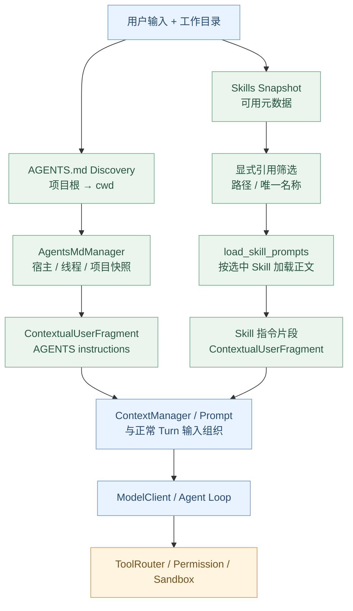
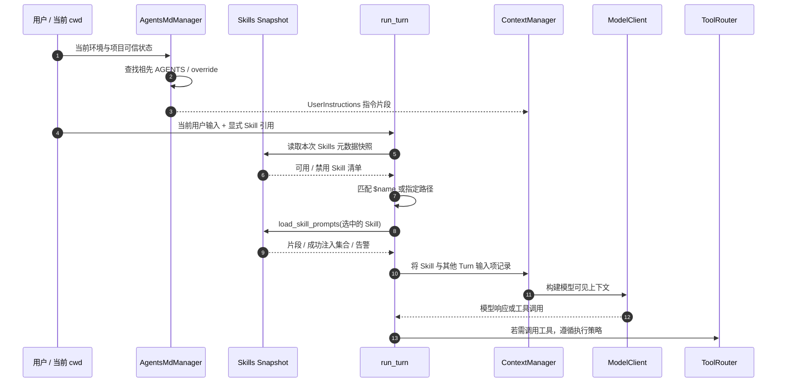

# 扩展篇 A1：AGENTS.md / Skills——Codex 如何加载项目指令与技能？

> **本章核心问题：** Codex 进入一个已有仓库时，怎么发现并读取对应的 `AGENTS.md`？用户说“使用某个 Skill”时，Runtime 如何定位 `SKILL.md`、决定是否注入，以及如何避免将所有技能正文一次性塞进上下文？
>
> [上一章：Token Budget / Compaction](../12-token-budget-compaction/README.zh.md) · [教程首页](../README.zh.md) · [本章 Demo](./demo.py)

第 01–12 章已走通 Codex 内核主线。现在进入 **Capability Extensions（能力扩展）**：不是修改 Agent Loop 本身，而是让既有 Agent 按项目和任务获得额外的行为指引。

这篇只讨论 **`AGENTS.md` 与 Skills**。下一篇 A2 再深入 MCP / Plugins / Connectors。

读完本章，你应该可以：

1. 解释 `AGENTS.md` 的项目根目录、逐层查找和 `AGENTS.override.md` 优先级。
2. 分清**宿主指令、线程指令、项目文件指令**及其来源。
3. 根据真实源码指出 AGENTS 项进入模型时的 **`user` 角色**，而非自行猜测它是 `system`。
4. 区分 Skill 的**发现 / 元数据 / 显式选择 / 正文注入 / 执行相关工具**几个阶段。
5. 理解为什么 `$name` 可能因重名而无法唯一选择 Skill。
6. 运行一个无副作用 Python Demo，观察项目指令和 Skill 选择机制。

**源码基线：** [openai/codex @ `014489466a17`](https://github.com/openai/codex/tree/014489466a1739c2c563cdfe57880c2c7c8680e3)。这是一份对固定 Rust 提交的阅读教程，不将教学 Demo 当作当前所有客户端的完整实现。

---

## 1. 为什么 Agent 需要“项目指令”和“技能”两套机制？

设想 Codex 被要求：

> 检查 `api/auth` 模块的登录失败原因。遵守项目规范，并使用代码审查 Skill。

这里有两类信息：

**项目约束**往往与当前目录有关：

- 只能运行受影响的单元测试；
- 不要修改其他工作树；
- 涉及认证逻辑不得输出凭据；
- 代码风格与团队约定。

**Skill** 则更像可复用任务流程：

- 按什么顺序检查输入与输出；
- 需要产出怎样的审计证据；
- 哪些辅助文件、脚本或参考资料可以使用；
- 是否依赖某类外部工具。

因此，这两种能力不是同义词：

| 项目 | `AGENTS.md` | `SKILL.md` |
| --- | --- | --- |
| 主要作用 | 当前项目、目录或环境中的指令 | 一项可复用的任务能力说明 |
| 发现方式 | 从项目根向当前目录逐级发现项目文件 | 从 Skill 来源构建元数据快照 |
| 载入模式 | 按有效工作目录收集相关项目指令 | 先发现元数据，再按选择等机制加载内容 |
| 常见来源 | 仓库、宿主、线程 | 本地、系统、插件或环境相关 Skill 来源 |
| 是否直接执行操作？ | 不会 | `SKILL.md` 本身也不会直接替代 Tool Runtime |

**不要把 Skill 当作一个已经取得执行权限的 Shell 工具。** 它是指引与能力资源的组织方式，实际执行仍受到第 07–09 章的工具和安全边界约束。

## 2. 总体架构：项目指令与 Skill 在哪里汇合？



图中的 `Skills Snapshot` 不是“已经将所有 SKILL.md 正文复制进 Prompt”。**发现元数据与加载正文是两个不同阶段**。

与此同时，AGENTS 指令和 Skill 指令进入模型的具体时机也不同：前者属于会话的指令快照，后者会根据本次输入触发相关加载。

---

## 第一部分：AGENTS.md

## 3. 源码入口：`agents_md.rs` 写明了什么？

先读 [`core/src/agents_md.rs`](https://github.com/openai/codex/blob/014489466a1739c2c563cdfe57880c2c7c8680e3/codex-rs/core/src/agents_md.rs#L1-L47)。

这个文件顶部的模块注释直接给出查找规则：

1. 从当前工作目录 `cwd` 向上寻找**最近的项目根标记**。
2. 如果没有配置专门的 `project_root_markers`，使用默认标记（`.git`）。
3. 从项目根目录开始，沿路径向下直到当前工作目录，包含两个端点。
4. **不越过项目根目录**继续查找。
5. 如果未找到任何项目根标记，**只考虑当前工作目录**。

例如：

```text
/repo/
├── .git/
├── AGENTS.md
├── api/
│   ├── AGENTS.md
│   └── auth/
│       ├── AGENTS.md
│       └── login.py
└── web/
    └── AGENTS.md
```

当 `cwd = /repo/api/auth` 时，典型发现范围是：

```text
/repo/AGENTS.md
/repo/api/AGENTS.md
/repo/api/auth/AGENTS.md
```

不会读取 `/repo/web/AGENTS.md`，因为它不在本次工作目录的祖先路径上。

### “项目根”是不是操作系统文件系统根？

不是。`project_root_markers` 决定扫描停止位置。对于使用 Git 的项目，`.git` 是默认标记；如果配置不同，发现边界可能变化。

当项目根标记列表被明确设为空时，源码还提供了不向上遍历的行为。具体规则见 [`agents_md_paths`](https://github.com/openai/codex/blob/014489466a1739c2c563cdfe57880c2c7c8680e3/codex-rs/core/src/agents_md.rs#L189-L268)。

## 4. 一个目录里同时出现 AGENTS.md 和 AGENTS.override.md 怎么办？

这里存在**真正的文件选择优先级**。

[`candidate_filenames`](https://github.com/openai/codex/blob/014489466a1739c2c563cdfe57880c2c7c8680e3/codex-rs/core/src/agents_md.rs#L272-L295) 会先返回：

```rust
names.push(LOCAL_AGENTS_MD_FILENAME);  // AGENTS.override.md
names.push(DEFAULT_AGENTS_MD_FILENAME); // AGENTS.md
```

接下来才是配置允许的 fallback 文件名。

[`agents_md_paths`](https://github.com/openai/codex/blob/014489466a1739c2c563cdfe57880c2c7c8680e3/codex-rs/core/src/agents_md.rs#L242-L265) 对**每一个扫描到的目录**按候选顺序检查，找到第一个存在的普通文件就选择它。

因此：

```text
/repo/AGENTS.md                ← 使用
/repo/api/AGENTS.md            ← 本目录被 override 取代
/repo/api/AGENTS.override.md   ← 使用
/repo/api/auth/AGENTS.md       ← 使用
```

这有两个边界：

- **同一个目录中**：优先选择 `AGENTS.override.md`。
- **不同层级之间**：仍然沿项目根到当前目录累积相应指令。

**不能误写成“存在一个 override，就忽略整个仓库所有 AGENTS.md”。** 它的覆盖对象是同目录候选文件，而不是让整条祖先路径自动失效。

### 为什么 fallback 文件名不能随意包含路径？

[`agents_md.rs`](https://github.com/openai/codex/blob/014489466a1739c2c563cdfe57880c2c7c8680e3/codex-rs/core/src/agents_md.rs#L272-L295) 会根据**执行环境的路径约定**过滤非法的 fallback 候选，包括路径分隔符和部分 Windows 特有的不安全形式。

源码注释提醒：在 Windows 环境中，错误地对网络路径做元数据探测可能携带环境凭据。这属于**发现阶段本身的安全边界**，而不是普通字符串校验的小细节。

## 5. AGENTS 文件内容怎样读取？有长度限制吗？

读 [`read_agents_md`](https://github.com/openai/codex/blob/014489466a1739c2c563cdfe57880c2c7c8680e3/codex-rs/core/src/agents_md.rs#L118-L187)。

它拿到选中的文件路径后，依次使用执行环境提供的 `ExecutorFileSystem` 读取文件。

这说明：

- AGENTS 发现不应假定全都在 Codex 主机的本地文件系统；
- 可以存在不同的执行环境与文件系统提供者；
- 读文件时需要遵守适用的文件系统 Sandbox；
- 会限制扫描并装载项目指令的总字节数。

源码以 `project_doc_max_bytes` 作为项目文档预算，并在超出剩余字节时截断相应读取内容。

### 如果当前项目被标记为 Untrusted 呢？

[`load_project_instructions`](https://github.com/openai/codex/blob/014489466a1739c2c563cdfe57880c2c7c8680e3/codex-rs/core/src/agents_md.rs#L56-L116) 有一条很关键的条件：

```rust
if config.active_project.is_untrusted() {
    return Ok((!loaded.is_empty()).then_some(loaded));
}
```

即该路径在项目不受信任时，会**跳过仓库项目指令的发现**；已有的宿主提供的用户指令并不因为这一判断自动清空。

这是明确的来源信任边界。

**注意：** 只跳过自动加载项目文档，不表示对不受信任内容可以无条件执行。项目脚本、工具输出和 Skill 资源仍需受到实际安全策略约束。

## 6. Host / Thread / Project 三类指令如何组合？

[`LoadedAgentsMd`](https://github.com/openai/codex/blob/014489466a1739c2c563cdfe57880c2c7c8680e3/codex-rs/core/src/agents_md.rs#L298-L344) 保存：

```rust
pub struct LoadedAgentsMd {
    user_instructions: Option<Instructions>,
    thread_instructions: Option<Instructions>,
    entries: Vec<InstructionEntry>,
}
```

- `user_instructions`：宿主或账号层提供的用户指令；
- `thread_instructions`：当前 Thread 的额外指令；
- `entries`：实际发现的项目文件内容及来源信息。

在 [`LoadedAgentsMd::text`](https://github.com/openai/codex/blob/014489466a1739c2c563cdfe57880c2c7c8680e3/codex-rs/core/src/agents_md.rs#L378-L487) 中，它们会按顺序组装，必要时使用 `--- project-doc ---` 作为来源边界标记。

**这是组合顺序，并不能据此推导“后面的项目文本一定比宿主指令优先级高”。** 实际的指令优先级与冲突处理仍受消息角色、系统策略、来源信任等机制约束。

### 多执行环境会怎样？

如果当前 Step 有多个项目执行环境，`LoadedAgentsMd` 在需要时会为各环境贡献的指令加上标识，避免将来自两个不同工作目录的规则混成“同一项目的规则”。

细节见 [`environment_labeled_text`](https://github.com/openai/codex/blob/014489466a1739c2c563cdfe57880c2c7c8680e3/codex-rs/core/src/agents_md.rs#L421-L469)。

这对跨工作树、多工作区、多 Executor 的 Agent 很关键：**同一个指令文件名并不说明它来自同一环境**。

## 7. `AgentsMdManager`：为什么还需要快照和缓存？

[`agents_md_manager.rs`](https://github.com/openai/codex/blob/014489466a1739c2c563cdfe57880c2c7c8680e3/codex-rs/core/src/agents_md_manager.rs#L23-L67) 定义 `AgentsMdManager`，负责指令来源与已应用快照。

[`refresh`](https://github.com/openai/codex/blob/014489466a1739c2c563cdfe57880c2c7c8680e3/codex-rs/core/src/agents_md_manager.rs#L68-L151) 会：

1. 串行化可能相互重叠的指令刷新；
2. 取得当前执行环境选择与项目可信状态；
3. 在执行环境或信任级别变化时判断是否必须重新发现；
4. 从适用的 Host / Thread Provider 刷新指令；
5. 校验有效数据后再应用新的快照。

这里有一个安全细节：**读取权限收紧时，不能继续保留过去可读、现在不可读的旧项目指令缓存。**

因此缓存不仅用于性能，也涉及快照正确性和来源隔离。

[`SessionInstructions`](https://github.com/openai/codex/blob/014489466a1739c2c563cdfe57880c2c7c8680e3/codex-rs/core/src/agents_md_manager.rs#L28-L37) 还支持预先提供项目快照，而不是永远强制重新扫描。子 Agent 继承和共享 Provider 的行为也有明确配置边界。

### 改了 AGENTS.md，模型是否一定实时立刻看到？

不能这么断言。可见内容受到已捕获的快照、刷新边界和具体 Session / Step 生命周期影响。

判断一条规则究竟是否生效，应检查：

- 当前 `cwd` 与执行环境；
- 当前活跃的项目根和信任级别；
- 实际加载了哪些文件来源；
- 是否执行了相应刷新；
- 这次 Turn 取到的是哪个快照。

## 8. AGENTS.md 最后进入模型时是什么角色？

这也是最容易被错误解释的地方。

[`LoadedAgentsMd::contextual_user_fragment`](https://github.com/openai/codex/blob/014489466a1739c2c563cdfe57880c2c7c8680e3/codex-rs/core/src/agents_md.rs#L473-L486) 将指令组装为 `ContextUserInstructions`。

在 [`context/user_instructions.rs`](https://github.com/openai/codex/blob/014489466a1739c2c563cdfe57880c2c7c8680e3/codex-rs/core/src/context/user_instructions.rs#L8-L42) 中，对应的 `ContextualUserFragment` 明确返回：

```rust
fn role(&self) -> &'static str {
    "user"
}
```

同时还带有 `agents_md.instructions` 内容种类，以及 `# AGENTS.md instructions` 和 `<INSTRUCTIONS>` 等标记。

**因此不能声称“AGENTS.md 直接变成 System Prompt”。** 在这个固定版本中，它是具有来源标记的 User 级上下文片段。

对照 [`context/developer_instructions.rs`](https://github.com/openai/codex/blob/014489466a1739c2c563cdfe57880c2c7c8680e3/codex-rs/core/src/context/developer_instructions.rs#L25-L45)，DeveloperInstructions 的 role 则明确是 `developer`。两者不一样。

### 这意味着 AGENTS 可以绕过安全策略吗？

当然不能。模型读取项目指令与实际工具权限是两条独立控制链。

`AGENTS.md` 是提供上下文约束的途径，绝不是执行授权凭证。即使某个仓库文件声称“允许任意 Shell”，第 09 章的审批与 Sandbox 仍应按有效配置生效。

---

## 第二部分：Skills

## 9. Skill 的最小目录结构是什么？

一个教学上的 Skill 文件夹可以这样组织：

```text
.agents/skills/
└── code-review/
    ├── SKILL.md
    ├── references/
    │   └── checklist.md
    └── scripts/
        └── inspect.py
```

这里的路径用于演示，并不是说所有 Codex 安装都必然只从 `.agents/skills/` 发现资源。真实 Skill 来源由 Loader 输入、插件根、配置层及执行环境快照决定。

`SKILL.md` 示例：

```markdown
---
name: code-review
description: Review changed code and report findings with evidence.
metadata:
  short-description: Check correctness and risk
---

# Workflow

1. Inspect affected files.
2. Identify concrete failure cases.
3. Run only authorized checks.
4. Report findings with file references.
```

### 哪些元数据来自真实源码？

[`skills/src/parser.rs`](https://github.com/openai/codex/blob/014489466a1739c2c563cdfe57880c2c7c8680e3/codex-rs/skills/src/parser.rs#L7-L92) 的 Frontmatter 解析器处理：

- `name`：可省略，在适用情况使用默认名称；
- `description`：必填的非空描述；
- `metadata.short-description`：可选；
- YAML Frontmatter 的格式校验与字段约束。

这里不能误说“SKILL.md 的全部正文就是 YAML 元数据”。**Frontmatter 是入口信息；后续的 Markdown 正文包含具体操作指导。**

## 10. `SkillMetadata`：系统首先知道哪些信息？

在 [`skills/src/model.rs`](https://github.com/openai/codex/blob/014489466a1739c2c563cdfe57880c2c7c8680e3/codex-rs/skills/src/model.rs#L8-L38) 里：

```rust
pub struct SkillMetadata {
    pub name: String,
    pub description: String,
    pub short_description: Option<String>,
    pub interface: Option<SkillInterface>,
    pub dependencies: Option<SkillDependencies>,
    pub policy: Option<SkillPolicy>,
    pub path_to_skills_md: PathUri,
    pub scope: SkillScope,
    pub plugin_id: Option<String>,
    pub remote_plugin_id: Option<String>,
}
```

这些字段提供了：

| 字段 | 用途 |
| --- | --- |
| `name / description` | 展示与匹配的核心元数据 |
| `path_to_skills_md` | 对应资源的位置和身份 |
| `scope` | Skill 的作用域信息 |
| `policy` | 如是否允许隐式调用、产品限制 |
| `dependencies` | 相关工具依赖信息 |
| `plugin_id` | 与插件提供者的关联 |

**一个 Skill 被发现，不等于其全部 Markdown 正文已经进入当前模型窗口。**

元数据快照可以用于判断有哪些 Skill 可用、如何展示，以及本次请求是否选中了其中某一个。

## 11. Skill 来源在哪里决定？一定从仓库读取吗？

[`core/src/skills.rs → skills_load_input_for_environments`](https://github.com/openai/codex/blob/014489466a1739c2c563cdfe57880c2c7c8680e3/codex-rs/core/src/skills.rs#L34-L75) 的职责是结合：

- 当前配置；
- 主要执行环境的工作目录；
- 该执行环境的文件系统提供者；
- 有效的插件 Skill 根；
- 配置层堆栈；
- 插件管理器中的相关快照。

将这些内容整理为 `HostSkillsLoadInput`。

因此，源码并非简单写死：

```python
glob(".agents/skills/*/SKILL.md")
```

真实的资源来源和路径归属比这个复杂，而且可能具有多环境和插件上下文。

### 为什么需要文件系统所有者？

因为 Agent 可能在不同的执行环境里工作。Skill 的 URI 与实际资源访问能力必须匹配所在环境，不应该无条件使用主进程本地路径打开远端环境的 Skill。

这里延续了第 09 章的边界：**发现到了资源路径，不代表立即获得读取或执行权限**。

## 12. 选择 Skill：`$name` 不是无条件模糊匹配

显式选择的关键源码：

[`skills/src/selection.rs → collect_explicit_skill_mentions`](https://github.com/openai/codex/blob/014489466a1739c2c563cdfe57880c2c7c8680e3/codex-rs/skills/src/selection.rs#L18-L112)。

主要来源包括：

- 结构化 `UserInput::Skill`；
- 用户文本中的 `$skill-name`；
- 带资源路径的显式引用。

在这个实现中：

1. 结构化 Skill 输入优先按路径匹配已启用的 Skill。
2. 文本引用再解析 `$name` 或对应资源路径。
3. 资源路径可以匹配真实身份或适用的逻辑发现路径。
4. **只有名称不歧义时**，才应按普通名称匹配。
5. 禁用的 Skill 不能因为用户仅提到名字就自动重新启用。

### 为什么不能看到 `$review` 就随便选第一个？

假设两个 Skill：

```text
/repo/.agents/skills/review/SKILL.md      name: review
/plugin/review/SKILL.md                   name: review
```

用户只写：

```text
请使用 $review
```

系统应避免静默把名字相同、来源却不同的 Skill 随机当作用户意图。

这一版本的 [`selection.rs`](https://github.com/openai/codex/blob/014489466a1739c2c563cdfe57880c2c7c8680e3/codex-rs/skills/src/selection.rs#L121-L205) 正是围绕路径、名称计数和已启用状态处理这类选择逻辑。

**不歧义的纯名称**可以使用；**重名情况**需要更明确的资源身份。Demo 会重现这种区别。

## 13. Skill 正文什么时候真正进入模型？

从 [`session/turn.rs → build_skills_and_plugins`](https://github.com/openai/codex/blob/014489466a1739c2c563cdfe57880c2c7c8680e3/codex-rs/core/src/session/turn.rs#L1105-L1250) 顺着读：

```text
StepContext 的 Skills Snapshot
          ↓
collect_explicit_skill_mentions
          ↓
收集对应 SkillMetadata
          ↓
load_skill_prompts(&mentioned_skills)
          ↓
HostSkillPrompts { fragments, injected, warnings }
          ↓
ContextualUserFragment 转为 ResponseItem
          ↓
作为本次 Turn 的上下文注入项
```

**关键：** `load_skill_prompts` 接收的是**本次提到的 Skills**，不是无条件把所有 Skills 的全文塞入每次 Prompt。

源码还会：

- 发出适用的 Skill 调用追踪；
- 将加载警告反馈成 `EventMsg::Warning`；
- 处理已有 Host 注入内容的去重；
- 与插件及扩展输入合并。

这些处理发生在 Tool Router 执行工具之前，属于为**模型请求准备上下文**的一部分。

### Skill 注入是什么角色？

这里的 Skill 正文被转换为 `ContextualUserFragment` 的 `ResponseItem`。不能将 Skill 直接等同于独立的 `system` 权限，也不能认为 Skill 的 Markdown 可以修改 Rust Runtime 的审批结果。

### 为什么需要 Warning？

某个 Skill 被选择后，内容可能因为权限、路径不存在、读取失败或其他问题而无法加载。

被匹配不等于加载必然成功。**追踪、告警和实际注入结果应分别观察。**

## 14. 显式调用与隐式使用是一回事吗？

不是。

[`core/src/skills.rs`](https://github.com/openai/codex/blob/014489466a1739c2c563cdfe57880c2c7c8680e3/codex-rs/core/src/skills.rs#L76-L168) 会跟踪**显式注入的 Skill**，并在当前 Extension 与遥测链路里记录相关调用信息。

同一文件还包含 `maybe_emit_implicit_skill_invocation`，而 [`skills/src/invocation.rs`](https://github.com/openai/codex/blob/014489466a1739c2c563cdfe57880c2c7c8680e3/codex-rs/skills/src/invocation.rs#L14-L70) 允许根据工具命令访问某些 Skill 脚本或文档的行为，识别隐式 Skill 使用。

这意味着：

- **Explicit**：用户显式选择、提及了某个 Skill，并进入相应提示注入流程；
- **Implicit**：基于某些实际资源访问或使用事实识别 Skill 关联；
- **Available**：Skill 已被发现或列入元数据；
- **Injected**：本次需要的正文片段确实进入上下文。

这些状态不能混成一个布尔值 `skill_used = True`。

在工程上，最好分别记录：**发现了什么、选中了什么、成功注入了什么、实际调用了什么工具**。

## 15. Skill 里写了“执行脚本”，为什么不代表脚本自动执行？

`SKILL.md` 可以描述某个脚本，例如：

```text
scripts/inspect.py
```

但 Markdown 文件不是进程启动器。真正操作仍需要 Model 输出工具调用，经由 `ToolRouter`、`Handler`、权限审批和 Sandbox 执行。

这也是为什么 A1 和 A2 分开：

| 能力 | 问题 |
| --- | --- |
| `AGENTS.md` | 我在这个项目工作时应该遵守哪些约束？ |
| `SKILL.md` | 完成特定任务应该参考怎样的工作流程？ |
| Tool | Runtime 有什么具体可执行操作？ |
| MCP / Plugin / Connector | 外部能力从哪里来、怎样被发现与调用？ |

**Skill 可以引用工具，但本身并不能绕过 Tool 的执行安全边界。**

---

## 第三部分：把两套能力放回 Agent Loop

## 16. 一次真实 Turn 的简化时序



这里刻意把 AGENTS 刷新与 Turn 内 Skill 选择画在不同位置：**它们的加载边界不同**。实际 RunTurn 可以使用之前捕获的指令快照，并不要求每次采样都重新遍历磁盘。

## 17. 实验：用 Python 建一个最小指令与 Skill 选择系统

[`demo.py`](./demo.py) 使用 Python 3.10+ 标准库，构造了**一个内存中的假文件系统**。

运行：

```bash
python demo.py
```

不需要 API Key，不读取你的真实 `AGENTS.md`，不执行 Shell，不修改项目文件。

### 实验 A：祖先目录顺序

假仓库中有：

```text
/repo/.git
/repo/AGENTS.md
/repo/api/AGENTS.md
/repo/api/AGENTS.override.md
/repo/api/auth/AGENTS.md
/repo/other/AGENTS.md
```

输入工作目录：

```text
/repo/api/auth
```

输出：

```text
AGENTS.md discovery order: ['/repo/AGENTS.md', '/repo/api/AGENTS.override.md', '/repo/api/auth/AGENTS.md']
```

验证了三点：

1. 从项目根向当前目录收集；
2. 同目录 override 优先；
3. 不加载兄弟目录。

### 实验 B：不受信任的项目与大小限制

Demo 断言：

- `trusted=False` 时，不加载项目文件；
- 字节预算被耗尽时，停止加载；
- 没找到项目根时，只在当前目录查找。

**注意：** 它使用 `PurePosixPath` 模拟固定 POSIX 路径，不实现 Codex 的远端 URI、执行器 Sandbox、Windows 路径安全检查。

### 实验 C：Host / Thread / Project 的组装

Demo 组合三个来源，并检查顺序：

```text
Host instructions
Thread instructions
--- project-doc ---
Root instructions...
Nested instructions...
```

还会打印：

```text
Instruction role: user (not system); project-doc separator present: True
```

这里的角色结论有真实 Rust 源码支持，而组装文本只是教学模拟。

### 实验 D：四个 Skill，实际只注入两个

教学元数据包括：

```text
review（仓库 Skill）
tests（仓库 Skill）
deploy（已禁用）
review（另一个位置的重名 Skill）
```

Demo 验证：

- 文本里普通词语 `review` 不算显式引用；
- 纯 `$review` 因存在重名而无法唯一选择；
- 已禁用的 `$deploy` 不被自动注入；
- 明确的结构化路径可选择正确的仓库 `review`；
- `$tests` 可以根据不歧义名称选择。

输出：

```text
Discovered Skill metadata: ['review', 'tests', 'deploy', 'review']
Injected Skill bodies: ['/repo/.agents/skills/review/SKILL.md', '/repo/.agents/skills/tests/SKILL.md']
Unmentioned, ambiguous, or disabled Skill bodies were not injected
All teaching assertions passed
```

**Demo 没有实现 YAML Frontmatter 解析或真实文件读取**：Skill 元数据在内存里直接构造。这样可以单独检验选择和正文按需注入，不依赖磁盘或第三方库。

## 18. 实际工程常见误区

| 误区 | 为什么不准确？ |
| --- | --- |
| “当前目录有 AGENTS.md 就只读这一份。” | 项目根到 cwd 的祖先路径也会参与 |
| “AGENTS.override.md 会覆盖所有上层规则。” | 它首先是**同目录候选文件**的选择优先级 |
| “AGENTS.md 是 System Prompt。” | 当前对应的是具有来源标记的 `user` 片段 |
| “新建一个 SKILL.md 就会被所有会话注入。” | 还取决于发现来源、选择及加载过程 |
| “系统会自动把所有 Skill 正文装进上下文。” | 显式选择等流程会按需加载 |
| “重名 Skill 随便选择第一个就行。” | 普通名称只有无歧义时才适合解析 |
| “Skill 可以允许原本被 Sandbox 禁止的命令。” | Skill 文本不具有执行授权能力 |
| “一旦加载 AGENTS，文件变化就立即反映到旧 Prompt。” | 有已应用快照和刷新边界 |

## 19. 安全与可靠性：不要忽视来源

AGENTS 和 Skill 都可能来自仓库文件、插件或执行环境资源。它们的**来源、信任、路径、版本和有效期**应当可观察。

值得关注的风险：

- **指令污染**：不受信任的项目文本可能试图覆盖更高层规则。
- **路径冒用**：名称相同、路径不同的 Skill 可能被错误选中。
- **资源失效**：元数据存在，但 SKILL.md 正文读取失败。
- **快照过期**：执行环境或权限变化之后沿用旧的指令内容。
- **上下文膨胀**：无条件注入全部 Skill 正文，浪费 Token。
- **工具越权**：将 Markdown 描述误当作 Tool 执行授权。

因此，好的扩展系统需要分离：**发现、元数据、授权、加载、注入与实际执行**。

这一分层并非为了复杂而复杂，而是让 Agent 的行为可追踪、可解释、可复现。

## 20. 源码阅读路线

按顺序读，先看 AGENTS，再看 Skill 的正文注入。

| 顺序 | 源码 | 要验证的事实 |
| --- | --- | --- |
| 1 | [`agents_md.rs` 顶部说明](https://github.com/openai/codex/blob/014489466a1739c2c563cdfe57880c2c7c8680e3/codex-rs/core/src/agents_md.rs#L1-L47) | 项目根与祖先路径规则 |
| 2 | [`agents_md_paths`](https://github.com/openai/codex/blob/014489466a1739c2c563cdfe57880c2c7c8680e3/codex-rs/core/src/agents_md.rs#L189-L268) | 真正从 cwd 查找哪些文件 |
| 3 | [`candidate_filenames`](https://github.com/openai/codex/blob/014489466a1739c2c563cdfe57880c2c7c8680e3/codex-rs/core/src/agents_md.rs#L272-L295) | override、常规文件与 fallback 优先级 |
| 4 | [`load_project_instructions`](https://github.com/openai/codex/blob/014489466a1739c2c563cdfe57880c2c7c8680e3/codex-rs/core/src/agents_md.rs#L56-L116) | 不受信任项目的边界 |
| 5 | [`read_agents_md`](https://github.com/openai/codex/blob/014489466a1739c2c563cdfe57880c2c7c8680e3/codex-rs/core/src/agents_md.rs#L118-L187) | 有预算且遵守执行器文件系统的读取 |
| 6 | [`LoadedAgentsMd`](https://github.com/openai/codex/blob/014489466a1739c2c563cdfe57880c2c7c8680e3/codex-rs/core/src/agents_md.rs#L298-L344) | Host / Thread / Project 数据结构 |
| 7 | [`AgentsMdManager::refresh`](https://github.com/openai/codex/blob/014489466a1739c2c563cdfe57880c2c7c8680e3/codex-rs/core/src/agents_md_manager.rs#L68-L151) | 快照缓存和刷新一致性 |
| 8 | [`UserInstructions.role`](https://github.com/openai/codex/blob/014489466a1739c2c563cdfe57880c2c7c8680e3/codex-rs/core/src/context/user_instructions.rs#L8-L42) | AGENTS 指令进入模型的消息角色 |
| 9 | [`parse_skill_frontmatter_metadata`](https://github.com/openai/codex/blob/014489466a1739c2c563cdfe57880c2c7c8680e3/codex-rs/skills/src/parser.rs#L7-L92) | Skill Frontmatter 的元数据校验 |
| 10 | [`SkillMetadata`](https://github.com/openai/codex/blob/014489466a1739c2c563cdfe57880c2c7c8680e3/codex-rs/skills/src/model.rs#L8-L38) | 可用技能的身份与来源 |
| 11 | [`skills_load_input_for_environments`](https://github.com/openai/codex/blob/014489466a1739c2c563cdfe57880c2c7c8680e3/codex-rs/core/src/skills.rs#L34-L75) | Skill 来源与执行环境绑定 |
| 12 | [`collect_explicit_skill_mentions`](https://github.com/openai/codex/blob/014489466a1739c2c563cdfe57880c2c7c8680e3/codex-rs/skills/src/selection.rs#L18-L112) | 结构化路径、$name、禁用与歧义 |
| 13 | [`build_skills_and_plugins`](https://github.com/openai/codex/blob/014489466a1739c2c563cdfe57880c2c7c8680e3/codex-rs/core/src/session/turn.rs#L1105-L1250) | 对选中 Skill 加载正文并注入 |
| 14 | [`emit_explicit_skill_invocations`](https://github.com/openai/codex/blob/014489466a1739c2c563cdfe57880c2c7c8680e3/codex-rs/core/src/skills.rs#L76-L168) | 成功注入、调用记录与来源分析 |
| 15 | [`Skill implicit invocation`](https://github.com/openai/codex/blob/014489466a1739c2c563cdfe57880c2c7c8680e3/codex-rs/skills/src/invocation.rs#L14-L70) | 访问技能脚本或文档时如何识别隐式使用 |

## 21. 思考题

**1. 当前 cwd 是 `/repo/api/auth`，为什么不能只看最近一份 AGENTS？**

因为 Codex 沿项目根到当前目录逐级读取对应文件，祖先目录的指令同样可能适用。

**2. AGENTS.override.md 是否总能胜过所有高层指令？**

不是。它首先是同目录文件选择的优先项，不是提升为更高消息角色，也不自动取消宿主或父层约束。

**3. 发现了 100 个 Skill，模型就一定看到了 100 份 SKILL.md 正文吗？**

不是。元数据发现与正文加载分开；本次被选择的 Skill 可以按需加载相应提示。

**4. 两个 Skill 都叫 review，为什么纯 `$review` 不能直接随便挑一个？**

名称不能唯一确定资源身份。应使用明确路径或其他结构化选择信息，避免加载错误的工作流。

**5. 为什么 Skill 提示中写了一个 Shell 命令，也不能直接说明已获准执行？**

因为 Markdown 指引与实际工具执行是不同边界，仍必须经过 ToolRouter、有效权限、审批及 Sandbox。

---

## 本章总结

```text
执行环境 / cwd / 用户输入
           │
           ├─ AGENTS.md 路径发现
           │     └─ 宿主 + 线程 + 项目指令快照
           │                      │
           └─ Skill 元数据发现   │
                 └─ 显式选择     │
                       └─ 读取相关正文
                                  │
                                  ▼
                         ContextManager
                                  │
                                  ▼
                            ModelClient
                                  │
                                  ▼
                            Agent Loop
                                  │
                                  ▼
                      Tool / Approval / Sandbox
```

**最重要的结论：AGENTS.md 提供当前项目的上下文约束，Skills 提供可复用的任务指导；两者都是进入模型上下文的资源，但都不是绕过 Runtime 执行策略的权限凭证。**

下一篇：[扩展篇 A2《MCP / Plugins / Connectors》](../A2-mcp-plugins-connectors/README.zh.md)。

接下来我们将进一步追踪：**外部工具能力从哪里发现、如何建立连接、如何转换成 ToolSpec，以及为什么 Skill、MCP Tool 与 Plugin 不应该混为一谈。**

