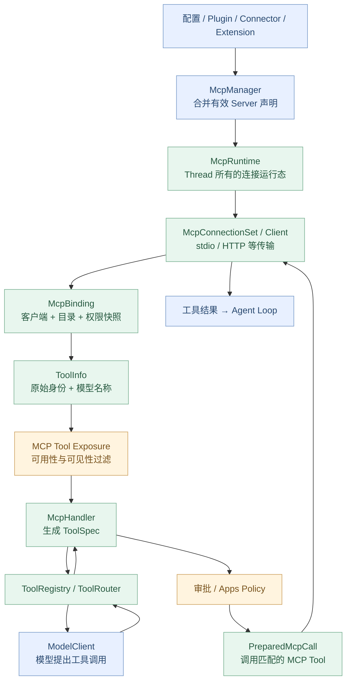
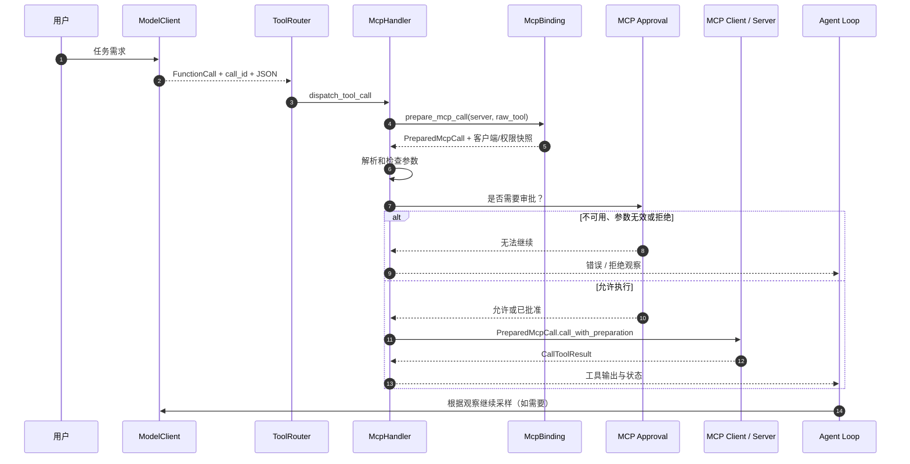

# 扩展篇 A2：MCP / Plugins / Connectors——Codex 如何接入外部工具？

> **这一章回答：** Codex 怎样连接 MCP Server、读取工具列表、把外部工具转换为模型可调用的 ToolSpec，再安全地将模型调用路由回对应服务端？Plugin、Connector 和 MCP Tool 到底是什么关系？
>
> [上一章：A1《AGENTS.md / Skills》](../A1-agents-md-skills/README.zh.md) · [教程首页](../README.zh.md) · [本章 Demo](./demo.py)

第 07 章介绍了 ToolRegistry / ToolRouter；A1 讲了项目指令与 Skills 的发现和按需加载。A2 再往外走一步：**真正的外部能力怎样进入 Codex Agent Loop？**

本章基于 [openai/codex 固定提交 `014489466a17`](https://github.com/openai/codex/tree/014489466a1739c2c563cdfe57880c2c7c8680e3)。这里的 MCP 是 Model Context Protocol（模型上下文协议），不是某个特定的 ChatGPT 插件接口；不同产品界面可能对 Plugin、App、Connector 使用不同的用户可见名称。

学完以后，你应能：

1. 区分 **MCP Server、MCP Runtime / Binding、Plugin、Connector、McpHandler、ToolSpec**；
2. 解释 `tools/list` 获得的原始工具身份，为什么不等于模型看到的工具名；
3. 追踪 `ToolInfo → McpHandler → ToolRegistry → ToolRouter → tools/call`；
4. 理解 **发现、注册、暴露、授权、调用**是五个不同步骤；
5. 解释 App/Connector 的工具为什么还有单独的可用性与审批门禁；
6. 理解为什么一次运行中的 MCP Tool Call 必须绑定具体客户端与权限快照；
7. 运行一个离线 Python 实验，验证命名空间、延迟暴露、审批和目录刷新隔离。

---

## 1. 先把 MCP、Plugin、Connector 放在不同层

假设用户请求：

> 从企业 CRM 查询客户记录，然后查 GitHub 仓库里的对应修复代码。

这可能涉及两类外部系统：CRM、GitHub。Codex 需要知道**有什么工具、在哪里调用、使用哪个身份、是否应该让模型看到，以及调用时能否获得批准**。

不要把下面五个名词混为一谈：

| 名词 | 本质 | 例子 |
| --- | --- | --- |
| **MCP Server** | 遵循 MCP 协议提供 Tools / Resources 等能力的服务端 | 一个提供 `read_file` 的仓库 MCP Server |
| **MCP Tool** | MCP Server 暴露的一项具体调用能力 | `read_file`、`search_code` |
| **Connector / App** | 面向某项外部服务的可访问集成身份与能力集合 | CRM App、GitHub Connector |
| **Plugin** | 能组织、配置、分发不同扩展能力的包或管理对象 | 带 MCP Server 声明、Skill、Connector 声明的插件 |
| **McpHandler** | Codex 内部将 MCP Tool 接入统一 ToolRuntime 的适配器 | `McpHandler::handle_call` |

关系不是固定的 “一个 Plugin = 一个 MCP Server = 一个 Connector = 一个 Tool”。

一个插件可能贡献 MCP Server 和 Connector；一个 MCP Server 可能有许多 Tool；某些 Connector Tool 会经过宿主托管的 Apps MCP 入口。**实际映射以安装的能力、配置及权限为准。**

### 为什么还要 Plugin 层？

单纯的 MCP 配置解决“连上服务端”的问题，但不必然解决：

- 插件包的发现、启停、版本与分发；
- 一个插件携带多个能力组件；
- 哪些 Connector 可以在当前身份下使用；
- 对不同 Thread 选择不同扩展包；
- 来源、权限、依赖和工具可见性如何受配置治理。

真实源码的 [`PluginsManager`](https://github.com/openai/codex/blob/014489466a1739c2c563cdfe57880c2c7c8680e3/codex-rs/core-plugins/src/manager.rs#L550-L598) 中，存在插件存储、加载缓存、远端安装状态、技能快照和 ToolSuggest 元数据管理等职责。

**Plugin Manager 不是 MCP Tool Router 的另一个名字。**

## 2. 总图：从外部服务到模型调用



图示是职责主线，**不表示每次调用都重新建立连接或重新列举全部工具**。在这个固定版本中，运行时支持缓存、惰性启动、目录快照及连接复用。

## 3. MCP Server 从哪里来？并非只读一个 config.toml

先读 [`core/src/mcp.rs → McpManager`](https://github.com/openai/codex/blob/014489466a1739c2c563cdfe57880c2c7c8680e3/codex-rs/core/src/mcp.rs#L108-L187)。

`McpManager` 的职责之一是整理适用于当前配置、当前 Thread 和执行环境的 MCP 服务端来源。

在 [`runtime_config_with_context`](https://github.com/openai/codex/blob/014489466a1739c2c563cdfe57880c2c7c8680e3/codex-rs/core/src/mcp.rs#L262-L344) 中，你会看到它不仅考虑主配置，还组合：

- 有效配置层；
- Plugin Manager 提供的能力；
- Thread 选择的插件贡献；
- Extension 的 MCP Server 贡献；
- 不同执行环境的服务端发现结果；
- 运行时禁用项和特定能力约束。

服务端声明的来源类型，在 [`codex-mcp/src/catalog.rs → McpServerSource`](https://github.com/openai/codex/blob/014489466a1739c2c563cdfe57880c2c7c8680e3/codex-rs/codex-mcp/src/catalog.rs#L73-L117) 中有明确枚举：

```rust
pub enum McpServerSource {
    Plugin(McpPluginAttribution),
    SelectedPlugin(McpPluginAttribution),
    Config,
    Compatibility { id: String },
    Extension { id: String, host_owned_apps: bool },
}
```

这意味着：**配置文件中的 Server 和插件贡献的 Server，最终可以进入同一套有效 MCP 目录，但保留来源信息。**

### 如果两个来源声明了同名 Server 怎么办？

源码还有 [`RegistrationPrecedence`](https://github.com/openai/codex/blob/014489466a1739c2c563cdfe57880c2c7c8680e3/codex-rs/codex-mcp/src/catalog.rs#L119-L141) 与目录解析逻辑，对同名来源存在明确的优先级与覆盖规则。

不能单凭“最后配置文件里出现的声明”预测最后有效的 Server，更不能通过同名把较低权限来源偷偷升级为宿主权限。

这一点对安全尤其重要：**来源优先级与凭据权限属于控制面，不是模型自行选择的文本字段。**

## 4. 连接层：McpRuntime、McpConnectionSet 和 McpBinding

这三个结构非常重要，也很容易混淆。

| 结构 | 职责 |
| --- | --- |
| **`McpRuntime`** | 一个 Codex Thread 内的 MCP 运行状态和发布机制 |
| **`McpConnectionSet`** | 管理可用服务端连接、启动状态、工具与资源 |
| **`McpBinding`** | 给某次使用捕获一组确定的连接、配置、工具目录与可调用项 |

[`codex-mcp/src/runtime.rs`](https://github.com/openai/codex/blob/014489466a1739c2c563cdfe57880c2c7c8680e3/codex-rs/codex-mcp/src/runtime.rs#L1-L116) 文件头说明 `McpRuntime` 属于线程级状态，并由 `ArcSwap` 发布最新运行时快照；旧 Binding 可以继续持有对应的**原始连接和配置**。

[`connection_manager.rs`](https://github.com/openai/codex/blob/014489466a1739c2c563cdfe57880c2c7c8680e3/codex-rs/codex-mcp/src/connection_manager.rs#L1-L95) 描述 `McpConnectionSet`：管理启动状态、服务端元信息，并从已运行的客户端聚合 Tool 与 Resource 能力。

[`binding.rs`](https://github.com/openai/codex/blob/014489466a1739c2c563cdfe57880c2c7c8680e3/codex-rs/codex-mcp/src/binding.rs#L33-L102) 展示 `McpBinding`：

```rust
pub struct McpBinding {
    connections: Arc<McpConnectionSet>,
    clients: Arc<McpBindingClients>,
    config: Arc<McpConfig>,
    plugins_available: bool,
    tools: Arc<[ToolInfo]>,
    calls: HashMap<(String, String), PreparedMcpCall>,
}
```

**重要区分：Runtime 是当前活动状态；Binding 是捕获的确定视图。**

### 为什么不能始终使用“最新客户端”？

假设：

```text
t0：模型看到 github 服务端 v1 的 read_file
t1：v1 的工具调用开始，审批正在进行
t2：后台刷新 MCP 配置，发布 v2
t3：审批通过，v1 调用继续
```

如果 t3 不加区分地去最新全局目录查找客户端，可能把**v1 的工具签名、许可和来源身份**应用到 v2 连接上。

Codex 的 [`PreparedMcpCall`](https://github.com/openai/codex/blob/014489466a1739c2c563cdfe57880c2c7c8680e3/codex-rs/codex-mcp/src/binding.rs#L172-L253) 就是为这种一致性保存具体的客户端、目录快照、配置和服务端身份。

**在异步 Agent 里，刷新目录与正在执行的调用之间必须有快照边界。**

## 5. MCP 启动：Eager / Lazy，不是永远启动全部进程

[`McpStartupPolicy`](https://github.com/openai/codex/blob/014489466a1739c2c563cdfe57880c2c7c8680e3/codex-rs/codex-mcp/src/runtime.rs#L68-L74) 有两种模式：

- `Eager`：任务运行时发布后启动可启动的服务器。
- `LazyWhenCached`：具备缓存工具定义时，允许首次使用时再启动服务器。

相应地，[`connection_manager/startup.rs`](https://github.com/openai/codex/blob/014489466a1739c2c563cdfe57880c2c7c8680e3/codex-rs/codex-mcp/src/connection_manager/startup.rs#L35-L65) 还向 Core 事件流发出 `McpStartupUpdate`，并处理需要重新认证等启动失败原因。

所以“工具声明已在模型列表里”和“MCP Server 的具体连接已经准备就绪”有时是不同的状态。

### 传输层也不是只有 stdio

Codex 的 MCP 运行时通过 [`codex-mcp/src/rmcp_client.rs`](https://github.com/openai/codex/blob/014489466a1739c2c563cdfe57880c2c7c8680e3/codex-rs/codex-mcp/src/rmcp_client.rs) 及相关客户端执行实际传输启动。它支持本地子进程、HTTP 等配置化路径；不同服务端可能需要不同身份获取与认证策略。

**本地 stdio Server 不等于远端 HTTP Server 可以共享同一文件系统、环境变量和执行权限。**

参考 [`PreparedMcpCall::sandbox_codex_executable`](https://github.com/openai/codex/blob/014489466a1739c2c563cdfe57880c2c7c8680e3/codex-rs/codex-mcp/src/binding.rs#L269-L307)：源码特别避免从一个 HTTP Endpoint 推断“我们能够访问相同的本地路径”。

---

## 6. 工具发现：MCP 原始名称为什么不能直接暴露给模型？

当 MCP Client 读取工具列表，得到了类似原始声明：

```json
{
  "name": "read_file",
  "description": "Read a file in the configured repository",
  "inputSchema": {
    "type": "object",
    "properties": {
      "path": {"type": "string"}
    },
    "required": ["path"]
  }
}
```

这段是**最小 MCP 工具声明示例**，不是 Codex 内部 `ToolInfo` 的原样 JSON。

会有两个问题：

1. GitHub Server 和另一台 Server 可能都叫 `read_file`；
2. 某些服务端的原始工具名或命名空间不符合模型 API 的长度和字符限制。

因此，Codex 用 [`codex-mcp/src/tools.rs → ToolInfo`](https://github.com/openai/codex/blob/014489466a1739c2c563cdfe57880c2c7c8680e3/codex-rs/codex-mcp/src/tools.rs#L25-L63) 同时保留：

- `server_name`：实际服务端身份；
- `tool.name`：MCP Tool 的原始名称；
- `callable_namespace / callable_name`：模型可见名称；
- Connector 和 Plugin 相关来源信息；
- 工具输入定义和并行性等元数据。

在 [`normalize_tools_for_model_with_prefix`](https://github.com/openai/codex/blob/014489466a1739c2c563cdfe57880c2c7c8680e3/codex-rs/codex-mcp/src/tools.rs#L107-L161) 中，Codex 会规范化模型可见名称，并处理重复、截断与 Hash 冲突。

### 原始名 vs 模型可见名

教学例子：

```text
MCP 原始身份：
  server = github
  tool   = read_file

模型侧可以看到：
  namespace = mcp__github
  function  = read_file

内部调用时仍然使用：
  github / read_file
```

**不要把这个格式当成所有真实工具的唯一命名规则。** 当前版本存在 Namespace 模式、前缀设置、Apps 与 Plugin 的特定名称形式，以及冲突消解。

核心不变量只有一个：**面向模型的标识可以规范化，但实际 MCP 协议调用必须保持可追溯的原始服务端和工具身份。**

## 7. ToolFilter：Server 声明过的 Tool，不一定能用

[`ToolFilter`](https://github.com/openai/codex/blob/014489466a1739c2c563cdfe57880c2c7c8680e3/codex-rs/codex-mcp/src/tools.rs#L67-L105) 根据当前 Server 配置的：

- `enabled_tools`：如果配置白名单，只有列出的工具可用；
- `disabled_tools`：显式禁用工具不可用。

二者是叠加条件。

例如：

```text
server offers: read_file, search_code, delete_repository
enabled_tools: read_file, search_code
disabled_tools: search_code

最终可用：read_file
```

从服务端拿到列表只能证明“服务端声明存在”，不能证明“当前模型已获得权限调用”。

**第一道边界：发现 ≠ 许可。**

## 8. MCP Tool 的 Model Visibility：工具存在也可能不对模型展示

在 [`connection_manager/tool_catalog.rs → tool_is_model_visible`](https://github.com/openai/codex/blob/014489466a1739c2c563cdfe57880c2c7c8680e3/codex-rs/codex-mcp/src/connection_manager/tool_catalog.rs#L43-L75)：

- 没有特定 UI visibility 标记时，默认认为可对模型呈现；
- 如果明确声明 visibility 数组，必须包含 `model` 才属于模型可见。

例如一种可能的工具元数据：

```json
{
  "_meta": {
    "ui": {
      "visibility": ["app"]
    }
  }
}
```

这个工具可能是供应用 UI 而不是模型直接调用；不应仅凭它出现在 `tools/list` 就注册成直接暴露的模型工具。

**第二道边界：许可使用 ≠ 模型可见。**

## 9. App/Connector 工具还要经过专门政策

[`mcp_tool_exposure.rs`](https://github.com/openai/codex/blob/014489466a1739c2c563cdfe57880c2c7c8680e3/codex-rs/core/src/mcp_tool_exposure.rs#L63-L101) 明确区分：

- **普通 MCP Tool**；
- **Codex Apps MCP Tool**，还要检查 Apps 是否启用、Connector ID 和 AppToolPolicy。

[`filter_codex_apps_mcp_tools`](https://github.com/openai/codex/blob/014489466a1739c2c563cdfe57880c2c7c8680e3/codex-rs/core/src/mcp_tool_exposure.rs#L169-L197) 不只是看 Tool 名称是否存在，还会结合：

- `connector_id` 是否有效；
- App 是否在当前配置中启用；
- 工具声明的破坏性 / 开放世界提示等注解；
- 有效的 AppToolPolicy 决策。

这就是为什么“Connector 已连接”和“这个 Connector 的更新操作能直接执行”不能划等号。

### Connector 是如何从 ToolInfo 构建可访问列表的？

[`core/src/connectors.rs`](https://github.com/openai/codex/blob/014489466a1739c2c563cdfe57880c2c7c8680e3/codex-rs/core/src/connectors.rs#L464-L491) 会基于具有 `connector_id` 的 Codex Apps 工具，聚合可访问 Connector，保留名称、描述和关联插件来源。

Plugin 可能声明 Connector 入口，但**能否使用仍依赖有效的连接身份、目录与 App Policy**。

**第三道边界：Connector 被发现 ≠ 所有动作都被批准。**

## 10. McpHandler：将外部 Tool 适配成 Codex 内部 ToolSpec

在第 07 章，我们已经认识 `ToolExecutor<ToolInvocation>`。

MCP 工具接入同一个 Runtime 抽象：

[`core/src/tools/handlers/mcp.rs → McpHandler`](https://github.com/openai/codex/blob/014489466a1739c2c563cdfe57880c2c7c8680e3/codex-rs/core/src/tools/handlers/mcp.rs#L50-L145)。

`McpHandler` 内部持有：

```rust
pub struct McpHandler {
    tool_info: ToolInfo,
    agent_plugin: bool,
    spec: Arc<ToolSpec>,
    // ... 缓存的 CodeMode 定义
}
```

它实现 `ToolExecutor<ToolInvocation>`，提供：

- `tool_name()`；
- `spec()`；
- `supports_parallel_tool_calls()`；
- `handle(...)`。

[`create_tool_spec`](https://github.com/openai/codex/blob/014489466a1739c2c563cdfe57880c2c7c8680e3/codex-rs/core/src/tools/handlers/mcp.rs#L502-L547) 会把 `ToolInfo` 转换为包含函数声明的 `ToolSpec::Namespace`。

### 为什么既有 MCP Tool 定义，又有 ToolSpec？

因为二者职责不同：

- MCP Server 提供的是**协议能力声明**；
- Codex 的 `ToolSpec` 是用于统一工具注册、模型采样和调用调度的内部工具声明。

它还可能受输入 Schema 长度预算、插件类型、模型 API 格式等约束。

**第四道边界：MCP Tool Info ≠ 最终交给模型的 ToolSpec。**

## 11. ToolRegistry：注册 ≠ 直接展示

看 [`tools/spec_plan.rs → build_tool_router`](https://github.com/openai/codex/blob/014489466a1739c2c563cdfe57880c2c7c8680e3/codex-rs/core/src/tools/spec_plan.rs#L121-L185)。

Codex 大致执行：

```text
创建 ToolRegistry
   ↓
注册内建 Tool
   ↓
McpHandlerCache::append_mcp_tools(...)
   ↓
apply_mcp_tool_exposure_policy(...)
   ↓
追加扩展和动态 Tool
   ↓
finalize_tool_router(...)
   ↓
得到当前 Step 使用的 ToolRouter
```

[`mcp_tool_exposure.rs`](https://github.com/openai/codex/blob/014489466a1739c2c563cdfe57880c2c7c8680e3/codex-rs/core/src/mcp_tool_exposure.rs#L88-L160) 支持不同的 ToolExposure：

| 暴露方式 | 教学理解 |
| --- | --- |
| **Direct** | 本次模型工具声明中直接提供 |
| **Deferred** | 可以被延迟发现、搜索或进一步激活 |
| **Hidden** | 不在适用的模型直接调用界面暴露 |

源码中，支持工具搜索的模型可能走 Deferred 路径；Agent Plugin 的工具声明还有独立大小预算。遇到某些 Schema 错误或预算问题，工具可能被跳过或隐藏。

**注册到了 ToolRegistry，也不等于必须在本次模型请求中直接展示。**

### 第 07 章的 ToolRouter 在这里扮演什么角色？

它统一处理模型输出的工具调用，按本次 Step 对应的注册和暴露规则找到 Handler，然后执行。

因此，无论工具来自本地 Shell、内建文件处理、MCP 还是插件贡献，Codex 不必为每种来源重新发明一个 Agent Loop。

## 12. 调用阶段：旧 Binding 为什么必须继续有效？

看 [`McpHandler::handle_call`](https://github.com/openai/codex/blob/014489466a1739c2c563cdfe57880c2c7c8680e3/codex-rs/core/src/tools/handlers/mcp.rs#L186-L270) 的关键开始步骤：

```rust
let prepared_mcp_call =
    invocation.session.prepare_mcp_call(&self.tool_info).await;
```

源码注释明确解释：

> 使用本次执行调用对应的 Binding；后续目录刷新不能改变调用资格。

它随后取得：

- 当前 ToolInvocation 的 `session / step_context / call_id`；
- 准备好的 MCP 调用；
- JSON 参数；
- 输出截断策略；
- 工具执行生命周期信息。

参数与权限有关的实际处理主要进入 [`core/src/mcp_tool_call.rs → handle_mcp_tool_call`](https://github.com/openai/codex/blob/014489466a1739c2c563cdfe57880c2c7c8680e3/codex-rs/core/src/mcp_tool_call.rs#L134-L229)。

### 什么叫“目录快照正确”，还不够？

仅保存 Tool 的名字并不够。一个已准备调用还需要对应的：

- 有效连接和客户端；
- 服务端配置及权限；
- 对应的工具目录项；
- 具体协议级原始 Tool 名称；
- Connector / Plugin 的来源元信息。

因此 [`PreparedMcpCall`](https://github.com/openai/codex/blob/014489466a1739c2c563cdfe57880c2c7c8680e3/codex-rs/codex-mcp/src/binding.rs#L172-L253) 要把它们绑定在一起。

这是**长运行 Agent 与异步连接系统中极其重要的一致性设计**。

## 13. 审批：MCP Tool 不是绕过安全体系的后门

[`mcp_tool_call.rs`](https://github.com/openai/codex/blob/014489466a1739c2c563cdfe57880c2c7c8680e3/codex-rs/core/src/mcp_tool_call.rs#L225-L330) 对 MCP Tool 调用准备审批策略：

- 普通 MCP Server 有自己的有效 Tool Approval 模式；
- Hosted Apps Tool 还受到 AppToolPolicy 的启停与审批设置约束；
- 被禁用的 App Tool 不会因为模型提出调用就直接执行；
- 如需人工或自动审核，会等待相应结果。

相关审核结果包括批准、按会话批准、拒绝、超时、取消等。

在 [`批准执行路径`](https://github.com/openai/codex/blob/014489466a1739c2c563cdfe57880c2c7c8680e3/codex-rs/core/src/mcp_tool_call.rs#L463-L545)，经过适用批准后，才使用 `PreparedMcpCall::call_with_preparation(...)` 执行调用，并处理传参调整、审计和结果。

**MCP 的网络调用也是有副作用的外部动作。** 它虽然不一定启动本地 Shell 进程，但不能因此认为无需权限治理。

### MCP 审批是否就是 Shell Approval 的完全同一段代码？

不是。两者都遵从安全和审核体系，但针对的工具类型、批准范围、连接身份、参数和错误分类可能不同。不要把第 09 章的 `ExecApprovalRequirement` 直接说成所有 MCP 工具唯一的审批数据类型。

## 14. 错误怎么返回？要分三层看

一次 MCP 调用可能失败于不同位置：

| 失败层 | 现象 | 意味着什么 |
| --- | --- | --- |
| **注册与发现** | MCP Server 未启动、Tool 被禁用或不可见 | 工具尚不可调用 |
| **参数与审批** | JSON 无效、权限不足、审批拒绝 | 未成功进入对应 Tool 执行 |
| **MCP 执行结果** | Server 返回 `isError` 或其他错误结果 | 工具执行了，但业务或远端动作失败 |

[`handle_mcp_tool_call`](https://github.com/openai/codex/blob/014489466a1739c2c563cdfe57880c2c7c8680e3/codex-rs/core/src/mcp_tool_call.rs#L147-L201) 对无效 JSON 与没有对应 `PreparedMcpCall` 的情况有显式处理，不会简单执行任意工具名。

与第 07 章一样，**工具收到调用、网络请求完成、远端工具业务成功、整个 Agent Turn 完成**是不同的状态。

### 连接失败后也不应该“静默调用别人的工具”

如服务端重连、目录刷新或权限发生变化，不应该用仅仅同名的新工具替换旧调用目标。需要维护服务端身份、原始 Tool 身份和适用的调用快照。

---

## 15. 插件与 Connector：从“可以安装”到“可以调用”

现在把控制面和数据面明确分开。

**控制面**：

- Plugin 管理、启用和配置；
- 有效 MCP Server 目录生成；
- Connector 账号及可访问能力选择；
- ToolList 缓存、过滤、命名；
- 生成本次模型可见 ToolSpec。

**数据面**：

- 模型实际请求某个 Tool；
- ToolRouter 查找具体 Handler；
- 准备并验证绑定调用；
- 处理参数和审批；
- 向对应 MCP 客户端发起调用；
- 将工具结果反馈给 Agent Loop。

[`PluginsManager`](https://github.com/openai/codex/blob/014489466a1739c2c563cdfe57880c2c7c8680e3/codex-rs/core-plugins/src/manager.rs#L550-L598) 主要集中在前者的一部分；[`McpHandler`](https://github.com/openai/codex/blob/014489466a1739c2c563cdfe57880c2c7c8680e3/codex-rs/core/src/tools/handlers/mcp.rs#L186-L270) 与 [`mcp_tool_call.rs`](https://github.com/openai/codex/blob/014489466a1739c2c563cdfe57880c2c7c8680e3/codex-rs/core/src/mcp_tool_call.rs#L463-L545) 集中在后者。

**插件被安装、连接器被列出、工具被发现，都不等于用户已经批准发起任意操作。**

## 16. 一条 MCP Tool Call 的时序图



图示省略了连接重试、认证请求、Hooks、网络上传、结果截断、ToolSearch 与 CodeMode 的特殊路径。**它展示常见主线，不表示每种工具都必定触发审批弹窗。**

## 17. 动手实验：离线 MCP 目录、调用和快照隔离

源码：[`demo.py`](./demo.py)。

运行：

```bash
python demo.py
```

环境：Python 3.10+，仅标准库。**它使用内存中伪造的 MCP Client，不启动服务器、没有网络、OAuth、GitHub API、CRM 写入，也不读取用户私有资源。**

Demo 建立六种教学工具：

| Tool | 特性 |
| --- | --- |
| `github/read_file` | 普通直接可见工具 |
| `github/search_code` | Deferred，需先发现 |
| `github/private_admin` | 不对模型暴露 |
| `github/delete_repo` | 已禁用 |
| `apps/search_crm` | 需要启用 Connector `crm` |
| `apps/update_crm` | 需要 Connector 且需要批准 |

### 实验 A：直接可见与延迟发现

打印：

```text
Direct model ToolSpecs: ['mcp__apps.search_crm', 'mcp__apps.update_crm', 'mcp__github.read_file']
Deferred registry entries: ['mcp__github.search_code']
```

这只是 Demo 的模型名称格式，**不是保证 Codex 的所有 ToolSpec 都使用点号表示**。

### 实验 B：调用链按原始身份正确路由

调用：

```text
call-1: mcp__github.read_file -> completed
```

实验断言真正投给伪客户端的 `raw_target` 为 `github/read_file`，而不是只依赖模型可见的字符串。

### 实验 C：错误输入不能跨过 Handler

验证：

```text
call-2: mcp__github.read_file -> invalid-json
call-3: mcp__github.read_file -> invalid-arguments
```

模型提出工具名不意味着参数天然有效。错误结果仍保留 `call_id`，供 Agent 关联观察。

### 实验 D：隐藏、禁用与 Deferred 不等于同一种情况

```text
call-4: mcp__github.private_admin -> not-available
call-5: mcp__github.delete_repo -> not-available
call-6: mcp__github.search_code -> not-exposed-yet
call-7: mcp__github.search_code -> completed
```

`call-7` 的前提是 Demo 明确模拟了“此工具已完成延迟发现”。它不实现真实的 Codex `tool_search`。

### 实验 E：Connector 与审批仍然必须检查

```text
call-8: mcp__apps.update_crm -> approval-denied
call-9: mcp__apps.update_crm -> completed
call-11: mcp__apps.search_crm -> not-available
```

其中 `call-11` 是没有启用教学 Connector 的另外一个 Binding。

没有启用 Connector 与审核未批准具体写入操作，是**不同的拒绝原因**。

### 实验 F：远端 MCP 的“业务错误”不同于传输失败

```text
call-10: mcp__github.read_file -> tool-error
```

这里伪客户端成功收到了调用，但返回 `is_error=True` 的 Tool Result。真实 MCP 还可能出现连接断开、超时、认证失败等不同错误，不应统一包装成“工具不存在”。

### 实验 G：目录刷新不应改变正在使用的 Binding

实验发布新的 GitHub 客户端 `v2` 后，分别通过旧 Binding 和新 Binding 调用：

```text
call-12: mcp__github.read_file -> completed
call-13: mcp__github.read_file -> completed
Published v2 catalog without retargeting the v1 binding
```

断言旧调用继续使用 `github@v1`，新调用使用 `github@v2`。

这不是网络重连实验，而是**调用绑定快照不被后续发布悄悄替换**的教学验证。

最后一行：

```text
All teaching assertions passed
```

## 18. 诊断实际工程：应该检查哪一层？

| 观察 | 优先检查 | 不应直接判断为 |
| --- | --- | --- |
| MCP Server 无法初始化 | Server 配置、传输与认证、启动状态事件 | ToolRouter 一定有 Bug |
| Server 正常，但工具不在模型列表 | ToolFilter、visibility、App Policy、Deferred/Hidden | Server 没有实现此 Tool |
| 两个 Server 工具重名 | 模型名称规范化、原始 Tool 身份、目录冲突处理 | 随机调用一个即可 |
| 调用返回 unavailable | Binding 与当前权限快照、工具是否真正可见 | 直接换成同名其他工具 |
| Apps Tool 需要额外审批 | Connector 的有效 AppToolPolicy | 所有 MCP Tool 都必须同样弹窗 |
| 执行返回 `isError` | Tool 自身业务错误内容与远端服务状态 | Agent Turn 必须终止 |
| Plugin 已安装却没有 Tool | Plugin 贡献、配置禁用、服务端启动、Tool 暴露过滤 | 一安装就必然自动注册所有工具 |
| 目录刷新后结果不一致 | 具体调用绑定版本与客户端身份 | 应强行使用最新的全局目录 |

好的 MCP Trace 至少应该保留：`call_id`、`server_name`、原始工具名、模型工具名、Binding / 配置来源、审批状态、执行时间和实际错误信息。Connector 或 Plugin 的用户身份和凭据不能未经处理直接进入模型上下文或日志。

## 19. 真实源码阅读顺序

不要一次啃完整个 MCP crate。按照**配置 → 目录 → ToolSpec → 调用**读即可：

| 顺序 | 源码位置 | 验证的问题 |
| --- | --- | --- |
| 1 | [`McpManager`](https://github.com/openai/codex/blob/014489466a1739c2c563cdfe57880c2c7c8680e3/codex-rs/core/src/mcp.rs#L108-L187) | 谁合并 MCP Server 配置和贡献 |
| 2 | [`McpServerSource`](https://github.com/openai/codex/blob/014489466a1739c2c563cdfe57880c2c7c8680e3/codex-rs/codex-mcp/src/catalog.rs#L73-L141) | 服务端来源与优先级 |
| 3 | [`McpRuntime / McpStartupPolicy`](https://github.com/openai/codex/blob/014489466a1739c2c563cdfe57880c2c7c8680e3/codex-rs/codex-mcp/src/runtime.rs#L68-L116) | Thread 所有的 MCP 运行态 |
| 4 | [`McpConnectionSet`](https://github.com/openai/codex/blob/014489466a1739c2c563cdfe57880c2c7c8680e3/codex-rs/codex-mcp/src/connection_manager.rs#L1-L95) | 连接与工具目录管理 |
| 5 | [`ToolInfo`](https://github.com/openai/codex/blob/014489466a1739c2c563cdfe57880c2c7c8680e3/codex-rs/codex-mcp/src/tools.rs#L25-L63) | 原始工具身份和模型可见身份 |
| 6 | [`ToolFilter / normalize_tools`](https://github.com/openai/codex/blob/014489466a1739c2c563cdfe57880c2c7c8680e3/codex-rs/codex-mcp/src/tools.rs#L67-L160) | 白名单、黑名单、去重和命名 |
| 7 | [`tool_is_model_visible`](https://github.com/openai/codex/blob/014489466a1739c2c563cdfe57880c2c7c8680e3/codex-rs/codex-mcp/src/connection_manager/tool_catalog.rs#L43-L75) | 模型可见性 |
| 8 | [`McpBinding / PreparedMcpCall`](https://github.com/openai/codex/blob/014489466a1739c2c563cdfe57880c2c7c8680e3/codex-rs/codex-mcp/src/binding.rs#L33-L102) | 快照及调用资格 |
| 9 | [`PluginsManager`](https://github.com/openai/codex/blob/014489466a1739c2c563cdfe57880c2c7c8680e3/codex-rs/core-plugins/src/manager.rs#L550-L598) | 插件管理与配置 |
| 10 | [`accessible_connectors_from_mcp_tools`](https://github.com/openai/codex/blob/014489466a1739c2c563cdfe57880c2c7c8680e3/codex-rs/core/src/connectors.rs#L464-L491) | Connector 如何从工具目录聚合 |
| 11 | [`append_mcp_tools`](https://github.com/openai/codex/blob/014489466a1739c2c563cdfe57880c2c7c8680e3/codex-rs/core/src/mcp_tool_exposure.rs#L37-L160) | 如何注册 McpHandler |
| 12 | [`App Tool 过滤`](https://github.com/openai/codex/blob/014489466a1739c2c563cdfe57880c2c7c8680e3/codex-rs/core/src/mcp_tool_exposure.rs#L169-L197) | Connector 政策 |
| 13 | [`create_tool_spec`](https://github.com/openai/codex/blob/014489466a1739c2c563cdfe57880c2c7c8680e3/codex-rs/core/src/tools/handlers/mcp.rs#L502-L547) | 从 MCP ToolInfo 构建 ToolSpec |
| 14 | [`build_tool_router`](https://github.com/openai/codex/blob/014489466a1739c2c563cdfe57880c2c7c8680e3/codex-rs/core/src/tools/spec_plan.rs#L121-L185) | 与其他工具统一组装 |
| 15 | [`McpHandler::handle_call`](https://github.com/openai/codex/blob/014489466a1739c2c563cdfe57880c2c7c8680e3/codex-rs/core/src/tools/handlers/mcp.rs#L186-L270) | 进入调用 Handler |
| 16 | [`handle_mcp_tool_call`](https://github.com/openai/codex/blob/014489466a1739c2c563cdfe57880c2c7c8680e3/codex-rs/core/src/mcp_tool_call.rs#L134-L330) | 参数和审批检查 |
| 17 | [`handle_approved_mcp_tool_call`](https://github.com/openai/codex/blob/014489466a1739c2c563cdfe57880c2c7c8680e3/codex-rs/core/src/mcp_tool_call.rs#L463-L545) | 最终调用准备与执行 |

## 20. 五道思考题

**1. 如果 MCP Server 返回了 50 个 Tools，是否意味着模型一定看到 50 个？**

不是。还要考虑 enabled/disabled 过滤、visibility、Connector 政策、Schema 校验与预算，以及 Direct / Deferred / Hidden 暴露策略。

**2. 为什么模型可见 Tool 名不能简单直接使用 MCP `tool.name`？**

不同 Server 可能有相同原始名称，模型 API 还有命名约束。需要规范化和去重，但真正执行时必须保留原始身份。

**3. Plugin、Connector、MCP Tool 哪个是直接由 ToolRouter 调用的？**

ToolRouter 调用的是注册的 Tool Runtime（例如 `McpHandler`），而非直接“执行 Plugin”。Connector 和 Plugin 用于能力来源、配置、可访问性与治理。

**4. 刷新 MCP 目录后，之前排队的工具调用是否应该自动切换到最新同名 Server？**

不应该。PreparedMcpCall 需要绑定确定的连接、权限和目录快照，否则可能出现越权、错路由或参数不兼容。

**5. MCP 调用的 `isError` 是否一定说明连接失败？**

不是。它可能表示 Server 已执行但工具业务失败。应区分连接、审批、参数与工具结果。

---

## 本章总结

```text
MCP Server / Plugin / Connector 来源
                     │
                     ▼
              McpManager
                     │
                     ▼
       McpRuntime / ConnectionSet
                     │
                     ▼
          McpBinding + ToolInfo
                     │
          ┌──────────┴──────────┐
          ▼                     ▼
      可见性过滤            Connector Policy
          └──────────┬──────────┘
                     ▼
          McpHandler → ToolSpec
                     │
                     ▼
         ToolRegistry / ToolRouter
                     │
                Model Tool Call
                     │
                     ▼
             PreparedMcpCall
                     │
               审批 + 权限
                     │
                     ▼
              MCP Client / Server
                     │
                     ▼
           Tool Result → Agent Loop
```

**A2 的核心结论：MCP 负责协议连接与工具能力，Plugin 管理扩展的来源与组合，Connector 表示可访问的外部服务集成；Codex 的 Runtime 再负责把这些能力经过可见性、注册、授权和快照绑定，安全地变成 Agent 可调用的工具。**

下一篇：[扩展篇 A3《Hooks / Extension API》](../A3-hooks-extension-api/README.zh.md)。

我们将继续分析：**当外部能力已能被调用，Codex 又如何让第三方扩展在任务生命周期、工具执行前后、压缩、审批等边界挂载自定义逻辑？**

