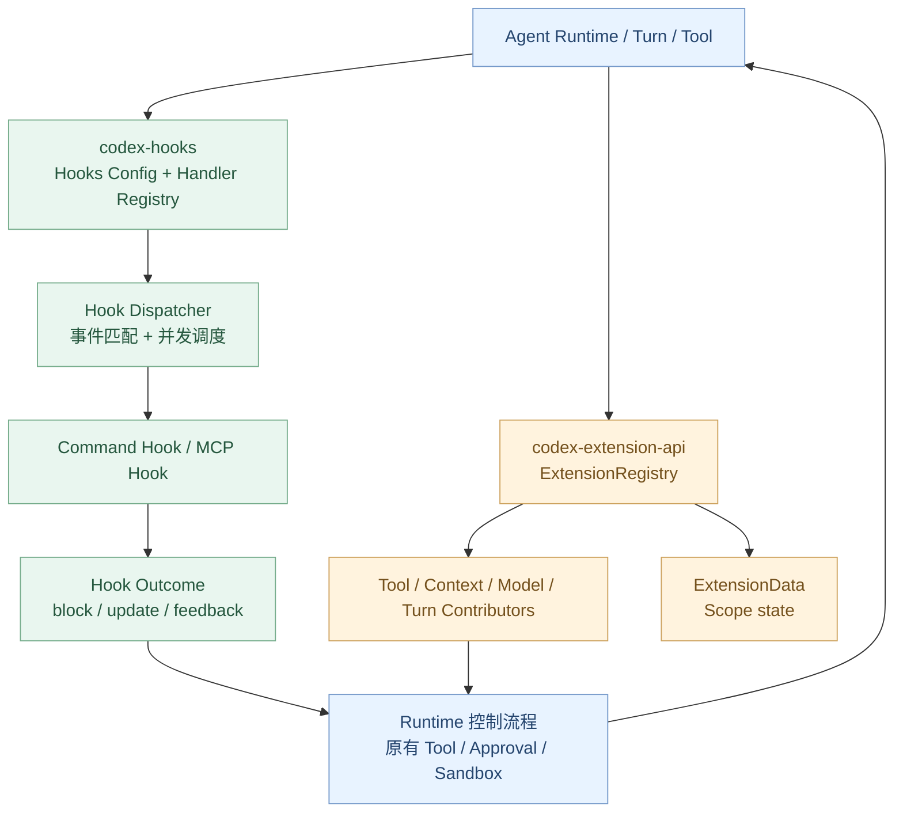
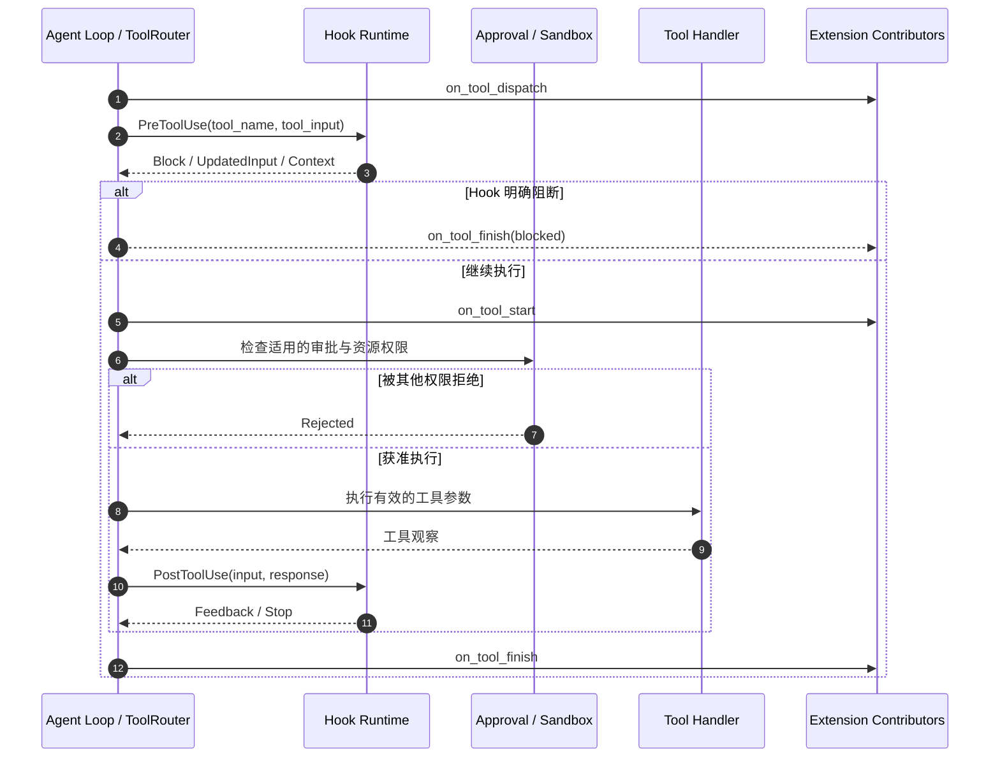

# 扩展篇 A3：Hooks / Extension API——Codex 如何扩展 Agent 的生命周期？

> **核心问题：** 当 Codex 已经能够运行 Agent Loop、调用模型和工具后，我们怎样在执行前后加入审计、检查、审批、提示注入和自定义工具？为什么一个 Hook 的“允许执行”不等于绕过原来的安全策略？
>
> [上一章：A2《MCP / Plugins / Connectors》](../A2-mcp-plugins-connectors/README.zh.md) · [教程首页](../README.zh.md) · [本章 Demo](./demo.py)

本章是“扩展能力”阶段的第三篇。A1 研究 `AGENTS.md / Skills` 如何注入上下文，A2 研究 MCP/Plugin/Connector 如何提供外部工具。A3 研究 **Codex 执行过程中有哪些可供扩展的事件与类型化接口**。

在这个固定版本中，要区分两个相关但不同的机制：

- **`codex-hooks`**：基于生命周期事件、匹配规则和 Handler 的 Hook 系统，可运行命令或 MCP 工具，按事件协议返回阻断、反馈或输入调整等效果。
- **`codex-extension-api`**：宿主组装的类型化 Contributor 注册表，可参与 Tool、MCP 来源、模型请求、Thread/Turn 生命周期、上下文及其他运行流程。

本章使用固定源码提交 [`openai/codex@014489466a17`](https://github.com/openai/codex/tree/014489466a1739c2c563cdfe57880c2c7c8680e3)，不把教程中的纯 Python 模拟误当成真实 Rust API 的可替代实现。

完成本章，你应能：

1. 列出常见 Hook 事件并识别它们各自的触发时机。
2. 解释 `PreToolUse` 与 `PostToolUse` 的阻断语义为何不同。
3. 理解 `PermissionRequest` 中“拒绝优先”以及 Hook 审批与 OS Sandbox 的边界。
4. 分清同步 Hook、异步 Hook 和 Executor 相关 Handler 的调度方式。
5. 理解 `ExtensionRegistryBuilder`、`ToolContributor`、`ToolLifecycleContributor` 和 `ExtensionData`。
6. 运行离线 Demo，验证拒绝优先、最新完成的输入改写、压缩前后以及宿主扩展注册。

---

## 1. Hook 到底扩展了什么？

假设用户要求：

> 在项目中分析一次 API 调用失败，只运行已授权的检查。

执行过程可以拥有不同的观察点：

```text
用户提交输入
      │
      ▼
开始一个 Turn
      │
      ▼
模型请求 / 响应
      │
      ▼
准备执行 Tool
      ├── PreToolUse：执行之前
      ├── PermissionRequest：需要申请操作权限时
      ▼
Tool Handler 实际执行
      └── PostToolUse：获得成功输出后
      │
      ▼
上下文快满？
      ├── PreCompact：压缩之前
      └── PostCompact：压缩之后
      │
      ▼
Turn 停止 / 中断 / Session 关闭
```

Hook 的工程用途包括：

- 为工具请求增加适当的校验和提示；
- 拦截符合规则的具体操作；
- 对工具输出增加反馈和上下文；
- 在模型请求和任务阶段记录可观察事实；
- 与运行时审批机制协作；
- 在压缩和任务生命周期边界运行辅助逻辑。

但**Hook 不是万能的安全沙箱**。Hook 本身也是代码或外部 MCP 调用，会失败、超时，具有来源信任和执行权限问题；它不能替代 ToolPolicy、数据权限或操作系统的实际资源约束。

## 2. 一张图：两套扩展机制如何参与 Runtime？



**这不是“一次工具调用必须依次运行两种扩展”的逐行时序图**。不同 Contributor 和 Hook 在不同触发边界被调用，适用配置、加载状态和调用路径也不相同。

## 3. Hook 一共有哪几类事件？

[`hooks/src/lib.rs`](https://github.com/openai/codex/blob/014489466a1739c2c563cdfe57880c2c7c8680e3/codex-rs/hooks/src/lib.rs#L19-L56) 在固定版本中列出 14 个事件名。

| Hook 事件 | 主要边界 |
| --- | --- |
| `SessionStart` | Session 进入可用状态的相关开始路径 |
| `SessionEnd` | Session 结束 |
| `UserPromptSubmit` | 用户提交输入 |
| `PreModelRequest` | 模型请求前 |
| `PostModelRequest` | 模型请求后 |
| `PreToolUse` | 工具执行前 |
| `PermissionRequest` | 权限请求时 |
| `PostToolUse` | 工具产生成功输出后 |
| `PreCompact` | 上下文压缩前 |
| `PostCompact` | 上下文压缩后 |
| `SubagentStart` | 子 Agent 启动 |
| `SubagentStop` | 子 Agent 停止 |
| `Stop` | Turn 停止相关阶段 |
| `Interrupt` | 中断相关阶段 |

**不要因为事件名里有 Pre/Post，就推断每次运行都一定触发全部事件。** 例如没有调用工具的 Turn 就不会产生正常的 PreToolUse/PostToolUse 成对事件；未经压缩的 Turn 自然不会经过压缩 Hook。

还有一个重要边界：**并非所有事件都使用同一套 Matcher**。源码中的 `HOOK_EVENT_NAMES_WITH_MATCHERS` 只包含需要按工具、触发方式或开始/结束原因匹配的那部分事件。

## 4. Hooks Config、Hook Registry 和 Handler 各管什么？

先看 [`hooks/src/registry.rs`](https://github.com/openai/codex/blob/014489466a1739c2c563cdfe57880c2c7c8680e3/codex-rs/hooks/src/registry.rs#L46-L109)：

- `HooksConfig` 汇集启用状态、配置层、插件 Hook 来源、可执行 Shell 配置等；
- `Hooks::new` 将这些配置与 Thread 和 MCP Hook 执行器绑定；
- `Hooks` 提供 `run_pre_tool_use`、`run_permission_request`、`run_post_tool_use`、`run_pre_compact` 等调用入口。

真正发现 Handler 的工作位于 [`hooks/src/engine/discovery.rs`](https://github.com/openai/codex/blob/014489466a1739c2c563cdfe57880c2c7c8680e3/codex-rs/hooks/src/engine/discovery.rs#L1-L110)。

它不是单纯读取当前工作目录下随便一个可执行文件，而是综合：

- 配置层和 Hooks 文件；
- 用户或插件提供的 Hook 声明；
- 执行环境与 Handler 来源；
- 插件信任状态；
- Required / Optional Hook 约束；
- 可用的事件与 Matcher 规则。

### 必须加载的 Hook 失败怎么办？

[`Hooks::new`](https://github.com/openai/codex/blob/014489466a1739c2c563cdfe57880c2c7c8680e3/codex-rs/hooks/src/registry.rs#L76-L94) 明确检查 `required_load_errors`。如果必需的受管 Hook 不能加载，初始化直接返回错误，而不是默默跳过。

这与普通可选 Hook 产生 Warning 后继续运行是不同的设计选择。

## 5. Handler 有两种主要执行形态

[`dispatcher::execute_handler`](https://github.com/openai/codex/blob/014489466a1739c2c563cdfe57880c2c7c8680e3/codex-rs/hooks/src/engine/dispatcher.rs#L193-L228) 区分：

| Handler | 执行方式 | 要注意的风险 |
| --- | --- | --- |
| `ConfiguredHandlerKind::Command` | 运行 Hook 命令，通过 stdin 传入 JSON | 命令权限、超时、输出解析、进程资源 |
| `ConfiguredHandlerKind::McpTool` | 调用指定 MCP Server/Tool，按模板生成参数 | MCP 连接、身份、参数模板、超时、调用权限 |

因此不能把“Hook”定义成“只能执行 Shell 脚本”。Codex 这里还支持 MCP Tool Handler。

### Command Hook 的实际机制

在 [`engine/command_runner.rs`](https://github.com/openai/codex/blob/014489466a1739c2c563cdfe57880c2c7c8680e3/codex-rs/hooks/src/engine/command_runner.rs#L209-L300)，可以看到：

1. 如有必要，验证插件来源信任。
2. 使用 Handler 规定的 Shell/环境构造命令。
3. 设置工作目录。
4. 将 JSON 请求写入 stdin。
5. 读取 stdout/stderr 与退出状态。
6. 对包括写入 stdin 在内的执行过程应用超时边界。

这条链路强调：**Hook 运行可能失败，而且本身不等于 Agent Tool 成功。**

### MCP Hook 的实际机制

[`engine/mcp_runner.rs`](https://github.com/openai/codex/blob/014489466a1739c2c563cdfe57880c2c7c8680e3/codex-rs/hooks/src/engine/mcp_runner.rs#L29-L102) 读取 Hook Event JSON、展开参数模板，通过 `HookMcpExecutor` 发起调用并记录结果。

Hook 访问 MCP 时，不能凭一个名称就假定获得宿主机器的任意文件系统权限。环境标识和信任约束仍然有意义。

## 6. Matcher 与调度：一个 Hook 如何匹配某次调用？

[`dispatcher::select_handlers_for_matcher_inputs`](https://github.com/openai/codex/blob/014489466a1739c2c563cdfe57880c2c7c8680e3/codex-rs/hooks/src/engine/dispatcher.rs#L32-L80) 先筛选事件类型，然后根据事件决定是否检查 Matcher。

对于 `PreToolUse`、`PermissionRequest` 和 `PostToolUse`，它会参考 Tool 名及兼容别名。

特别要注意：**同一个 Handler 即使匹配多个别名，也只会运行一次**。例如一个规则同时匹配 `apply_patch|Write|Edit` 时，不会因同一次工具调用带了多个兼容名就重复执行同一 Hook。

对于 `PreModelRequest`、`PostModelRequest`、`UserPromptSubmit`、`Stop` 等事件，当前源码的 Dispatcher 对 Matcher 的适用逻辑不同，不能生搬硬套 Tool 名匹配规则。

## 7. PreToolUse：执行之前可以发生什么？

看 [`events/pre_tool_use.rs`](https://github.com/openai/codex/blob/014489466a1739c2c563cdfe57880c2c7c8680e3/codex-rs/hooks/src/events/pre_tool_use.rs#L24-L46)：

```rust
pub struct PreToolUseOutcome {
    pub hook_events: Vec<HookCompletedEvent>,
    pub should_block: bool,
    pub block_reason: Option<String>,
    pub additional_contexts: Vec<HookContext>,
    pub updated_input: Option<Value>,
}
```

其中有三个关键控制结果：

- **`should_block`**：是否拒绝这次工具调用；
- **`updated_input`**：是否对即将执行的工具参数提出改写；
- **`additional_contexts`**：是否添加后续模型可见的上下文。

在 [`events/pre_tool_use.rs → run`](https://github.com/openai/codex/blob/014489466a1739c2c563cdfe57880c2c7c8680e3/codex-rs/hooks/src/events/pre_tool_use.rs#L72-L166)，源码先并行收集匹配 Handler 的结果，再确定阻断和有效输入改写。

### 多个 Hook 都要改写输入，谁说了算？

真实 [`latest_updated_input`](https://github.com/openai/codex/blob/014489466a1739c2c563cdfe57880c2c7c8680e3/codex-rs/hooks/src/events/pre_tool_use.rs#L152-L166) 的注释明确：**如果存在多个改写，以实际最后完成的 Hook 为准**，而不是纯粹以配置中谁写在最后为准。

这也是本章 Demo 的第一组实验。

### 有任意一个 Hook 拒绝会发生什么？

这个事件聚合时使用 `any(should_block)`。只要有有效的拒绝，调用应按拒绝路径结束，输入改写也不会被当作可执行结果继续采用。

不过还有一个微妙处：[`core/src/hook_runtime.rs`](https://github.com/openai/codex/blob/014489466a1739c2c563cdfe57880c2c7c8680e3/codex-rs/core/src/hook_runtime.rs#L188-L245) 对没有明确阻断理由的结果有特殊处理。因此**不要把任意 Hook 异常、退出码或空 stderr 都等同于“明确拒绝”**。

真正的阻断要满足对应事件的输出协议和控制效果检查。

## 8. PreToolUse 的 JSON 输出不能乱写

Hook Runner 并不是把 stdout 中所有文字都当作执行指令。

[`pre_tool_use.rs → parse_completed`](https://github.com/openai/codex/blob/014489466a1739c2c563cdfe57880c2c7c8680e3/codex-rs/hooks/src/events/pre_tool_use.rs#L193-L312) 对以下情况分别处理：

| Hook 执行结果 | 解释 |
| --- | --- |
| 空 stdout + 成功退出 | 可能没有控制效果 |
| 有效事件 JSON | 按受支持字段解析阻断、改写、补充上下文 |
| 看起来像 JSON 却无法解析 | 记录失败 |
| 退出码 2 且具备控制资格且提供阻断理由 | 可形成阻断 |
| 不受支持的权限决策 | 按错误/无效处理，不能猜测其效果 |
| 启动失败或超时 | 记录执行失败，不能自动套用所有其他事件的阻断规则 |

尤其是 `permissionDecision: "allow"` 或 `"ask"` 的含义**不能仅凭它们是英语单词就假定能在 PreToolUse 中生效**。固定版本对受支持字段有严格解释。

### 出于安全原因，能否仅靠 Hook 来强制“拒绝所有危险命令”？

不应该。工具政策与 Sandbox 是独立的强制边界。Hook 可以作为额外控制、审计或输入改写，但没有足够证据表明所有安全相关路径都应依赖用户提供的 Hook 成功运行。

---

## 9. PermissionRequest：审批 Hook 与安全策略的边界

[`events/permission_request.rs`](https://github.com/openai/codex/blob/014489466a1739c2c563cdfe57880c2c7c8680e3/codex-rs/hooks/src/events/permission_request.rs#L36-L65) 中：

```rust
pub enum PermissionRequestDecision {
    Allow,
    Deny { message: String },
}
```

当存在多个匹配的审批 Hook，结果聚合由 [`resolve_permission_request_decision`](https://github.com/openai/codex/blob/014489466a1739c2c563cdfe57880c2c7c8680e3/codex-rs/hooks/src/events/permission_request.rs#L146-L166) 负责。

**核心规则：有任何 Deny 则 Deny 优先；否则保留合适的 Allow；若没有决定则返回 None。**

这不是说 Hook 结果能绕过所有其余授权机制。第 09 章解释过：审批行为和有效 PermissionProfile / Sandbox 属于不同安全边界。

### 三种情况应当分清

| Hook 结果 | 工程理解 |
| --- | --- |
| `Deny` | 当前 Hook 审批路径明确拒绝 |
| `Allow` | 当前 Hook 审批路径允许；仍受适用的其他执行限制 |
| `None` | Hook 没有给出决定，交由后续适用审核路径处理 |

例如某远程 MCP 上游明确拒绝某项数据查询，Hook 的 Allow 并不能让上游凭空授予该数据权限。

## 10. PostToolUse：已经执行完成，才进入后置处理

[`events/post_tool_use.rs`](https://github.com/openai/codex/blob/014489466a1739c2c563cdfe57880c2c7c8680e3/codex-rs/hooks/src/events/post_tool_use.rs#L24-L48) 输入中除了 ToolName 和 ToolInput，还有 `tool_response`；返回 `PostToolUseOutcome`，其结果包含阻断/停止与反馈。

[`core/src/hook_runtime.rs`](https://github.com/openai/codex/blob/014489466a1739c2c563cdfe57880c2c7c8680e3/codex-rs/core/src/hook_runtime.rs#L297-L327) 的注释明确：PostToolUse 用于**工具已经产生成功输出**之后。

这意味着：

- PostToolUse 可以提供反馈或要求停止后续正常处理；
- 它不应被描述成“让已执行工具的外部副作用自动撤销”；
- 若要避免危险副作用，控制必须在执行前或真实资源访问层生效。

### PostToolUse 是否能直接重写 MCP 输出？

不要泛化。当前 [`post_tool_use.rs`](https://github.com/openai/codex/blob/014489466a1739c2c563cdfe57880c2c7c8680e3/codex-rs/hooks/src/events/post_tool_use.rs#L167-L315) 对不受支持的输出字段会记录无效输入或失败；不是看到 `updatedMCPToolOutput` 就无条件修改真实结果。

事件类型决定能解释哪些控制字段，**不是所有 Hook 共用同一套万能 JSON 输出契约**。

---

## 11. PreCompact 与 PostCompact：同名“停止”，时机完全不同

在 [`hooks/src/events/compact.rs`](https://github.com/openai/codex/blob/014489466a1739c2c563cdfe57880c2c7c8680e3/codex-rs/hooks/src/events/compact.rs#L23-L55)：

- `PreCompactRequest` 带有 `trigger` 等信息；
- `PostCompactRequest` 也关联当前触发源；
- 两者分别返回包含 `should_stop` 等状态的 Outcome。

而 [`core/src/hook_runtime.rs`](https://github.com/openai/codex/blob/014489466a1739c2c563cdfe57880c2c7c8680e3/codex-rs/core/src/hook_runtime.rs#L544-L608) 将这些状态映射回压缩生命周期。

### PreCompact 停止

如果在压缩之前明确停止，则此次压缩还没执行。需要由外层生命周期处理下一步。

### PostCompact 停止

如果压缩已经完成，PostCompact 才提出停止后续流程，不能因此认为压缩的历史替换从未发生。

这直接衔接了第 12 章的 `replace_compacted_history` 与后台 Compaction 语义。

**同一个 “stop” 字段，发生在副作用之前与之后，其可逆性完全不同。**

## 12. 多 Hook 执行顺序：配置顺序不等于完成顺序

在 [`hooks/src/engine/dispatcher.rs`](https://github.com/openai/codex/blob/014489466a1739c2c563cdfe57880c2c7c8680e3/codex-rs/hooks/src/engine/dispatcher.rs#L117-L190) 中：

1. 对符合条件的同步 Handler 创建待执行任务；
2. 使用 `FuturesUnordered` 并行等待完成；
3. 记录实际完成顺序；
4. 最终按配置顺序排序以保证报告稳定性；
5. 根据事件类型和完成顺序解析控制效果。

对于 PreToolUse 的多个输入改写，源码选择**最后完成者**。因此“在配置文件里写在最末尾，就一定赢得输入改写”是不准确的。

### Async Handler 和同步 Handler 一样能阻断吗？

不能简单这样推断。Dispatcher 会将设置为异步模式的 Handler 交给后台调度，而不是当作本次事件的同步控制结果等待。

对于 Executor Scoped Hook，代码也会在部分条件下调度后台任务，并对失败记录 Warning。

因此**不能把“已经安排一个异步 Hook”当成“它已完成安全审批”**。要控制是否执行某个 Tool，必须依赖适用的同步审批/执行控制和安全策略。

### 这对性能意味着什么？

Hook 在关键路径上增加了实际延迟；但任意 Hook 都做网络调用，会拖慢模型与工具之间的交互。对非关键路径的遥测可以考虑异步模式，但必须理解其不具备相同的阻断语义。

---

## 13. Hook 的生命周期事件如何呈现给 UI？

Core 在 [`hook_runtime.rs`](https://github.com/openai/codex/blob/014489466a1739c2c563cdfe57880c2c7c8680e3/codex-rs/core/src/hook_runtime.rs#L188-L245) 调用前会生成 Hook 预览，并通过会话事件通知 Hook 开始；结束后又发送 Hook 完成事件。

这些事件与第 10 章 `Op / Event` 的体系衔接，让客户端知道：

- 哪类 Hook 被触发；
- 哪个 Tool 或 Turn 与它关联；
- Hook 是否完成、失败、阻断或停止；
- 何时需要显示额外反馈。

**不要将 Hook 的 Completed 状态直接推导为 Tool、Turn 或用户目标已成功完成。**

例如一个 PostToolUse 可能成功记录了“工具异常”事实，但这个 Hook 自己正常退出，不说明 Tool 业务成功。

## 14. Extension API：为什么不是另一种 Hook JSON？

[`ext/extension-api/src/registry.rs`](https://github.com/openai/codex/blob/014489466a1739c2c563cdfe57880c2c7c8680e3/codex-rs/ext/extension-api/src/registry.rs#L20-L49) 定义：

```rust
pub struct ExtensionRegistryBuilder<C: Sync> {
    registry: ExtensionRegistry<C>,
}
```

构建器提供类型化方法，例如：

- `thread_lifecycle_contributor`；
- `turn_lifecycle_contributor`；
- `prompt_contributor`；
- `mcp_server_contributor`；
- `model_request_contributor`；
- `tool_contributor`；
- `tool_lifecycle_contributor`；
- `approval_review_contributor`；
- `turn_input_contributor` 等。

详见 [`registry.rs`](https://github.com/openai/codex/blob/014489466a1739c2c563cdfe57880c2c7c8680e3/codex-rs/ext/extension-api/src/registry.rs#L68-L150)。

这些是由**宿主代码组装并注册**的 Contributor 接口，并不是在任意 `hooks.json` 加一个未知字段就能自动成为 Rust 组件。

### 举一个真正有意义的对照

你希望平台加入一个 `native_audit_tool`：

- 若实现为 MCP Tool，它来自 MCP 服务端和连接生命周期。
- 若作为 Host 的 `ToolContributor`，可以在相应 Step 提供内部 Tool 实现。
- 若仅有一个 `PreToolUse` Hook，它是在已有 Tool 运行前干预，不会凭空给 ToolRegistry 增加一个完整 Tool 实现。

**Hook ≠ ToolContributor ≠ MCP Tool。**

## 15. ToolContributor 与 ToolLifecycleContributor 的区别

[`contributors.rs`](https://github.com/openai/codex/blob/014489466a1739c2c563cdfe57880c2c7c8680e3/codex-rs/ext/extension-api/src/contributors.rs#L370-L447) 同时存在：

### `ToolContributor`

它负责**提供工具实现**：

- 在 Step 构建工具之前 `prepare_for_step`；
- 返回 Thread 作用域 Tool；
- 或提供更细粒度的 Step 作用域 Tool。

所以它改变的是运行时可用工具的构成。

### `ToolLifecycleContributor`

它负责**观察已有工具的运行生命周期**，包括：

- `on_tool_dispatch`；
- `on_tool_start`；
- `on_command_start`；
- `on_mcp_tool_result`；
- `on_tool_finish`；
- `on_tool_timing`。

这类接口适合统一执行监控、归因、追踪与状态统计。

有一个很重要的注释：**某次工具被 Hook 阻断时，可能有 Dispatch 回调，却没有相匹配的 Start 回调；Finish 仍可以收到被阻断等终态。**

因此，不应该直接用 “Start 次数 == Finish 次数” 推断工具完整性。具体监控设计应该保留 Tool Call ID 和生命周期状态。

## 16. ExtensionData：状态到底挂在哪里？

看 [`ext/extension-api/src/state.rs`](https://github.com/openai/codex/blob/014489466a1739c2c563cdfe57880c2c7c8680e3/codex-rs/ext/extension-api/src/state.rs#L1-L117)。

`ExtensionDataInit` 和 `ExtensionData` 使用 Rust `TypeId` + `Arc<dyn Any + Send + Sync>` 存放类型化数据。

它们提供：

- `insert` / `get`；
- `get_or_init`；
- `insert_if`；
- `level_id`（关联相应宿主作用域）。

这是**宿主拥有的作用域状态**，而不是任意 Hook 输出的自由变量容器。

### 是否等于数据库持久化？

不是。源码注释写得非常明确：`ExtensionDataInit` 不会自行安装扩展，也不提供持久化。

长期保存状态、跨进程恢复及存储一致性仍然是另一个问题，需要明确的 ThreadStore、数据库或自定义可靠存储机制。

## 17. Extension API 还有哪些重要 Contributor？

[`contributors.rs`](https://github.com/openai/codex/blob/014489466a1739c2c563cdfe57880c2c7c8680e3/codex-rs/ext/extension-api/src/contributors.rs#L78-L155) 以及 [`contributors.rs`](https://github.com/openai/codex/blob/014489466a1739c2c563cdfe57880c2c7c8680e3/codex-rs/ext/extension-api/src/contributors.rs#L158-L355) 还包括：

| Contributor | 典型用途 |
| --- | --- |
| `McpServerContributor` | 向运行时提供 MCP Server 声明 |
| `ContextContributor` | 贡献 Thread / Turn / WorldState 相关上下文 |
| `ThreadLifecycleContributor` | 线程开始、恢复、空闲、结束时的宿主逻辑 |
| `TurnLifecycleContributor` | Turn 开始、Item 完成、停止、中断、错误 |
| `TurnInputContributor` | 贡献 Turn 输入项 |
| `ModelRequestContributor` | 对模型请求执行指定的宿主级扩展 |
| `TokenUsageContributor` | 消费 Token 用量检查点 |
| `SkillInvocationContributor` | 观察 Skill 调用 |
| `ApprovalReviewContributor` | 在明确授权的扩展点参与审批决策 |

和 A2 联系起来看：`McpServerContributor` 贡献的是**Server 来源**；ToolRouter 最终仍然基于有效 MCP 目录注册工具。

这使系统可以通过统一的注册与状态边界添加能力，而不是在一个巨型 `run_turn` 函数里不断增加散落的特例。

---

### 工具执行的一次 Hook 时序



此图是生命周期**教学示意**：现实中审批、工具准备及部分 Contributor 的实际调用先后还取决于工具种类与具体执行路径；尤其不要将 `PreToolUse` 的“继续”理解成跳过其他安全门禁。

## 18. 动手实验：模拟事件匹配、控制与宿主注册

本章完整 Python Demo：[`demo.py`](./demo.py)。

运行：

```bash
python demo.py
```

环境：Python 3.10+，仅标准库。**它不调用模型，不连接 MCP，不执行 Shell，不读取或写入工作区文件，也不会真实修改安全策略。**

Demo 定义：

| 结构 | 教学含义 |
| --- | --- |
| `Hook` | 一个带事件、Matcher、动作与完成顺序的虚拟 Handler |
| `ToyHooks.dispatch` | 选择匹配事件并聚合控制结果 |
| `Outcome` | 聚合后的阻断、输入更新、反馈与模拟后台任务 |
| `ToyRuntime.tool_call` | 无副作用的执行流程 |
| `ToyRuntime.compact` | 压缩前后两个不同的检查点 |
| `ToyExtensionRegistry` | 另外一组宿主 Contributor 注册接口 |

这些是针对职责和边界的**教学数据模型**，不实现真实 JSON/Command Hook/HookRuntime/ExtensionRegistry 的全部协议。

### 实验 1：最后完成的输入改写

两条 PreToolUse Handler 的配置顺序是：

```text
slow-rewrite  → 配置位置 1 / 完成 tick=9
fast-rewrite  → 配置位置 2 / 完成 tick=1
```

最终接受 `slow-rewrite` 的内容，因为它**实际最后完成**。

同时后台 Observer 被登记为已安排，但不参与当前的同步阻断决策。

### 实验 2：PreToolUse 明确拒绝优先

即使另一个 Handler 提出输入改写，只要适用的同步结果包含明确 Deny，本次 Tool 不执行。

```text
blocked before tool execution
```

### 实验 3：PermissionRequest 里 Deny 优先

```text
allow + deny → deny
none         → 后续审核路径
```

这对应源码 [`resolve_permission_request_decision`](https://github.com/openai/codex/blob/014489466a1739c2c563cdfe57880c2c7c8680e3/codex-rs/hooks/src/events/permission_request.rs#L146-L166) 的决策优先思想。

### 实验 4：Hook Allow 不能绕过 Sandbox

Demo 在审批允许之后，再模拟一次资源限制：

```text
PermissionRequest: allow
Sandbox: deny
Tool: not executed
```

它证明的是**安全检查彼此独立**，不等于这个 Python 函数已经拥有真正的进程隔离能力。

### 实验 5：PostToolUse 停止不能撤销此前的工具执行

Demo 的虚拟 Tool 已经记录执行一次，随后 PostToolUse 要求停止。

```text
post-hook-stopped
executed=True
```

这并不表示任何外部操作被自动回滚。

### 实验 6：PreCompact 与 PostCompact 有不同效果

- `PreCompact.stop`：压缩次数仍为 0；
- `PostCompact.stop`：压缩次数为 1，停止发生在它之后。

### 实验 7：ExtensionRegistry 不是 Hook

单独注册：

- 一个宿主提供的 `native_audit_tool`；
- 一个宿主 Turn Lifecycle Contributor。

断言它们通过类型化注册表对外产生信息，而不是被当成 Hook JSON 来解释。

测试全部通过时打印：

```text
All teaching assertions passed
```

## 19. 设计自己 Agent 平台的 Hook/Governance：应该注意什么？

如果要为企业级 Agent 平台引入此类能力，建议分开三个概念：

| 机制 | 应负责的事情 | 不应负责的事情 |
| --- | --- | --- |
| **Hook 事件与执行器** | 在合适生命周期观察、记录、提供附加控制 | 凭 Markdown 或不可信脚本获得全部权限 |
| **Governance / Approval** | 根据身份、操作、资源和规则产生授权决定 | 只依据模型一句“允许”就放行 |
| **Extension Registry** | 用明确契约装配受信任的宿主级能力 | 动态把任意插件代码当高权限 Rust 接口执行 |

特别是通过 MCP 调用业务系统时，至少要区分：

1. Tool 在本平台是否可见和可调用；
2. 这个用户、租户和上下文是否拥有当前操作的权限；
3. 该调用是否需要额外审批；
4. 上游系统是否认可当前身份与请求；
5. 工具调用后如何记录事实、审计、错误和下一步模型观察。

**审批 Hook 不是上游业务数据权限的替代品。** 也不能认为 PostToolUse 能安全过滤已经从上游泄露到不可信目标的内容；数据最小化、授权及隔离应该更早生效。

## 20. 调试 Hook：该怎样诊断具体失败？

| 现象 | 优先排查 |
| --- | --- |
| Hook 未触发 | 事件类型、Matcher、配置来源、启用状态 |
| Handler 已匹配但没有阻断 | 执行模式、返回协议、是否有有效阻断理由、控制资格 |
| 改写结果与配置顺序不符 | 实际完成顺序，不是仅看配置行号 |
| Hook 执行太慢 | Command/MCP 超时、同步 Handler 数量、外部依赖 |
| Hook 有 Error 但 Tool 继续 | 事件特定失败语义与调度策略 |
| Permission Hook 批准但 Tool 仍失败 | ToolPolicy、Sandbox、上游服务权限 |
| PostToolUse 反馈出现但数据没有恢复 | 执行已经完成；后置 Hook 不保证回滚 |
| Extension 工具没有注册 | Host Registry 是否装配了对应 Contributor、作用域和 Step 准备状态 |

对于高价值操作，应将 Hook Event ID、Turn ID、Tool Use ID、审批来源和真实 Tool 结果关联起来，而不是只依赖一句模型最终回复。

## 21. 源码阅读路线

按**事件目录 → 调度 → Core 桥接 → 宿主扩展**的顺序阅读：

| 顺序 | 固定源码入口 | 重点 |
| --- | --- | --- |
| 1 | [`HOOK_EVENT_NAMES`](https://github.com/openai/codex/blob/014489466a1739c2c563cdfe57880c2c7c8680e3/codex-rs/hooks/src/lib.rs#L19-L56) | 事件类型和 Matcher 适用范围 |
| 2 | [`HooksConfig / Hooks::new`](https://github.com/openai/codex/blob/014489466a1739c2c563cdfe57880c2c7c8680e3/codex-rs/hooks/src/registry.rs#L46-L109) | Hook 注册、必需 Handler 加载边界 |
| 3 | [`discover_handlers`](https://github.com/openai/codex/blob/014489466a1739c2c563cdfe57880c2c7c8680e3/codex-rs/hooks/src/engine/discovery.rs#L1-L110) | 配置、插件、信任及来源 |
| 4 | [`select_handlers_for_matcher_inputs`](https://github.com/openai/codex/blob/014489466a1739c2c563cdfe57880c2c7c8680e3/codex-rs/hooks/src/engine/dispatcher.rs#L32-L80) | 事件匹配和兼容别名 |
| 5 | [`execute_handlers_with_metadata`](https://github.com/openai/codex/blob/014489466a1739c2c563cdfe57880c2c7c8680e3/codex-rs/hooks/src/engine/dispatcher.rs#L117-L228) | 并发执行、后台任务与汇总 |
| 6 | [`Command Hook Runner`](https://github.com/openai/codex/blob/014489466a1739c2c563cdfe57880c2c7c8680e3/codex-rs/hooks/src/engine/command_runner.rs#L209-L300) | Shell、stdin、timeout |
| 7 | [`MCP Hook Runner`](https://github.com/openai/codex/blob/014489466a1739c2c563cdfe57880c2c7c8680e3/codex-rs/hooks/src/engine/mcp_runner.rs#L29-L102) | 外部 MCP 工具执行 |
| 8 | [`PreToolUseOutcome`](https://github.com/openai/codex/blob/014489466a1739c2c563cdfe57880c2c7c8680e3/codex-rs/hooks/src/events/pre_tool_use.rs#L24-L166) | Block、AdditionalContext 和 Rewrite |
| 9 | [`PreToolUse Result Parser`](https://github.com/openai/codex/blob/014489466a1739c2c563cdfe57880c2c7c8680e3/codex-rs/hooks/src/events/pre_tool_use.rs#L193-L312) | 输出协议与失败语义 |
| 10 | [`PermissionRequest Decision`](https://github.com/openai/codex/blob/014489466a1739c2c563cdfe57880c2c7c8680e3/codex-rs/hooks/src/events/permission_request.rs#L36-L166) | Deny 优先 |
| 11 | [`PostToolUseOutcome`](https://github.com/openai/codex/blob/014489466a1739c2c563cdfe57880c2c7c8680e3/codex-rs/hooks/src/events/post_tool_use.rs#L24-L145) | 反馈和后置控制 |
| 12 | [`Pre/PostCompact`](https://github.com/openai/codex/blob/014489466a1739c2c563cdfe57880c2c7c8680e3/codex-rs/hooks/src/events/compact.rs#L23-L121) | 压缩前后不同阶段 |
| 13 | [`run_pre_tool_use_hooks`](https://github.com/openai/codex/blob/014489466a1739c2c563cdfe57880c2c7c8680e3/codex-rs/core/src/hook_runtime.rs#L188-L245) | Core 如何消费阻断与改写 |
| 14 | [`run_post_tool_use_hooks`](https://github.com/openai/codex/blob/014489466a1739c2c563cdfe57880c2c7c8680e3/codex-rs/core/src/hook_runtime.rs#L297-L327) | Core 的后置 Hook 契约 |
| 15 | [`ExtensionRegistryBuilder`](https://github.com/openai/codex/blob/014489466a1739c2c563cdfe57880c2c7c8680e3/codex-rs/ext/extension-api/src/registry.rs#L20-L150) | 宿主级注册机制 |
| 16 | [`ToolContributor / ToolLifecycleContributor`](https://github.com/openai/codex/blob/014489466a1739c2c563cdfe57880c2c7c8680e3/codex-rs/ext/extension-api/src/contributors.rs#L370-L447) | 拥有工具 vs 观察工具 |
| 17 | [`ExtensionData`](https://github.com/openai/codex/blob/014489466a1739c2c563cdfe57880c2c7c8680e3/codex-rs/ext/extension-api/src/state.rs#L1-L117) | 类型化作用域状态 |

## 22. 五个思考题

**1. 同一工具调用同时触发两个 PreToolUse，两个都要改写输入，应该按配置位置还是执行完成顺序选取？**

固定源码选择最后完成的有效改写，同时将 Hook 记录按配置顺序提供稳定报告。两种顺序不应混淆。

**2. 一条 PostToolUse Hook 阻断后，是否说明这个 MCP Tool 从未访问上游系统？**

不说明。PostToolUse 位于调用之后；不能自动撤销已经发生的外部副作用。

**3. Hook 返回 Allow，是否可以直接访问被 Sandbox 明确禁止的资源？**

不能。适用的权限审批与 OS/执行器资源隔离仍然有效。

**4. ExtensionRegistry 的 ToolContributor 是否等于在 `hooks.json` 里增加一段命令？**

不等于。它是宿主注册的类型化 Rust Contributor，能够真正提供 Tool Runtime；Hook 是事件配置与 Handler 执行体系。

**5. 为何异步 Hook 不应作为高风险操作的唯一审批门禁？**

因为异步 Handler 可以不在原操作执行之前完成，本次调用的同步控制不能凭“任务已安排”推断出有效批准。

---

## 本章小结

```text
用户输入 / Turn / Model / Tool
               │
               ├── codex-hooks
               │      ├── 事件匹配
               │      ├── Command / MCP Handler
               │      └── Block / Rewrite / Feedback / Stop
               │
               └── extension-api
                      ├── Context / MCP / Tool Contributor
                      ├── Lifecycle / Approval Contributor
                      └── ExtensionData 作用域状态
               │
               ▼
       Agent Runtime + ToolRegistry
               │
               ▼
      Governance / Sandbox / Executor
```

**最重要的结论：Hook 是事件驱动的扩展点，Extension API 是宿主拥有的类型化运行时扩展点；两者都必须嵌入已有的权限和执行生命周期，而不是绕开它们。**

下一篇：[Agent Systems A4《Multi-Agent》（课程大纲）](../codex00.md)。

接下来进入多 Agent 系统：**一个主 Agent 怎样分派子任务、管理 Child Thread、并发等待、合并观察与控制执行隔离？**

