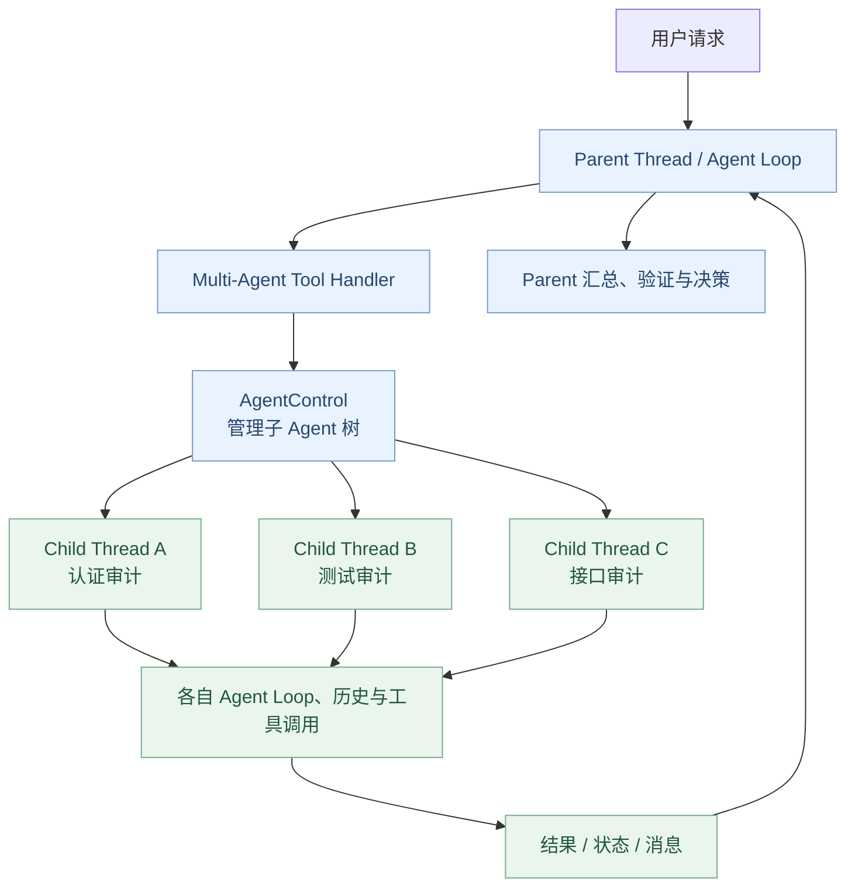
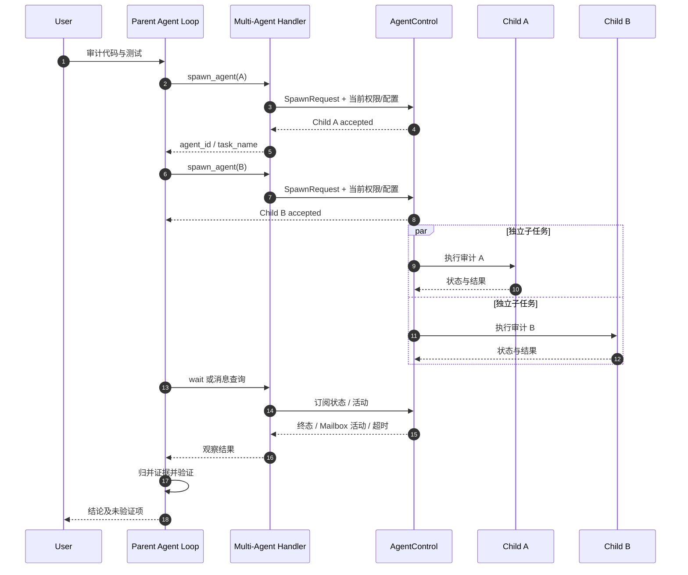

# Agent Systems A4：Multi-Agent——Codex 如何创建、调度与协调子 Agent？

> **核心问题：** 当一个任务适合分给多个 Agent，Codex 怎样创建 Child Thread、给它们传递上下文与权限、并发等待、收集结果、发送后续消息并关闭子 Agent？为什么多个 Agent 并行不代表它们可以安全地同时修改同一批文件？
>
> [上一章：A3《Hooks / Extension API》](../A3-hooks-extension-api/README.zh.md) · [课程首页](../README.zh.md) · [本章可运行 Demo](./demo.py)

前 12 章完成了单 Agent 的 Runtime；A1–A3 引入项目指令、外部能力和生命周期扩展。现在从单个 Thread 扩展到**一棵存在父子关系的 Agent Thread 树**。

本章围绕固定源码提交 [`openai/codex@014489466a17`](https://github.com/openai/codex/tree/014489466a1739c2c563cdfe57880c2c7c8680e3)。注意此版本同时存在 **Multi-Agent V1 和 V2**，两版的工具名、任务标识、消息交付和等待语义有所区别；本章会分别讲清楚。

学完本章，你应能：

1. 说明主 Agent、Child Agent、Thread、Turn 与 Tool Call 的关系。
2. 沿源码追踪 `spawn_agent → AgentControl::spawn → Child Thread`。
3. 解释**新建 / Fork 历史**与**继承当前权限 / 工作环境**是不同维度。
4. 区分 V1 `send_input / wait_agent` 与 V2 `send_message / followup_task / wait_agent`。
5. 理解深度、数量、正在执行的 Turn 容量等控制约束。
6. 给并行编码任务定义文件写入边界，避免多个 Agent 竞争同一个工作树。
7. 运行一个纯内存多 Agent 模型，验证创建确认、并发 Fan-out/Fan-in、消息、冲突检测、中断和结果回收。

---

## 1. 为什么不是所有任务都交给一个 Agent？

假设用户要求：

> 审计一个后端项目，检查认证、测试和接口设计，给出证据与风险。

可以把工作拆为三个相对独立的子任务：

| 子任务 | 适合做什么 | 主要产物 |
| --- | --- | --- |
| 认证审计 | 只读检查登录、权限、Token 传播 | 问题清单与代码位置 |
| 测试审计 | 检查现有测试范围与失败条件 | 覆盖缺口与测试证据 |
| API 审计 | 检查参数、异常与兼容性 | 设计风险和建议 |

如果主 Agent 先等认证完成，再启动测试、再检查 API，就不能充分利用彼此独立的工作。

**Multi-Agent 的价值不是“模型越多就越聪明”，而是把相互独立的工作并发执行，同时由一个协调者负责收敛结果与处理依赖。**

重要前提是**任务边界清楚**。如果三个 Agent 都会改同一控制器文件，简单并行反而可能增加冲突和返工。

## 2. 整体架构：一个 Thread Tree，不是一个超级模型请求



在这个架构中：

- **Parent Thread** 自己仍有正常的 Session、Turn 和 Agent Loop。
- **Child Thread** 是另一个被管理的线程，会拥有其自身的执行/事件/历史生命周期。
- **AgentControl** 是管理树结构、创建、消息交付、状态查询、停止等操作的统一接口。
- **工具调用不是子 Agent 自身**：`spawn_agent` 只是模型发起创建操作的一次 Tool Call。

最需要记住的一句话：**spawn 成功 ≠ Child Turn 已完成 ≠ 用户目标已实现。**

## 3. 代码从哪里进入：Multi-Agent Tool Spec 与 Handler

先读 [`tools/handlers/multi_agents_spec.rs`](https://github.com/openai/codex/blob/014489466a1739c2c563cdfe57880c2c7c8680e3/codex-rs/core/src/tools/handlers/multi_agents_spec.rs#L70-L163)。

它提供 V1、V2 两种 `spawn_agent` ToolSpec。两者虽然都有“创建子 Agent”的含义，但在固定版本中格式不同：

| 对比 | Multi-Agent V1 | Multi-Agent V2 |
| --- | --- | --- |
| ToolSpec | namespaced `spawn_agent` | plain function `spawn_agent` |
| 子 Agent 定位 | 主要根据 Thread ID | 使用任务路径，也保留 Thread ID |
| 控制工具 | `send_input`、`wait_agent`、`close_agent` 等 | `send_message`、`followup_task`、`wait_agent`、`list_agents`、`interrupt_agent` 等 |
| 等待设计 | 观察指定 Agent 的终态状态 | 等待 Mailbox 活动、User Steering 或超时 |
| 历史 Fork 参数 | `fork_context` | `fork_turns` |

上述工具在实际使用时仍取决于功能开关、模型工具配置与当前运行环境。**不要把两版不同的参数和返回值混到同一个 Tool Call 中。**

## 4. AgentControl 是真正的控制边界

[`core/src/agent/api.rs`](https://github.com/openai/codex/blob/014489466a1739c2c563cdfe57880c2c7c8680e3/codex-rs/core/src/agent/api.rs#L1-L128) 给出了核心接口：

```rust
pub trait AgentControl: Send + Sync {
    fn identity(&self) -> SessionId;
    fn spawn(&self, request: SpawnRequest)
        -> BoxFuture<'_, Result<(LiveAgent, ThreadConfigSnapshot)>>;
    fn send(&self, request: SendRequest)
        -> BoxFuture<'_, Result<DeliveryReceipt>>;
    fn take_mailbox(&self, agent: ThreadId)
        -> Vec<InterAgentCommunication>;
    // resolve / watch_mailbox / interrupt / list / close ...
}
```

这是**概念性的真实方法节选**，省略了声明中的其他方法和完整类型路径。

源码文件头强调：该接口协调一棵 Agent 树，独立于 Thread 实际运行的位置。具体实现拥有成员关系、加载、消息交付和共享资源的管理职责。

### 为什么要抽象 AgentControl？

因为创建子 Agent 不应被写成：

```python
subagent = ModelClient()
result = subagent.chat("帮我看看")
```

真实 Child Agent 还要解决：

- Thread 身份与父子关系；
- 输入交付与目标解析；
- 当前权限和配置快照；
- 恢复及卸载；
- 正在运行的 Turn 与消息队列；
- 子 Agent 深度、容量与资源配额；
- 状态观测与生命周期事件。

这些都不是创建第二个模型客户端就能解决的。

## 5. 真实 Spawn 链路

V1 的 [`handle_spawn_agent`](https://github.com/openai/codex/blob/014489466a1739c2c563cdfe57880c2c7c8680e3/codex-rs/core/src/tools/handlers/multi_agents/spawn.rs#L53-L127) 可以拆成：

1. 解析模型提供的参数；
2. 解析 Agent Role 和初始输入；
3. 计算 Child Depth 并检查最大深度；
4. 发送 `CollabAgentToolCall` 开始事件；
5. 从当前 Step 准备 Child Config；
6. 构造带 Parent Thread、Parent Turn、环境与插件选择的 `SpawnRequest`；
7. 调用 `AgentControl::spawn`；
8. 返回 Child Thread ID/昵称，并发送完成事件。

V2 的 [`thread_spawn::spawn`](https://github.com/openai/codex/blob/014489466a1739c2c563cdfe57880c2c7c8680e3/codex-rs/core/src/thread_spawn.rs#L29-L140) 统一准备 `ThreadSpawnRequest`，由 [`multi_agents_v2/spawn.rs`](https://github.com/openai/codex/blob/014489466a1739c2c563cdfe57880c2c7c8680e3/codex-rs/core/src/tools/handlers/multi_agents_v2/spawn.rs#L94-L195) 接入具体 Tool。

### Spawn 返回了什么？

源码 [`ThreadSpawnResult`](https://github.com/openai/codex/blob/014489466a1739c2c563cdfe57880c2c7c8680e3/codex-rs/core/src/thread_spawn.rs#L38-L48) 的注释：

> Acceptance does not mean the turn completed.

即 `agent_control.spawn(...)` 返回成功，代表子任务被接受并创建相应执行实体。后续模型调用、工具执行、验证和结果收集仍可能需要很长时间，也可能失败。

**如果主 Agent 不等待或观察结果就宣布全部完成，会形成假成功。**

## 6. Child 继承父 Agent 的哪些东西？

阅读 [`agent/child_config.rs`](https://github.com/openai/codex/blob/014489466a1739c2c563cdfe57880c2c7c8680e3/codex-rs/core/src/agent/child_config.rs#L105-L202)。

`build_agent_shared_config` 基于当前 Parent Turn 的有效配置，再应用 Child 的角色、模型或其他合法覆盖。

特别重要的内容有：

- 当前模型与 Provider 信息；
- 本次 Step 对应的模型/推理配置；
- Developer Instructions 及特定子 Agent 指令；
- 工作目录 `cwd`；
- 审批策略 `approval_policy`；
- 当前权限配置/Permission Profile；
- 当前 Token Budget 配置；
- 当前执行环境绑定与插件禁用选择等。

### 为什么不简单克隆父配置就完了？

因为 Parent 的配置可能在过去的 Thread 生命周期中发生变化。真正的执行安全策略来自**当前活跃 Turn 的有效快照**。

[`apply_spawn_agent_runtime_overrides`](https://github.com/openai/codex/blob/014489466a1739c2c563cdfe57880c2c7c8680e3/codex-rs/core/src/agent/child_config.rs#L179-L202) 的源码注释明确指出：如果忽略当前运行态，仅克隆过时配置，Child 可能得到错误的 Provider、审批模式、工作目录或 Sandbox。

这与 A2 的 `PreparedMcpCall` 快照设计思路一致：**开始一个动作之前，应先固定这次动作的有效配置与身份。**

### Child 获得的权限一定和 Parent 完全一样吗？

不能一概而论。当前源码先继承适用状态，再根据 Child Role、有效策略和环境能力允许受控覆盖；真实执行仍要经过第 09 章的权限和 Sandbox。

更重要的是：**Fork 上下文历史不代表 Fork 权限凭据，也不应推断能突破父级策略。**

## 7. Fresh Context vs FullHistory Fork

对子 Agent，至少要分清两个维度：

- **历史来源**：创建一个新的对话历史，还是 Fork 一份已有模型历史。
- **运行权限**：当前用户/执行环境授予了什么操作能力。

[`SpawnAgentForkMode::FullHistory`](https://github.com/openai/codex/blob/014489466a1739c2c563cdfe57880c2c7c8680e3/codex-rs/core/src/agent/types.rs#L22-L45) 表示支持 Fork 历史；[`ThreadSpawnRequest`](https://github.com/openai/codex/blob/014489466a1739c2c563cdfe57880c2c7c8680e3/codex-rs/core/src/thread_spawn.rs#L29-L48) 则说明不指定 Fork 可以从新上下文开始。

### 两种策略

| 策略 | 适用情形 | 代价 |
| --- | --- | --- |
| Fresh | 子任务独立、任务书足够自洽 | 必须显式交付必要事实 |
| FullHistory | 子任务强依赖父任务现有推理和工具观察 | 历史更长、成本更高、上下文可能含无关内容 |

### V2 Fork 参数有一个陷阱

[`SpawnAgentArgs::fork_mode`](https://github.com/openai/codex/blob/014489466a1739c2c563cdfe57880c2c7c8680e3/codex-rs/core/src/tools/handlers/multi_agents_v2/spawn.rs#L203-L241)：

- V2 不再接受 V1 的 `fork_context`；
- 使用 `fork_turns`；
- `none` 表示 Fresh；
- `all` 或部分兼容数字字符串代表 FullHistory；
- **兼容数字不表示真的“只 Fork 最近 N 个 Turn”**。

这点非常容易凭参数名猜错，源码明确写着“接受旧 Turn 数但不限制继承历史”。因此教程不应教读者用 `fork_turns: 3` 来精确控制 Fork 三轮历史。

## 8. Agent 树和任务身份

V1 Tool 往往直接返回 `agent_id`，对应该 Child Thread ID。

V2 还用 `task_name` 构建层级化 `AgentPath`。见 [`thread_spawn::spawn`](https://github.com/openai/codex/blob/014489466a1739c2c563cdfe57880c2c7c8680e3/codex-rs/core/src/thread_spawn.rs#L81-L114)：

```text
root
├── authentication
│   └── token-check
└── tests
    └── regression
```

这是一张教学树，而非真正的项目文件夹。**AgentPath 不等于文件系统路径，更不是 Git Branch**。

使用任务路径可以便于 Child 定位、列举、通信和展示。实际 Thread ID 仍是运行时实体标识。

## 9. 必须限制递归 Spawn 和 Agent 数量

如果 Child 可以无限创建 Child，将导致不可控的模型请求、工具执行和 Token 消耗。

源码使用两种相互关联的限制：

**深度限制：** [`agent/registry.rs`](https://github.com/openai/codex/blob/014489466a1739c2c563cdfe57880c2c7c8680e3/codex-rs/core/src/agent/registry.rs#L71-L98) 定义 `next_thread_spawn_depth` 和 `exceeds_thread_spawn_depth_limit`；V1 Spawn 会与当前 `agent_max_depth` 对比。

**数量限制：** [`AgentRegistry::reserve_spawn_slot`](https://github.com/openai/codex/blob/014489466a1739c2c563cdfe57880c2c7c8680e3/codex-rs/core/src/agent/registry.rs#L15-L45) 和 [`reserve_spawn_slot`](https://github.com/openai/codex/blob/014489466a1739c2c563cdfe57880c2c7c8680e3/codex-rs/core/src/agent/registry.rs#L98-L124) 对共享 Session 的子 Agent 数量提供配额管理。

[`AgentControl`](https://github.com/openai/codex/blob/014489466a1739c2c563cdfe57880c2c7c8680e3/codex-rs/core/src/agent/api.rs#L104-L127) 还涉及 V2 的 Turn Admission 与执行资源守卫。**可创建的 Child 总数**与**此刻可运行的 Turn 数量**不能混为同一个指标。

### 超过限制怎么办？

不应该让模型无限重试 Spawn。通常应把任务缩小为本 Agent 自己完成，或者等待已有子任务结束并复用已有 Agent。

此处也有现实成本：每个活跃 Agent 可以产生自己的模型请求、工具调用、历史和追踪数据。不能仅通过“并发数”估算完整成本。

## 10. Multi-Agent V1：send_input 和 wait_agent

在 [`multi_agents/send_input.rs`](https://github.com/openai/codex/blob/014489466a1739c2c563cdfe57880c2c7c8680e3/codex-rs/core/src/tools/handlers/multi_agents/send_input.rs#L35-L114) 中，V1 `send_input` 定位目标 Agent，并根据参数决定是否先中断目标，再把新输入送给该 Child。

**`interrupt=true` 与普通追加输入不是同一语义**。立即打断当前工作是重大行为，不应该只为“快一点回应”随意启用。

V1 `wait_agent` 的重点是订阅指定 Child 的状态：

[`multi_agents/wait.rs`](https://github.com/openai/codex/blob/014489466a1739c2c563cdfe57880c2c7c8680e3/codex-rs/core/src/tools/handlers/multi_agents/wait.rs#L55-L180)

它会：

1. 校验目标与超时参数；
2. 订阅指定 Agent 的状态流；
3. 如果已有可用终态，直接整理；
4. 否则异步等待状态变化或超时；
5. 返回目标 Agent 的状态映射与 `timed_out`。

[`wait.rs`](https://github.com/openai/codex/blob/014489466a1739c2c563cdfe57880c2c7c8680e3/codex-rs/core/src/tools/handlers/multi_agents/wait.rs#L180-L243) 还会在第一个结果出现后收集同一时刻已就绪的更多结果。

### Wait 是“等所有 Agent 全部结束”吗？

**不是。** 这里更接近“等待目标集合中的一个或多个终态观察，在超时边界返回”，而不是无条件阻塞到所有 Child 全部完成。

**收到一次 wait 的结果，也不代表其他 Agent 已完成。** 主 Agent 应检查各 Agent 当前状态，必要时再次等待或进行收敛。

### Interrupted 算终态吗？

[`agent/status.rs`](https://github.com/openai/codex/blob/014489466a1739c2c563cdfe57880c2c7c8680e3/codex-rs/core/src/agent/status.rs#L1-L32) 中，`is_final` 并不将 `Interrupted` 简单视为最终终态。这是因为某些路径还允许重新开始或调整工作。

因此不能使用“所有非 Running 状态都算完成”的粗糙判断。

## 11. Multi-Agent V2：消息与任务唤醒分离

V2 的设计与 V1 有明显区别。

在 [`agent/types.rs`](https://github.com/openai/codex/blob/014489466a1739c2c563cdfe57880c2c7c8680e3/codex-rs/core/src/agent/types.rs#L59-L64) 有：

```rust
pub enum MessageDeliveryMode {
    QueueOnly,
    TriggerTurn,
}
```

| 模式 | 含义 |
| --- | --- |
| `QueueOnly` | 向 Mailbox 投递消息，不因此直接启动空闲 Agent 的新 Turn |
| `TriggerTurn` | 投递输入，并在目标空闲时启动相应工作 |

看看两个 Tool：

- [`send_message.rs`](https://github.com/openai/codex/blob/014489466a1739c2c563cdfe57880c2c7c8680e3/codex-rs/core/src/tools/handlers/multi_agents_v2/send_message.rs#L29-L57) 使用 `QueueOnly`。
- [`followup_task.rs`](https://github.com/openai/codex/blob/014489466a1739c2c563cdfe57880c2c7c8680e3/codex-rs/core/src/tools/handlers/multi_agents_v2/followup_task.rs#L30-L58) 使用 `TriggerTurn`。

实际交付逻辑在 [`message_tool.rs`](https://github.com/openai/codex/blob/014489466a1739c2c563cdfe57880c2c7c8680e3/codex-rs/core/src/tools/handlers/multi_agents_v2/message_tool.rs#L41-L100) 中，通过 `AgentControl::send` 处理。

**发送成功只代表输入被接受，不代表对方已阅读，更不代表任务已完成。**

V2 还提供 [`list_agents`](https://github.com/openai/codex/blob/014489466a1739c2c563cdfe57880c2c7c8680e3/codex-rs/core/src/tools/handlers/multi_agents_v2/list_agents.rs#L35-L74) 和 [`interrupt_agent`](https://github.com/openai/codex/blob/014489466a1739c2c563cdfe57880c2c7c8680e3/codex-rs/core/src/tools/handlers/multi_agents_v2/interrupt_agent.rs#L34-L84) 等控制工具。

## 12. V2 的 wait_agent：等的是活动，不是特定子任务终态

这是本章最容易把源码讲错的地方。

在 [`multi_agents_v2/wait.rs`](https://github.com/openai/codex/blob/014489466a1739c2c563cdfe57880c2c7c8680e3/codex-rs/core/src/tools/handlers/multi_agents_v2/wait.rs#L39-L135)：

- 先订阅当前 Turn 的 Input Queue 活动；
- 可以因 Mailbox 活动唤醒；
- 可以因新的用户 Steering 唤醒；
- 也可以因超时结束等待。

对应的 [`WaitOutcome`](https://github.com/openai/codex/blob/014489466a1739c2c563cdfe57880c2c7c8680e3/codex-rs/core/src/tools/handlers/multi_agents_v2/wait.rs#L196-L221) 是：

```rust
enum WaitOutcome {
    MailboxActivity,
    Steered,
    TimedOut,
}
```

这**不是 V1 按 Agent ID 订阅终态的 wait 语义**。

### 为什么 V2 用 Mailbox Activity？

因为主 Agent 可以等待多个子 Agent 的消息，而不必每次都逐一轮询其 Thread 状态。子 Agent 的活动或最终通知通过消息机制聚合，主 Agent 被唤醒后再检查消息和相关状态。

但不应推断“Mailbox 被唤醒 = 全部 Child 结束”——它只代表有值得继续处理的活动。

## 13. AgentStatus：要分开汇报生命周期和业务结果

在 [`agent/status.rs`](https://github.com/openai/codex/blob/014489466a1739c2c563cdfe57880c2c7c8680e3/codex-rs/core/src/agent/status.rs#L1-L32)，源码把 Session 事件映射为 Agent 状态：

| 事件 | 对应状态 |
| --- | --- |
| `TurnStarted` | `Running` |
| `TurnComplete` 且无错误 | `Completed(last_agent_message)` |
| `TurnComplete` 携带错误 | `Errored` |
| `TurnAborted` 的部分中断理由 | `Interrupted` |
| `ShutdownComplete` | `Shutdown` |

**注意：Completed 只是该子 Agent Turn 的生命周期终态，不是它提交的代码或审计报告已经经主 Agent 验证。**

例如 Child 只读审计完成后报告“没有风险”，Parent 仍要检查证据是否覆盖真实文件、是否遗漏边界案例，以及与其他 Child 的发现是否冲突。

## 14. 最关键的执行安全问题：并发 Agent 会共享哪些资源？

**Child Thread 是不同的会话实体，不必然拥有不同的文件系统。**

[`child_config.rs`](https://github.com/openai/codex/blob/014489466a1739c2c563cdfe57880c2c7c8680e3/codex-rs/core/src/agent/child_config.rs#L179-L202) 将父级有效 `cwd` 带入子配置；[`SpawnAgentOptions`](https://github.com/openai/codex/blob/014489466a1739c2c563cdfe57880c2c7c8680e3/codex-rs/core/src/agent/types.rs#L27-L46) 还可以携带继承的执行环境绑定。

因此如果多个 Agent 具有相同工作目录，并且同时改动相同文件，可能发生：

- 读取到另一 Agent 尚未完成的更改；
- 覆盖未提交文件；
- 互相干扰测试与构建产物；
- 误将不同分支 / 工作区的文件内容当作同一份源代码；
- 出现 Git Index 竞争或中间状态。

**spawn_agent 本身不会自动创建 Git Worktree。**

### 如何划分并行与串行？

| 情况 | 工程上更合适的选择 |
| --- | --- |
| 多个只读审计，读同一仓库 | 可以考虑并行 |
| 两人各自编辑互不相交的目录，且构建环境隔离 | 在明确文件所有权和工具资源后可并行 |
| 两个 Agent 同时编辑同一个 Java Service | 不应直接并行写同一文件 |
| 一个 Agent 修改代码，另一个跑依赖完整构建的测试 | 需定义完成先后或独立工作树 |
| 多个 Agent 都可能更新同一 Git Index | 应以独立 Worktree 或串行 Git 操作协调 |

对于真正需要并行**写代码**的任务，通常应先准备独立工作树、确定文件所有权和合并负责人。**这个步骤是编排与执行环境设计，不是启动一个 Child Thread 自带的能力。**

## 15. 结果回收：Fan-out / Fan-in 的职责是谁？

主 Agent 不只是“派发了三个子任务”。完整闭环应包含：

1. **Fan-out**：将范围、输入和验收标准交给具体 Child。
2. **Observe**：等待消息、状态或事件，处理超时与失败。
3. **Fan-in**：收集实际结果，确认出处与适用范围。
4. **Reconcile**：处理相互矛盾的发现以及依赖关系。
5. **Decide**：判断是否需要后续工具、重新分派或结束 Turn。

主 Agent 通常应保留对最终答案和副作用的最终责任，而不是无条件复述每个 Child 的结果。

一个值得注意的设计点是：**每个 Child 最终返回给模型的文本，不自动保证事实正确。** 如果需要代码落地，仍要检查代码、测试与环境一致性。

## 16. 多 Agent 时序图



图中“wait 或消息查询”取决于 V1/V2，不代表两个版本内部调用完全一致。

## 17. 实验：构建一个零外部依赖的 Multi-Agent 控制器

[本章 Demo](./demo.py) 基于 Python 3.10+ 标准库 `asyncio`，构建 `ToyAgentControl`。

运行：

```bash
python demo.py
```

它**不调用真实模型、不创建文件、不运行 Shell、不连接网络、不对真实仓库执行任何更改**。

包含：

| 教学对象 | 对应职责 |
| --- | --- |
| `Agent` | Child 身份、父节点、深度、状态、Mailbox 和结果 |
| `PermissionSnapshot` | 创建时捕获有效配置，不主动扩权 |
| `ToyAgentControl.spawn` | 创建限制和异步受理 |
| `ToyAgentControl.wait_any` | 简化的 V1 风格终态等待 |
| `ToyAgentControl.send_message` | QueueOnly 风格消息 |
| `ToyAgentControl.interrupt` | 请求取消模拟任务 |
| `ToyAgentControl.collect` | 只允许从 Completed Child 回收结果 |

### 实验 A：Spawn ACK 不等于 Child 完成

两个审计 Child 被创建后，立刻验证：

```text
spawn ACK: accepted; outputs not completed; policy snapshot inherited
```

其 `result` 仍为空，但都拿到了相同的教学权限快照。

### 实验 B：拒绝共享文件写入冲突

已有 Child 正在读取 `auth.py`。如果新 Child 想写它，实验拒绝创建冲突工作。

```text
shared-workspace conflict rejected
```

**这是教学控制器主动提供的规则，不是说 Codex 的 spawn_agent 自动执行了 Git 文件读写集静态分析。**

### 实验 C：生成深度限制

父深度 0、最大 Child Depth 1。Child 再 Spawn Grandchild 会失败：

```text
depth limit rejected grandchild
```

与 [`registry.rs`](https://github.com/openai/codex/blob/014489466a1739c2c563cdfe57880c2c7c8680e3/codex-rs/core/src/agent/registry.rs#L71-L98) 的基本深度判定思想相呼应。

### 实验 D：QueueOnly 消息不表示任务结束

模拟向正在工作的 Child 发送一条消息；只检查它被放入 Mailbox，不把这件事当作 Child 最终回复。

```text
queue-only message delivered without implying completion
```

### 实验 E：Wait 可以超时，而任务仍在执行

`wait_any(..., timeout=0)` 立即返回空观察；后台 Child 随后继续执行。

```text
short wait: timed out; agent remains running
```

这个 Demo 是**教学化 V1 终态等待**，没有真实 Thread 状态订阅、实时通信、V2 Steering，也没有完全复刻 Codex 的 `is_final` 规则；尤其不能以 Toy 的中断状态分类推断真实 `Interrupted` 一定终止等待。

### 实验 F：并行 Fan-in 收敛结果

等待两个只读 Child 完成，Parent 收集：

```text
fan-in: both read-only results collected by parent
```

Demo 不会自动把结果写成 PR，也不会“模型决定”要不要通过审计；这里只验证消息、状态和收集边界。

### 实验 G：中断与结果确认

当一个长运行 Child 进入运行阶段后，发出取消请求并等待观察到教学终态。此时不允许从它提取 Completed 结果。

```text
interrupted child has no completed result
All teaching assertions passed
```

**取消请求已被提交**不等于**已确认最终停止**。实际异步运行时如果协程甚至尚未开始执行，就可能没有机会运行内部清理逻辑，所以不能仅靠发出 `cancel()` 假定已收到终态。

## 18. 工程审计：典型多 Agent 故障

| 问题 | 最先检查 |
| --- | --- |
| Spawn 成功但 Child 没结果 | Child Thread、Turn 状态、工具调用、等待机制 |
| Child 配置与 Parent 不一致 | 当前 Step/Turn 配置快照和角色覆盖 |
| 无法 Spawn 更多 Child | 深度、Agent Registry 配额、执行容量 |
| V2 wait 被唤醒但 Child 未结束 | Mailbox 活动、User Steering、真实子任务状态 |
| 多 Agent 覆盖了彼此文件 | 工作目录、Git Worktree、文件所有权、共享构建资源 |
| Parent 收到的结果不完整 | 是否只收到一个 Child 的终态、是否还需等待其余目标 |
| Interrupted 后还能继续对话 | 中断不是所有等待与恢复路径中的最终终态 |
| 子任务成本异常 | 各 Thread 模型请求、Token、工具数量与重试 |

应保留的最低追踪信息：Parent Thread ID、Parent Turn ID、Child Thread ID、AgentPath、Spawn Call ID、有效权限配置版本、角色、模型、状态、消息送达方式与实际结果。

## 19. 源码阅读顺序

建议按**ToolSpec → Spawn → AgentControl → ChildConfig → Messaging → Wait → Lifecycle**阅读：

| 顺序 | 固定版本源码 | 看什么 |
| --- | --- | --- |
| 1 | [`multi_agents_spec.rs`](https://github.com/openai/codex/blob/014489466a1739c2c563cdfe57880c2c7c8680e3/codex-rs/core/src/tools/handlers/multi_agents_spec.rs#L70-L163) | V1/V2 ToolSpec 的差异 |
| 2 | [`V1 spawn handler`](https://github.com/openai/codex/blob/014489466a1739c2c563cdfe57880c2c7c8680e3/codex-rs/core/src/tools/handlers/multi_agents/spawn.rs#L53-L127) | 参数、深度、Child Config |
| 3 | [`V2 spawn handler`](https://github.com/openai/codex/blob/014489466a1739c2c563cdfe57880c2c7c8680e3/codex-rs/core/src/tools/handlers/multi_agents_v2/spawn.rs#L94-L195) | task_name 与 V2 Tool 入口 |
| 4 | [`thread_spawn.rs`](https://github.com/openai/codex/blob/014489466a1739c2c563cdfe57880c2c7c8680e3/codex-rs/core/src/thread_spawn.rs#L29-L140) | 子任务接纳与 Thread 身份 |
| 5 | [`AgentControl trait`](https://github.com/openai/codex/blob/014489466a1739c2c563cdfe57880c2c7c8680e3/codex-rs/core/src/agent/api.rs#L1-L128) | 控制边界与后端抽象 |
| 6 | [`build_agent_shared_config`](https://github.com/openai/codex/blob/014489466a1739c2c563cdfe57880c2c7c8680e3/codex-rs/core/src/agent/child_config.rs#L105-L202) | Parent 权限与有效设置继承 |
| 7 | [`SpawnAgentOptions`](https://github.com/openai/codex/blob/014489466a1739c2c563cdfe57880c2c7c8680e3/codex-rs/core/src/agent/types.rs#L22-L64) | 历史 Fork、环境和插件选择 |
| 8 | [`Registry 深度与配额`](https://github.com/openai/codex/blob/014489466a1739c2c563cdfe57880c2c7c8680e3/codex-rs/core/src/agent/registry.rs#L71-L124) | 防止无限生成 |
| 9 | [`V1 send_input`](https://github.com/openai/codex/blob/014489466a1739c2c563cdfe57880c2c7c8680e3/codex-rs/core/src/tools/handlers/multi_agents/send_input.rs#L35-L114) | 追加输入和中断 |
| 10 | [`V1 wait_agent`](https://github.com/openai/codex/blob/014489466a1739c2c563cdfe57880c2c7c8680e3/codex-rs/core/src/tools/handlers/multi_agents/wait.rs#L55-L243) | 指定 Agent 终态订阅 |
| 11 | [`V2 send_message`](https://github.com/openai/codex/blob/014489466a1739c2c563cdfe57880c2c7c8680e3/codex-rs/core/src/tools/handlers/multi_agents_v2/send_message.rs#L29-L57) | QueueOnly |
| 12 | [`V2 followup_task`](https://github.com/openai/codex/blob/014489466a1739c2c563cdfe57880c2c7c8680e3/codex-rs/core/src/tools/handlers/multi_agents_v2/followup_task.rs#L30-L58) | TriggerTurn |
| 13 | [`V2 wait_agent`](https://github.com/openai/codex/blob/014489466a1739c2c563cdfe57880c2c7c8680e3/codex-rs/core/src/tools/handlers/multi_agents_v2/wait.rs#L39-L135) | Mailbox、Steering 与超时 |
| 14 | [`Agent Status`](https://github.com/openai/codex/blob/014489466a1739c2c563cdfe57880c2c7c8680e3/codex-rs/core/src/agent/status.rs#L1-L32) | 状态与终态判断 |
| 15 | [`V2 list_agents`](https://github.com/openai/codex/blob/014489466a1739c2c563cdfe57880c2c7c8680e3/codex-rs/core/src/tools/handlers/multi_agents_v2/list_agents.rs#L35-L74) | 查询子 Agent 树 |

## 20. 思考题

**1. `spawn_agent` 返回 `agent_id` 之后，Parent 能否直接宣布子任务成功？**

不能。它表示创建请求被接受；必须继续观察 Child 的真实状态和产物。

**2. V1 和 V2 的 `wait_agent` 一样吗？**

不一样。V1 关注指定 Agent 的终态订阅；V2 关注 Mailbox、User Steering 或超时等活动。

**3. Child 使用 FullHistory Fork 是否代表它得到更高的数据库或文件权限？**

不是。历史复制与运行授权是不同边界，实际权限应来自当前有效的执行环境和权限快照。

**4. 为什么多个只读 Agent 更容易并行，而多个同文件写入 Agent 不适合直接并行？**

因为后者会产生写冲突、测试环境竞争和未提交状态覆盖；需要独立工作树或明确协调协议。

**5. 主 Agent 如何确定 Multi-Agent 工作真正闭环？**

不仅要回收 Child 结果，还要核验证据、处理未完成或错误状态、协调结果冲突，并对最终结论负责。

---

## 本章总结

```text
                Parent Agent
                     │
             spawn_agent / 分派
                     │
              AgentControl
                     │
       ┌─────────────┼─────────────┐
       ▼             ▼             ▼
     Child A       Child B       Child C
       │             │             │
       └─────────────┼─────────────┘
                     ▼
          状态 / 消息 / 终态 / 证据
                     │
                     ▼
             Parent Fan-in
                     │
                     ▼
        验证结果、权限和副作用
                     │
                     ▼
              最终用户回复
```

**这一章的核心结论：Multi-Agent 是由线程树、控制接口、消息交付、状态观测与隔离策略共同构成的运行系统；并不是让模型多次请求 `spawn_agent` 就自动实现可靠协作。**

下一篇：[Agent Systems A5《Memory》（课程大纲）](../codex00.md)。

接下来研究 Codex 如何跨 Session 保存有效记忆、检索既有知识，以及 Memory 与 History、Rollout、Context 之间的差别。

