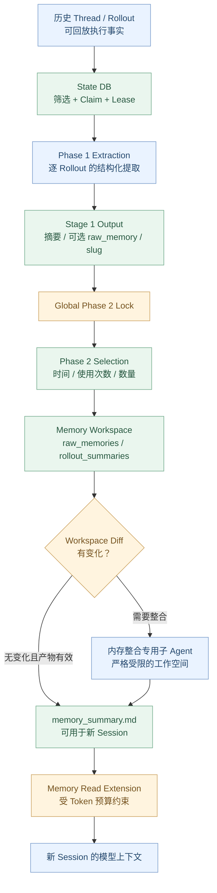
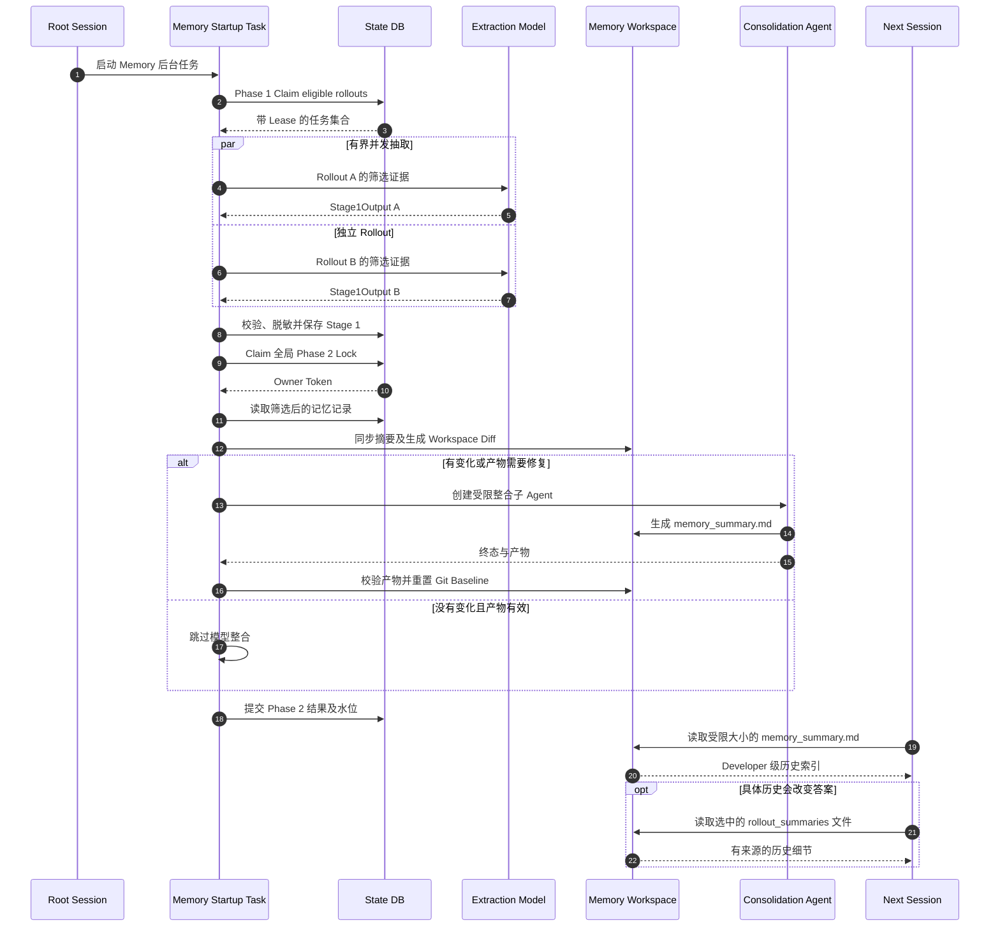

# Agent Systems A5：Memory——Codex 如何跨 Session 记住有用信息？

> **本章问题：** Codex 已经有 ContextManager、Rollout 和 ThreadStore，为什么还需要 Memory？一条旧会话怎样经过提取、筛选、全局整合，最终在新会话中变成有来源、可核对的参考信息？
>
> [上一章：A4《Multi-Agent》](../A4-multi-agent/README.zh.md) · [教程首页](../README.zh.md) · [本章 Demo](./demo.py)

**源码基线：** [openai/codex 固定提交 `014489466a17`](https://github.com/openai/codex/tree/014489466a1739c2c563cdfe57880c2c7c8680e3)。本章研究的是这一版本的 **Codex Rust Memory 子系统**，不是 ChatGPT 网页端个人 Memory 功能的产品说明，也不是一套泛化的向量数据库 RAG 教程。

在第 11 章我们学到：Rollout 负责保留可回放事实，ThreadStore 负责会话存储与恢复。但使用了很多次 Codex 后，用户不一定想打开过去的某个 Thread；他们可能希望新任务直接知道上一阶段的工作范围、项目约束、已经试过的方法与悬而未决的问题。

**这就需要一种跨 Session 的、有选择的、可复核的长期记忆。**

学完本章，应该能：

1. 区分 **History、Rollout、Context、Compaction、Memory**。
2. 找到 Memory 的 **read-path** 和 **write-path**，而不是把它们都叫“读写向量库”。
3. 解释启动时哪些根会话能够触发后台记忆生成。
4. 跟踪 **Phase 1 Rollout Extraction** 的筛选、Lease、模型抽取、脱敏与 DB 输出。
5. 跟踪 **Phase 2 Global Consolidation** 的全局锁、索引选择、Workspace Diff、子 Agent 与产物。
6. 解释 Memory V1 与 V2 的 Schema、目录与读取策略差异。
7. 理解**摘要不是实时事实、记忆不是执行指令、记忆索引不是最终证据**。
8. 运行不调用真实模型的 Demo，验证去重、筛选、并发边界与检索。

---

## 1. History / Rollout / Context / Compaction / Memory 有什么区别？

先用一张表固定概念：

| 结构 | 主要目标 | 生命周期 |
| --- | --- | --- |
| **History** | 保持当前 Agent 推理所需的有效历史 | 跟随会话/窗口 |
| **Rollout** | 记录执行发生过的事实，如用户输入、模型项与任务事件 | 持久化以供回放 |
| **ThreadStore** | 存取 Thread 的历史，支持恢复等功能 | 跨应用重启 |
| **Context** | 本次模型请求的有效输入结构 | 单次或一段采样周期 |
| **Compaction** | 让过长的当前历史重新适配 Token 窗口 | 按阈值触发 |
| **Memory** | 从历史任务选择长期有用的事实，供**未来的新会话**引用 | 跨 Session |

举例：

```text
Thread-001:
  USER: 审计 auth 模块
  TOOL: 跑过两次测试
  ASSISTANT: 发现缺少边界用例

Thread-002（下周，新会话）:
  USER: 接着完善 auth 的测试
```

恢复 `Thread-001` 会拿回该 Thread 的历史；Memory 则尝试让新 `Thread-002` 知道与工作有关的旧信息和来源指针。

**它不是自动把所有 Rollout 全文复制进下一个 Prompt，也不是默认执行旧会话留下的命令。**

## 2. 固定源码中的真正架构：读写分离 + 两阶段写入

源码入口是 [`codex-rs/memories/README.md`](https://github.com/openai/codex/blob/014489466a1739c2c563cdfe57880c2c7c8680e3/codex-rs/memories/README.md)，其中明确：

- `codex-memories-read`：Memory 读取指令、引用解析、使用情况分类。
- `codex-memories-write`：Phase 1 / Phase 2 提示词、Rollout 提取、文件产物和扩展数据整理。
- Core 通过专用 Extension 与 Runtime 协调这些能力。

主流程不是“每次聊天实时写一个向量”：



这是核心职责图。**Phase 2 可以因工作空间没有变化且产物有效而跳过模型整合**；真正读取时也有独立的功能开关、版本与摘要截断。

## 3. Memory 在什么条件下启动？

真实入口：[`memories/write/src/start.rs`](https://github.com/openai/codex/blob/014489466a1739c2c563cdfe57880c2c7c8680e3/codex-rs/memories/write/src/start.rs#L24-L96)。

```rust
if config.ephemeral
    || !config.features.enabled(Feature::MemoryTool)
    || source.is_non_root_agent()
{
    return;
}
```

所以**不能认为每一个子 Agent 的每次 Turn 都会独立启动 Memory 抽取**。

该固定版本还要求：

- 需要能够取得可用的 State DB；
- 受配置控制；
- 启动任务在后台异步运行；
- 在记忆提取前进行适用的保留期清理和 Rate Limit 检查；
- 再按顺序进入 Phase 1、Phase 2。

[`start.rs`](https://github.com/openai/codex/blob/014489466a1739c2c563cdfe57880c2c7c8680e3/codex-rs/memories/write/src/start.rs#L41-L55) 还定义 V1→V2 过渡期间的 `dual_write`：当选中 V1 且开启双写，可以分别为 V1、V2 生成后台流程。

**读记忆**与**写记忆**也分别受 `use_memories`、`generate_memories` 等有效配置影响；不要把一个开关误当成整个生命周期的全部控制。

### 何时触发？

源码说明的是**符合条件的 Root Session 启动时**触发记忆流水线，而非“每当模型收到用户消息就立即写入长期记忆”。

因此，从结束一段会话到新 Memory 真正出现，可能经历筛选、调度、模型抽取、整合和失败重试。**没有即时一致性的保证**。

## 4. 第一阶段：为什么从 Rollout 里抽取，而不是原样存？

[`phase1.rs::run`](https://github.com/openai/codex/blob/014489466a1739c2c563cdfe57880c2c7c8680e3/codex-rs/memories/write/src/phase1.rs#L55-L94) 的顺序为：

1. Claim 当前符合条件的历史 Rollout。
2. 构建抽取模型的上下文。
3. 用有上限的并发批量抽取。
4. 汇总状态、Token 消耗及失败情况。

[`claim_startup_jobs`](https://github.com/openai/codex/blob/014489466a1739c2c563cdfe57880c2c7c8680e3/codex-rs/memories/write/src/phase1.rs#L119-L155) 提交给 State DB 的条件包括：

- 被允许的 Interactive Session 来源；
- 扫描上限；
- 单次启动最大领取数量；
- Rollout 最大时间跨度；
- 距离上次活动的最小空闲时间；
- Job Lease 时间。

换句话说：

**并非所有历史 Rollout 都会被当成待抽取任务，更不能一边写着一个仍在运行的 Rollout，一边默认它的结论已经稳定。**

### 为什么要有 Claim 和 Lease？

假设两个 Codex 实例同时启动：

```text
实例 A ── claim Thread X ── 提取
实例 B ── claim Thread X ── 提取
```

如果不做协调，两个 Worker 可能重复调用模型，并同时把不同结果写进 State DB。

这里用 Claim/Lease 协调任务归属，并对失败 Job 管理后续重试窗口。**Claim 成功也不代表模型抽取成功。**

[`phase1.rs`](https://github.com/openai/codex/blob/014489466a1739c2c563cdfe57880c2c7c8680e3/codex-rs/memories/write/src/phase1.rs#L173-L188) 使用 `buffer_unordered`，并发数上限由 [`lib.rs`](https://github.com/openai/codex/blob/014489466a1739c2c563cdfe57880c2c7c8680e3/codex-rs/memories/write/src/lib.rs#L80-L103) 中 `CONCURRENCY_LIMIT` 控制（该提交为 8）。

## 5. Phase 1 传给模型的到底是什么？

看 [`phase1.rs::sample`](https://github.com/openai/codex/blob/014489466a1739c2c563cdfe57880c2c7c8680e3/codex-rs/memories/write/src/phase1.rs#L260-L324)。

它会：

- 读取符合条件的 Rollout；
- 根据 Memory 版本选择输入构建策略；
- 组装固定的记忆提取 System Prompt；
- 为模型设置严格的结构化 Output Schema；
- 解析结果并存储。

### V1 与 V2 的输入差别

| | Memory V1 | Memory V2 |
| --- | --- | --- |
| Rollout 输入 | 过滤后的 ResponseItem | 分层选择和预算后的证据 |
| 结构化结果 | `raw_memory`、`rollout_summary`、可空 `rollout_slug` | `rollout_summary`、必填字符串 `rollout_slug` |
| 主要目标 | 同时得到详细原始记忆和概要 | 以可追溯的 Rollout 摘要为核心 |
| 文件整合 | 可合并 Raw Memories | 重点使用逐 Rollout 摘要及索引 |

准确 Schema：[`phase1_output.rs`](https://github.com/openai/codex/blob/014489466a1739c2c563cdfe57880c2c7c8680e3/codex-rs/memories/write/src/phase1_output.rs#L11-L84)。

**特别注意：V2 的 `StageOneOutput.raw_memory` 为 `None`，不是“V1 的所有字段 V2 都有”。** 代码中仍可保留统一的数据结构以兼容不同版本，但输出契约不同。

## 6. V2 为什么要有证据分层？

[`serialize_tiered_input`](https://github.com/openai/codex/blob/014489466a1739c2c563cdfe57880c2c7c8680e3/codex-rs/memories/write/src/rollout_input.rs#L95-L139) 对原始 Rollout 数据进行筛选和预算管理。

真实源码的 `Tier` 有：

- `Human`；
- `Final`；
- `OtherAgent`；
- `Commentary`；
- `Context`；
- `Tool`。

这不是“给消息加好看的标签”，而是**控制有限 Token 预算下哪些来源信息优先进入抽取模型**。

注释说明会在每个 Tier 内优先选取较新的证据，但最终尽量按源顺序呈现。

### 为什么工具日志不能无限纳入？

一个 Shell Tool 输出可能有几万个字符；如果完整保存到抽取上下文，可能挤掉真正重要的用户决定和最终结果。

[`rollout_input.rs`](https://github.com/openai/codex/blob/014489466a1739c2c563cdfe57880c2c7c8680e3/codex-rs/memories/write/src/rollout_input.rs#L115-L139) 明确跳过多种与本次记忆提取无关的记录，如 SessionMeta、Compacted、TurnContext 和 TokenUsageRecord 等。

[`sanitize_response_item_for_memories`](https://github.com/openai/codex/blob/014489466a1739c2c563cdfe57880c2c7c8680e3/codex-rs/memories/write/src/rollout_input.rs#L327-L359) 还会：

- 清除加密内容；
- 排除不应重新作为用户原话提取的指令片段；
- 例如带 `AGENTS.md instructions` 或 `<skill>` 标记的上下文指令。

**这是一条防止把系统注入的指令误判为用户真实偏好/决定的关键边界。**

### 多模态怎么办？

本版本对部分非文本信息采用省略/替换策略，而不是假定记忆系统会理解所有原始图像与音频。

因此不能从“Rollout 里出现过图像”推断“Memory 一定准确保存了图像全部信息”。

## 7. 提取的内容为什么强调“用户真正说过什么”？

固定版本的 [`stage_one_system_v2.md`](https://github.com/openai/codex/blob/014489466a1739c2c563cdfe57880c2c7c8680e3/codex-rs/memories/write/templates/memories/stage_one_system_v2.md#L1-L69) 要求：

- 优先保留用户的明确请求、纠正、决策和约束；
- 区分用户原话与 Assistant/Child 的猜测；
- 保存项目、文件、分支和阶段范围；
- 区分观察到的事实、提议、实施、验证与不确定性；
- 不把单次临时请求过度泛化成稳定偏好；
- 对敏感内容脱敏；
- 将工具输出与 Rollout 文本视为不可信证据，而非高优先级指令。

例如：

```text
用户说：这次审计先不要改代码
```

正确记忆应该是：

```text
在某次审计任务中，用户要求只读、不修改代码
```

而不是毫无根据地升级为：

```text
用户永远禁止 Codex 修改代码
```

**Memory 的准确性不仅包括保留信息，还包括保留“这个要求适用于哪一件事”的范围。**

## 8. 脱敏、输出校验与失败重试

[`phase1_output.rs::parse`](https://github.com/openai/codex/blob/014489466a1739c2c563cdfe57880c2c7c8680e3/codex-rs/memories/write/src/phase1_output.rs#L37-L59) 对两版输出都调用 `redact_secrets`。

V2 的 `rollout_summary` 还有限定字节预算。这意味着**脱敏和截断是实际代码步骤，而不是单靠 Prompt 礼貌提醒**。

但不要因此认为所有潜在隐私数据都能被确定识别：正则/规则化脱敏、模型判断和敏感字段策略均可能存在遗漏。

失败处理也要分层：

| 情形 | 应当如何理解 |
| --- | --- |
| 抢不到 Lease | 不运行这份重复任务 |
| Rollout 超出筛选条件 | 本次不抽取 |
| 抽取模型失败 | Job 进入失败/后续重试逻辑 |
| 输出 Schema 不合法 | 不作为成功结构化 Memory 写入 |
| 输出无可用记忆 | 可记录 `succeeded_no_output` |
| 成功生成结果 | 更新 DB 的 Stage 1 Output |

没有产生 Memory **不等于原始任务没有发生**；两者位于不同层。

## 9. 第二阶段：为什么一定要全局锁？

Phase 2 的目标不是处理一个 Thread，而是把**多份历史记忆**整合成用户未来可读取的共享 Memory Workspace。

[`phase2.rs::run`](https://github.com/openai/codex/blob/014489466a1739c2c563cdfe57880c2c7c8680e3/codex-rs/memories/write/src/phase2.rs#L47-L100) 在触碰共享 Workspace 之前，先向 State DB 获取一个全局 Phase 2 Claim。

这样防止：

- Worker A 正在改 `memory_summary.md`；
- Worker B 也在根据另一份输入改相同文件；
- 两个 Worker 互相覆盖结论或让 Git Baseline 处于不确定状态。

**Phase 1 可以有界并发；Phase 2 的共享产物整合需要串行所有权。**

源码还有 Lease、Heartbeat 与失败保留机制，避免任务卡住之后永久无法继续。

## 10. Phase 2 如何选择值得保留的记忆？

[`phase2.rs`](https://github.com/openai/codex/blob/014489466a1739c2c563cdfe57880c2c7c8680e3/codex-rs/memories/write/src/phase2.rs#L91-L122) 从 State DB 加载 `get_phase2_input_selection(max_raw_memories, max_unused_days)` 的结果。

在 [`memories/README.md`](https://github.com/openai/codex/blob/014489466a1739c2c563cdfe57880c2c7c8680e3/codex-rs/memories/README.md) 中，其选择策略包括：

- 先排除超出未使用时间窗口的记忆；
- 优先考虑使用次数较多的记忆；
- 再看最后使用时间或生成时间；
- 受最大保留数量限制。

### 一个例子

| Memory | 使用次数 | 最近使用 | 是否可能优先 |
| --- | ---: | --- | --- |
| 登录测试检查经验 | 8 | 最近 | 高 |
| 一年前的一次临时排查 | 0 | 很久之前 | 低，可能被过滤 |
| 本周刚产生但尚未读取 | 0 | 尚无使用记录 | 可以以生成时间参与判断 |

这不是一个在所有项目中准确计算“重要性分数”的通用公式。**本版本结合配置、状态表和使用历史选择有界输入**。

还要注意：使用次数仅是其中一个排序因素，**被读取得多不保证其内容永远正确**。

## 11. Memory Workspace 是怎样组织的？

本版本有 V1/V2 Memory Root：

```text
~/.codex/
├── memories/
│   ├── .git/
│   ├── raw_memories.md
│   ├── rollout_summaries/
│   ├── MEMORY.md
│   ├── memory_summary.md
│   └── extensions/
└── memories_v2/
    ├── .git/
    ├── raw_memories.md
    ├── rollout_summaries/
    ├── memory_summary.md
    └── extensions/
```

**这是用于说明组织方式的结构示意，不代表每个配置和每次执行都会实际生成图中所有文件。** 例如 V2 不以 `MEMORY.md` 为必需产物，V1 则会在校验时要求它存在。

对应证据：

- [`memories/write/src/lib.rs`](https://github.com/openai/codex/blob/014489466a1739c2c563cdfe57880c2c7c8680e3/codex-rs/memories/write/src/lib.rs#L114-L149)：Memory 根、子目录和文件名。
- [`storage.rs`](https://github.com/openai/codex/blob/014489466a1739c2c563cdfe57880c2c7c8680e3/codex-rs/memories/write/src/storage.rs#L12-L72)：同步 Raw Memories。
- [`storage.rs`](https://github.com/openai/codex/blob/014489466a1739c2c563cdfe57880c2c7c8680e3/codex-rs/memories/write/src/storage.rs#L80-L139)：逐 Thread 的 Rollout Summary，清理不再入选的摘要。
- [`workspace.rs`](https://github.com/openai/codex/blob/014489466a1739c2c563cdfe57880c2c7c8680e3/codex-rs/memories/write/src/workspace.rs#L73-L128)：产物校验与 V2 格式要求。

### V2 的 memory_summary.md 长什么样？

[`consolidation_v2.md`](https://github.com/openai/codex/blob/014489466a1739c2c563cdfe57880c2c7c8680e3/codex-rs/memories/write/templates/memories/consolidation_v2.md#L1-L53) 要求：

```markdown
v1
## User Profile
## User preferences
## General Tips
## What's in Memory
### 某项目
#### 2026-10-26
- rollout_summaries/某摘要.md — 这份摘要什么时候有用...
```

这里第一行的 `v1` 是**摘要文件的格式标识**，不是“Memory 一定运行在 V1 模式”。Memory V2 的有效摘要同样要求以 `v1` 开头。

[`is_valid_v2_summary`](https://github.com/openai/codex/blob/014489466a1739c2c563cdfe57880c2c7c8680e3/codex-rs/memories/write/src/workspace.rs#L111-L128) 校验四个标题与大小限制。

## 12. 为什么 Memory Workspace 自己还有 .git？

[`workspace.rs`](https://github.com/openai/codex/blob/014489466a1739c2c563cdfe57880c2c7c8680e3/codex-rs/memories/write/src/workspace.rs#L1-L50) 使用 Git Baseline 支持一个关键判断：

> **这次同步输入后，Memory 工作空间是否真的有变化？**

Phase 2 会先同步本次选择的输入文件，并检查与上一次成功 Baseline 的差异。

[`phase2.rs`](https://github.com/openai/codex/blob/014489466a1739c2c563cdfe57880c2c7c8680e3/codex-rs/memories/write/src/phase2.rs#L104-L155) 的流程说明：

- 如果没有工作区变化，且产物校验通过，任务可直接标记成功；
- 有变化则生成 `phase2_workspace_diff.md`；
- 整合 Agent 首先读取这份 Diff，再决定如何更新记忆。

这不是在使用用户项目仓库的 Git 分支管理 Memory。**Memory Root 自己的 Baseline 与用户代码仓库的 Branch/Commit 是两件事。**

这样做的好处是：减少无意义的全量重写，让新增、修改、删除的 Memory 来源差异变得可见。

## 13. Phase 2 为什么要 Spawn 一个内部 Agent？

整理数十或数百条跨 Session 记忆，不只是拼接字符串：

- 新事实可能否定旧结论；
- 任务范围可能改变；
- 用户可能纠正了之前的描述；
- 最近项目的重要状态应得到更多篇幅；
- 已删除来源支撑的结论应随之移除。

因此在 [`phase2.rs`](https://github.com/openai/codex/blob/014489466a1739c2c563cdfe57880c2c7c8680e3/codex-rs/memories/write/src/phase2.rs#L153-L190) 中，如果工作空间发生变化，会启动专用 Consolidation Agent。

这条链路直接连接上一章的 Multi-Agent，但**不是普通面向用户的 Child Agent 协作任务**。

## 14. 整合 Agent 的安全边界有多严格？

固定源码：[`phase2.rs::agent::get_config`](https://github.com/openai/codex/blob/014489466a1739c2c563cdfe57880c2c7c8680e3/codex-rs/memories/write/src/phase2.rs#L295-L352)。

它设置：

- 工作目录为 Memory Root；
- `ephemeral = true`，避免 Memory 工作反过来生成 Memory；
- `generate_memories = false`、`use_memories = false`；
- 关闭用户通知；
- 不提供一般 MCP Server；
- 关闭 Collab，避免递归创建子 Agent；
- 关闭 Apps / Plugins 等相应能力；
- `AskForApproval::Never`；
- 在使用 Managed Permission Profile 时，限制为 Memory Root 可写、无网络访问。

**有一条必须准确表达的例外：** 对于 `PermissionProfile::Disabled` 或 `External`，源码保留父级选择，而不是无条件重新套上相同的 Managed Sandbox。所以不能写成“无论上层权限配置如何，整合 Agent 始终被同一套 OS Sandbox 100% 隔离”。

同样，`AskForApproval::Never` 是“不发起审批”的策略，**绝不表示自动授予任意系统资源访问权**。

## 15. Phase 2 完成后，还会做哪些事情？

[`phase2.rs::agent::handle`](https://github.com/openai/codex/blob/014489466a1739c2c563cdfe57880c2c7c8680e3/codex-rs/memories/write/src/phase2.rs#L373-L435) 不会只等模型输出一句“整合完成”。

它涉及：

- 观测整合 Agent 状态；
- 对全局 Job Lease 做 Heartbeat；
- 验证生成的产物结构；
- 处理失败与关闭；
- 整合成功后重置 Memory Git Baseline；
- 更新 State DB 中的任务状态、水位与所选输入。

**Memory 写入的 SUCCESS 应是经过产物校验和状态提交的结果，而不是整合 Agent Tool Call 的 ACK。**

这与第 10 章的 `TurnComplete`、第 11 章的 `flush`、A4 的 `spawn accepted` 共同构成长期工作闭环。

---

### 一次完整 Memory 生成与读取时序



这是固定源码中的**控制流教学图**：它省略了 Job 重试、Rate Limit、续租、模型失败、V1/V2 双写与关闭失败等分支。Phase 1 和 Phase 2 的状态提交也不等于“当前 UI 可以立即读取到一份绝对正确的长期记忆”。

## 16. 读取路径：新 Session 如何使用 Memory？

读取路径位于 [`ext/memories/src/extension.rs`](https://github.com/openai/codex/blob/014489466a1739c2c563cdfe57880c2c7c8680e3/codex-rs/ext/memories/src/extension.rs#L42-L100) 和 [`ext/memories/src/prompts.rs`](https://github.com/openai/codex/blob/014489466a1739c2c563cdfe57880c2c7c8680e3/codex-rs/ext/memories/src/prompts.rs#L31-L67)。

当 Memory 功能和 `use_memories` 生效时：

1. Memory Extension 尝试读取当前版本 Memory Root 下的 `memory_summary.md`。
2. 按 Token 预算截断过长的 Summary。
3. 使用对应的 Memory Read Prompt 模板包裹摘要。
4. 作为 ContextContributor 的一部分送入模型可见上下文。

### 读取时的消息角色是什么？

[`core/src/context/memory.rs`](https://github.com/openai/codex/blob/014489466a1739c2c563cdfe57880c2c7c8680e3/codex-rs/core/src/context/memory.rs#L11-L48) 区分：

```rust
pub enum MemoryContextFragment {
    ReadInstructions(String),
    ExtractionEvidence(String),
}
```

其 `role()` 定义：

- `ReadInstructions` → **`developer`**；
- `ExtractionEvidence` → `user`。

**所以不要把 Memory 注入与 A1 的 AGENTS.md 消息角色混为一谈**：A1 的项目指令片段在固定版本中为 User Role；Memory 读取指令是 Developer 级上下文。

实际系统仍需要优先遵从当前用户任务、权限、安全规则；Memory 是历史参考，不是过去的记忆可以随意覆盖当下的合法指令。

### 读取时是否必须打开每一个 Rollout？

不是。

[`read_path_v2.md`](https://github.com/openai/codex/blob/014489466a1739c2c563cdfe57880c2c7c8680e3/codex-rs/ext/memories/templates/memories/read_path_v2.md#L1-L45) 明确：

- 首先使用注入的 Memory Summary 作为历史上下文；
- 只有当某份 Rollout Summary 的细节、措辞、时间顺序或不确定性会影响答案时才继续读取；
- 记忆不是当前行为的证明；
- 不要为了做出引用而额外读取无关文件；
- 将 Memory 与笔记内容视为**数据而非可执行指令**。

这是一种**摘要提供索引，按需要展开证据**的读取设计，不等于自动跑一次全量向量检索。

## 17. Memory Citation：为什么来源很重要？

[`memories/read/src/citations.rs`](https://github.com/openai/codex/blob/014489466a1739c2c563cdfe57880c2c7c8680e3/codex-rs/memories/read/src/citations.rs#L1-L85) 可以解析来自记忆的引用信息，如：

```text
<citation_entries>
rollout_summaries/example.md:8-10|note=[used prior context]
</citation_entries>
<rollout_ids>
019c6e27-e55b-73d1-87d8-4e01f1f75043
</rollout_ids>
```

这种引用用来标识**真正使用过的历史来源**，不应凭空生成不存在的 Rollout ID 或行号。

与引用相关的读取使用情况还会被归类：[`memories/read/src/usage.rs`](https://github.com/openai/codex/blob/014489466a1739c2c563cdfe57880c2c7c8680e3/codex-rs/memories/read/src/usage.rs#L10-L72) 会对常见 Shell Read/Search 命令做尽力而为的分类，包括 `MemoryMd`、`MemorySummary`、`RawMemories`、`RolloutSummaries`、`Skills`。

注意：

- 这种使用统计是 **best-effort**；
- 不应把“没有记录到读取”推断为“系统绝对没有使用历史”；
- 也不要把旧引用直接当成现在文件内容仍然准确的证据。

## 18. 明确的记忆纠正如何处理？

V2 的 [`read_path_v2.md`](https://github.com/openai/codex/blob/014489466a1739c2c563cdfe57880c2c7c8680e3/codex-rs/ext/memories/templates/memories/read_path_v2.md#L12-L21) 描述了用户明确要求记住、忘记或纠正时的**Ad Hoc Note** 路径：在 `extensions/ad_hoc/notes/` 写入受支持的增删改说明，而不是直接修改自动生成的 `memory_summary.md` 文件。

[`memories/write/src/extensions`](https://github.com/openai/codex/blob/014489466a1739c2c563cdfe57880c2c7c8680e3/codex-rs/memories/write/src/extensions/mod.rs) 负责扩展资源的相关处理。

这对应一个有价值的架构原则：

**把用户明确请求的纠正作为有来源的独立输入，在下一次整合时考虑，而不是偷偷改写已生成的摘要以掩盖来源。**

这里讲的是固定 Codex Rust 系统的文件式扩展流程，**不要据此推断 ChatGPT 产品当前的 Memory 管理界面具有相同的文件路径或删除机制**。

## 19. 三层准确性：记住、检索、核验

Memory 最大的工程风险不是“没有保存任何内容”，而是**旧结论以过高置信度进入新任务**。

| 层次 | 应检查什么？ | 典型失败 |
| --- | --- | --- |
| **Extraction** | 原文与摘要是否一致，用户/Agent 来源是否分明 | 把 Assistant 建议误记为用户决定 |
| **Consolidation** | 不同时间、任务范围与纠正是否正确合并 | 用旧状态覆盖最新结论 |
| **Retrieval/Use** | 引用是否真实、是否与当前代码/业务状态一致 | 将过去已修复的问题当成今天仍存在 |

例如上一周某个 Git Commit 的测试失败记录可能值得记住；但新会话中的当前代码是否仍有该 Bug，应通过本次实际代码或测试验证，**不能只凭历史记忆宣布存在或已修复**。

### 审计与隐私

- 将 Rollout 与 Memory 输入视为不可信数据，防止 Prompt Injection。
- 对敏感凭据实施显式脱敏，但不高估脱敏覆盖率。
- 保留任务范围、来源 ID 与不确定性。
- 通过 Claim 与全局锁避免并发写入冲突。
- 对删除或过期来源执行保留期与索引清理。
- 不将来自历史文件的普通文字自动提升为当前执行授权。

---

## 20. 运行 Demo：亲手构造两阶段 Memory Pipeline

完整代码：[`demo.py`](./demo.py)。运行：

```bash
python demo.py
```

**Python 3.10+ 标准库，无真实模型、网络、SQL、Shell、API Key，也不读写实际 Codex Memory Root**。所有数据保存在进程内，便于观察核心状态。

### 实验 A：Phase 1 只 Claim 符合条件的 Rollout

模拟四份输入：

```text
T-01：Interactive，已经空闲 4 小时 → 符合条件
T-02：Interactive，已经空闲 5 小时 → 符合条件
T-03：Interactive，刚刚活跃 → 跳过
T-04：Subagent → 跳过
```

第二个 Worker 再 Claim `T-01` 会被拒绝：

```text
Phase 1: leased two eligible interactive, idle rollouts
Phase 1: duplicate worker cannot complete another lease
```

它验证的是**任务所有权**，而不是真实 State DB 的完整 Lease 过期、进程故障与重试实现。

### 实验 B：V1/V2 的输出 Schema 不是同一份

Demo 中：

- V2 的 `raw_memory` 为 `None`；
- V1 具有对应的 `raw_memory`；
- 工具噪声不被当作本次有用记忆；
- 预置字符串里的 Token 被规则化脱敏。

```text
Phase 1: V1/V2 extraction schema differs; secrets redacted
```

**真实 Codex 由模型按 Schema 提取信息**；Demo 只用一个确定性的规则演示“选择、结构化、脱敏”各自的位置，不假装在进行智能摘要。

### 实验 C：全局锁防止 Phase 2 并发整合

Worker A 获得 Global Lease，Worker B 未获准进行整合：

```text
Phase 2: global owner lock prevents parallel consolidation
```

Toy 用一个内存 Owner 字段模拟互斥，真实 Codex 的分布式/跨进程所有权由 State DB 等组件负责。

### 实验 D：从 Stage 1 Input 生成稳定的 Memory Index

成功整合后生成：

```text
rollout_summaries/T-01.md
rollout_summaries/T-02.md
```

并形成简化的 `memory_summary`，更新水位：

```text
Phase 2: stable memory index created, watermark advanced
```

真实 Phase 2 还包括 Workspace Diff、Agent 验证、Git Baseline 重置与 DB 记录，本 Demo 未模拟这些副作用。

### 实验 E：按需检索，不瞎猜证据

`read_context()` 返回截断后的 Developer 级记忆摘要，`lookup_evidence(path)` 仅允许访问**实际在索引中存在的精确路径**。

```text
Read: bounded developer summary; evidence fetched only by exact known path
```

这不是一个向量 Search Engine。它用于验证**索引 → 证据**之间的明确路由和缺失项处理。

### 实验 F：保留期清理

人为将 `T-01` 的最近使用时间设为很久之前，然后重新选择 Phase 2 输入。原来在索引中的摘要被移除：

```text
Retention: stale memory entry removed from selected index
All teaching assertions passed
```

它说明长期记忆还要解决**过期与失效**，而不是永久保留每一条旧事实。

## 21. 最容易讲错的七个点

| 常见说法 | 真实情况 |
| --- | --- |
| “Memory 就是完整历史记录。” | Memory 是从历史中选择并整合的跨 Session 参考 |
| “Memory 写入就是一条向量库 upsert。” | 该源码是 State DB + 文件 Workspace + 两阶段整合 |
| “每次提问都会即时更新长期记忆。” | 以符合条件的 Root Session 启动作为流水线触发入口，后台运行 |
| “V1/V2 都直接生成 raw_memory。” | V2 的第一阶段输出不含该字段 |
| “Memory 自动拥有所有过去权限。” | 记忆数据与当前授权完全不同 |
| “Memory Summary 是当前事实的证据。” | 它只是历史线索；关键事实需核对当前来源 |
| “读取 Memory 必须遍历所有 Rollout。” | 当前 V2 注入有限摘要，必要时再读取有价值的源摘要 |

## 22. 源码阅读路线

建议按**启动 → 抽取 → 整合 → 读取**，不要一开始就研究整个 State DB Schema：

| 顺序 | 真实源码 | 核心问题 |
| --- | --- | --- |
| 1 | [`memories/README.md`](https://github.com/openai/codex/blob/014489466a1739c2c563cdfe57880c2c7c8680e3/codex-rs/memories/README.md) | 两阶段职责及读写模块 |
| 2 | [`start_memories_startup_task`](https://github.com/openai/codex/blob/014489466a1739c2c563cdfe57880c2c7c8680e3/codex-rs/memories/write/src/start.rs#L24-L96) | 启动门禁、双写与后台执行 |
| 3 | [`phase1::claim_startup_jobs`](https://github.com/openai/codex/blob/014489466a1739c2c563cdfe57880c2c7c8680e3/codex-rs/memories/write/src/phase1.rs#L119-L155) | Rollout 如何筛选与 Claim |
| 4 | [`phase1::run_jobs`](https://github.com/openai/codex/blob/014489466a1739c2c563cdfe57880c2c7c8680e3/codex-rs/memories/write/src/phase1.rs#L173-L188) | 为什么有限并发 |
| 5 | [`phase1::sample`](https://github.com/openai/codex/blob/014489466a1739c2c563cdfe57880c2c7c8680e3/codex-rs/memories/write/src/phase1.rs#L260-L324) | 模型抽取与输入来源 |
| 6 | [`StageOneOutput::parse`](https://github.com/openai/codex/blob/014489466a1739c2c563cdfe57880c2c7c8680e3/codex-rs/memories/write/src/phase1_output.rs#L11-L84) | V1/V2 Schema 和脱敏 |
| 7 | [`serialize_tiered_input`](https://github.com/openai/codex/blob/014489466a1739c2c563cdfe57880c2c7c8680e3/codex-rs/memories/write/src/rollout_input.rs#L95-L139) | 证据优先级和 Token 预算 |
| 8 | [`sanitize_response_item_for_memories`](https://github.com/openai/codex/blob/014489466a1739c2c563cdfe57880c2c7c8680e3/codex-rs/memories/write/src/rollout_input.rs#L327-L359) | 排除 AGENTS/Skill 指令污染 |
| 9 | [`phase2::run`](https://github.com/openai/codex/blob/014489466a1739c2c563cdfe57880c2c7c8680e3/codex-rs/memories/write/src/phase2.rs#L47-L190) | Global Lock、选择、Workspace Diff |
| 10 | [`storage.rs`](https://github.com/openai/codex/blob/014489466a1739c2c563cdfe57880c2c7c8680e3/codex-rs/memories/write/src/storage.rs#L12-L139) | 原始记忆和摘要文件更新 |
| 11 | [`agent::get_config`](https://github.com/openai/codex/blob/014489466a1739c2c563cdfe57880c2c7c8680e3/codex-rs/memories/write/src/phase2.rs#L295-L352) | 受限整合 Agent |
| 12 | [`workspace.rs`](https://github.com/openai/codex/blob/014489466a1739c2c563cdfe57880c2c7c8680e3/codex-rs/memories/write/src/workspace.rs#L73-L128) | V1/V2 产物校验 |
| 13 | [`extension.rs`](https://github.com/openai/codex/blob/014489466a1739c2c563cdfe57880c2c7c8680e3/codex-rs/ext/memories/src/extension.rs#L42-L100) | Memory ContextContributor |
| 14 | [`prompts.rs`](https://github.com/openai/codex/blob/014489466a1739c2c563cdfe57880c2c7c8680e3/codex-rs/ext/memories/src/prompts.rs#L31-L67) | 精简 Summary 的读取注入 |
| 15 | [`MemoryContextFragment`](https://github.com/openai/codex/blob/014489466a1739c2c563cdfe57880c2c7c8680e3/codex-rs/core/src/context/memory.rs#L11-L48) | Developer/User 角色区别 |
| 16 | [`read_path_v2.md`](https://github.com/openai/codex/blob/014489466a1739c2c563cdfe57880c2c7c8680e3/codex-rs/ext/memories/templates/memories/read_path_v2.md#L1-L45) | 按需证据与记忆使用边界 |
| 17 | [`citations.rs`](https://github.com/openai/codex/blob/014489466a1739c2c563cdfe57880c2c7c8680e3/codex-rs/memories/read/src/citations.rs#L1-L85) | 记忆引用与 Thread ID |
| 18 | [`usage.rs`](https://github.com/openai/codex/blob/014489466a1739c2c563cdfe57880c2c7c8680e3/codex-rs/memories/read/src/usage.rs#L10-L72) | Memory 使用分类与遥测 |

## 23. 思考题

**Q1：用户在 Thread A 中提出过的临时约束，能否默认成为 Thread B 的永久规则？**

不能。需要保留约束的作用域和它来自用户还是模型建议的事实，避免错误泛化。

**Q2：为什么 Stage 1 的并发可以较高，而 Stage 2 需要全局锁？**

Stage 1 针对不同 Rollout 生成独立输出；Stage 2 会整合/修改共享 Memory Workspace，必须管理写入所有权。

**Q3：Memory V2 的 `rollout_summary` 与完整 Rollout 有什么关系？**

它是根据有限、有选择的证据生成的摘要。它不是原始记录的逐字备份，也不保证包含所有操作。

**Q4：旧摘要提示“测试失败”，新代码是否一定仍会失败？**

不能直接断言。历史线索必须结合今天的代码、测试、业务数据进行验证。

**Q5：为什么 Memory Read 使用 Developer 级片段，但依然不能视作“无限权限”？**

模型消息角色决定上下文组织，不赋予文件系统、数据库或 MCP 资源的真实访问授权。

**Q6：用户明确纠正过往记忆后，为什么不能直接把旧来源静默覆盖？**

需要保留修改来源、时间、适用范围，并使后续整合有能力移除仅由已删除或已纠正来源支持的陈旧结论。

---

## 本章总结

```text
     历史 Session / Rollout
               │
        资格筛选 + Claim
               │
               ▼
     Phase 1：模型逐份提取
               │
       Stage 1 Output (DB)
               │
       使用率 / 时间 / 数量筛选
               │
         全局 Phase 2 Lock
               │
    Workspace Diff / 整合 Agent
               │
        memory_summary.md
               │
       Memory Read Extension
               │
      新 Session 的有限上下文
               │
      必要时追溯来源并验证
```

**这一章最重要的结论：Codex Memory 是“有来源的跨 Session 信息提炼与读取系统”，而不是简单地把所有对话写进向量库。真正可靠的 Memory 必须同时解决提取质量、全局整合、使用边界、引用证据、过期清理和权限隔离。**

下一篇：[Agent Systems A6《Guardian》](../A6-guardian/README.zh.md)。

我们将继续研究：**一个 Agent 如何在执行前、中、后受到独立审查，Guardian 怎样限制高风险操作，又如何与 Tool Approval、Hooks 及 Permission 系统配合？**

