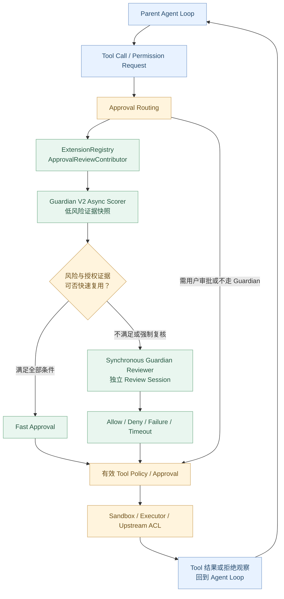
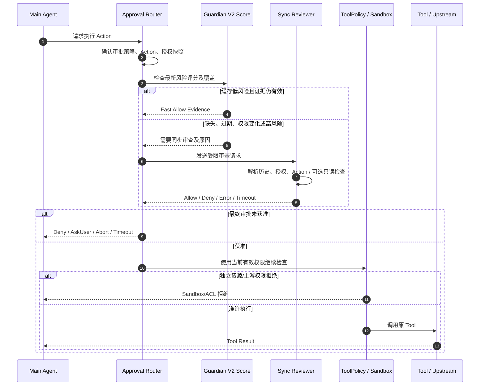

# Agent Systems A6：Guardian——Codex 如何独立审查高风险 Agent 操作？

> **本章核心问题：** 当 Agent 要执行命令、修改文件、调用 MCP、请求网络或提升权限时，Codex 如何在原 Tool Runtime 之外取得独立审查意见？低风险评分何时可以复用，什么时候必须同步审查？失败、取消、历史变化与真正的 Sandbox/数据权限之间是什么关系？
>
> [上一章：A5《Memory》](../A5-memory/README.zh.md) · [教程首页](../README.zh.md) · [运行 Demo](./demo.py)

在第 09 章，我们学习了审批、Sandbox 和 Executor；A3 学习了 Hooks 与 Extension API；A4 学习了多 Agent。Guardian 正处于这些能力的交汇点，但它**不是**给主 Agent 增加一个更长的系统 Prompt。

本章依据 [Codex Rust 固定源码 `014489466a17`](https://github.com/openai/codex/tree/014489466a1739c2c563cdfe57880c2c7c8680e3)。此提交中 Guardian 涉及三个值得区分的模块：

- `codex-rs/ext/guardian-v2`：注册同步 Reviewer 与 V2 异步评分相关 Contributor。
- `codex-rs/ext/guardian-reviewer`：审批路由、同步复核、JSON 结果、重试和报告。
- `codex-rs/core/src/guardian` 以及 `guardian-context`：采集动作、上下文与授权版本，运行宿主审查会话并验证证据。

**Guardian 是否启用、使用哪个模型、是否采用自适应评分，均受功能开关、模型与审批配置影响。** 不要把本章所述机制理解为所有环境始终必经的固定步骤。

读完本章，你应能：

1. 区分 `Guardian`、`Tool Approval`、`Hook`、`Permission Profile`、`Sandbox`。
2. 找到独立 Reviewer 的 Extension 注册和审批路由。
3. 说清楚 **V2 异步风险评分 → 快速允许或同步复核** 的条件。
4. 解释为什么缓存分数不是通用授权凭证。
5. 理解同步审查的结构化输出、取消、重试、失败关闭与审计。
6. 对照源码分析 **History/Authorization 改变导致审查失效** 的场景。
7. 运行不接触真实系统的 Demo，测试九组决策边界。

---

## 1. Guardian 解决的是什么问题？

假设用户要求：

> 检查 CRM 客户资料同步失败的原因。

Agent 在排查中可能产生这些工具请求：

```text
Tool A: 读取只读接口定义
Tool B: 查询测试数据
Tool C: 执行会写入生产 CRM 的同步
Tool D: 申请扩大文件系统写权限
```

如果执行权完全掌握在正在解决问题的同一个 Agent 内，它可能为了完成目标高估某次操作的合理性。

Guardian 提供**独立于主 Agent 具体 Tool Call 的审查路径**，将待执行动作、用户授权线索、当前权限和相关上下文组织为审查请求。

这里的“独立”主要指**审查职责、执行会话及所用上下文/模型路径分离**，而不等于 Guardian 是一个不受配置影响、永远不会出错的安全模块。

### Guardian 与其它安全机制的职责区别

| 机制 | 负责什么 | 不能据此推导什么 |
| --- | --- | --- |
| **Guardian** | 对指定动作做政策/风险/授权审查，产出允许、拒绝或其它路由结果 | 凭审查文本获得真实系统资源权限 |
| **Tool Approval** | 根据有效政策决定是否需要模型审核或用户批准 | 拒绝之后仍能执行原动作 |
| **PreToolUse Hook** | 在特定工具执行前提供事件式额外控制 | 与 Guardian 是同一个数据结构 |
| **PermissionProfile** | 定义执行权限与可申请额外授权的边界 | Guardian 允许就自动扩大 |
| **Sandbox / Executor** | 对进程、文件和网络实施真实执行限制 | 只靠模型文本即可绕过 |
| **上游 ACL** | 业务系统核验用户/租户/资源数据权限 | 自己平台审查放行就必然有数据权限 |

**必须分别记录每层结果。** 例如 `Guardian=Approved`、`Sandbox=Denied`，最终仍然是不能执行。

## 2. 核心架构



**图示是有条件的主流程，不代表所有 Approval 都要跑异步评分**。某些模式直接走用户审核、某些操作不需要额外审批；`ReviewDecision::Approved` 也不等于执行完成。

## 3. 源码地图：从 Extension 到 Review

按调用职责找入口：

| 模块 | 文件 | 责任 |
| --- | --- | --- |
| Extension 注册 | [`ext/guardian-v2/src/lib.rs`](https://github.com/openai/codex/blob/014489466a1739c2c563cdfe57880c2c7c8680e3/codex-rs/ext/guardian-v2/src/lib.rs#L1-L23) | 安装 Async Scorer 与 Sync Reviewer |
| 同步会话注册 | [`sync_reviewer/mod.rs`](https://github.com/openai/codex/blob/014489466a1739c2c563cdfe57880c2c7c8680e3/codex-rs/ext/guardian-v2/src/sync_reviewer/mod.rs#L36-L112) | Thread 生命周期中准备 Reviewer Pool 和配置 |
| 异步评分注册 | [`async_scorer/extension.rs`](https://github.com/openai/codex/blob/014489466a1739c2c563cdfe57880c2c7c8680e3/codex-rs/ext/guardian-v2/src/async_scorer/extension.rs#L182-L215) | Tool Lifecycle 与审批 Contributor |
| 审批统一路由 | [`guardian-reviewer/routing.rs`](https://github.com/openai/codex/blob/014489466a1739c2c563cdfe57880c2c7c8680e3/codex-rs/ext/guardian-reviewer/src/routing.rs#L54-L168) | 用户/Reviewer、快结果/复核等路由 |
| 风险缓存核验 | [`async_scorer/approval.rs`](https://github.com/openai/codex/blob/014489466a1739c2c563cdfe57880c2c7c8680e3/codex-rs/ext/guardian-v2/src/async_scorer/approval.rs#L181-L346) | 分数延迟、授权、覆盖、阈值 |
| 同步 Review | [`guardian-reviewer/review.rs`](https://github.com/openai/codex/blob/014489466a1739c2c563cdfe57880c2c7c8680e3/codex-rs/ext/guardian-reviewer/src/review.rs#L96-L246) | 独立审查、重试、事件和拒绝计数 |
| 宿主上下文 | [`core/guardian/review_session_setup.rs`](https://github.com/openai/codex/blob/014489466a1739c2c563cdfe57880c2c7c8680e3/codex-rs/core/src/guardian/review_session_setup.rs#L1-L82) | 父 Thread 快照、复用键、History 版本 |
| 授权失效 | [`core/guardian/review_request.rs`](https://github.com/openai/codex/blob/014489466a1739c2c563cdfe57880c2c7c8680e3/codex-rs/core/src/guardian/review_request.rs#L45-L95) | History / Authorization / Review Context 的变化校验 |
| 输出转换 | [`guardian-reviewer/completion.rs`](https://github.com/openai/codex/blob/014489466a1739c2c563cdfe57880c2c7c8680e3/codex-rs/ext/guardian-reviewer/src/completion.rs#L38-L164) | 正常允许/拒绝、错误与警告 |

这份地图能解释一个重要事实：**Guardian 不是只在 ToolHandler 中调用一条 LLM API。** 它横跨审查 Extension、Core Session、风险评分缓存、执行事件与审批策略。

## 4. Guardian 审查的动作范围有多广？

[`core/guardian/approval_request.rs`](https://github.com/openai/codex/blob/014489466a1739c2c563cdfe57880c2c7c8680e3/codex-rs/core/src/guardian/approval_request.rs#L13-L76) 的 `GuardianApprovalRequest` 至少包含：

- `ExecCommand`：命令、工作目录、Sandbox 权限和可选额外授权；
- `WriteStdin`：向已运行进程继续输入；
- `ApplyPatch`：文件与补丁；
- `NetworkAccess`：目标、Host、协议与端口；
- `McpToolCall`：Server、Tool Name、参数、Connector 元数据；
- `RequestPermissions`：权限请求描述与范围。

因此不能把 Guardian 简化为 **“只检查 Shell 危险命令”**。

### 为什么审查必须包含实际动作数据？

用户说“检查是否正常”，并不自动授权删除资源。审查应当了解这一次**具体**要做什么：

```text
request_id: approval-007
call_id: tool-043
action: McpToolCall
server: crm
tool_name: update_customer
arguments: ...（需按敏感策略最小化）
authorization_snapshot: ...
```

上面是**教学字段示意**，不是 `GuardianApprovalRequest` 的原样 JSON。真实协议中不同工具类型有各自的结构化字段。

关联具体动作是审计和防止“批准一项请求，被用于另一项请求”的前提。

## 5. Guardian 何时进入审批路由？

[`guardian-reviewer/routing.rs`](https://github.com/openai/codex/blob/014489466a1739c2c563cdfe57880c2c7c8680e3/codex-rs/ext/guardian-reviewer/src/routing.rs#L54-L61) 对自动审查政策有明确门槛：

```rust
matches!(
    policy,
    AskForApproval::OnRequest | AskForApproval::Granular(_)
) && reviewer == ApprovalsReviewer::AutoReview
```

而 [`ReviewRequest::decide`](https://github.com/openai/codex/blob/014489466a1739c2c563cdfe57880c2c7c8680e3/codex-rs/ext/guardian-reviewer/src/routing.rs#L65-L168) 还会综合：

- 是否有显式强制 Guardian 的要求；
- 当前是否 Full Access；
- 是否可准备具体动作；
- Reviewer Contributor 有没有给出快速决策；
- 本次是否必须做 Fresh Review；
- 是否应将权限请求留给用户；
- 取消与 Parent Stop 状态。

### Guardian 未启用是不是就必然拒绝一切？

不是。审批路由可能回到**正常用户批准**，也可能按其它政策执行。反过来，Guardian 不可用也**不应被解释为自动允许**。

理解 `Option<ReviewDecision>` 非常重要：

- `Some(Approved/Denied/Abort...)`：这条路由做出了明确结果；
- `None`：这条 Guardian/Extension 路由不直接决策，后续路径处理。

**`None` 不是 `Approved`。**

## 6. V2 异步评分解决什么问题？

每次都启动完整独立 Reviewer，会增加时间和调用成本。

Guardian V2 因此可以利用前台执行轨迹的风险评分，在**证据可用且满足策略**时快速放行低风险操作。

相关入口：

- [`async_scorer/extension.rs`](https://github.com/openai/codex/blob/014489466a1739c2c563cdfe57880c2c7c8680e3/codex-rs/ext/guardian-v2/src/async_scorer/extension.rs#L38-L145)：Thread 启动时设置评分状态、模型与相关上下文。
- [`score.rs`](https://github.com/openai/codex/blob/014489466a1739c2c563cdfe57880c2c7c8680e3/codex-rs/ext/guardian-v2/src/async_scorer/score.rs#L58-L96)：保存分数、工具索引、滞后与授权证据。
- [`coverage.rs`](https://github.com/openai/codex/blob/014489466a1739c2c563cdfe57880c2c7c8680e3/codex-rs/ext/guardian-v2/src/async_scorer/coverage.rs#L1-L30)：按配置选择需要分类的工具。
- [`approval.rs`](https://github.com/openai/codex/blob/014489466a1739c2c563cdfe57880c2c7c8680e3/codex-rs/ext/guardian-v2/src/async_scorer/approval.rs#L51-L181)：决定快速允许还是转同步审查。

### Risk Score 是最终批准吗？

**不是。** Risk Score 是辅助审查的证据。真实批准还需要检查：

- 当前操作的类型和政策；
- 使用的模型/评分配置；
- 有效的当前权限；
- 评分是否够新、是否覆盖当前动作；
- 是否存在失败、遗漏或不兼容的上下文。

## 7. 低风险快速允许的必要条件

[`cached_evidence`](https://github.com/openai/codex/blob/014489466a1739c2c563cdfe57880c2c7c8680e3/codex-rs/ext/guardian-v2/src/async_scorer/approval.rs#L181-L346) 非常值得逐行看。

示意判断：

```text
有缓存分数吗？
  ├─ 无 → 同步审查/其他适用路径
  └─ 有
      ├─ 本次 Action 是否超出可评分预算？
      ├─ 历史压缩与权限上下文是否兼容？
      ├─ 最近评分的 Tool Lag 是否超限？
      ├─ 是否有尚未评分的失败？
      ├─ 当前 Authorization 是否与评分快照相同？
      ├─ 评分的动作是否覆盖当前 Tool Call？
      └─ Risk < 配置阈值？
                   ├─ 是 → 允许使用有效缓存证据
                   └─ 否 → 同步审查
```

实际源码使用 `SecurityRiskScore`、`ScoreAuthorization`、`GuardianV2ScoreProgress` 等类型，而非一个简单的布尔字段 `safe=true`。

### 为什么 Lag 很重要？

[`score.rs`](https://github.com/openai/codex/blob/014489466a1739c2c563cdfe57880c2c7c8680e3/codex-rs/ext/guardian-v2/src/async_scorer/score.rs#L142-L227) 追踪已观察工具数量和最新被评分工具的位置。

例如：

```text
t1: Tool-1 → 已评分
t2: Tool-2 → 执行
t3: Tool-3 → 执行
t4: Tool-4 → 请求扩大权限
```

如果评分仍停留在旧的 Tool-1 上，不能无条件拿它批准 Tool-4。

`max_tool_call_lag` 是**配置限制**，并不是始终固定为 1 或 2。

### 风险阈值是不是 0.5？

[`config.rs`](https://github.com/openai/codex/blob/014489466a1739c2c563cdfe57880c2c7c8680e3/codex-rs/ext/guardian-v2/src/async_scorer/config.rs#L24-L40) 存在默认与 Legacy 阈值，但还会结合本地配置、模型默认值与约束解析。

因此不要宣称“所有 Guardian 操作都在 Risk=0.5 时必须拒绝”。**阈值用于决定是否可以快速走低风险路径，较高风险通常需要更多审查，而非直接等价于同步 Reviewer 的 Deny。**

## 8. 缓存授权不是通用令牌

[`cached_evidence`](https://github.com/openai/codex/blob/014489466a1739c2c563cdfe57880c2c7c8680e3/codex-rs/ext/guardian-v2/src/async_scorer/approval.rs#L257-L346) 会取得当前 `ScoreAuthorization::current(...)` 并与缓存证据比较。

同时在 [`review_request.rs`](https://github.com/openai/codex/blob/014489466a1739c2c563cdfe57880c2c7c8680e3/codex-rs/core/src/guardian/review_request.rs#L45-L95) 中，Guardian 会检查：

- 根 Thread 的 History Reset；
- 用户消息的版本变化；
- Root Authorization Version；
- Review Context Revision；
- 取消状态。

结果可被归类为 `Aborted` 或 `StaleAuthorization`。

### 为什么新用户输入会让审批失效？

假设：

```text
10:00 用户：只检查，不修改
10:01 Agent 准备写入 CRM，Guardian 开始审查
10:02 用户：停止，不要更新 CRM
10:03 旧审查结果返回 Allow
```

如果 10:03 忽略用户最新指令，仅依据 10:01 的旧上下文直接执行写入，就是典型的**授权快照竞争问题**。

Guardian 不能仅通过“结果由独立模型生成”来防止此类竞态；必须用版本、来源及当前 Action 状态做二次校验。

### 与 A2 McpBinding 的共同思路

A2 的 `PreparedMcpCall` 捕获工具和客户端身份；A6 的审查上下文捕获权限与历史证据。

它们都在解决：**异步操作期间全局状态可能改变，不能让旧快照悄悄授权新动作。**

## 9. 同步 Reviewer 是怎样运行的？

[`sync_reviewer/mod.rs`](https://github.com/openai/codex/blob/014489466a1739c2c563cdfe57880c2c7c8680e3/codex-rs/ext/guardian-v2/src/sync_reviewer/mod.rs#L36-L112) 将同步审查器接入 Thread 生命周期。

Reviewer 通过 `ReviewerPool<GuardianReviewSession>` 管理，有专门的会话来源 `InternalSessionSource::Guardian`，使用所选 Reviewer Model，并在创建时应用隔离和 Tool Policy。

[`core/guardian/review_session_setup.rs`](https://github.com/openai/codex/blob/014489466a1739c2c563cdfe57880c2c7c8680e3/codex-rs/core/src/guardian/review_session_setup.rs#L1-L82) 负责：

1. 捕获 Parent 当前历史和权限/指令上下文；
2. 构建可复用 Reviewer 的身份键；
3. 保留 Parent 的历史重置通知；
4. 决定复用现有审查会话还是从 Parent Checkpoint 重建。

**不要将 Reviewer 理解成与 Parent 共享一条不设边界的 Agent Loop。**

### Guardian 是否能做额外读取？

[`assessment.rs`](https://github.com/openai/codex/blob/014489466a1739c2c563cdfe57880c2c7c8680e3/codex-rs/ext/guardian-reviewer/src/assessment.rs#L104-L115) 的输出契约提示 Reviewer 可以使用**只读工具检查**补足证据。

但这不代表它拥有无限制执行任意命令的权限；Reviewer 的 Tool Policy、Session Isolation、输入预算和执行配置仍限制其行为。

## 10. Reviewer 输出不是一句自然语言“可以”

真正结构：[`GuardianAssessment`](https://github.com/openai/codex/blob/014489466a1739c2c563cdfe57880c2c7c8680e3/codex-rs/ext/guardian-reviewer/src/assessment.rs#L11-L19)：

```rust
pub struct GuardianAssessment {
    pub risk_level: GuardianRiskLevel,
    pub user_authorization: GuardianUserAuthorization,
    pub outcome: GuardianAssessmentOutcome,
    pub rationale: String,
}
```

输出 JSON Schema 中核心字段：

| 字段 | 典型值 | 表示 |
| --- | --- | --- |
| `risk_level` | low / medium / high / critical | 风险分层 |
| `user_authorization` | unknown / low / medium / high | 用户授权证据强度 |
| `outcome` | allow / deny | Reviewer 的结果 |
| `rationale` | 文本 | 审查理由 |

关键点：**风险级别与最终审核结果不是同一个字段**。也不能拿 `user_authorization="high"` 推断一定应批准，更不能把模型结果直接替代业务系统的数据授权。

### 输出格式错误会发生什么？

[`parse_guardian_assessment`](https://github.com/openai/codex/blob/014489466a1739c2c563cdfe57880c2c7c8680e3/codex-rs/ext/guardian-reviewer/src/assessment.rs#L24-L59) 首先尝试解析完整 JSON；若模型输出包了一些额外文字，会尝试定位其中的 JSON 对象恢复。

但如果仍无法解析，应标记**审查失败**，而不是让模型自由文字中的“我觉得没问题”直接决定授权。

## 11. Fast Decision、同步 Decision 与执行结果是三份状态

三者应分开记录：

| 状态 | 含义 |
| --- | --- |
| `Risk Score` | 观察与分类数据 |
| `GuardianReviewOutcome` | 审核已完成 / 缓存证据可用 / 失败 |
| `ReviewDecision` | Approval 路由最终接收到的决定 |
| `Tool Execution Result` | 最终是否真的调用成功、被 Sandbox 阻挡或由上游拒绝 |

[`guardian-reviewer/outcome.rs`](https://github.com/openai/codex/blob/014489466a1739c2c563cdfe57880c2c7c8680e3/codex-rs/ext/guardian-reviewer/src/outcome.rs#L1-L130) 的 `GuardianReviewOutcome` 有：

```rust
pub enum GuardianReviewOutcome {
    CachedApproval,
    Completed(GuardianAssessment),
    Error(GuardianReviewError),
}
```

**CachedApproval** 与**真正运行完一次 Reviewer 的 Completed Allow** 有不同的证据与遥测来源。

## 12. 异步评分与同步审查可以形成竞速

这是固定源码中比较高级的一处设计。

在 [`guardian-reviewer/review.rs`](https://github.com/openai/codex/blob/014489466a1739c2c563cdfe57880c2c7c8680e3/codex-rs/ext/guardian-reviewer/src/review.rs#L96-L188) 中，同步审查启动之后，如果后续异步评分已经提供满足条件的有效证据，可以取消不再需要的重复审查，并**继续清理正在执行的 Reviewer 任务**。

但不能“评分结果一出来就销毁 Reviewer，然后直接允许”：

- 旧缓存需要再次校验是否仍对应当前 Action；
- 当前 Parent 是否已经取消；
- 原审查过程的会话和资源必须正确清理；
- 被取消的 Reviewer 不等于产生了一份新的 Allow 评估。

这种竞速适合减少平均延迟，但使**生命周期管理**比单次同步审核复杂得多。

## 13. 重试和超时：哪种失败值得继续尝试？

[`guardian-reviewer/retry.rs`](https://github.com/openai/codex/blob/014489466a1739c2c563cdfe57880c2c7c8680e3/codex-rs/ext/guardian-reviewer/src/retry.rs#L23-L103) 使用最大尝试次数、统一 Deadline 和取消信号管理重复审查。

[`should_retry_guardian_review`](https://github.com/openai/codex/blob/014489466a1739c2c563cdfe57880c2c7c8680e3/codex-rs/ext/guardian-reviewer/src/retry.rs#L173-L221) 对故障进行分类：

可能考虑重试：

- JSON 解析失败；
- Stale Authorization（在允许时间窗口内刷新证据）；
- 特定模型服务超载、Rate Limit、可重试 HTTP/流错误。

不会一概重试：

- 用户取消；
- 审查本身已正常完成；
- 无法构造 Prompt；
- 部分不可恢复的输入预算或策略错误。

**“出了错就立刻无限重试”既会增加模型成本，也可能造成审查结果与现有授权上下文进一步漂移。**

## 14. 失败后该如何放行？

这里需要精确，不能只给“fail-open / fail-closed”两个口号。

[`completion.rs`](https://github.com/openai/codex/blob/014489466a1739c2c563cdfe57880c2c7c8680e3/codex-rs/ext/guardian-reviewer/src/completion.rs#L38-L164) 按情况处理：

| 结果 | 固定源码的处理方向 |
| --- | --- |
| `Completed(Allow)` | 审核通过，形成相应批准 |
| `Completed(Deny)` | 审核拒绝并记录评估 |
| `CachedApproval` | 确认的当前低风险证据允许 |
| `Timeout` | 产生明确超时决策与告警 |
| `Cancelled` | 中止审核 |
| 解析、模型 Session 或权限证据失效 | 很多路径进入拒绝/失败关闭并发出 Warning |
| 可选审查的某些 `InputBudgetExceeded` | 可能返回 `None`，移交用户审批路径 |

因此不能写成“Guardian 只要失败就永远直接 Deny”，也不能写成“模型调用失败就自动 Allow”。

尤其在**未强制 Guardian**的可选场景下，存在退回用户审批的明确路径。这是**路由未决**，不是系统静默允许执行。

## 15. 连续拒绝与 Turn 中断

审查拒绝如果不断出现，主 Agent 可能持续重复提出相同或类似高风险操作。

[`guardian-reviewer/review.rs`](https://github.com/openai/codex/blob/014489466a1739c2c563cdfe57880c2c7c8680e3/codex-rs/ext/guardian-reviewer/src/review.rs#L203-L246) 使用 `ReviewDenials` 记录 Turn 上的拒绝序列；达到配置的保护边界时，可以触发警告并中断当前 Turn 的正常推进。

这说明 Guardian 不仅解决**一次 Action 是否允许**，还要约束**失败后 Agent 是否反复重试相同行为**。

但它并不等于所有操作上的无限期黑名单：拒绝记录有自己的 Turn 与生命周期边界。

## 16. Guardian 是否改变了原有 Sandbox？

没有替代关系。

一次操作的真正执行，仍然需要符合：

```text
当前用户/任务授权
        +
Guardian/审批要求（如适用）
        +
Tool Registry & Handler 可用性
        +
PermissionProfile & Sandbox
        +
外部系统自身数据权限
        =
才有可能执行对应操作
```

在 A2 的 CRM 场景中：

```text
Guardian: Allow
本平台 Tool Policy: Allow
上游 CRM: 403 / 权限不足
执行结论: 上游拒绝，绝不伪装成 SUCCESS
```

另外，Guardian 的 `Allow` 不能使一个被资源隔离规则禁止的文件目录或网络目标突然可写。

这与“本平台是否能够展示失败原因”是两件事：主 Agent 可以继续解释工具失败，不必因为上游没有权限就将整个 Agent Loop 认定为不曾启动。

## 17. Guardian 与 Hooks / Governance Plane 应如何配合？

回看 A3，Hook 更适合在执行生命周期做自定义检查、记录或附加控制。

企业 Agent 系统可以区分三层：

| 层 | 示例职责 | 主要状态 |
| --- | --- | --- |
| **Capability Runtime** | 统一 Tool、MCP、Shell、FunctionCall 注册与调用 | Tool ID、Call ID、执行结果 |
| **Governance Plane** | 用户/租户/资源授权与规则决策 | Policy ID、权限快照、Permit/Deny |
| **Guardian Reviewer** | 对高风险动作或低置信度授权证据进行独立风险审查 | Assessment、风险、依据、Reviewer 状态 |

如果有实际的上游 CRM 用户数据，最稳妥的方式仍是**上游系统自己强制核验资源权限**；若必须由下游代理核验，必须确保完整代理访问路径都可强制约束，不能只在模型输出之后做文本过滤。

**Guardian 不应承担所有数据权限校验，更不该成为所有失败场景的唯一恢复机制。**

## 18. Reviewer 的审查输入也是有限资源

[`core/guardian/input_budget.rs`](https://github.com/openai/codex/blob/014489466a1739c2c563cdfe57880c2c7c8680e3/codex-rs/core/src/guardian/input_budget.rs#L36-L110)、
[`core/guardian/request_budget.rs`](https://github.com/openai/codex/blob/014489466a1739c2c563cdfe57880c2c7c8680e3/codex-rs/core/src/guardian/request_budget.rs#L28-L125) 都体现了对审查文本与历史的预算控制。

一条巨大工具日志不应该让审查模型完全看不见真正要执行的命令和用户权限约束。

真实设计需要：

- 为待审查 Action 保留必要内容；
- 区分必需、历史与可选上下文；
- 按预算删减证据，而非悄悄截断权限目标；
- 若必需数据不完整，返回可辨识的审查失败；
- 当 Parent 历史发生变化时，正确选择重建的 Review Context。

**不能用“给 Reviewer 再调用一次 Compaction”代替对授权证据完整性的检查。**

## 19. 时序图：有缓存审查与无缓存审查



这是逻辑图，不代表所有缓存路径、Full Access、用户审批和异步竞争都必须按同一固定顺序调用每个函数。**真实运行的关键不变量是：未经有效授权的操作不因为“审查流程有进度”就被视为获准。**

---

## 20. 动手实验：用 Python 实现最小 Guardian 决策路由

完整代码：[`demo.py`](./demo.py)。

环境：Python 3.10+、标准库、无 API Key。不会启动 LLM、执行 Shell、调用 MCP、访问网络或修改项目。**它完全不是生产安全策略执行器**。

运行：

```bash
python demo.py
```

Demo 的结构：

| 教学类型 | 用途 |
| --- | --- |
| `Action` | 要审查的工具调用及授权版本 |
| `Score` | 风险值、工具覆盖、版本、滞后和失败标记 |
| `ToyGuardian.cached_evidence` | 检查快速放行条件 |
| `ToyGuardian.review` | 教学审批路由与简单的同步审查 |
| `Audit` | 留下调用 ID、决策来源和尝试次数 |
| `ToyGuardian.try_execute` | 独立检查审批、Sandbox 和上游 ACL |

### 实验 1：低风险且证据完全匹配

```text
1. matching low-risk evidence -> fast approval
```

预设阈值为 0.3、风险为 0.12；只有当动作 ID、授权版本、评分覆盖和滞后都有效时，才允许快速放行。

**教学数字不是 Codex 生产环境的通用默认阈值。**

### 实验 2：风险值再低，过期也不能复用

```text
2. stale score -> synchronous review; not automatic allow
```

即使分数仅 0.01，若滞后超限，也不能直接作为新动作的授权。Demo 提供了一条明确的同步 Allow 结果才批准。

### 实验 3：当前授权改变

```text
3. authorization change -> fresh review can deny
```

评分授权版本与当前请求不同，后续 Reviewer 拒绝。证明**历史评分无法代替实时授权上下文**。

### 实验 4：错误的 Tool Call 不能借用别人的分数

```text
4. old call-specific score cannot authorize another action
```

风险证据来自旧调用且不覆盖新动作；即使分数低于阈值，Demo 仍不批准。

### 实验 5：风险升高或未评分失败

```text
5. elevated risk or unscored failure -> cannot fast approve
```

如果 Reviewer 不可用，Demo 的未决态是 `AskUser`，而不是自动通过。真实系统会根据 require_guardian 和故障类别选择批准、拒绝、人工路径或中断。

### 实验 6：Fresh Review 与有限重试

```text
6. fresh review retries a transient transport error
```

模拟一次网络传输失败和之后一次有效 JSON Allow，确认尝试计数为 2。真实 Codex 会根据 Error 类型、截止时间及 Backoff 决定是否重试。

### 实验 7：畸形结果与取消

```text
7. malformed output not auto-approved; cancellation aborts
```

不允许因为 Reviewer 返回无效 JSON 就偷偷批准；取消应有独立结果。

### 实验 8：User Review/Disabled 不意味着自动审查通过

```text
8. user-review / disabled Guardian routes outside auto-review
```

启用用户审核或禁用自适应 Reviewer 时，可以转入正常审批路径。

### 实验 9：Guardian、Sandbox 和上游 ACL 相互独立

```text
9. Guardian approval is separate from sandbox and upstream ACL
All teaching assertions passed
```

即使 Guardian 已 Approved，只要 Sandbox 禁止或上游权限拒绝，模拟工具就不能执行。

## 21. 怎样审计一个 Guardian 系统？

不要只问“有风险模型吗”，应该要求以下最小证据：

| 可审计字段 | 作用 |
| --- | --- |
| Parent Thread ID / Turn ID | 确定是谁在要求执行 |
| Approval ID / Tool Call ID | 关联具体动作与模型调用 |
| Tool 原始身份、参数摘要及资源范围 | 防止批准错动作 |
| 用户/租户及权限快照版本 | 确定当时采用的授权上下文 |
| Guardian Scope / Policy / Model | 确定审查条件与模型来源 |
| Cached Score / Sample Time / Lag | 证明快速允许所依赖的证据 |
| Review Attempts / Failure Reason | 识别超时、重试、解析错误 |
| Decision Source | 区分快速结果、同步 Reviewer、人工审批 |
| Sandbox / Upstream Result | 核验真实执行是否被允许 |
| 工具最终结果、时间与 Trace Link | 避免把批准当成业务成功 |

建议对失败原因做至少这些分类：`MISSING_SCORE`、`STALE_SCORE`、`AUTH_CHANGED`、`ELEVATED_RISK`、`REVIEW_DENIED`、`REVIEW_TIMEOUT`、`REVIEW_FAILED`、`SANDBOX_DENIED`、`UPSTREAM_ACL_DENIED`。

这些大写状态是**建议的企业可观测性分类**，不是本章宣称 Codex 已经具有相同名称的枚举。

## 22. 常见错误说法

| 错误说法 | 正确理解 |
| --- | --- |
| “Guardian 评分低，就意味着本次操作安全。” | 还需要授权、覆盖、时效与其它门禁 |
| “Guardian 用的是第二个 Agent，所以它不会出错。” | 依然可能发生误判、服务不可用和上下文缺失 |
| “Guardian 审核通过就拥有了数据库数据权限。” | 不会，数据权限由有效权限层与上游强制 |
| “Guardian 没返回结果等于 Allow。” | 未决或错误按有效审批政策处理，不能静默允许 |
| “同步 Reviewer 失败必须无限重试。” | 源码按错误类型、尝试次数和 Deadline 处理 |
| “过期的风险评分只需重新查询一下缓存。” | 权限/历史变化可能需要全新审查 |
| “Guardian 的 Deny 能撤销已经执行的工具。” | 审查应在操作执行前应用 |
| “所有工具都必经 Guardian V2。” | 依赖 Feature、审批模式、模型政策与工具覆盖 |
| “Guardian 与 PreToolUse Hook 是同一个事件系统。” | 分属不同的 Extension 与事件/审批边界 |

## 23. 源码阅读顺序

按**安装 → 请求 → 快速审查 → 同步审查 → 执行反馈**的顺序阅读：

| 顺序 | 源码入口 | 看什么 |
| --- | --- | --- |
| 1 | [`guardian-v2/lib.rs`](https://github.com/openai/codex/blob/014489466a1739c2c563cdfe57880c2c7c8680e3/codex-rs/ext/guardian-v2/src/lib.rs#L1-L23) | 安装异步/同步 Reviewer |
| 2 | [`sync_reviewer/mod.rs`](https://github.com/openai/codex/blob/014489466a1739c2c563cdfe57880c2c7c8680e3/codex-rs/ext/guardian-v2/src/sync_reviewer/mod.rs#L36-L112) | 审查 Session Pool 与隔离 |
| 3 | [`async_scorer/extension.rs`](https://github.com/openai/codex/blob/014489466a1739c2c563cdfe57880c2c7c8680e3/codex-rs/ext/guardian-v2/src/async_scorer/extension.rs#L38-L145) | 异步评分启动条件 |
| 4 | [`guardian/approval_request.rs`](https://github.com/openai/codex/blob/014489466a1739c2c563cdfe57880c2c7c8680e3/codex-rs/core/src/guardian/approval_request.rs#L13-L76) | 支持审查哪些操作 |
| 5 | [`routing.rs`](https://github.com/openai/codex/blob/014489466a1739c2c563cdfe57880c2c7c8680e3/codex-rs/ext/guardian-reviewer/src/routing.rs#L54-L168) | 判断由谁审批 |
| 6 | [`approval.rs::decide_request`](https://github.com/openai/codex/blob/014489466a1739c2c563cdfe57880c2c7c8680e3/codex-rs/ext/guardian-v2/src/async_scorer/approval.rs#L51-L181) | Adaptive / Fresh Review 路由 |
| 7 | [`score.rs`](https://github.com/openai/codex/blob/014489466a1739c2c563cdfe57880c2c7c8680e3/codex-rs/ext/guardian-v2/src/async_scorer/score.rs#L58-L96) | 缓存评分状态 |
| 8 | [`approval.rs::cached_evidence`](https://github.com/openai/codex/blob/014489466a1739c2c563cdfe57880c2c7c8680e3/codex-rs/ext/guardian-v2/src/async_scorer/approval.rs#L181-L346) | 权限、覆盖和评分时效 |
| 9 | [`review_session_setup.rs`](https://github.com/openai/codex/blob/014489466a1739c2c563cdfe57880c2c7c8680e3/codex-rs/core/src/guardian/review_session_setup.rs#L1-L82) | 父上下文快照与审查会话复用 |
| 10 | [`review_request.rs::invalidation`](https://github.com/openai/codex/blob/014489466a1739c2c563cdfe57880c2c7c8680e3/codex-rs/core/src/guardian/review_request.rs#L45-L95) | 授权变化使结果失效 |
| 11 | [`assessment.rs`](https://github.com/openai/codex/blob/014489466a1739c2c563cdfe57880c2c7c8680e3/codex-rs/ext/guardian-reviewer/src/assessment.rs#L11-L115) | 输出 JSON 结构 |
| 12 | [`review.rs`](https://github.com/openai/codex/blob/014489466a1739c2c563cdfe57880c2c7c8680e3/codex-rs/ext/guardian-reviewer/src/review.rs#L96-L246) | Reviewer 会话、竞速、拒绝计数 |
| 13 | [`retry.rs`](https://github.com/openai/codex/blob/014489466a1739c2c563cdfe57880c2c7c8680e3/codex-rs/ext/guardian-reviewer/src/retry.rs#L23-L103) | 有界重试 |
| 14 | [`should_retry_guardian_review`](https://github.com/openai/codex/blob/014489466a1739c2c563cdfe57880c2c7c8680e3/codex-rs/ext/guardian-reviewer/src/retry.rs#L173-L221) | 哪些错误可以重试 |
| 15 | [`completion.rs`](https://github.com/openai/codex/blob/014489466a1739c2c563cdfe57880c2c7c8680e3/codex-rs/ext/guardian-reviewer/src/completion.rs#L38-L164) | 超时、失败关闭和人工回退 |
| 16 | [`guardian/input_budget.rs`](https://github.com/openai/codex/blob/014489466a1739c2c563cdfe57880c2c7c8680e3/codex-rs/core/src/guardian/input_budget.rs#L36-L110) | 输入预算 |
| 17 | [`GuardianPolicy.role`](https://github.com/openai/codex/blob/014489466a1739c2c563cdfe57880c2c7c8680e3/codex-rs/core/src/context/guardian_policy.rs#L20-L41) | 独立 Reviewer 的 Developer Policy |

## 24. 五道思考题

**1. 为什么 `score=0.01` 仍然可能无法快速批准？**

因为分数可能过期、覆盖的是另一个动作，或者授权快照和当前用户输入已变化。风险值只是证据的一部分。

**2. Guardian 运行一个独立模型，就能充当上游 CRM 的数据权限系统吗？**

不能。模型审查与数据权限执行是不同层；资源 ACL 必须由能强制控制访问路径的系统核验。

**3. Reviewer 返回无效 JSON，能否因为“模型应该是想说 Allow”就放行？**

不能。结构化输出无法验证时，应按配置的失败、重试或用户审批路径处理。

**4. 为什么异步评分出来后，已经运行的同步 Reviewer 不能简单丢弃？**

它可能仍持有会话资源与执行任务；必须取消并清理，且快速允许要再次确认缓存授权仍有效。

**5. Guardian 审查通过，但 Tool 最终返回 403，该怎样记账？**

记录 Guardian 审批通过、工具已尝试调用、上游数据权限拒绝，不能把批准当成业务成功，也不能据此重试绕过 ACL。

---

## 本章小结

```text
            Main Agent 提出操作
                     │
               Approval Router
                     │
             ┌───────┴───────┐
             ▼               ▼
       V2 Risk Evidence   其它审批路径
             │               │
       授权/覆盖/时效检查      │
             │               │
    ┌────────┴─────────┐     │
    ▼                  ▼     │
 Fast Allow       Sync Guardian
                       │
              JSON Allow / Deny
              Timeout / Failure
                       │
    └──────────────┬────┘
                   ▼
          有效审批最终状态
                   │
                   ▼
        Permission / Sandbox
                   │
                   ▼
           上游 ACL / Tool
                   │
                   ▼
             Agent 观察结果
```

**一句话总结：Guardian 是对特定动作、当前授权与执行上下文进行独立审查的运行能力；真正可靠的实现必须同时验证评分证据时效、审查结果、授权版本、失败语义以及后续真实资源权限。**

下一篇：[Agent Systems A7《Goal Runtime》](../A7-goal-runtime/README.zh.md)。

接下来我们将研究：**长期目标是否能独立于当前 Turn 持续运行？目标任务如何建模、跟踪进度、管理等待与失败，以及如何与 Multi-Agent、Memory 和 Guardian 对齐？**

