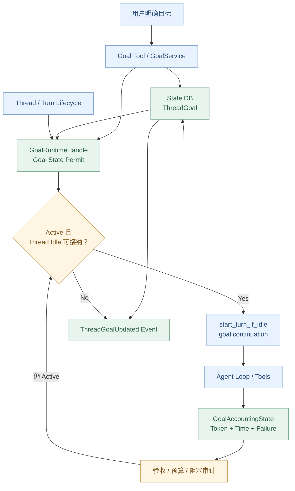
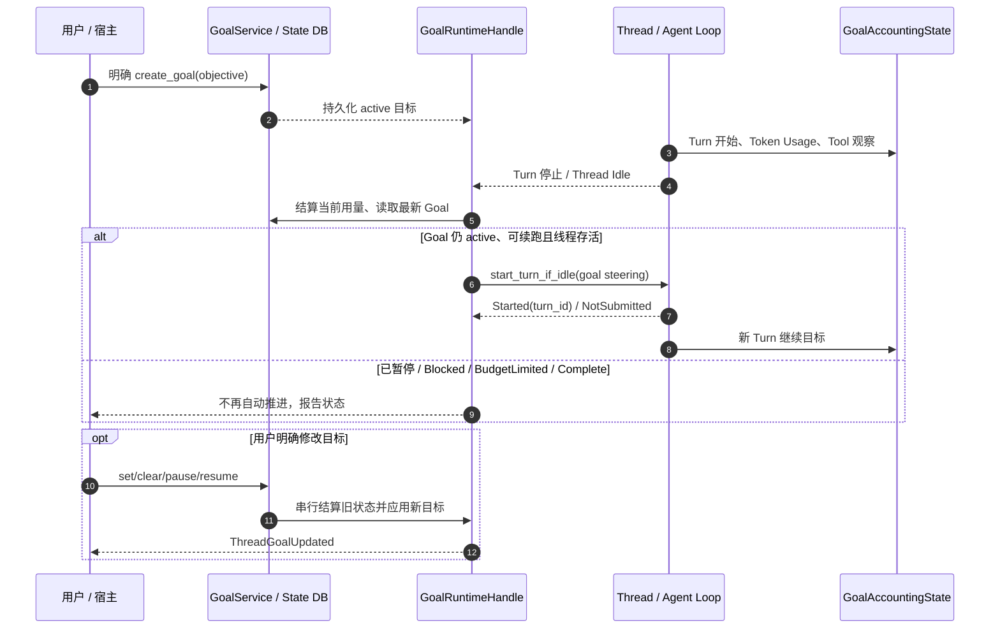

# Agent Systems A7：Goal Runtime——Codex 如何围绕长期目标持续执行？

> **本章核心问题：** 普通 Agent Turn 结束就停止一次工作，但一个需要多个 Turn 才能完成的目标，怎样保留原始验收范围、自动进入下一轮、统计累计 Token / 时间、在预算耗尽或重复失败时安全停止，并在 Thread 恢复后继续？
>
> [上一章：A6《Guardian》](../A6-guardian/README.zh.md) · [课程首页](../README.zh.md) · [运行本章 Demo](./demo.py)

从第 01 章到 A6，我们研究了模型、上下文、工具、持久化、多 Agent、Memory 与安全审查。A7 讨论一个更接近完整自主系统的能力：**Goal Runtime**。

**先限定范围：** 本章以 [`openai/codex` 固定 Rust 提交 `014489466a17`](https://github.com/openai/codex/tree/014489466a1739c2c563cdfe57880c2c7c8680e3) 为准。它确实实现了**持久化的 Thread Goal 和符合条件的自动 Turn Continuation**；但不能由此推断它有独立于存活 Thread/Host 的云端定时器、离线任务队列或无限时长的无人值守执行承诺。

本章将回答：

1. Goal 与 User Task、Plan、Turn、Thread 有什么区别？
2. `get_goal / create_goal / update_goal` 如何进入 Tool Runtime？
3. 哪六种 Goal Status 存在，哪些状态允许续跑？
4. 如何持久化目标、更新目标以及避免旧 Goal 覆盖新 Goal？
5. `on_thread_idle → continue_if_idle → start_turn_if_idle` 如何发起新一轮？
6. Token、Time、子 Agent 的资源消耗如何计入 Goal？
7. 如何防止重复失败、空响应和预算耗尽时无限自循环？
8. 为什么 `complete` 必须依赖真实验收证据？

---

## 1. Goal 不是一个普通的“任务描述”字段

例如用户对 Codex 说：

> 检查服务中三处接口的权限链路，修复确认存在的问题，运行相关测试，并完成真实 HTTP 验收。

一次 Turn 可能只够完成第一处代码审计。

**普通 Agent：**

```text
USER → Turn-1 → 查询/修改/回复 → 本轮结束
```

**带 Goal Runtime 的 Agent：**

```text
USER → 创建 Thread Goal
          │
          ├─ Turn-1：审计与发现
          ├─ Turn-2：完成一部分修复
          ├─ Turn-3：运行定向测试
          ├─ Turn-4：核验真实接口
          └─ Goal: complete / blocked / paused / budget_limited ...
```

Goal 的作用不是让模型记住一句更长的 Prompt，而是给 Runtime 增加：**可持续的目标状态、跨 Turn 记账、明确停止条件和受控续跑**。

### 和相邻概念比较

| 概念 | 作用 | 是否能单独驱动下一轮？ |
| --- | --- | --- |
| **User Input** | 用户这次交代的任务 | 通常仅触发本次处理 |
| **Plan / TODO** | 当前任务的步骤与可视化进度 | 计划文本本身不等于新 Turn 调度器 |
| **Turn** | 一次模型与工具循环 | 自己有开始和结束 |
| **Thread** | 对话与执行生命周期容器 | 可以容纳多个 Turn |
| **Goal** | Thread 级持久目标和状态 | **Active 且运行条件满足时**可以触发新的 Turn |
| **Memory** | 历史长期参考信息 | 不直接替代 Goal 的执行和验收状态 |

**不能把“Plan 任务全部勾选”视作 Goal 已完成**，还要核验当前真实状态。

## 2. 源码地图：Goal 不是写死在 run_turn 里的无限循环

固定版本存在独立 Crate：[`codex-rs/ext/goal`](https://github.com/openai/codex/blob/014489466a1739c2c563cdfe57880c2c7c8680e3/codex-rs/ext/goal/src/lib.rs#L1-L29)。

其关键文件：

| 文件 | 主要职责 |
| --- | --- |
| [`spec.rs`](https://github.com/openai/codex/blob/014489466a1739c2c563cdfe57880c2c7c8680e3/codex-rs/ext/goal/src/spec.rs#L1-L95) | 三个模型可见 Goal Tool 定义与行为契约 |
| [`tool.rs`](https://github.com/openai/codex/blob/014489466a1739c2c563cdfe57880c2c7c8680e3/codex-rs/ext/goal/src/tool.rs#L169-L338) | 解析 Goal Tool 调用，读写 State DB |
| [`api.rs`](https://github.com/openai/codex/blob/014489466a1739c2c563cdfe57880c2c7c8680e3/codex-rs/ext/goal/src/api.rs#L130-L340) | 宿主侧直接设置、恢复、清空 Goal 的 API |
| [`extension.rs`](https://github.com/openai/codex/blob/014489466a1739c2c563cdfe57880c2c7c8680e3/codex-rs/ext/goal/src/extension.rs#L98-L257) | Thread 生命周期：创建/恢复/空闲等 |
| [`runtime.rs`](https://github.com/openai/codex/blob/014489466a1739c2c563cdfe57880c2c7c8680e3/codex-rs/ext/goal/src/runtime.rs#L28-L118) | GoalRuntimeHandle 与会话运行时状态 |
| [`accounting.rs`](https://github.com/openai/codex/blob/014489466a1739c2c563cdfe57880c2c7c8680e3/codex-rs/ext/goal/src/accounting.rs#L20-L90) | Token、时间、失败和空响应记账 |
| [`steering.rs`](https://github.com/openai/codex/blob/014489466a1739c2c563cdfe57880c2c7c8680e3/codex-rs/ext/goal/src/steering.rs#L45-L93) | 自动续跑、预算限制和目标修改的上下文提示 |
| [`state/runtime/goals.rs`](https://github.com/openai/codex/blob/014489466a1739c2c563cdfe57880c2c7c8680e3/codex-rs/state/src/runtime/goals.rs#L8-L70) | 真正的 Thread Goal 数据持久化 |
| [`state/model/thread_goal.rs`](https://github.com/openai/codex/blob/014489466a1739c2c563cdfe57880c2c7c8680e3/codex-rs/state/src/model/thread_goal.rs#L14-L70) | Goal 状态枚举和字段结构 |

### 总体控制链



这张图展示的是**逻辑职责**，不是一次 HTTP 调用里的递归栈。实际续跑由 Thread Idle 等生命周期事件驱动，并受到线程是否存活、是否存在待提交的用户输入及有效配置限制。

---

## 3. Goal 有哪些状态？不要靠名字猜语义

读 [`ThreadGoalStatus`](https://github.com/openai/codex/blob/014489466a1739c2c563cdfe57880c2c7c8680e3/codex-rs/state/src/model/thread_goal.rs#L14-L42)：

```rust
pub enum ThreadGoalStatus {
    Active,
    Paused,
    Blocked,
    UsageLimited,
    BudgetLimited,
    Complete,
}
```

| 状态 | 解释 | 会自动启动下一轮 Goal Turn 吗？ |
| --- | --- | --- |
| `active` | 目标仍在推进 | 符合空闲和 Host 条件时可以 |
| `paused` | 用户明确要求暂停 | 不会 |
| `blocked` | 确认存在持续阻塞，当前不能有意义推进 | 不会 |
| `usage_limited` | 模型/产品用量限制 | 不会 |
| `budget_limited` | Goal 的 Token Budget 到达限制 | 不会 |
| `complete` | 原始目标已经被验收证明完成 | 不会 |

**源码里的 `is_terminal()` 只对 `BudgetLimited` 和 `Complete` 返回 true**，见 [`thread_goal.rs`](https://github.com/openai/codex/blob/014489466a1739c2c563cdfe57880c2c7c8680e3/codex-rs/state/src/model/thread_goal.rs#L23-L42)。

所以存在两个必须分开的判断：

- **是否 Active：** 决定当下能否由 Goal 逻辑续跑。
- **是否 Terminal：** 用于某些状态迁移、Goal 替换等特定规则。

不能把 `paused`、`blocked`、`usage_limited` 随意统称为 `terminal`。它们虽然不会自动续跑，但在管理和恢复方面语义不同。

## 4. Goal 的持久化数据结构

[`ThreadGoal`](https://github.com/openai/codex/blob/014489466a1739c2c563cdfe57880c2c7c8680e3/codex-rs/state/src/model/thread_goal.rs#L61-L70)：

```rust
pub struct ThreadGoal {
    pub thread_id: ThreadId,
    pub goal_id: String,
    pub objective: String,
    pub status: ThreadGoalStatus,
    pub token_budget: Option<i64>,
    pub tokens_used: i64,
    pub time_used_seconds: i64,
    pub created_at: DateTime<Utc>,
    pub updated_at: DateTime<Utc>,
}
```

每个字段都不是装饰：

- `thread_id`：归属于哪条会话线程。
- `goal_id`：这次具体目标的唯一身份，防止旧异步结果修改新目标。
- `objective`：用户要求的完整目标，不应在执行中缩小为较容易完成的任务。
- `status`：能否继续的状态。
- `token_budget`：可选的目标 Token 上限。
- `tokens_used`：已消耗的累计 Token。
- `time_used_seconds`：累计执行时间。
- `created_at / updated_at`：创建、更新和恢复时需要的记录信息。

[`GoalStore::get_thread_goal`](https://github.com/openai/codex/blob/014489466a1739c2c563cdfe57880c2c7c8680e3/codex-rs/state/src/runtime/goals.rs#L43-L70) 明确从 State DB 的 `thread_goals` 表读取，支持跨进程重建目标状态。

**持久化 Goal 不等于持久化正在运行的模型协程。** 后者涉及 Thread/Session 恢复以及再次获得 Host 执行容量。

## 5. 模型可用的三个 Goal Tools

[`spec.rs`](https://github.com/openai/codex/blob/014489466a1739c2c563cdfe57880c2c7c8680e3/codex-rs/ext/goal/src/spec.rs#L9-L95) 定义：

| Tool | 参数 | 职责 |
| --- | --- | --- |
| `get_goal` | 无 | 返回当前 Thread 的 Goal、Status、预算和用量 |
| `create_goal` | `objective`；可选 `token_budget` | 在不存在未完成目标时创建新目标 |
| `update_goal` | `status` | 只允许特定的停止/完成状态 |

`update_goal` 的模型工具 Schema **只接受**：

```text
complete
blocked
paused
```

它不能由模型任意设置 `active`、`budget_limited` 或 `usage_limited`。这些转移有用户、宿主和系统控制边界。

### 谁能创建 Goal？

Tool 描述写得非常明确：**只有用户或 System/Developer 明确要求创建目标时才能创建**，不能将每一个普通需求都私自升级为长期目标。

这里的限制首先体现在模型工具描述与平台约束中；它不应被误读为“Rust 本身已经从自然语言无误识别了每一句用户授权”。实际产品还应通过宿主/API 规则防止错误创建。

## 6. 为什么不允许覆盖一个未完成 Goal？

[`tool.rs::handle_create`](https://github.com/openai/codex/blob/014489466a1739c2c563cdfe57880c2c7c8680e3/codex-rs/ext/goal/src/tool.rs#L195-L251) 调用 `insert_thread_goal`；若当前 Thread 已有未完成目标，就返回错误。

这保护原始目标不被悄悄替换。

比如：

```text
原 Goal：完成 3 个接口的真实验收
当前只完成第 1 个接口

错误做法：
  创建一个新 Goal：“写一份进度总结”
  然后宣布该新 Goal 完成
```

源码的目标创建边界就是为了减少此类以局部产物替代原始验收范围的问题。

注意：宿主可以使用独立的 [`GoalService::set_thread_goal`](https://github.com/openai/codex/blob/014489466a1739c2c563cdfe57880c2c7c8680e3/codex-rs/ext/goal/src/api.rs#L140-L293) 接口，在明确用户指令下更新目标，这与模型的 `create_goal` 权限不同。

### 宿主直接更新为什么还要锁？

`GoalService` 会在目标变更前获取 `goal_state_permit`，先处理现有进度，再记录用户指令并更新 State DB。

这是为了避免：

```text
线程处于 Idle
  ├── A 读取旧 Goal，准备启动下一轮
  └── B 用户已经修改/暂停了 Goal
```

如果 A 和 B 没有串行化，就可能在用户暂停目标后继续启动旧任务。

[`api.rs`](https://github.com/openai/codex/blob/014489466a1739c2c563cdfe57880c2c7c8680e3/codex-rs/ext/goal/src/api.rs#L168-L240) 使用 Goal State Permit 保护此类读取-写入与续跑竞态。

## 7. 线程生命周期怎样承载 Goal？

[`GoalExtension::on_thread_start`](https://github.com/openai/codex/blob/014489466a1739c2c563cdfe57880c2c7c8680e3/codex-rs/ext/goal/src/extension.rs#L98-L158) 将当前 Goal Runtime 注册到 Thread Scope。

它也会检查：

- 该 Thread 的 Goal 功能是否启用；
- 当前 Thread 是否拥有**持久化状态能力**；
- 某些 Review SubAgent 是否应该隐藏 Goal Tools；
- 关联的 Root / Parent Accounting 状态。

`ToolContributor::tools` 在 [`extension.rs`](https://github.com/openai/codex/blob/014489466a1739c2c563cdfe57880c2c7c8680e3/codex-rs/ext/goal/src/extension.rs#L556-L616) 提供 `get_goal / create_goal / update_goal`，但 **Tool 可见 ≠ 当前 Thread 有持久化能力并允许执行**。

[`tool.rs`](https://github.com/openai/codex/blob/014489466a1739c2c563cdfe57880c2c7c8680e3/codex-rs/ext/goal/src/tool.rs#L169-L188) 明确在不允许执行时回复：

```text
Goal tools require a persistent thread.
```

### 恢复旧 Thread 会做什么？

[`GoalRuntimeHandle::restore_after_resume`](https://github.com/openai/codex/blob/014489466a1739c2c563cdfe57880c2c7c8680e3/codex-rs/ext/goal/src/runtime.rs#L406-L425) 读取 State DB：

- 有 `active` Goal，则恢复本地的活动目标记账标识；
- 否则清理当前活动记账状态。

但是**恢复 Goal 的可见状态不代表它已获得一个新 Turn 的执行资格**。之后的 Idle 判断才会决定是否能够继续。

## 8. 自动续跑的真正入口：continue_if_idle

最值得阅读的源码：[`GoalRuntimeHandle::continue_if_idle`](https://github.com/openai/codex/blob/014489466a1739c2c563cdfe57880c2c7c8680e3/codex-rs/ext/goal/src/runtime.rs#L427-L529)。

它不是：

```python
while not complete:
    model.chat(objective)
```

而是按运行时条件依次判断：

1. Goal Tools 在此 Thread 是否可用；
2. 是否拿到 Goal State Permit，阻止与用户更新竞态；
3. 是否存在 Continuation Deferral；
4. 当前 `ThreadManager` 是否仍存在；
5. 是否还能取得有效的 Live Thread；
6. State DB 中的 Goal 是否为 `active`；
7. 当前 Thread 是否允许接受新的 Turn；
8. `start_turn_if_idle` 是否真的返回 `Started`。

调用结果还可能是 `NotSubmitted` 或错误。**这两种情况都不能硬说续跑已开始，更不能把它们算作任务完成。**

### 续跑注入的是什么？

[`steering.rs::continuation_steering_item`](https://github.com/openai/codex/blob/014489466a1739c2c563cdfe57880c2c7c8680e3/codex-rs/ext/goal/src/steering.rs#L53-L93) 把：

- 原始目标；
- 已使用 Token；
- Token 上限；
- 剩余可用预算；

转换为 Goal 相关的内部上下文输入项，并根据是否支持 `update_plan` 选择不同模板。

[`templates/goals/continuation.md`](https://github.com/openai/codex/blob/014489466a1739c2c563cdfe57880c2c7c8680e3/codex-rs/ext/goal/templates/goals/continuation.md) 是这次续跑的工作指引。

**这并不是新用户发来一条普通消息，而是由 Host 确认条件后注入的 Goal Continuation Turn。**

## 9. 它是 Always-On Agent 吗？

**有条件地算“跨 Turn 持续推进”，但不等于完整的 Always-On 后台调度平台。**

这个固定实现已具备：

- 目标持久化；
- 当前 Thread 空闲时主动发起新 Turn；
- 预算与失败计数；
- 恢复时加载已保存目标；
- 更新目标和审查状态。

但源码中的 `continue_if_idle` 明确依赖 **Live ThreadManager、Live Thread、Goal State Permit 和 StartIfIdle Admission**。

因此不能宣称：

- 客户端和承载进程都停止后模型仍自动运转；
- 每天定时自动重新唤醒目标；
- 网络断开时保证自动恢复并精确一次执行；
- 每个目标都自动具备分布式任务队列或通知系统。

如果希望真正设计 **Always-On / Durable Agent**，还需要独立的调度器、持久任务队列/Lease、Job Ownership、幂等键、故障恢复策略、通知、可观测性和执行环境管理。这是**扩展方向**，不是本章已经在源码中核实的现成功能。

---

## 10. Goal 预算：为什么必须跨 Turn 记账？

一次模型请求的 Token Usage 只描述某次响应。一个 Goal 可能横跨十几个 Turn，还可能包括多个子 Agent。

[`GoalAccountingState`](https://github.com/openai/codex/blob/014489466a1739c2c563cdfe57880c2c7c8680e3/codex-rs/ext/goal/src/accounting.rs#L20-L90) 维护：

- 当前 Turn 的 Token 起点；
- 活跃 Goal ID；
- Turn 中已被观察的模型用量；
- 跨 Turn 的进度快照；
- 工具执行状态；
- 空响应/执行失败计数；
- Idle 状态下仍需核对的时间段；
- 子 Agent 用量传递等信息。

[`extension.rs::on_token_usage`](https://github.com/openai/codex/blob/014489466a1739c2c563cdfe57880c2c7c8680e3/codex-rs/ext/goal/src/extension.rs#L453-L474) 会记录 Token Usage，并将适当的 Descendant Usage 传递给 Root Accounting。

### 与“模型本次请求用了多少 Token”不同

```text
Goal A:
    Turn-1: 110 tokens
    Turn-2: 90 tokens
    Turn-3: 20 tokens
    Turn-4: 80 tokens
    总量: 300 tokens
```

这是一个**教学数值**，不是 Codex 的真实成本测量；真实计量的 Input / Output / Cache 等口径需要看 [`accounting.rs`](https://github.com/openai/codex/blob/014489466a1739c2c563cdfe57880c2c7c8680e3/codex-rs/ext/goal/src/accounting.rs#L282-L312) 的实现及关联 State DB 更新路径。

重点是：**Goal 的 Budget 是累计约束，不是每轮独立重置**。

## 11. BudgetLimited ≠ Complete

固定源码在 [`state/runtime/goals.rs`](https://github.com/openai/codex/blob/014489466a1739c2c563cdfe57880c2c7c8680e3/codex-rs/state/src/runtime/goals.rs#L300-L375) 的状态更新逻辑中检查 Budget 上限。

预算触顶时，会转成 `budget_limited`，而不是伪装为目标达成。

[`templates/goals/budget_limit.md`](https://github.com/openai/codex/blob/014489466a1739c2c563cdfe57880c2c7c8680e3/codex-rs/ext/goal/templates/goals/budget_limit.md) 要求：

- 不再为该 Goal 开始新的实质工作；
- 尽快总结已有进度；
- 明确尚未完成的事项；
- 不要因预算结束而把 Goal 标为 Complete；
- 预算限制优先于单纯的 Pause。

[`extension.rs::on_tool_finish`](https://github.com/openai/codex/blob/014489466a1739c2c563cdfe57880c2c7c8680e3/codex-rs/ext/goal/src/extension.rs#L475-L553) 在适用工具尝试后记账，若首次触及预算限制，还可以向当前活动 Turn 注入 Budget Limit Steering。

**这里可能允许当前 Turn 收尾，但不允许为了“完成目标”继续无限打开新的实质工作。**

## 12. 目标完成的判断是证据问题

[`continuation.md`](https://github.com/openai/codex/blob/014489466a1739c2c563cdfe57880c2c7c8680e3/codex-rs/ext/goal/templates/goals/continuation.md) 对 Goal 完成审计写得非常细：

- 从原始 `objective`、文件、PRD、SPEC、测试和命令中提取全部验收条件；
- 对每条要求识别**权威证据**；
- 实际检查当前代码、测试、PR、运行状态或工件；
- 判断：已证实 / 矛盾 / 不完整 / 证据不足 / 缺失；
- 验证范围应覆盖原始要求，不得拿局部成功代表全局成功；
- 只有所有必需项被证明完成，才能调用 `update_goal(status="complete")`。

### 一个实际判断案例

目标：

> 完成 3 个接口的修复、定向测试和真实 HTTP 验收。

观察：

```text
接口 A：代码 + 单测 + HTTP 均通过
接口 B：代码 + 单测通过，HTTP 未验证
接口 C：尚未修复
```

此时：

- `A` 可以报告完成；
- `B` 只能报告部分完成；
- `C` 仍未完成；
- **整个 Goal 不能标为 Complete**。

Goal Runtime 的状态正确性依赖模型能正确理解验收证据，但状态持久化和生命周期机制又提供了明确的控制与追踪边界。

## 13. 阻塞判定：不是工作困难就设置 blocked

[`spec.rs`](https://github.com/openai/codex/blob/014489466a1739c2c563cdfe57880c2c7c8680e3/codex-rs/ext/goal/src/spec.rs#L60-L83) 与 [`continuation.md`](https://github.com/openai/codex/blob/014489466a1739c2c563cdfe57880c2c7c8680e3/codex-rs/ext/goal/templates/goals/continuation.md) 对 `blocked` 设定了严格行为说明：

- 同一个有效阻塞条件至少连续出现 **3 个 Goal Turn**；
- 包括原本用户触发的 Turn 以及自动续跑的 Turn；
- 该阻塞导致确实无法在不获得用户信息或外部变化时取得有效进展；
- 不允许仅因为工作难、慢、需要额外调查就提前标记 `blocked`；
- 用户恢复 Blocked Goal 后，阻塞审计计数从新的执行开始重新核验。

### 为什么需要三次？

否则模型第一次遇到 transient 错误就宣布“无法完成”，会损失自动恢复的能力。

但也不能无限重试同一个明确失败；达到阈值后应该停止自动续跑并准确报告障碍。

[`accounting.rs::execution_failure_goal`](https://github.com/openai/codex/blob/014489466a1739c2c563cdfe57880c2c7c8680e3/codex-rs/ext/goal/src/accounting.rs#L121-L173) 还有运行时级的专门判定：连续的适用 `exec` 失败且没有成功工具操作时，可以触发阻塞停止。

[`accounting.rs::empty_response_goal`](https://github.com/openai/codex/blob/014489466a1739c2c563cdfe57880c2c7c8680e3/codex-rs/ext/goal/src/accounting.rs#L228-L245) 对自动续跑中的重复空响应也存在保护逻辑。

**提醒：** 两者并不是使用同一个简单的“所有错误计数器”；其中的工具类别、成功标记、是否自动 Turn、是否受中断影响等条件不同。Demo 只取其“连续阻塞要到门槛”的教学思想。

## 14. 非正常停止有明确分类

[`extension.rs::on_turn_error`](https://github.com/openai/codex/blob/014489466a1739c2c563cdfe57880c2c7c8680e3/codex-rs/ext/goal/src/extension.rs#L421-L452) 中，终结 Turn 的错误分为：

- `UsageLimitExceeded` → Goal 变为 `usage_limited`；
- 其它已无法继续恢复的 Turn Error → Goal 变为 `blocked`。

[`runtime.rs::stop_active_goal_for_turn`](https://github.com/openai/codex/blob/014489466a1739c2c563cdfe57880c2c7c8680e3/codex-rs/ext/goal/src/runtime.rs#L280-L398) 还可处理：

- `TurnError`；
- `UsageLimit`；
- `EmptyResponse`；
- `ExecutionUnavailable`。

状态转移前，它要检查 Goal ID 和状态是否仍符合预期，防止**一个旧 Turn 的错误晚到，错误地停止用户刚切换的新 Goal**。

### 为什么实际失败比模型叙述重要？

模型可以说“我会再试”，但如果 Tool Handler 持续失败、目标达到用量限制或当前运行时不再可用，Goal Runtime 必须采取可验证的停止措施，不能只靠自然语言“继续努力”。

## 15. 用户暂停、恢复和宿主 API

`update_goal` 工具规定：**只有用户明确请求 Pause，Agent 才应该将 Goal 设为 `paused`**。

而 [`GoalService::set_thread_goal`](https://github.com/openai/codex/blob/014489466a1739c2c563cdfe57880c2c7c8680e3/codex-rs/ext/goal/src/api.rs#L140-L293) 能在宿主侧直接处理目标、状态与预算变更，并要求先记录用户指令。

`paused` 与 `blocked` 的恢复应由用户或系统发起；模型 Tool 自己不能假装用户已经同意恢复。

如果外部 API 修改正在执行的 Goal，Runtime 还会：

1. 尝试结算旧 Goal 的进度；
2. 在 State Permit 内执行修改；
3. 生成目标修改 Steering；
4. 视新的状态和线程是否空闲，决定能否继续。

这也说明 `Goal` 是**用户意图、持久状态和 Runtime 调度**三者协作的对象，不是用户 UI 里一个可以随意改写的状态标签。

## 16. 多 Agent 与 Goal：Token 和完成标准应由谁负责？

在 A4 中，Parent 可以分派多个子任务。Goal Runtime 在 [`extension.rs`](https://github.com/openai/codex/blob/014489466a1739c2c563cdfe57880c2c7c8680e3/codex-rs/ext/goal/src/extension.rs#L112-L147) 会为符合条件的 Child 关联 Root Accounting State，适用的子任务 Token Usage 会贡献到根目标统计。

这不意味着 Child 结果自动完成 Parent Goal：

```text
Root Goal：完成知识权限端到端验收
   ├─ Child-A：审计后端
   ├─ Child-B：审计前端
   └─ Child-C：检查接口测试

三者已返回报告
        ≠
Root Goal 已通过真实 E2E
```

Parent 仍应检查每个 Child 的范围、证据、相互冲突与缺口。

对并行写操作，也依然必须遵守 A4 的隔离约束：**Goal Runtime 不会因为目标跨 Turn 就为 Child 自动创建 Git Worktree**。

## 17. Memory 与 Goal：谁是最终事实？

Memory 是之前工作的**参考**，Goal 是当前 Thread 的**目标和状态**。

继续推进一个目标时，[`continuation.md`](https://github.com/openai/codex/blob/014489466a1739c2c563cdfe57880c2c7c8680e3/codex-rs/ext/goal/templates/goals/continuation.md) 明确把当前工作树和外部权威状态放在旧对话记忆之前。

示例：

```text
Memory：昨晚后端测试失败
当前真实单测：已通过
Goal：仍需验证前端和 E2E
```

不能因为 Memory 说“失败”，就忽视当前已验证的测试结果；反过来，也不能因为 Memory 说“修复完成”，就不检查当前工作树和实际接口。

**Goal 的完成必须依靠当前证据；Memory 提供导航和历史线索。**

## 18. Guardian 与 Goal：持续执行也不代表自动放权

即使一个目标已经被明确创建，并获得自动续跑资格：

- 每一轮的 Tool 调用仍需经过对应 ToolRuntime；
- MCP/外部系统仍需校验用户/租户/数据访问权限；
- Guardian、Approval、Sandbox 等在适用时仍应生效；
- 前一轮审批不是无限未来操作的全局授权令牌。

**目标持久化不等于权限永久化**。用户可以改变指令、停止工作、撤销能力或使凭证失效。

## 19. 续跑、暂停与收敛的时序



这里的箭头不表示所有 UI 都能直接以同一种 API 控制 Goal；Tool、宿主 API 与 User Steering 使用不同的入口。**只有 `Started` 才说明新的 Turn 真正进入接纳流程。**

---

## 20. 可运行 Demo：自己构造一个最小 Goal Runtime

[`demo.py`](./demo.py) 使用 Python 3.10+ 标准库：

```bash
python demo.py
```

它会在系统临时目录写少量教学 JSON，运行完自动清理。**不读取真实 Codex State DB，不调用模型、不执行 Shell，也不拥有离线任务调度能力。**

教学组件：

| 组件 | 作用 |
| --- | --- |
| `Goal` | 模拟 Thread Goal 状态、预算与累计用量 |
| `GoalStore` | 使用临时 JSON 文件保存/恢复目标 |
| `GoalRuntime` | 模拟 Live Thread、Idle Admission 和状态操作 |
| `continue_if_idle` | 只允许符合条件的 `active` Goal 进入下一轮 |
| `finish_turn` | 模拟跨 Turn 资源记账、完成与阻塞处理 |
| `user_pause / user_resume` | 明确的用户停止/恢复操作 |

**Demo 没有实现真实 State DB 原子事务、协程取消、Tool Lifecycle、复合 Token 计费或真实 Reviewer/Executor**，不要将模拟测试通过等同于产品环境的集成验收。

### 实验 1：不能覆盖尚未完成的目标

```text
1. explicit goal persisted; unfinished goal cannot be overwritten
```

### 实验 2：一次只能有一个被接纳的教学 Turn

```text
2. idle admission is conditional; two blockers do not complete goal
```

Demo 模拟两个相同的有效阻塞，但目标仍为 `active`。

### 实验 3：连续相同阻塞达到门槛

```text
3. three consecutive same blockers -> blocked, not infinite retries
```

Demo 用显式传入的 `blocker` 来计数；**真实 Codex 不具备凭任意自然语言错误字符串自动判定“两个问题语义相同”的确定性 Rust 规则**，这里是为教学简化的条件。

### 实验 4：BudgetLimited 不代表完成

```text
4. budget exhausted -> budget_limited; never fake complete
```

累计预算到达 `300` 后，不再接纳续跑。即使随后有人提出 Pause，教学状态也保持 BudgetLimited 优先。

### 实验 5：Pause 需要用户明确要求

```text
5. pause requires explicit user request; resume resets blocking audit
```

没有明确请求就无法在 Demo 中执行 Pause；恢复后开始新的阻塞审计。

### 实验 6：持久状态可以恢复，执行能力仍依赖 Live Runtime

```text
6. persisted state survives runtime recreation; no offline scheduler implied
All teaching assertions passed
```

同一个 Thread Goal 可从磁盘恢复；但当 `live = False` 时，即使状态是 `active`，也无法自动启动新的 Turn。

## 21. 实际工程中的常见故障

| 现象 | 优先检查 |
| --- | --- |
| 已经创建 Goal，但后续没有自动执行 | Goal 是否 Active、Thread 是否 Live、Continuation Deferral 和 StartIfIdle 结果 |
| Goal 显示 Active，却没有进度 | Tool/模型是否真实推进，是否只是重复总结或更新计划 |
| Token 预算异常增长 | 多 Turn、子 Agent、工具尝试和累计 Token 记账口径 |
| Goal 已停止但仍出现 Tool | 旧 Turn 是否仍在执行、状态变更是否穿过有效 Permit |
| 预算耗尽却报告 Complete | 是否把 BudgetLimited 错当成业务验收成功 |
| 同一个接口错误一直重试 | `blocked` 审计、连续失败和空响应保护 |
| Resume 后没有新工作 | Runtime 是否恢复、是否重新进入 Idle/Admission 条件 |
| 外部更新覆盖旧目标 | `goal_id`、状态版本、持久化更新和竞态 |
| Child 审计完成但 Goal 仍未完成 | Parent 验收是否覆盖完整原始目标 |

## 22. 生产设计缺什么？和真正 Durable Agent 的差别

固定版本 Goal Runtime 已经提供不少可靠基础，但要把它扩展到**真正长期可靠执行**，还应单独设计：

- **持久 Scheduler / Wakeup**：在没有活动 Thread 时由可靠宿主重新接纳任务；
- **任务所有权与 Lease**：多实例不能重复执行同一个 Goal；
- **幂等执行**：重启和网络重试不应重复产生外部副作用；
- **Checkpoint / Recovery**：不仅保存 Goal 状态，也要辨别正在等待哪个真实任务；
- **Permission Revalidation**：恢复之前重新校验身份、授权和工具可用性；
- **成本和用量门禁**：跨子 Agent、跨模型与故障重试统一核算；
- **可观察性**：Goal ID、Turn ID、Tool Call、Resume Reason、证据和终态；
- **人机控制**：取消、暂停、恢复、延长预算和最终验收必须有可确认的入口。

这是基于源码边界得到的**架构延伸建议**，不能作为“Codex 当前已支持以上全部能力”的事实表述。

## 23. 源码阅读路径

按**数据结构 → Tool → Extension → Continuation → Accounting → State DB**阅读：

| 次序 | 固定源码 | 检查点 |
| --- | --- | --- |
| 1 | [`ThreadGoalStatus`](https://github.com/openai/codex/blob/014489466a1739c2c563cdfe57880c2c7c8680e3/codex-rs/state/src/model/thread_goal.rs#L14-L70) | 状态及真正的 Terminal 判定 |
| 2 | [`ToolSpec`](https://github.com/openai/codex/blob/014489466a1739c2c563cdfe57880c2c7c8680e3/codex-rs/ext/goal/src/spec.rs#L9-L95) | 用户授权、Goal Creation 和更新限制 |
| 3 | [`GoalToolExecutor::handle_create`](https://github.com/openai/codex/blob/014489466a1739c2c563cdfe57880c2c7c8680e3/codex-rs/ext/goal/src/tool.rs#L195-L251) | 不覆盖未完成目标 |
| 4 | [`GoalToolExecutor::handle_update`](https://github.com/openai/codex/blob/014489466a1739c2c563cdfe57880c2c7c8680e3/codex-rs/ext/goal/src/tool.rs#L253-L326) | Complete / Blocked / Paused |
| 5 | [`GoalService::set_thread_goal`](https://github.com/openai/codex/blob/014489466a1739c2c563cdfe57880c2c7c8680e3/codex-rs/ext/goal/src/api.rs#L140-L293) | 宿主操作、用户指令及状态互斥 |
| 6 | [`GoalExtension::on_thread_start`](https://github.com/openai/codex/blob/014489466a1739c2c563cdfe57880c2c7c8680e3/codex-rs/ext/goal/src/extension.rs#L98-L158) | Thread Scope 与持久化门禁 |
| 7 | [`on_thread_idle`](https://github.com/openai/codex/blob/014489466a1739c2c563cdfe57880c2c7c8680e3/codex-rs/ext/goal/src/extension.rs#L176-L214) | 空闲时由 Host 触发续跑 |
| 8 | [`restore_after_resume`](https://github.com/openai/codex/blob/014489466a1739c2c563cdfe57880c2c7c8680e3/codex-rs/ext/goal/src/runtime.rs#L406-L425) | Thread 恢复后的状态 |
| 9 | [`continue_if_idle`](https://github.com/openai/codex/blob/014489466a1739c2c563cdfe57880c2c7c8680e3/codex-rs/ext/goal/src/runtime.rs#L427-L529) | Live Thread、Permit 和 Turn Admission |
| 10 | [`GoalAccountingState`](https://github.com/openai/codex/blob/014489466a1739c2c563cdfe57880c2c7c8680e3/codex-rs/ext/goal/src/accounting.rs#L20-L90) | 多 Turn 记账 |
| 11 | [`Tool Failure Accounting`](https://github.com/openai/codex/blob/014489466a1739c2c563cdfe57880c2c7c8680e3/codex-rs/ext/goal/src/accounting.rs#L121-L173) | 连续执行故障 |
| 12 | [`Empty Response Accounting`](https://github.com/openai/codex/blob/014489466a1739c2c563cdfe57880c2c7c8680e3/codex-rs/ext/goal/src/accounting.rs#L228-L245) | 防止无限空回复 |
| 13 | [`on_turn_stop/error`](https://github.com/openai/codex/blob/014489466a1739c2c563cdfe57880c2c7c8680e3/codex-rs/ext/goal/src/extension.rs#L310-L452) | 完成/失败后的状态更新 |
| 14 | [`on_token_usage`](https://github.com/openai/codex/blob/014489466a1739c2c563cdfe57880c2c7c8680e3/codex-rs/ext/goal/src/extension.rs#L453-L474) | 子 Agent 和总量 |
| 15 | [`on_tool_finish`](https://github.com/openai/codex/blob/014489466a1739c2c563cdfe57880c2c7c8680e3/codex-rs/ext/goal/src/extension.rs#L475-L553) | 工具进度、预算触顶提示 |
| 16 | [`continuation_steering_item`](https://github.com/openai/codex/blob/014489466a1739c2c563cdfe57880c2c7c8680e3/codex-rs/ext/goal/src/steering.rs#L45-L93) | 新 Turn 的内部指引 |
| 17 | [`continuation.md`](https://github.com/openai/codex/blob/014489466a1739c2c563cdfe57880c2c7c8680e3/codex-rs/ext/goal/templates/goals/continuation.md) | 完整目标、无进展和完成验收 |
| 18 | [`budget_limit.md`](https://github.com/openai/codex/blob/014489466a1739c2c563cdfe57880c2c7c8680e3/codex-rs/ext/goal/templates/goals/budget_limit.md) | 预算上限后的行为边界 |
| 19 | [`GoalStore`](https://github.com/openai/codex/blob/014489466a1739c2c563cdfe57880c2c7c8680e3/codex-rs/state/src/runtime/goals.rs#L43-L70) | 持久化读取 |
| 20 | [`Goal Runtime Extension 安装`](https://github.com/openai/codex/blob/014489466a1739c2c563cdfe57880c2c7c8680e3/codex-rs/ext/goal/src/extension.rs#L618-L637) | 生命周期、Tool 和 Usage Contributor 接入 |

## 24. 思考题

**Q1. 为什么 `TurnComplete` 不等于 `GoalComplete`？**

一个目标可能分多轮推进。Turn 结束只说明这次执行闭环，不等于所有验收条件已满足。

**Q2. Goal 已经在 State DB 中保存，为什么进程退出后不能直接说它仍在后台执行？**

持久化是数据存储；继续执行还需要存活的 Host、ThreadManager、执行器以及新的 Turn Admission。

**Q3. `blocked` 和 `budget_limited` 的区别是什么？**

前者表示真实阻塞需要用户或环境变化才能推进，后者表示累计 Token 上限已触顶。两者都不能直接表示业务完成。

**Q4. 为什么原 Goal 是“完成三处验收”，不能用“成功修复一处”作为 Complete 的证据？**

完成范围必须匹配原始目标的全部显式验收条件，局部通过不足以证明整体通过。

**Q5. 两个实例同时恢复同一个 Goal，保存了 Goal ID 就能保证不重复写业务数据吗？**

不能。Goal ID 只能帮助关联和防止陈旧更新；跨进程任务所有权、Lease、幂等副作用和恢复检查还需要额外设计。

**Q6. 子 Agent 返回“测试通过”，Goal 是不是立刻完成？**

不是。需要检查 Child 提交的证据、测试覆盖范围和所有尚未验收的要求。

---

## 本章总结

```text
User Authorized Goal
        │
        ▼
ThreadGoal in State DB
        │
        ▼
Goal Runtime + Lifecycle
        │
        ├── Turn-1 / Tool / Token Accounting
        ├── Turn-2 / Tool / Token Accounting
        ├── Turn-3 / Tool / Token Accounting
        │
        ▼
     Status Decision
        │
        ├─ active ──────→ continue_if_idle (满足条件才启动)
        ├─ paused ──────→ 等用户恢复
        ├─ blocked ─────→ 等有效条件变化 / 用户恢复
        ├─ usage_limited → 用量门禁
        ├─ budget_limited → 总预算收尾，不能伪装完成
        └─ complete ────→ 仅经证据证明目标达成
```

**核心结论：Goal Runtime 的价值不在于无限循环，而在于持久化真实目标、合理控制续跑与资源成本、正确区分停续状态，并用当前权威证据审计最终完成。**

下一篇：[最终实战《一条真实 Codex 请求的完整源码追踪》](../final-end-to-end-trace/README.zh.md)。

最终篇会把第 01–12 章以及 A1–A7 串联起来：**从用户提交请求、Session / Thread / Turn、Prompt、Model Stream、Tool Call、Approval / Guardian，到 Rollout、Memory 和 Goal Continuation 形成端到端源码地图与追踪实验。**

