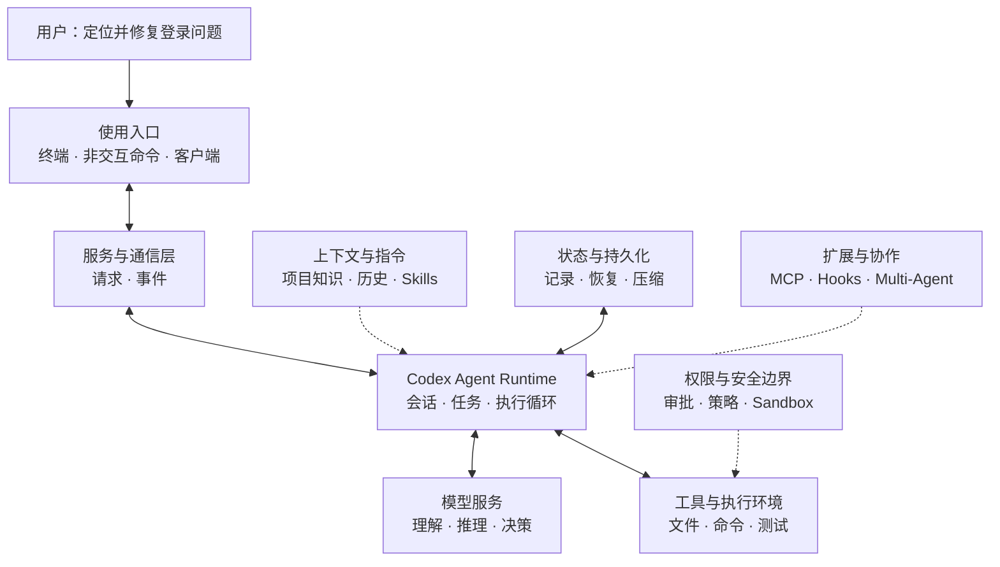

# Learn Codex：从一个 AI 助手，到一套 Agent 系统

> **读懂 Codex，不只是弄清楚它如何调用大模型，而是理解一个 AI Agent 如何理解任务、采取行动、管理状态，并在真实软件工程环境中持续工作。**

你不需要先学会 Rust，也不需要一开始就理解上百个源码目录。这份教程会从一个熟悉的场景出发，逐层拆开 Codex 的架构，最后再把各个模块连接回真实源码。

## 一个问题：为什么 Codex 能帮你改代码？

假设你对 Codex 说：

> 这个项目的登录功能有问题，帮我定位原因、修复它，再运行相关测试。

普通聊天模型可以根据你提供的信息分析问题、给出建议，但它并不会仅凭一段回复就自动获得项目文件、终端和测试结果。

Codex 不同。它能够在获得相应权限后，围绕这项任务反复进行工作：

```text
理解需求
   ↓
查看项目与相关代码
   ↓
判断下一步要做什么
   ↓
读取文件 / 修改代码 / 运行测试
   ↓
观察执行结果
   ↓
继续分析，直到形成答复
```

这里有一个关键区别：

**模型提供理解和决策能力；Codex 的 Agent Runtime 把这些决策组织成可执行、可控制、可持续的工作过程。**

这也是本教程真正要研究的对象。

---

## 第一层：从用户看到的 Codex 开始

我们最先接触的是交互界面：在终端提问、查看工具执行过程，或者通过非交互命令把任务交给 Codex。

这些只是不同的**使用入口**。

入口负责接收用户意图、呈现过程与结果，却不应该各自重新实现一套 Agent。它们背后需要一个能够处理请求、传递运行事件、协调会话的公共系统。

因此，先记住第一条关系：

```text
用户
 ↓
交互界面 / 非交互命令 / 其他客户端
 ↓
服务与通信层
 ↓
Codex Agent Runtime
```

这是一张**职责关系图，不是进程部署图**。例如，当前 Codex 的部分入口可以使用进程内 App Server，并非每一层都必须运行在独立进程中。

## 第二层：进入真正的 Agent Runtime

当你提交一个任务，Codex 不能只考虑“调用哪一个模型”。

它还需要知道：

- 这是哪个会话？之前聊过什么？
- 当前要完成的任务是什么？是否仍在执行？
- 模型下一步是回答用户，还是请求使用工具？
- 用户中途补充要求、打断任务时怎么办？

这就引出了 Codex 的核心：**围绕会话和任务组织运行的 Agent Runtime**。

在真实源码中，你会逐渐遇到几个重要名字：

| 概念 | 先这样理解 |
| --- | --- |
| **Thread** | 一段可以持续交互、恢复和管理的会话 |
| **Session** | 支撑会话运行的配置与状态 |
| **Turn** | 一次任务执行所处的运行周期 |
| **Agent Loop** | 反复调用模型、处理工具结果、推进任务的执行循环 |

现在不必记住这些对象的所有字段和生命周期。你只需要理解：**Codex 能连续完成多步工作，是因为有 Runtime 在持续组织它，而不是模型一次调用就做完了全部事情。**

## 第三层：模型如何让 Codex 真正采取行动？

有了 Runtime，还需要回答一个更实际的问题：

> 模型说“我需要读取这个文件”，文件到底是谁读取的？

答案不是模型本身。

模型可以生成回答，也可以提出工具调用请求；Codex 则通过工具系统识别请求、检查约束、调用相应执行能力，再把结果送回模型。

```text
         ┌───────────────┐
         │  Agent Runtime │
         └───────┬───────┘
                 │
          组织模型请求
                 ↓
            大模型服务
                 │
          返回回答或工具请求
                 ↓
            Agent Runtime
                 │
          路由与执行工具
                 ↓
       文件 / 终端 / 测试 / 外部服务
                 │
            返回执行结果
                 └──────→ 进入下一步判断
```

例如，运行测试并不意味着“大模型拥有一个终端”。而是 Codex 提供了受控的执行能力，并根据有效权限与执行环境处理工具调用。

这条循环，是理解 Codex 的核心线索。后面的课程会从最小可运行模型开始，再对照真正的 Rust 实现。

## 第四层：一个能用的 Agent，还需要什么？

如果只有“模型调用 + 工具调用”，我们已经能做一个简单 Demo，但距离能够用于真实项目的 Codex 还有很长的路。

Codex 还必须处理四类问题：

| 关键问题 | 对应的架构能力 |
| --- | --- |
| **模型应该知道什么？** | 上下文构建、项目指令、Skills、历史信息 |
| **Agent 可以做什么？** | 工具系统、权限、审批、Sandbox |
| **执行过程如何持续和恢复？** | 会话状态、历史记录、持久化、上下文压缩 |
| **如何支持更复杂的任务？** | MCP、扩展机制、多 Agent、长期记忆等 |

这些能力不是与 Agent Loop 毫无关系的功能清单。它们都在解决同一个问题：

**如何让一个会调用模型的程序，逐步成为可靠、可扩展的 Agent 系统？**

## 把四层放到同一张图里



> 这是用于教学的**逻辑架构图**：箭头帮助理解职责与信息流，并不代表真实源码里的每一条函数调用或进程关系。

读完这张图，你应该已经能大致解释一次任务是如何流动的：**用户提出目标，Runtime 组织工作，模型决定下一步，工具执行动作，状态系统记录过程，必要时再次进入循环。**

---

## 这套教程会带你学到什么？

我们的目标不是背下 Codex 有多少个目录、多少个 Rust 类型，而是让你最终能够独立回答几个工程问题：

**第一，Codex 是如何运转的？** 从用户输入到会话创建、模型请求、工具执行，再到结果返回，完整追踪一条任务链路。

**第二，Codex 为什么这样设计？** 理解为什么需要 Thread、Session、工具路由、事件协议、执行隔离和状态管理，而不是把所有逻辑塞进一个循环。

**第三，Codex 如何从单 Agent 走向复杂系统？** 看懂上下文管理、扩展机制、长期记忆、多 Agent 协作等能力怎样建立在核心 Runtime 之上。

**第四，能不能自己构建一个简化版？** 学会把真实源码中的核心机制抽象出来，先实现小而清晰的教学模型，再理解生产实现为何复杂。

### 我们将怎样学习？

课程按理解难度逐步推进，而不是按源码目录逐个讲解：

| 阶段 | 学习主题 | 要解决的问题 |
| --- | --- | --- |
| **01 · 架构认知** | Codex 整体架构 | 这是一个怎样的系统？ |
| **02 · 运行时模型** | Thread、Session、Turn、Step | 一项任务由谁管理？ |
| **03 · Agent 核心** | Agent Loop、模型、Context、Tools | Codex 如何思考并行动？ |
| **04 · 执行与安全** | 命令执行、权限与 Sandbox | 如何安全地操作真实环境？ |
| **05 · 状态与持续运行** | 事件通信、历史、持久化、压缩 | 为什么它可以交互、恢复和持续工作？ |
| **06 · 扩展与高级系统** | Skills、MCP、Hooks、Multi-Agent、Memory 等 | 如何从基础 Agent 扩展到复杂系统？ |

最后，我们会回到一次完整的真实任务，把前面学过的模块沿着源码调用链串起来。

完整章节安排见：[课程大纲（codex00.md）](./codex00.md)。

## 这套教程适合谁？

适合了解一点编程、对 AI Agent 或 Codex 感兴趣，但面对大型开源项目不知道从哪里开始的读者。

**不要求你一开始就会 Rust。** 我们会先用图解、简化示例和运行过程建立概念；真正需要阅读源码时，再引入对应的类型、函数与调用关系。

这套教程有两个坚持：

- **先回答“为什么需要这个设计”，再解释“源码如何实现”。**
- **简化示例用于理解原理，真实源码用于验证架构，两者明确区分。**

教程依据 [OpenAI 开源 Codex 仓库](https://github.com/openai/codex) 展开，源码阅读使用[固定教学基线](https://github.com/openai/codex/tree/014489466a1739c2c563cdfe57880c2c7c8680e3)，以减少持续更新带来的差异。这里研究的是公开仓库可见的实现，不代表覆盖所有未开源的服务端系统。

---

**接下来：Codex 的整体架构。** 我们将先认识用户入口、服务层与核心 Runtime 之间的边界，再逐步进入管理会话的 Thread 系统。
