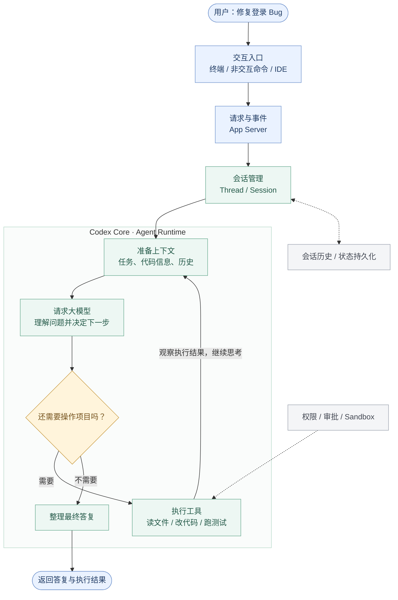

# Learn Codex：从一次提问，读懂一套 Agent 系统

> **Codex 为什么不只是一个会调用工具的聊天模型？**
>
> 这是一套面向初学者的 Codex 源码教程。我们从一个真实的编程任务出发，先看懂整体架构，再循着运行链路深入源码，最终理解一个 AI Coding Agent 是怎样构建出来的。

不要求你先掌握 Rust，也不会让你打开教程就面对几千行代码。**先理解系统如何工作，再理解源码为什么这样写。**

## 从一个任务开始

假设你对 Codex 说：

> 帮我修复项目的登录 Bug，并运行相关测试。

一个普通聊天模型可以分析你贴出的代码，但无法仅凭回复就直接读取本地文件、修改项目或运行测试。

Codex 则可以在获得相应权限后，逐步完成任务：**观察项目 → 分析问题 → 执行操作 → 检查结果 → 决定是否继续。**

这背后并不是模型“一次想完了所有步骤”，而是一套持续组织模型、工具、状态和执行环境的 **Agent Runtime（智能体运行时）**。

## 一张图，看懂 Codex 如何工作

先只关注图中的**实线主流程**，虚线代表为整个过程提供支持的能力。

**读图只需要记住三件事：**

1. **用户通过入口提交任务**，服务与通信层将请求交给核心运行时。
2. **模型负责判断下一步**，但真正读取文件、修改代码、运行测试的是 Codex 的工具与执行系统。
3. **工具结果会回到运行时**，作为下一步判断的依据；直到任务可以结束，才返回最终答复。

这是一张**帮助理解职责的逻辑图**，不是精确函数调用栈，也不意味着每个方框都是独立进程。当前 Codex 的部分客户端可以使用进程内 App Server。

## 沿着这条链，认识 Codex 的四个层次

### ① 入口与通信：用户如何与 Agent 交互？

你可能通过终端对话，也可能用 `codex exec` 发起一次非交互任务。入口可以不同，但不必分别实现一套 Agent。

它们背后需要统一的请求与事件机制：接收任务、报告进度、展示工具调用、处理用户中断与审批。这就是 **CLI / TUI / App Server / Protocol** 要解决的问题。

### ② 核心运行时：谁负责让任务持续推进？

模型不会自己管理所有会话。Codex 需要记住当前线程、执行状态、用户输入，以及一轮任务中发生的多个步骤。

因此，核心源码中会出现 **Thread、Session、Turn、Step** 等概念。它们共同回答：**任务是谁创建的、由谁管理、什么时候继续、什么时候停止？**

### ③ 模型与工具：为什么 Codex 能真正修改代码？

模型可以提出“读取这个文件”或“运行这组测试”的请求，但实际动作需要工具系统完成。

Codex 在这里负责连接 **Model Client、Tool Router、执行环境和安全策略**。最关键的机制是一个循环：**调用模型 → 执行工具 → 回传观察结果 → 再次调用模型**。

### ④ 状态与扩展：怎样从 Demo 变成可用的系统？

真正的软件工程任务往往很长，还可能被中断、恢复，或者需要访问外部系统。

因此 Codex 不只有 Agent Loop，还需要 **上下文管理、持久化、权限控制、Sandbox、Skills、MCP、Hooks、Multi-Agent** 等能力。这些不是孤立的功能，而是围绕核心 Runtime 不断扩展的系统。

---

## 完整学习路线：每一章学什么？

教程遵循 **先认识整体 → 理解运行机制 → 跟踪实际执行 → 掌握工程保障 → 研究高级架构** 的顺序。

这里的目录依据 Codex 当前开源架构设计，不刻意凑章节数，也不按源码文件夹机械拆分。

### 第一阶段｜建立架构认知（01–03）

先搞清楚“谁负责什么”，再研究“它具体怎么做”。

| 章节 | 主题 | 你将理解 |
| --- | --- | --- |
| **[01](./01-codex-architecture/README.zh.md)** | [Codex 整体架构](./01-codex-architecture/README.zh.md) | 从用户入口到 Agent Runtime，主要模块怎样协作？ |
| **[02](./02-thread-management/README.zh.md)** | [ThreadManager 与 CodexThread](./02-thread-management/README.zh.md) | Codex 如何创建、管理和访问多个会话？ |
| **[03](./03-session-turn-step/README.zh.md)** | [Session / Turn / Step](./03-session-turn-step/README.zh.md) | 一次任务为什么有多层生命周期？ |

**阶段成果：** 能在脑海中建立 Codex 的运行时结构，不再把它看成一个单独的循环函数。

### 第二阶段｜理解 Agent 如何思考与行动（04–08）

从最小 Agent Loop 出发，一步步补上真正需要的能力。

| 章节 | 主题 | 你将理解 |
| --- | --- | --- |
| **[04](./04-agent-loop/README.zh.md)** | [`run_turn`：Agent Loop](./04-agent-loop/README.zh.md) | 模型、工具和执行结果如何形成连续循环？ |
| **[05](./05-model-client/README.zh.md)** | [ModelClient 与流式响应](./05-model-client/README.zh.md) | Runtime 如何请求模型、接收和处理流式事件？ |
| **[06](./06-context-prompt/README.zh.md)** | [Context 与 Prompt 构建](./06-context-prompt/README.zh.md) | Codex 怎样组织指令、项目知识、历史与当前输入？ |
| **[07](./07-tool-system/README.zh.md)** | [Tool System](./07-tool-system/README.zh.md) | 工具如何被声明、选择、路由和执行？ |
| **[08](./08-shell-execution/README.zh.md)** | [一次 Shell 调用的完整链路](./08-shell-execution/README.zh.md) | 从模型提出命令到获得终端结果，中间发生了什么？ |

**阶段成果：** 能跟踪一次真实工具调用，并尝试实现一个简化版 Coding Agent。

### 第三阶段｜让 Agent 在真实环境中可靠运行（09–12）

Agent 不只是要“会做事”，还必须“知道能做什么，并记得做过什么”。

| 章节 | 主题 | 你将理解 |
| --- | --- | --- |
| **[09](./09-permission-sandbox/README.zh.md)** | [Permission / Approval / Sandbox / Exec](./09-permission-sandbox/README.zh.md) | 权限、人工审批和操作系统隔离各自解决什么问题？ |
| **[10](./10-op-event/README.zh.md)** | [Op / Event 与客户端通信](./10-op-event/README.zh.md) | 界面怎样获取进度、工具调用和任务状态？ |
| **[11](./11-history-rollout-thread-store/README.zh.md)** | [History / Rollout / Thread Store](./11-history-rollout-thread-store/README.zh.md) | Codex 如何保存、恢复、分叉和管理会话历史？ |
| **[12](./12-token-budget-compaction/README.zh.md)** | [Token Budget / Compaction](./12-token-budget-compaction/README.zh.md) | 上下文越来越长时，Runtime 如何控制模型输入？ |

**阶段成果：** 不只看懂 Agent Demo，还能解释 Codex 作为长期运行软件系统需要的工程机制。

### 第四阶段｜扩展 Agent 的能力（A1–A3）

在核心运行时之外，为 Codex 增加知识、工具和扩展点。

| 章节 | 主题 | 你将理解 |
| --- | --- | --- |
| **[A1](./A1-agents-md-skills/README.zh.md)** | [AGENTS.md / Skills](./A1-agents-md-skills/README.zh.md) | 项目指令与可复用技能怎样影响 Agent 的行为？ |
| **[A2](./A2-mcp-plugins-connectors/README.zh.md)** | [MCP / Plugins / Connectors](./A2-mcp-plugins-connectors/README.zh.md) | Codex 如何发现并接入外部工具和服务？ |
| **[A3](./A3-hooks-extension-api/README.zh.md)** | [Hooks / Extension API](./A3-hooks-extension-api/README.zh.md) | 如何在既有运行流程中增加扩展能力？ |

**阶段成果：** 理解“扩展 Agent”与“修改核心循环”的区别。

### 第五阶段｜走向更复杂的 Agent 系统（A4–A7）

最后再研究多 Agent、长期记忆和更高程度的自治能力。

| 章节 | 主题 | 你将理解 |
| --- | --- | --- |
| **A4** | Multi-Agent | 多个 Agent 如何创建、通信、分工与协作？ |
| **A5** | Memory | 跨会话信息如何提取、保存并用于后续任务？ |
| **A6** | Guardian | 更复杂的操作审查与授权机制如何设计？ |
| **A7** | Goal Runtime | 如何围绕目标完成情况管理持续执行？ |

**阶段成果：** 从理解单 Agent 的运行循环，进一步理解复杂 Agent 系统的组织方式。

> 高级篇会以源码中实际存在的机制为依据；**源码中存在某种能力，不代表它在所有产品入口中都默认启用**。教程会区分设计实现与实际可用状态。

### 最终实战｜追踪一条完整的 Codex 请求

我们会重新回到开头的任务：

> 修复登录 Bug，并运行相关测试。

这一次不再只看概念图，而是沿着真实源码，把**入口、会话、模型、上下文、工具、执行、安全、事件和历史记录**串成完整链路。

学到这里，你应该可以从一个用户动作出发，知道去哪里寻找对应模块，以及它们为什么采用现在的设计。

完整课程索引：[codex00.md](./codex00.md)。

---

## 这套教程适合谁？

适合会一点编程、了解大模型基本概念，但面对大型 Agent 项目还不知道从哪里入手的读者。**不要求一开始就会 Rust**：先通过流程图和小型可运行示例理解问题，再对照真实源码验证。

整套教程坚持两个原则：

- **先讲为什么，再讲怎么实现。** 每章从一个具体问题出发，而不是逐行翻译 Rust。
- **简化模型与真实实现分开。** 教学代码用来理解机制；源码分析用来认识工程中的复杂性与边界。

阅读后你将逐步具备四种能力：**看懂整体架构、追踪真实调用链、解释关键设计决策、构建简化版 Agent Runtime。**

本教程以 [OpenAI 开源 Codex](https://github.com/openai/codex) 为研究对象，源码阅读采用[固定教学基线](https://github.com/openai/codex/tree/014489466a1739c2c563cdfe57880c2c7c8680e3)，以减少上游更新带来的差异。公开源码不等于所有产品或托管服务的完整实现。

**[进入第 01 章：Codex 整体架构 →](./01-codex-architecture/README.zh.md)**
