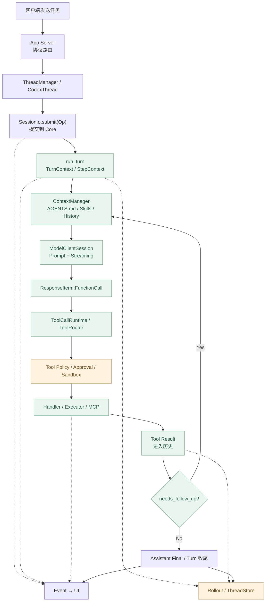
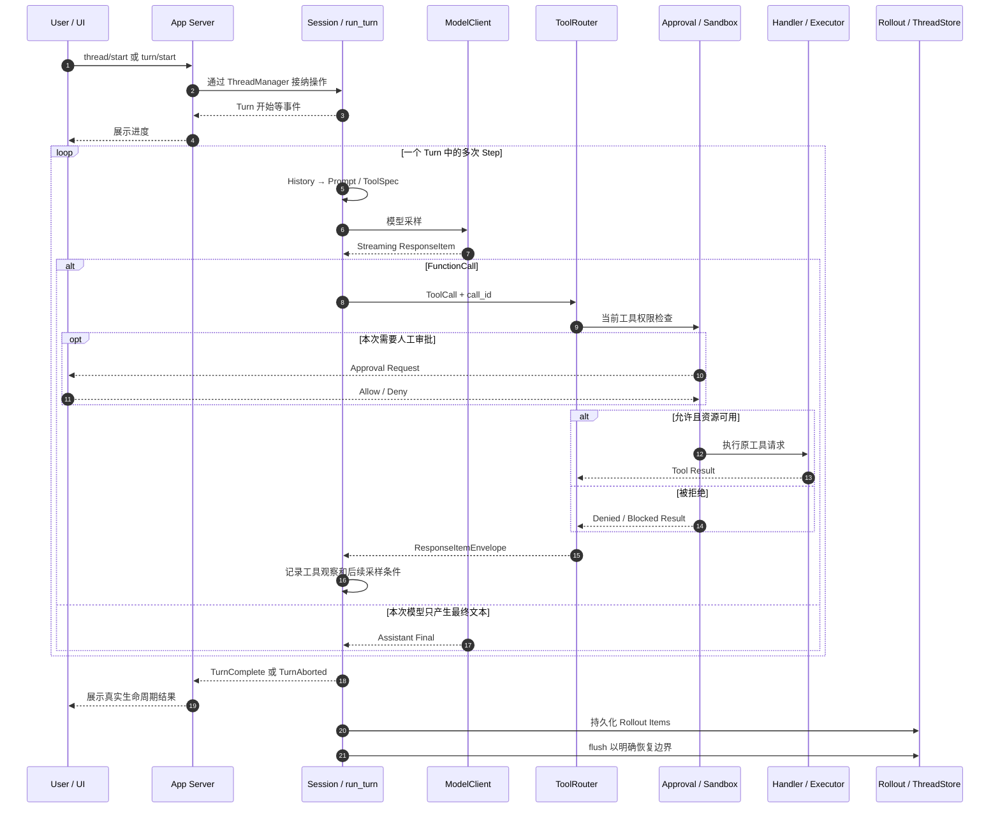

# 最终实战：一条 Codex 请求的完整源码追踪

> **一条请求，打通整套 Codex 架构：** 从用户点击发送、Thread/Turn 建立，到 Prompt 构建、模型流式生成、ToolSpec/Router、工具审批与执行、观察反馈、收尾事件、Rollout 持久化，再看 Memory、Guardian、Multi-Agent 与 Goal 等扩展在什么条件下参与。
>
> [教程首页](../README.zh.md) · [完整课程大纲](../codex00.md) · [上一章 A7《Goal Runtime》](../A7-goal-runtime/README.zh.md) · [本章可运行 Demo](./demo.py)

这一篇是全课程的**集成复盘**。前面的 01–12 章和 A1–A7 将源码拆成了独立模块；现在用一个具体的编程任务，沿一次完整的 Agent Loop 把它们接起来。

**固定源码：** [`openai/codex@014489466a1739c2c563cdfe57880c2c7c8680e3`](https://github.com/openai/codex/tree/014489466a1739c2c563cdfe57880c2c7c8680e3)。

**证据边界：** 本章的 Rust 调用路径、模块职责和差异结论来自该固定版本的**真实源码**。本章 Python `demo.py` 使用脚本化模型、内存工具和临时 JSONL，展示一条**可重复的教学执行轨迹**；它**不是从真实 Codex 模型会话截取的 Rollout**，也不会运行真实的 Rust Codex、模型 API、Shell、补丁或 Sandbox。不要把 Demo 中自定义的事件名称误认为全部是 Codex 原生 `EventMsg` 枚举。

## 学习目标

完成这一篇之后，应该能独立回答：

1. “点击发送”在哪一层被接纳？`Op` 与 `Event` 为什么不是一回事？
2. `Thread`、`Session`、`Turn`、`Step` 的归属分别是什么？
3. 多次模型请求为什么可能属于同一个 Turn？
4. 一条 `FunctionCall` 如何变成 `ToolInvocation`，又如何匹配它的 Handler？
5. 为什么模型说“执行这个操作”不等于它已经执行？
6. 工具失败、被拒绝、已执行失败、Turn 中断与目标未完成分别如何记录？
7. UI 进度和可靠落盘为什么需要不同的完成确认？
8. 哪些扩展是可选分支，而不是每条请求都执行的固定链？

---

## 1. 定义这次真正要追踪的请求

我们使用整套教程开篇的任务：

> **帮我修复项目的登录 Bug，并运行相关测试。**

教学项目包含：

```text
project/
├── src/
│   └── login.py
└── tests/
    └── test_login.py
```

假设 `login.py` 原本写错了判断条件。成功的验收应包含：

- 实际读到登录模块的当前代码；
- 发现问题位置；
- 在允许写入的权限下修正错误；
- 运行与该修复相关的真实测试；
- 最后报告执行过的事项和测试证据。

**案例刻意不包含无条件写入生产数据库、自动提交 Git、并行修改多个工作树等要求。**

### 必须区分“案例”和“真实源码”

| 本章对象 | 真实性 | 说明 |
| --- | --- | --- |
| Codex Rust `run_turn`、`ToolRouter`、`RolloutRecorder` | **真实源码** | 使用固定 Commit 的路径及行号定位 |
| Python `ScriptedModel` | 教学模拟 | 根据前序工具输出返回下一步 |
| Python `ToyTools` | 教学模拟 | 只修改内存字符串；不会碰你的项目 |
| Python `TraceRecorder` | 教学模拟 | 临时 JSONL；不等于真实 Rollout 格式 |
| Python `OpUserTurn`、`ModelStreamStarted` 等 | **自定义事件** | 用于观察责任边界，不是原生协议名称 |
| `TurnComplete`、`TurnAborted` 概念 | 真实 Codex 概念 | Demo 采用相同名称表达不同终态 |

这是**真实源码研究 + 可运行架构实验**，而不是对一次从未实际执行的线上模型调用伪造生产 Trace。

## 2. 第一次打开源码前，先看总图



图中虚线表示横向事件或持久化职责，不代表单一同步函数调用。真实执行还可能包含压缩、Hooks、CodeMode、工具搜索、用户 Steering、模型重试和环境快照。

## 3. 第一站：用户动作进入 App Server

在第 02 章，我们找到 [`app-server/src/message_processor.rs`](https://github.com/openai/codex/blob/014489466a1739c2c563cdfe57880c2c7c8680e3/codex-rs/app-server/src/message_processor.rs#L1298-L1311) 的 Thread 启动路由。已有 Thread 与新建 Thread 的接纳路径不同。

**App Server 是对外协议适配层，不是模型推理循环的拥有者。**

它要处理：

- 请求中的 `thread_id` 或创建新 Thread 的要求；
- 客户端/服务器之间的请求、通知与响应；
- 需要由用户批准的双向交互；
- 将 Core 事件映射为客户端消费的通知。

### `thread/start` 与 `turn/start` 不要混淆

前者负责建立或获取 Thread；后者在给定的 Thread 下提交新的工作。

用户在已有对话输入一句话，一般**不必因此新建一个独立 Thread**。

参考：[第 10 章《Op / Event》](../10-op-event/README.zh.md)。

## 4. 第二站：ThreadManager / CodexThread / SessionIo

[`ThreadManager::start_thread`](https://github.com/openai/codex/blob/014489466a1739c2c563cdfe57880c2c7c8680e3/codex-rs/core/src/thread_manager.rs#L1097-L1104) 是可定位的 Thread 创建入口；[`CodexThread::submit`](https://github.com/openai/codex/blob/014489466a1739c2c563cdfe57880c2c7c8680e3/codex-rs/core/src/codex_thread.rs#L253-L261) 与 [`SessionIo::submit`](https://github.com/openai/codex/blob/014489466a1739c2c563cdfe57880c2c7c8680e3/codex-rs/core/src/session/mod.rs#L1051-L1103) 将提交转换为 Core 可处理的消息。

真实 `SessionIo::submit_with_trace` 会产生 Submission ID，还能关联 Trace 与 Parent/Root Turn。

**接纳 Submission 的返回不等于完成工作。**

### 这几个 ID 的作用

| ID | 用来关联什么 | 必须避免的误解 |
| --- | --- | --- |
| Thread ID | 当前对话及存储归属 | 不等于一次工具调用 |
| Turn ID | 用户这次工作及生命周期事件 | 不等于一次模型网络请求 |
| Step | Turn 内的一次模型采样上下文 | 不保证一次只发一个 Tool Call |
| Tool Call ID | 模型提出的具体工具调用和对应输出 | 不等于 Git Commit ID |
| Submission ID | 提交操作的接纳身份 | 不代表 Tool 业务完成 |
| Trace/Span ID | 可观测性路径关联 | 不替代真实授权和业务结果 |

第 03 章的 [`TurnContext`](https://github.com/openai/codex/blob/014489466a1739c2c563cdfe57880c2c7c8680e3/codex-rs/core/src/session/turn_context.rs#L322-L365) 与 [`StepContext`](https://github.com/openai/codex/blob/014489466a1739c2c563cdfe57880c2c7c8680e3/codex-rs/core/src/session/step_context.rs#L23-L49) 能帮助你理解身份与快照的实际生效边界。

## 5. 第三站：为什么进入 run_turn，而不是直接调 ModelClient？

[`session/turn.rs::run_turn`](https://github.com/openai/codex/blob/014489466a1739c2c563cdfe57880c2c7c8680e3/codex-rs/core/src/session/turn.rs#L160-L235) 的签名：

```rust
pub(crate) async fn run_turn(
    sess: Arc<Session>,
    turn_context: Arc<TurnContext>,
    mut input: Vec<TurnInput>,
    mcp_startup_requirements: &mut McpStartupRequirements,
    prewarmed_client_session: Option<ModelClientSession>,
    cancellation_token: CancellationToken,
) -> CodexResult<Option<String>>
```

其职责包括：

- 在合适的时刻构造最初的 Step；
- 组织初始用户输入、项目上下文与历史；
- 根据有效配置运行必要的压缩与 Hooks；
- 在不同步骤调用模型；
- 处理工具输出与用户中途 Steering；
- 判断是否继续采样；
- 区分正常结束、取消、致命失败等出口。

**`run_turn` 是执行控制器，而不是模型 API 的单层封装。**

### 在本次案例里

教学轨迹的 `TurnStarted` 只出现一次；之后有四次 `ModelStreamStarted`。这反映**一个 Turn 内多次采样**的概念，不代表真实 Codex 在相同项目和模型下必定采样四次。

## 6. 第四站：构建 Prompt，不能只拼接最新 user 文本

[`ContextManager`](https://github.com/openai/codex/blob/014489466a1739c2c563cdfe57880c2c7c8680e3/codex-rs/core/src/context_manager/history.rs#L91-L125) 管理有效历史，`for_prompt` 在 [`history.rs`](https://github.com/openai/codex/blob/014489466a1739c2c563cdfe57880c2c7c8680e3/codex-rs/core/src/context_manager/history.rs#L601-L620) 中提供面向当前模型的输入表示。

[`run_turn 准备采样输入`](https://github.com/openai/codex/blob/014489466a1739c2c563cdfe57880c2c7c8680e3/codex-rs/core/src/session/turn.rs#L550-L575)：

```rust
let sampling_request_input: Vec<ResponseItem> = async {
    sess.clone_history()
        .await
        .for_prompt(&step_context.settings.model_info.input_modalities)
}
.instrument(trace_span!("run_turn.prepare_sampling_request_input"))
.await;
```

接着 [`run_sampling_request`](https://github.com/openai/codex/blob/014489466a1739c2c563cdfe57880c2c7c8680e3/codex-rs/core/src/session/turn.rs#L1714-L1794) 调用 `build_prompt(...)`，组合：

- 结构化历史与新输入；
- 模型信息和采样相关参数；
- 本 Step 有效的 ToolSpec；
- 基础指令和项目/环境上下文；
- 对适用的 Hook、Extension 和 Guardian 输入的整合。

### AGENTS.md 和 Skill 在何时加入？

A1 解释了这条路径：

- `AGENTS.md`/`AGENTS.override.md` 是有来源的目录级指令；
- Skills 首先可以只以元数据被发现；
- 需要具体 Skill 时才按条件加载对应正文。

**不能推断每次 Prompt 自动包含全部 Skill 文本。**

参考：[A1《AGENTS.md / Skills》](../A1-agents-md-skills/README.zh.md)。

## 7. 第五站：ModelClientSession 如何流式返回结果？

[`ModelClient / ModelClientSession`](https://github.com/openai/codex/blob/014489466a1739c2c563cdfe57880c2c7c8680e3/codex-rs/core/src/client.rs#L255-L311) 分别体现客户端与一次 Turn 对应的模型连接状态。真实采样使用 [`ModelClientSession::stream`](https://github.com/openai/codex/blob/014489466a1739c2c563cdfe57880c2c7c8680e3/codex-rs/core/src/client.rs#L2359-L2430)。

Codex 在 [`turn.rs 的 stream.next`](https://github.com/openai/codex/blob/014489466a1739c2c563cdfe57880c2c7c8680e3/codex-rs/core/src/session/turn.rs#L2774-L2825) 消费流式事件。

一次模型采样可能产生：

- 增量文本；
- Reasoning 的摘要事件；
- 正式的 Output Item；
- Function Call 或 Custom Tool Call；
- Token 使用统计；
- 模型结束或错误。

**“收到一段文本”不意味着“这一轮模型输出已经结束”。**

在真实 [`codex-api ResponseEvent`](https://github.com/openai/codex/blob/014489466a1739c2c563cdfe57880c2c7c8680e3/codex-rs/codex-api/src/common.rs#L74-L126) 中，可以进一步对照 Created、Output Item、Completed 等事件。

### 本 Demo 的简化方式

`ScriptedModel.sample(history, step)` 每次直接返回一个最终 `ToolCall` 或最终字符串，**没有模拟网络分块、并行 Tool Calls、推理缓存和 WebSocket 重连**。

它用于让读者看清：为什么当前历史不同会导致下一次采样做出不同决定。

## 8. 第六站：模型为什么会产生“下一步工具请求”？

案例 Step 1：

```text
Assistant:
  FunctionCall name=read_file
  arguments={"path":"src/login.py"}
  call_id=call-1
```

上述是示意消息，不是用户电脑真实 API 的响应内容。

[`ToolRouter::build_tool_call`](https://github.com/openai/codex/blob/014489466a1739c2c563cdfe57880c2c7c8680e3/codex-rs/core/src/tools/router.rs#L257-L308) 会识别 `ResponseItem::FunctionCall` 和其它可支持调用类型，转成 Codex 内部 `ToolCall`。

这个结构保留：

- Tool Name / Namespace；
- Call ID；
- 输入参数；
- 适用的附加信息。

### 为什么需要 call_id？

因为模型提出工具请求时，要在收到工具结果后知道**哪份输出对应哪次调用**。

本次四次采样中，`call-1`、`call-2`、`call-3` 是不同 Tool Call；但它们属于同一个教学 Turn。

**不能用工具名来充当唯一关联键**：一个 Turn 可以多次调用同名工具。

## 9. 第七站：ToolSpec / Registry / Router / Handler

[`ToolCallRuntime::handle_tool_call`](https://github.com/openai/codex/blob/014489466a1739c2c563cdfe57880c2c7c8680e3/codex-rs/core/src/tools/parallel.rs#L78-L173) 将 ToolCall 交给按 Step 固定的 Router，还要关注：

- 是否允许并行；
- Cancellation Token；
- Tool Lifecycle Contributor；
- 执行结果转换为 ResponseItemEnvelope；
- 哪些错误是 Tool 层失败，哪些错误应终止 Agent Loop。

这里同时串起了第 07 章与 A3 扩展篇。

**核心不变量：**

```text
模型可见 ToolSpec
        ≠
工具已经被调用

工具注册到 Registry
        ≠
用户有权限执行

Tool Handler 返回 Result
        ≠
用户业务目标已完成
```

阅读 [`tools/router.rs::dispatch_tool_call_with_state`](https://github.com/openai/codex/blob/014489466a1739c2c563cdfe57880c2c7c8680e3/codex-rs/core/src/tools/router.rs#L336-L359) 可以继续跟踪真正的 Handler 分发。

## 10. 第八站：读登录源码

Demo 第一轮：

```text
step=1 ModelFunctionCall call=call-1 read_file(src/login.py)
step=1 ToolResult        call=call-1 read: def login(password): return password == 'wrong'
```

教学 Tool 在内存中返回已有代码。这一点与真实 Codex 有本质差别：**真实 Agent 不会自动拥有用户电脑所有文件的读取能力**。它必须调用环境允许的 Tool，例如 `exec_command`、文件 API 或已注册的扩展工具。

本示例的 `read_file` 是我们自己定义的假工具，**并非断言 Codex 在本次固定版本中始终提供一个同名原生工具**。

实际需要看本次 Step 的 ToolSpec 和批准的执行环境。

## 11. 第九站：申请修改，Approval 如何回到客户端？

Demo Step 2：

```text
step=2 ModelFunctionCall call=call-2 apply_patch(src/login.py)
step=2 ApprovalRequested call=call-2
step=2 ApprovalResolved  call=call-2 approved
step=2 ToolResult        call=call-2 patch: applied
```

这是对审批结果与工具执行边界的教学模拟。

真实 [`tools/sandboxing.rs`](https://github.com/openai/codex/blob/014489466a1739c2c563cdfe57880c2c7c8680e3/codex-rs/core/src/tools/sandboxing.rs#L152-L226) 区分不同 Exec Approval 要求；[`tools/approvals.rs`](https://github.com/openai/codex/blob/014489466a1739c2c563cdfe57880c2c7c8680e3/codex-rs/core/src/tools/approvals.rs#L454-L570) 负责协调适用的审批来源与返回。

在 UI 路径上：[`app-server/src/bespoke_event_handling.rs`](https://github.com/openai/codex/blob/014489466a1739c2c563cdfe57880c2c7c8680e3/codex-rs/app-server/src/bespoke_event_handling.rs#L675-L825) 能看到 Core `ExecApprovalRequest` 如何转换成对客户端的审批请求。

### Approval、Sandbox、Guardian 不是一个按钮

审批至少有三层问题：

1. 当前操作是否需要审批？
2. 适用的 Reviewer/User 是否批准？
3. 即使批准，Executor 和上游系统是否拥有真实资源权限？

A6 的 Guardian 可作为特定配置下的独立审查分支，**但不是每个普通工具调用都有 Guardian V2 评分**。

更不能把“不用询问用户”理解成“可以执行任意副作用”。

### 本 Demo 对什么进行了省略？

它只提供布尔 `approve_patch` 和一个字符串前缀判断来模拟路径允许。**字符串前缀不是安全的文件系统授权实现；不能拷贝进生产安全代码。**

真实 Codex 的 Sandbox、Permission Profile、路径规范化和执行上下文远比本实验严格。

## 12. 第十站：修改代码的 Handler 可以是什么？

一种可能是 `apply_patch` 类工具；另一种情况是模型选择 `exec_command` 启动受控命令执行。

当选择 Shell Tool，真实调用路径可以从：

- [`shell_spec.rs`](https://github.com/openai/codex/blob/014489466a1739c2c563cdfe57880c2c7c8680e3/codex-rs/core/src/tools/handlers/shell_spec.rs#L22-L91)；
- [`unified_exec/exec_command.rs`](https://github.com/openai/codex/blob/014489466a1739c2c563cdfe57880c2c7c8680e3/codex-rs/core/src/tools/handlers/unified_exec/exec_command.rs#L107-L204)；
- [`tools/orchestrator.rs`](https://github.com/openai/codex/blob/014489466a1739c2c563cdfe57880c2c7c8680e3/codex-rs/core/src/tools/orchestrator.rs#L125-L215)；
- [`UnifiedExecRuntime::run`](https://github.com/openai/codex/blob/014489466a1739c2c563cdfe57880c2c7c8680e3/codex-rs/core/src/tools/runtimes/unified_exec.rs#L260-L297)

继续阅读。

工具的真实文件写入不会因为模型返回了工具参数而自动生效；必须确实到达允许的 Handler/Executor 路径，后续还应检查实际文件状态。

**本 Demo 则只是把内存文本 `'wrong'` 替换为 `'correct'`。**

## 13. 第十一站：测试输出要回到模型

Demo Step 3：

```text
step=3 ModelFunctionCall call=call-3 run_related_tests(tests/test_login.py)
step=3 ToolResult        call=call-3 test: passed
```

模型第一次想“修复”；第二次实际修改后，第三次“运行定向测试”；第四次才汇总。

这里最关键的是：**Tool 结果不是 Agent 的最终答案，而是下一轮模型做判断的输入。**

在真实 Codex 中，[`ToolCallRuntime::handle_tool_call`](https://github.com/openai/codex/blob/014489466a1739c2c563cdfe57880c2c7c8680e3/codex-rs/core/src/tools/parallel.rs#L78-L115) 会将可恢复工具失败转换为输出消息，而不是始终直接抛出致命异常。

[`ContextManager::record_items`](https://github.com/openai/codex/blob/014489466a1739c2c563cdfe57880c2c7c8680e3/codex-rs/core/src/context_manager/history.rs#L506-L521) 和 Turn 内的历史采样路径，会让适用的工具输出进入之后的 Prompt。

### 工具返回非零退出码意味着什么？

根据执行策略与 Handler 的结果类型，它可能是：

- 工具执行已完成，但业务检查失败；
- Tool Handler 返回可供模型继续分析的失败观察；
- 被审批策略拒绝；
- Sandbox 阻挡访问；
- 传输异常或执行器无响应；
- 需要中断 Turn 的不可恢复错误。

**不能仅凭“工具报错”推断整个 Agent Loop 必须终止。**

## 14. 第十二站：run_turn 什么时候再调用模型？

在 [`turn.rs#L580-L625`](https://github.com/openai/codex/blob/014489466a1739c2c563cdfe57880c2c7c8680e3/codex-rs/core/src/session/turn.rs#L580-L625)，源码综合：

- 模型侧是否要求继续 `model_needs_follow_up`；
- 当前是否存在可以被采样接受的待输入；
- Token Window 状态；
- 是否需要启动压缩。

核心语义可以简写为：

```rust
let needs_follow_up = model_needs_follow_up || has_pending_input;
```

**不要用“模型最后有没有说一句话”替代这个判断**。

如果本轮不再需要继续，才进入 [`run_turn 的 Stop Hook 与收尾分支`](https://github.com/openai/codex/blob/014489466a1739c2c563cdfe57880c2c7c8680e3/codex-rs/core/src/session/turn.rs#L724-L769)。

而某些 Stop Hook 还可以提供有效反馈，让当前 Turn 继续。

### 采样次数 = 工具调用次数 + 1 吗？

**不一定。** 本 Demo 恰好是三次调用加一次最终文本，但真实模型可能：

- 一次采样产生多个 Tool Call；
- 同步/并行执行多个工具；
- 一次采样只输出文本，随后仍有待输入；
- 某些 Hook 要求继续；
- 接到用户 Steering、取消或重试；
- 转到 Compaction 前后继续执行。

因此这只是**一条具体轨迹的计数，不是 Codex 的硬编码公式**。

## 15. 第十三站：正常结果和审批拒绝可以共存

我们再看 Demo 的 **CASE B**：

用户不批准本次修改：

```text
ApprovalResolved: denied
ToolResult: patch: denied
AssistantFinal: 已读取代码，但修改未获批准……
TurnComplete
```

这里有三个不同结论：

| 问题 | 结论 |
| --- | --- |
| 用户的修改请求完成了吗？ | **没有** |
| 这次补丁被执行了吗？ | **没有** |
| Agent Turn 可以正常结束吗？ | **可以**，因为它给出了准确的拒绝说明 |

这个区别对平台的 Task 状态很重要。**TurnComplete 是生命周期结果，Goal/业务验收成功是另一层判断。**

如果 UI 把所有 `TurnComplete` 都显示为“已完成修复”，就会制造假成功。

## 16. 第十四站：用户中断绝不是“自然停止”

Demo 的 **CASE C**：

- Step 1 读取完内存代码；
- 准备进入 Step 2 之前收到模拟用户取消；
- 生成 `TurnAborted`，不继续 Patch 和 Test。

[`turn.rs 的 stream.next 与 Cancellation Token`](https://github.com/openai/codex/blob/014489466a1739c2c563cdfe57880c2c7c8680e3/codex-rs/core/src/session/turn.rs#L2790-L2825) 展示真实 Codex 如何处理采样事件和取消竞态。

真实客户端还会区分 [`Session EventMsg::TurnComplete / TurnAborted`](https://github.com/openai/codex/blob/014489466a1739c2c563cdfe57880c2c7c8680e3/codex-rs/core/src/session/mod.rs#L2534-L2554)。

### 三种不同结束结果

| 情形 | 应报告 | 不能报告 |
| --- | --- | --- |
| 正常已测试 | TurnComplete + 具体测试证据 | “所有系统均通过” |
| 审批拒绝 | TurnComplete + 修改未实施 | “已修复” |
| 用户中断 | TurnAborted + 已观察工作范围 | “自然完成” |

不应在收到取消命令的瞬间就假定所有工具已经安全停止。某些 Tool 具备异步清理和独立的执行生命周期，需要观测真实终态。

## 17. 第十五站：Event 到 UI，Rollout 到存储

第 10 和第 11 章的边界在这里相交。

[`SessionIo::submit`](https://github.com/openai/codex/blob/014489466a1739c2c563cdfe57880c2c7c8680e3/codex-rs/core/src/session/mod.rs#L1051-L1103) 是输入端；CodexThread 的 [`next_event`](https://github.com/openai/codex/blob/014489466a1739c2c563cdfe57880c2c7c8680e3/codex-rs/core/src/codex_thread.rs#L772-L783) 是消费 Core Event 的一个入口。

但**Event 被 UI 收到，不等于相关数据已经保证落盘**。

持久化路径：

- [`Session::persist_rollout_items`](https://github.com/openai/codex/blob/014489466a1739c2c563cdfe57880c2c7c8680e3/codex-rs/core/src/session/mod.rs#L4788-L4800) 将 Rollout Item 写到当前 Live Thread；
- [`RolloutRecorder::persist`](https://github.com/openai/codex/blob/014489466a1739c2c563cdfe57880c2c7c8680e3/codex-rs/rollout/src/recorder.rs#L1082-L1103) 请求持久化；
- [`RolloutRecorder::flush`](https://github.com/openai/codex/blob/014489466a1739c2c563cdfe57880c2c7c8680e3/codex-rs/rollout/src/recorder.rs#L1103-L1118) 等待必要的刷新确认；
- [`ThreadStore 的 persist/flush`](https://github.com/openai/codex/blob/014489466a1739c2c563cdfe57880c2c7c8680e3/codex-rs/thread-store/src/store.rs#L226-L249) 定义可靠持久化读回的边界。

### 为什么教学 Demo 特别包含 CASE D？

Demo 先调用 `emit("UIEvent")`：

- `ui_events` 已立刻包含该事件；
- `reopen()` 尚无法读到未刷盘的内容；
- 调用 `flush()` 后，新的 Reader 才能读取这行 JSONL。

这用一个最小实验说明：

**进度可见性**与**恢复所需的持久性**是两个独立保证。

### Rollout 不是最终 Context 的简单副本

某些 Rollout Item 面向回放与审计；模型的下一次 Prompt 会使用筛选/规范化后的有效历史。

[`ContextManager::for_prompt`](https://github.com/openai/codex/blob/014489466a1739c2c563cdfe57880c2c7c8680e3/codex-rs/core/src/context_manager/history.rs#L601-L620) 与 [`Rollout 回放/恢复机制`](https://github.com/openai/codex/blob/014489466a1739c2c563cdfe57880c2c7c8680e3/codex-rs/core/src/session/rollout_reconstruction.rs#L208-L320) 负责不同的恢复和上下文处理问题。

因此“JSONL 完整”也不等于每次模型请求都要重新注入整份 JSONL。

## 18. 第十六站：Token Budget 与 Compaction 是什么时机？

我们的四次模型采样使用很短的教学历史，因此**本 Demo 不需要压缩**。

但是在真实 Codex：

- [`context_window_token_status`](https://github.com/openai/codex/blob/014489466a1739c2c563cdfe57880c2c7c8680e3/codex-rs/core/src/session/context_window.rs#L26-L53) 计算当前窗口状态；
- [`run_pre_sampling_compact`](https://github.com/openai/codex/blob/014489466a1739c2c563cdfe57880c2c7c8680e3/codex-rs/core/src/session/turn.rs#L1379-L1408) 在适当的采样前触发压缩；
- [`async_compaction::maybe_start`](https://github.com/openai/codex/blob/014489466a1739c2c563cdfe57880c2c7c8680e3/codex-rs/core/src/session/async_compaction.rs) 可在不同阶段尝试后台压缩；
- [`replace_compacted_history`](https://github.com/openai/codex/blob/014489466a1739c2c563cdfe57880c2c7c8680e3/codex-rs/core/src/session/mod.rs#L4242-L4409) 在条件满足时替换有效历史并记录对应状态。

注意：**Compaction 不是新 Thread，也不等于抹掉整个持久 Rollout**。第 12 章展示了 Context Window、摘要和检查点之间的差异。

## 19. 第十七站：可选扩展怎样接入这条请求？

不要把所有扩展画成每次请求都必经的环节。

| 扩展篇 | 可能接入的阶段 | 什么情况下才实际参与？ |
| --- | --- | --- |
| [A1 AGENTS.md / Skills](../A1-agents-md-skills/README.zh.md) | Prompt/Context 构建 | 当前目录有生效指令；Skill 被发现并按需加载 |
| [A2 MCP / Plugins / Connectors](../A2-mcp-plugins-connectors/README.zh.md) | ToolSpec 构建与 Handler 执行 | 有有效 Server、可见 Tool、连接身份和权限 |
| [A3 Hooks / Extension API](../A3-hooks-extension-api/README.zh.md) | 指定生命周期事件 | 已配置并匹配相应 Hook/Contributor |
| [A4 Multi-Agent](../A4-multi-agent/README.zh.md) | Tool Dispatch / Child Thread | 模型或宿主明确创建 Child；并遵守深度/数量限制 |
| [A5 Memory](../A5-memory/README.zh.md) | 某些 Session 启动/Context 注入 | Memory 版本与读写开关生效、历史有合格输入 |
| [A6 Guardian](../A6-guardian/README.zh.md) | 高风险动作审批/审查 | 审批策略、模型、来源和配置命中 |
| [A7 Goal Runtime](../A7-goal-runtime/README.zh.md) | Thread 目标持久化及 Idle/Turn 生命周期 | 用户/宿主明确建立 Goal，线程持久且可用 |

**本 Demo 没有真实启用这些扩展**。它模拟了最基本的审批、历史、工具与续跑主链；上表用于告诉你在扩展情形下应继续追哪些真实模块。

### 为什么不在同一个 Demo 塞进全部扩展？

因为那样会把多种可能性错误地画成一个必然发生的序列。比如：

- 一次简单只读查询不一定需要创建 Goal；
- 没有 Multi-Agent 的请求不应该凭空出现 Child Thread；
- Memory 不是每个 Turn 结束时立即同步写入；
- 工具未触发权限审查就不必自动运行 Guardian 同步模型；
- 没有接近 Token 上限就不一定进行 Compaction。

**可靠的源码追踪不仅要画“发生了什么”，还要证明“哪些路径没有发生，以及为什么”。**

---

## 20. 把 Python Demo 真正跑起来

源码：[`demo.py`](./demo.py)。

Python 3.10+，不需要 Codex CLI、Rust、API Key 或其它依赖：

```bash
cd docs/final-end-to-end-trace
python demo.py
```

Demo 在临时目录中构造四组可重复实验：

### CASE A：获批、修复、测试、结束

```text
CASE A: Approved: 4 samples, read -> patch -> test -> final
  [05] step=1 ModelFunctionCall call=call-1 read_file(src/login.py)
  [06] step=1 ToolResult call=call-1 read: def login(password): return password == 'wrong'
  [10] step=2 ModelFunctionCall call=call-2 apply_patch(src/login.py)
  [12] step=2 ApprovalResolved call=call-2 approved
  [13] step=2 ToolResult call=call-2 patch: applied
  [17] step=3 ModelFunctionCall call=call-3 run_related_tests(tests/test_login.py)
  [18] step=3 ToolResult call=call-3 test: passed
  [23] step=4 TurnComplete call=None successful lifecycle completion
```

**这里的修复和测试只是内存级模拟，绝不是对你的实际项目进行了真实单测。**

### CASE B：拒绝补丁，但 Turn 可以收尾

```text
CASE B: Approval denied: TurnComplete is possible; patch was not applied
```

验证：

- 源字符串仍含 `'wrong'`；
- 没有假装执行真实测试；
- 最终回复明确指出修改未经批准。

### CASE C：中断而不是完成

```text
CASE C: Cancelled: TurnAborted, not TurnComplete or silently successful
```

验证这条轨迹只有 `TurnAborted`，没有 `TurnComplete`，也没有执行后续修改。

### CASE D：可见事件不等于 Durable Rollout

```text
CASE D: UI observation precedes explicit durable JSONL flush
All teaching assertions passed
```

验证没有刷盘之前 Reader 看不到待持久化事件；刷盘后才能读到。

## 21. Demo 中哪段代码对应哪一层 Rust？

| 教学函数/对象 | 对应真实概念 | 原则性差别 |
| --- | --- | --- |
| `TraceRecorder.emit` | `EventMsg` 发出与 Rollout 事件观察 | 真实 Codex 事件类型更丰富，不是一张统一 Toy List |
| `MiniRuntime.run` | `run_turn` | 真实实现处理模型流、Hooks、压缩、任务取消、错误 |
| `history: list` | `ContextManager` | 真实 History 具有丰富的 ResponseItem 和元数据 |
| `ScriptedModel.sample` | `ModelClientSession::stream` | Demo 没有 API 请求及流式增量 |
| `ToolCall` | `ResponseItem::FunctionCall → ToolCall` | Demo 不处理工具命名空间/Schema/并行 |
| `ToyTools.execute` | `ToolRouter + Handler + Executor` | Demo 只操作内存字符串 |
| `approve_patch` | `Approval / Policy` | Demo 无真实 ACL/OS Sandbox |
| `TraceRecorder.flush` | `RolloutRecorder / ThreadStore flush` | Demo 只写临时 JSONL，不是 Codex Rollout Schema |
| `assert_valid_trace` | 执行轨迹不变量与审计 | Codex 不保证所有工具在同一 Turn 都按此脚本顺序 |

### 为什么要检查 Call ID 集合相等？

`assert_valid_trace` 会确认教学轨迹中所有 `ModelFunctionCall` 都收到了有相同 `call_id` 的 `ToolResult`。

这是本 Demo 的**选择性不变量**：我们有意把每条完整 Scripted Tool Call 都结算成输出。真实 Codex 在取消、网络传输失败和部分未完成操作时，还需要特殊的状态与结果关联，不能全局硬编码这个等式。

## 22. 一张从 UI 到落盘的完整时序图



这张图将“典型职责”放在一条可读的主线上。**实际 Codex 的 Rollout 写入可以发生在执行中，并非只在 TurnComplete 后一次性写入。** 部分事件与持久化可并行发生，应用不能把这里的说明图当作严格的 Happens-Before 证明。

## 23. 生产环境如何对照真实 Codex Trace？

如果你希望把教学轨迹换成自己的 Codex 实际调用，建议按**只读事实核验**展开：

1. 固定 Codex 的版本/Commit，记录运行环境、请求输入与本次 Tool 配置。
2. 找到目标 Thread 的 ID 和对应 Turn；先核验它是否真的开始。
3. 通过已有可观测性记录或 Rollout，找出模型采样次数、实际 Tool 名、Call ID、输入和输出。
4. 逐条核对哪些请求经过了人工审批、Guardian、Sandbox 和上游 ACL。
5. 把工具执行事实与测试日志/工作树 Diff 对照，不能只靠模型自己的总结。
6. 检查最后是 `TurnComplete`、`TurnAborted` 还是错误；若存在 Goal，还要核对 Goal Status。
7. 检查哪些 Rollout Item 已可靠写入，以及 Thread 恢复后能否重建相同事实。
8. 对敏感凭据、私人文件路径、CRM 客户数据进行脱敏，不要为了教学上传真实密钥或个人信息。

**本课程没有凭空构造“真实线上 Trace ID”或声称远端源仓库正在执行你的登录修复。** 追踪真实部署实例需要该实例的真实执行数据和可访问日志。

### 最小可用的端到端 Trace Schema（架构建议）

```text
Trace
  thread_id
  turn_id
  step_id
  model_request_id
  tool_call_id
  tool_name
  tool_source
  approval_decision
  sandbox_result
  tool_execution_status
  tool_business_status
  rollout_checkpoint
  turn_terminal_status
  goal_id (optional)
  parent_agent_id (optional)
```

这是**适用于自建 Agent 的建议字段**，不声称 Codex 原样定义了这个统一数据库表。

## 24. 完成一次真实任务要哪些证据？

对于“修复登录 Bug，运行定向测试”，建议用这份验收表：

| 检查 | 必要证据 | 不够的证据 |
| --- | --- | --- |
| 实际找到 Bug | 代码位置与可复现条件 | 模型猜测“可能是登录逻辑” |
| 修复被写入 | 工作树 Diff 或真实文件内容 | `apply_patch` 的入参 |
| 未越权 | 权限决定与有效资源访问限制 | “模型承诺不越权” |
| 测试确实运行 | 测试命令、退出码、相关日志 | 自述“已测试” |
| 测试覆盖当前修复 | 测试的作用范围和案例 | 无关单测全绿 |
| 没有误报成功 | Turn/Tool/业务状态一致 | 只看到 `TurnComplete` |
| 可以恢复证据 | Rollout/Trace 可检索 | 仅有 UI 临时消息 |

**这就是从“模型会写代码”走向“Agent 系统能够交付可信结果”的边界。**

## 25. 全课程源码入口总表

| 章节 | 现在应该关注哪一段源码？ |
| --- | --- |
| [01 架构地图](../01-codex-architecture/README.zh.md) | App Server、Core、Tools、State、Extensions 的分层 |
| [02 ThreadManager](../02-thread-management/README.zh.md) | [`thread_manager.rs`](https://github.com/openai/codex/blob/014489466a1739c2c563cdfe57880c2c7c8680e3/codex-rs/core/src/thread_manager.rs#L251-L258) |
| [03 Session/Turn/Step](../03-session-turn-step/README.zh.md) | [`turn_context.rs`](https://github.com/openai/codex/blob/014489466a1739c2c563cdfe57880c2c7c8680e3/codex-rs/core/src/session/turn_context.rs#L322-L365) |
| [04 Agent Loop](../04-agent-loop/README.zh.md) | [`run_turn`](https://github.com/openai/codex/blob/014489466a1739c2c563cdfe57880c2c7c8680e3/codex-rs/core/src/session/turn.rs#L160-L183) |
| [05 ModelClient](../05-model-client/README.zh.md) | [`client.rs::stream`](https://github.com/openai/codex/blob/014489466a1739c2c563cdfe57880c2c7c8680e3/codex-rs/core/src/client.rs#L2359-L2430) |
| [06 Context](../06-context-prompt/README.zh.md) | [`ContextManager::for_prompt`](https://github.com/openai/codex/blob/014489466a1739c2c563cdfe57880c2c7c8680e3/codex-rs/core/src/context_manager/history.rs#L601-L620) |
| [07 Tool System](../07-tool-system/README.zh.md) | [`ToolRouter::build_tool_call`](https://github.com/openai/codex/blob/014489466a1739c2c563cdfe57880c2c7c8680e3/codex-rs/core/src/tools/router.rs#L257-L308) |
| [08 Shell Execution](../08-shell-execution/README.zh.md) | [`exec_command handler`](https://github.com/openai/codex/blob/014489466a1739c2c563cdfe57880c2c7c8680e3/codex-rs/core/src/tools/handlers/unified_exec/exec_command.rs#L107-L204) |
| [09 Permission](../09-permission-sandbox/README.zh.md) | [`approvals.rs`](https://github.com/openai/codex/blob/014489466a1739c2c563cdfe57880c2c7c8680e3/codex-rs/core/src/tools/approvals.rs#L454-L570) |
| [10 Op/Event](../10-op-event/README.zh.md) | [`SessionIo::submit`](https://github.com/openai/codex/blob/014489466a1739c2c563cdfe57880c2c7c8680e3/codex-rs/core/src/session/mod.rs#L1051-L1103) |
| [11 History/Rollout](../11-history-rollout-thread-store/README.zh.md) | [`RolloutRecorder::flush`](https://github.com/openai/codex/blob/014489466a1739c2c563cdfe57880c2c7c8680e3/codex-rs/rollout/src/recorder.rs#L1103-L1118) |
| [12 Compaction](../12-token-budget-compaction/README.zh.md) | [`context_window_token_status`](https://github.com/openai/codex/blob/014489466a1739c2c563cdfe57880c2c7c8680e3/codex-rs/core/src/session/context_window.rs#L26-L53) |
| [A1 Instructions/Skills](../A1-agents-md-skills/README.zh.md) | 有来源的上下文指令和技能加载 |
| [A2 MCP/Connectors](../A2-mcp-plugins-connectors/README.zh.md) | [`McpHandler::handle_call`](https://github.com/openai/codex/blob/014489466a1739c2c563cdfe57880c2c7c8680e3/codex-rs/core/src/tools/handlers/mcp.rs#L186-L270) |
| [A3 Hooks](../A3-hooks-extension-api/README.zh.md) | [`run_pre_tool_use_hooks`](https://github.com/openai/codex/blob/014489466a1739c2c563cdfe57880c2c7c8680e3/codex-rs/core/src/hook_runtime.rs#L188-L245) |
| [A4 Multi-Agent](../A4-multi-agent/README.zh.md) | [`AgentControl`](https://github.com/openai/codex/blob/014489466a1739c2c563cdfe57880c2c7c8680e3/codex-rs/core/src/agent/api.rs#L1-L128) |
| [A5 Memory](../A5-memory/README.zh.md) | [`Memory Phase 1`](https://github.com/openai/codex/blob/014489466a1739c2c563cdfe57880c2c7c8680e3/codex-rs/memories/write/src/phase1.rs#L55-L94) |
| [A6 Guardian](../A6-guardian/README.zh.md) | [`Approval Routing`](https://github.com/openai/codex/blob/014489466a1739c2c563cdfe57880c2c7c8680e3/codex-rs/ext/guardian-reviewer/src/routing.rs#L54-L168) |
| [A7 Goal Runtime](../A7-goal-runtime/README.zh.md) | [`continue_if_idle`](https://github.com/openai/codex/blob/014489466a1739c2c563cdfe57880c2c7c8680e3/codex-rs/ext/goal/src/runtime.rs#L427-L529) |

## 26. 六道最终自测

**Q1：一次 Turn 有四次模型采样，是否意味着有四条独立用户消息？**

不一定。本例用户只发一条消息，但模型与工具循环采样四次。多次 `Step` 属于同一 Turn。

**Q2：为什么“Tool 调用拒绝”仍可能出现 `TurnComplete`？**

Turn 正常结束表明生命周期结束，Agent 可以准确解释操作被拒绝；并不证明业务目标实现。

**Q3：收到 `ExecApproval`，能否证明命令已经执行且测试通过？**

不能。Approval 只是独立门禁之一，还需要真实 Executor 和 Test 结果。

**Q4：为什么 Rollout 不应该直接当作 Prompt？**

Rollout 保存更丰富的执行事实；有效模型 Context 可能进行过滤、截断、压缩和指令重组。

**Q5：怎样证明一个长期 Goal 已完成？**

逐条核验原始目标所有验收条件，结合当前工作树、测试、运行时证据和外部授权/业务状态，而不是仅看最新一条自然语言回复。

**Q6：如何证明 Guardian/MCP/Memory 在这条请求中“没有参与”？**

观察当前配置、Tool 注册/调用路径、有效扩展、启动事件和 Rollout/Trace；不能仅因为源码中存在某个模块就认为它肯定运行了。

---

## 课程终点，也是源码阅读的起点

现在你可以从三个方向继续独立深入：

- **修改核心调度**：从 `run_turn`、`StepContext`、`ToolRouter` 和 `ToolCallRuntime` 出发；
- **强化执行可靠性**：从 Approval/Sandbox、Session Event、Rollout、Compaction 与 Goal Status 出发；
- **扩展 Agent 能力**：从 ExtensionRegistry、MCP/Plugin、Hooks、Multi-Agent、Memory、Guardian 与 Goal Runtime 出发。

这套教程的核心目标不是记住所有函数名，而是获得一条可重复使用的分析路线：

**用户请求 → 执行实体 → 当前上下文 → 模型决策 → 工具行为 → 权限与资源边界 → 真实结果 → 事件与持久化 → 下一步状态。**

当你能够用源码、Trace 和运行证据回答每一个箭头的“谁负责、何时发生、发生失败怎么办”，就真正建立了理解 Codex 内核架构所需的完整工程视角。

[返回教程首页](../README.zh.md) · [从第 01 章重新按链路复盘](../01-codex-architecture/README.zh.md)

